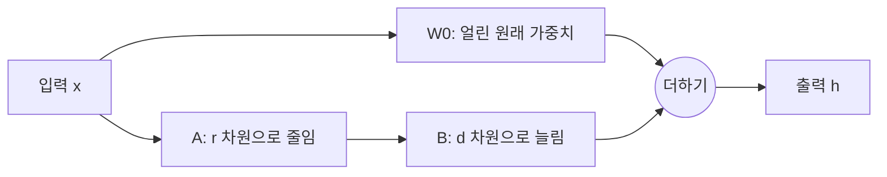

70억 파라미터 언어 모델을 내 데이터로 미세조정(fine-tuning)한다고 하자. 가중치만 fp16 으로 13.5GB 인데, 모든 가중치를 Adam 으로 학습하면 gradient 와 optimizer 상태까지 합쳐 약 108GB 가 필요하다. GPU 한 장에 들어가지 않는다.

LoRA 는 이 문제를 이렇게 푼다.

- **사전학습 가중치 $W_0$ 는 얼리고, 바뀌는 양 $\Delta W$ 만 배운다.**
- **$\Delta W$ 를 작은 행렬 두 개의 곱 $BA$ 로 근사한다.** 4096×4096 행렬(약 1,680만 칸)을 rank 8 로 근사하면 숫자 6.5만 개로 표현된다.
- **그래서 학습 파라미터와 optimizer 메모리가 크게 준다.** 얼린 가중치에는 gradient 도 optimizer 상태도 필요 없다.
- **추론 때는 $W_0 + BA$ 를 미리 더해 두면 지연이 늘지 않는다.** 병합한 모델은 원래 모델과 모양이 같다.

| 구분 | Full fine-tuning | LoRA |
| --- | --- | --- |
| 학습하는 것 | 모든 가중치 | 붙인 층의 $A$, $B$ |
| 7B 모델의 학습 파라미터 수 | 약 67억 개 | 약 2,000만 개 (선형층 전부에 rank 8) |
| 학습 메모리 (activation 제외) | 약 108GB | 약 14GB |
| 저장하는 것 | 모델 전체 | 어댑터($A$, $B$)만 |
| 추론 지연 | 기준 | 병합하면 같다 |

# A) 바뀌는 양만 작게 배우는 아이디어

## A.1) 미세조정은 변화량을 더하는 일

미세조정은 사전학습 가중치 $W_0$ 를 조금 고쳐 새 가중치 $W$ 를 만드는 일이다. 고친 양을 $\Delta W$ 라 쓰면 다음과 같다.

$$
W = W_0 + \Delta W
$$

Full fine-tuning 은 $\Delta W$ 의 모든 칸을 자유롭게 배운다. $W_0$ 가 4096×4096 이면 $\Delta W$ 도 4096×4096 이고, 배울 숫자가 1,680만 개다. 이런 행렬이 층마다 여러 개 있다.

## A.2) 변화량을 두 행렬의 곱으로 쓰기

LoRA 는 $\Delta W$ 를 직접 배우지 않는다. 세로로 긴 행렬 $B$ 와 가로로 긴 행렬 $A$ 를 배우고, 그 곱을 $\Delta W$ 로 쓴다.

$$
\Delta W = BA, \quad B \in \mathbb{R}^{d \times r}, \quad A \in \mathbb{R}^{r \times k}
$$

- $W_0$ 와 $\Delta W$ 의 크기는 $d \times k$ 다.
- $r$ 은 rank 다. $d$, $k$ 보다 훨씬 작게 둔다 (보통 4 에서 64 사이).
- $A$ 는 입력을 $r$ 차원으로 줄이고, $B$ 는 그것을 다시 $d$ 차원으로 늘린다.

입력 $x$ 는 원래 길과 LoRA 길을 따로 지나 마지막에 더해진다.

$$
h = W_0 x + BAx
$$



**학습하는 동안 $W_0$ 는 그대로이고, 학습되는 것은 $A$ 와 $B$ 뿐이다.** 실제로는 LoRA 길의 출력에 배율 $\alpha/r$ 을 곱한다. 이 배율은 뒤의 스케일링 절에서 다룬다.

## A.3) Step by Step 예시

**Step 1. 작은 행렬로 모양을 본다.** $d = k = 4$, $r = 1$ 로 두자.

$$
B = \begin{bmatrix} 1 \\ 2 \\ 0 \\ -1 \end{bmatrix}, \quad A = \begin{bmatrix} 0.5 & 0 & 1 & 0 \end{bmatrix}
$$

$$
BA = \begin{bmatrix} 0.5 & 0 & 1 & 0 \\ 1 & 0 & 2 & 0 \\ 0 & 0 & 0 & 0 \\ -0.5 & 0 & -1 & 0 \end{bmatrix}
$$

- $BA$ 는 16 칸이지만, 배운 숫자는 $B$ 의 4 개와 $A$ 의 4 개를 합한 8 개다.
- 모든 행이 $A$ 의 배수다 (1 배, 2 배, 0 배, -1 배).
- 이것이 rank 1 의 뜻이다. 16 칸이 방향 하나만 쓴다.
- $r$ 을 키우면 방향을 $r$ 개까지 섞어 쓸 수 있다.

**Step 2. 실제 크기로 센다.** $d = k = 4096$, $r = 8$ 이다.

- Full fine-tuning 의 $\Delta W$ 는 4096 × 4096 = 16,777,216 개다.
- LoRA 의 $B$ 는 4096 × 8 = 32,768 개, $A$ 는 8 × 4096 = 32,768 개다. 합하면 65,536 개다.
- 행렬 하나에서 학습 파라미터가 256 분의 1 로 준다.

**Step 3. 모델 전체로 센다.** Llama 2 7B 구조(층 32 개, $d = 4096$, MLP 중간 차원 11,008)에 rank 8 을 붙인다.

- 층 하나의 attention 행렬 4 개(q, k, v, o)는 각각 65,536 개라서 합이 262,144 개다.
- MLP 행렬 3 개(gate, up, down)는 각각 (4096 + 11008) × 8 = 120,832 개라서 합이 362,496 개다.
- 층 하나에 624,640 개, 32 층이면 19,988,480 개다. 모델 전체 67.4억 개의 0.3% 다.
- 원 논문처럼 q 와 v 에만 붙이면 4,194,304 개다.

**Step 4. 메모리로 바꾼다.** Adam 과 [[mixed precision]] 으로 학습하면 학습하는 파라미터 하나에 16 바이트가 든다.

- Full fine-tuning 은 67.4억 × 16 바이트 = 약 108GB 다.
- LoRA 는 얼린 가중치를 fp16 으로 올려 두기만 하면 되므로 13.5GB 다. 여기에 학습 파라미터 2,000만 × 16 바이트 = 0.32GB 가 더해진다.
- 둘 다 activation 메모리는 빠져 있다. activation 은 LoRA 로도 거의 줄지 않는다.

**절약의 대부분은 gradient 와 optimizer 상태에서 나온다.** 원 논문은 GPT-3 175B 에서 학습 메모리가 1.2TB 에서 350GB 로, 저장하는 체크포인트가 350GB 에서 35MB 로 줄었다고 보고했다 (rank 4, q 와 v 에만 적용). 반면 얼린 가중치는 여전히 GPU 에 올라가야 한다. 이 부분까지 줄인 것이 아래 변형 절의 QLoRA 다.

## A.4) 낮은 rank 로 충분한 이유

원 논문의 가설은 **새 작업에 맞추는 변화량은 고차원 행렬이어도 실제로 쓰는 방향이 몇 개 안 된다**는 것이다. 논문은 이를 변화량의 "intrinsic rank" 가 낮다고 표현했다.

- 사전학습 모델은 이미 일반적인 표현을 배웠다. 새 작업은 그 위에서 몇 방향만 조정하면 된다는 직관이다.
- 실험에서도 GPT-3 175B 는 많은 작업에서 $r = 1$ 로도 높은 rank 와 비슷한 성능을 냈다.

**작은 rank 가 모든 작업에 통하지는 않는다.** 원 논문도 사전학습과 다른 언어로 된 작업처럼 거리가 먼 작업에서는 모델 전체를 다시 학습하는 편이 나을 수 있다고 적었다.

# B) 초기화: B 는 0, A 는 랜덤

원 논문은 $A$ 를 가우시안 랜덤으로, $B$ 를 0 으로 초기화한다. 세 가지 경우를 나란히 놓으면 이유가 보인다.

- **둘 다 0 이면 학습이 시작되지 않는다.** $B$ 의 gradient 는 $Ax$ 에, $A$ 의 gradient 는 $B$ 에 비례한다. 둘 다 0 이면 둘 다 영원히 0 이다.
- **둘 다 랜덤이면 출발점이 원래 모델과 다르다.** $BA$ 가 처음부터 0 이 아니어서, 첫 step 에서 이미 사전학습 모델의 출력에 무작위 잡음이 더해진다.
- **$B$ 만 0 이면 출발점은 원래 모델 그대로이고 학습도 바로 시작된다.** $BA = 0$ 이라 처음 출력이 사전학습 모델과 같다. $A$ 가 0 이 아니므로 $B$ 에 gradient 가 흐르고, $B$ 가 움직이면 $A$ 에도 gradient 가 흐른다.

**둘 중 하나만 0 이면 된다.** 원 논문은 $B$ 쪽을 0 으로 두었다 (gradient 식은 부록).

# C) 스케일링 α/r

실제 LoRA 는 LoRA 길의 출력에 $\alpha / r$ 을 곱한다.

$$
h = W_0 x + \frac{\alpha}{r} BAx
$$

- $\alpha$ 는 정해 두는 상수다. LoRA 길이 원래 출력에 얼마나 세게 더해질지를 정한다.
- **$r$ 로 나누는 것은 rank 를 바꿀 때마다 학습률을 다시 찾지 않게 하려는 장치다.** $BAx$ 는 $r$ 개 방향을 더한 값이라 $r$ 이 클수록 커지기 쉽다. $r$ 로 나눠 크기를 맞춘다.
- **$\alpha$ 는 학습률과 비슷한 역할을 한다.** 원 논문은 Adam 에서 $\alpha$ 를 바꾸는 것이 학습률을 바꾸는 것과 거의 같다고 보고, $\alpha$ 를 처음 시도한 $r$ 값으로 정한 뒤 튜닝하지 않았다.

같은 $\alpha = 16$ 에서 rank 만 바꿔 보자.

- $r = 8$ 이면 배율은 16 / 8 = 2 다.
- $r = 64$ 이면 배율은 16 / 64 = 0.25 다. rank 를 8 배 키우면 배율은 8 분의 1 이 된다.

**$r$ 로 나누면 큰 rank 에서 지나치게 줄어든다는 반론이 있다.** rsLoRA 논문은 $r$ 이 커질수록 학습이 느려져, rank 를 키워도 성능이 작은 rank 와 비슷하게 머문다고 보였다. 그래서 $r$ 대신 $\sqrt{r}$ 로 나누자고 제안했다.

- 같은 $\alpha = 16$, $r = 64$ 에서 rsLoRA 의 배율은 16 / 8 = 2 다.
- 이렇게 하면 rank 를 키운 만큼 성능이 오른다고 보고했다. 추론 비용은 LoRA 와 같다.

# D) 붙이는 층

Transformer 블록의 선형층은 attention 의 q, k, v, o 와 MLP(Llama 계열은 gate, up, down)다. LoRA 는 이 중 고른 행렬에만 붙인다.

**원 논문은 attention 에만 붙이고 MLP 는 얼렸다.** 단순함과 파라미터 효율 때문이었다. 학습 파라미터를 GPT-3 175B 에서 1,800만 개로 고정하고 붙이는 곳만 바꿔 비교했다.

| 붙인 행렬 | rank | WikiSQL 정확도 | MultiNLI 정확도 |
| --- | --- | --- | --- |
| q | 8 | 70.4 | 91.0 |
| k | 8 | 70.0 | 90.8 |
| v | 8 | 73.0 | 91.0 |
| o | 8 | 73.2 | 91.3 |
| q, v | 4 | 73.7 | 91.3 |
| q, k, v, o | 2 | 73.7 | 91.7 |

- **같은 예산이면 rank 를 키우기보다 여러 행렬에 나눠 붙이는 편이 낫다.** q 하나에 rank 8 보다 q, v 에 rank 4 씩이 높다.
- q 나 k 에만 몰아 붙이면 성능이 크게 떨어진다.

**QLoRA 논문은 큰 모델에서 q, v 에만 붙이면 full fine-tuning 성능에 못 미친다고 보고했다.** 모든 선형층에 붙여야 full fine-tuning 과 비슷해졌고, 이때 rank 는 성능에 큰 영향이 없었다. 그래서 요즘은 MLP 까지 모든 선형층에 붙이는 설정을 많이 쓴다.

# E) 병합과 어댑터 교체

## E.1) 병합

학습이 끝나면 $BA$ 를 미리 계산해 $W_0$ 에 더한다.

$$
W = W_0 + \frac{\alpha}{r} BA
$$

- $BA$ 는 $W_0$ 와 크기가 같으므로, 더한 결과도 원래 행렬과 크기가 같다.
- 추론은 $Wx$ 한 번이다. 모델 구조가 사전학습 모델과 같아서 지연이 늘지 않는다.
- 층을 새로 끼워 넣는 방식(adapter layer)과 다른 점이다. 끼워 넣은 층은 순서대로 계산해야 하므로 지연이 늘어난다.

## E.2) 병합하지 않고 갈아 끼우기

어댑터를 따로 두면 작업마다 어댑터만 바꿔 쓸 수 있다.

- 원 논문 계산으로, GPT-3 175B 를 100 개 작업에 맞추면 full fine-tuning 은 모델 100 벌로 약 35TB 다.
- LoRA 는 base 모델 350GB 에 어댑터 35MB × 100 을 더해 약 354GB 다.
- 병합해 둔 모델도 $BA$ 를 빼고 다른 작업의 $B'A'$ 를 더하면 작업을 바꿀 수 있다.

**병합하면 한 batch 안에 서로 다른 작업의 입력을 섞기 어렵다.** 원 논문이 한계로 든 점이다. 이를 풀기 위해 base 모델 하나에 어댑터 여러 개를 병합하지 않은 채 붙여 두고, 요청마다 다른 어댑터를 쓰는 서빙 방식(S-LoRA, [[vllm]] 의 multi-LoRA)이 나왔다. 이때는 LoRA 길을 따로 계산하므로 병합한 모델보다 조금 느리다.

# F) 변형

변형들은 LoRA 의 서로 다른 부분을 고친다. 그래서 함께 쓸 수도 있다 (예: QLoRA 위에 rsLoRA 배율).

| 이름 | 고치는 부분 | 핵심 | 출처 |
| --- | --- | --- | --- |
| QLoRA | 얼린 가중치의 메모리 | $W_0$ 를 4-bit(NF4)로 저장하고, 어댑터는 16-bit 로 학습한다 | Dettmers et al. 2023 |
| DoRA | 변화량의 모양 | 가중치를 크기(magnitude)와 방향(direction)으로 나눈다. 방향은 LoRA 로, 크기는 직접 학습한다 | Liu et al. 2024 |
| LoRA+ | 학습률 | $B$ 의 학습률을 $A$ 보다 크게 둔다 | Hayou, Ghosh, Yu 2024 |
| rsLoRA | 스케일링 배율 | $\alpha / r$ 대신 $\alpha / \sqrt{r}$ 을 곱한다 | Kalajdzievski 2023 |

## F.1) QLoRA

앞의 7B 예시에서 LoRA 를 써도 얼린 가중치 13.5GB 는 남는다. QLoRA 는 이것을 4-bit 로 저장해 약 4 분의 1 로 줄인다. 계산할 때는 가중치를 BF16 으로 풀어서 곱하므로, 저장은 4-bit 이고 계산은 16-bit 다.

- **NF4(4-bit NormalFloat)**: 학습된 가중치는 대략 0 을 중심으로 한 정규분포를 따른다. 값이 몰린 0 근처에는 눈금을 촘촘히, 드문 양 끝에는 성기게 둔 4-bit 형식이다.
- **Double quantization**: 가중치 64 개마다 fp32 스케일 상수가 하나씩 붙어 파라미터당 0.5 bit 가 더 든다. 이 상수를 다시 8-bit 로 양자화해 0.127 bit 로 줄인다. 65B 모델에서 약 3GB 가 준다.
- **Paged optimizer**: 긴 시퀀스에서 메모리가 순간 튀면 optimizer 상태를 CPU 메모리로 내렸다가 필요할 때 다시 올린다. 메모리 부족으로 학습이 멈추는 것을 막는다.

**결과로 65B 모델의 미세조정 메모리가 780GB 이상에서 48GB 미만으로 줄었다.** 48GB GPU 한 장으로 학습하면서 16-bit full fine-tuning 과 비슷한 성능을 냈다. 양자화 자체는 [[Quantization]] 에서 다룬다.

## F.2) DoRA

가중치의 각 열을 길이(크기)와 단위 벡터(방향)로 나눠 따로 학습한다.

- 논문은 full fine-tuning 과 LoRA 가 가중치를 바꾸는 방식을 크기와 방향으로 나눠 비교했고, 두 방식의 패턴이 달랐다.
- 방향은 행렬이라 LoRA 로 학습하고, 크기는 열마다 숫자 하나라 직접 학습한다.
- 학습 후 다시 하나의 행렬로 합칠 수 있어 추론 지연이 늘지 않는다.

## F.3) LoRA+

LoRA 는 $A$ 와 $B$ 에 같은 학습률을 쓴다. LoRA+ 논문은 모델 폭(embedding 차원)이 클수록 이것이 비효율적이라고 보였다.

- $B$ 의 학습률을 $A$ 보다 몇 배 크게 두는 것만 바꾼다. 계산량은 LoRA 와 같다.
- 성능이 1 에서 2% 오르고, 학습이 최대 약 2 배 빨라졌다고 보고했다.
- 좋은 비율은 모델과 초기화에 따라 다르다. 실험에서 RoBERTa 는 4 에서 16 배, Llama 는 2 에서 4 배 정도가 좋았다.

# 부록: 식과 설정

**초기화와 gradient.** 배율을 $s = \alpha / r$, 출력의 gradient 를 $g = \partial L / \partial h$ 라 하면 다음과 같다.

$$
\frac{\partial L}{\partial B} = s \, g \, (Ax)^{\top}, \qquad \frac{\partial L}{\partial A} = s \, B^{\top} g \, x^{\top}
$$

- $B = 0$, $A$ 가 랜덤이면 첫 step 에서 $A$ 의 gradient 는 0 이고 $B$ 의 gradient 는 0 이 아니다.
- $B$ 가 한 번 움직이면 다음 step 부터 $A$ 에도 gradient 가 생긴다.

**파라미터 수.** $d \times k$ 행렬 하나에 대해 full fine-tuning 은 $dk$ 개, LoRA 는 $r(d + k)$ 개다. $d = k = 4096$, $r = 8$ 이면 16,777,216 대 65,536 이다.

**파라미터당 16 바이트.** Adam 과 mixed precision 학습에서 학습하는 파라미터 하나는 fp16 가중치 2 바이트, fp16 gradient 2 바이트, fp32 가중치 사본과 Adam 상태 두 개 12 바이트를 쓴다 (ZeRO 논문 기준).

**Hugging Face PEFT 설정.** 본문의 개념과 이름이 다음처럼 대응한다.

```python
from peft import LoraConfig, get_peft_model

config = LoraConfig(
    r=8,                          # rank r
    lora_alpha=16,                # α
    target_modules="all-linear",  # 붙일 층. ["q_proj", "v_proj"] 처럼 고를 수도 있다
    lora_dropout=0.05,
    use_rslora=False,             # True 면 α/√r 배율 (rsLoRA)
    use_dora=False,               # True 면 DoRA
)
model = get_peft_model(base_model, config)
# 학습 후 병합: model = model.merge_and_unload()
```

# 출처

- Hu et al. 2021, [LoRA: Low-Rank Adaptation of Large Language Models](https://arxiv.org/abs/2106.09685) (ICLR 2022)
- Dettmers et al. 2023, [QLoRA: Efficient Finetuning of Quantized LLMs](https://arxiv.org/abs/2305.14314) (NeurIPS 2023)
- Liu et al. 2024, [DoRA: Weight-Decomposed Low-Rank Adaptation](https://arxiv.org/abs/2402.09353)
- Hayou, Ghosh, Yu 2024, [LoRA+: Efficient Low Rank Adaptation of Large Models](https://arxiv.org/abs/2402.12354) (ICML 2024)
- Kalajdzievski 2023, [A Rank Stabilization Scaling Factor for Fine-Tuning with LoRA](https://arxiv.org/abs/2312.03732)
- Sheng et al. 2023, [S-LoRA: Serving Thousands of Concurrent LoRA Adapters](https://arxiv.org/abs/2311.03285)
- Rajbhandari et al. 2020, [ZeRO: Memory Optimizations Toward Training Trillion Parameter Models](https://arxiv.org/abs/1910.02054)

관련 노트: [[Quantization]], [[vllm]], [[mixed precision]], [[supervised fine-tuning]], [[catastrophic forgetting]]
