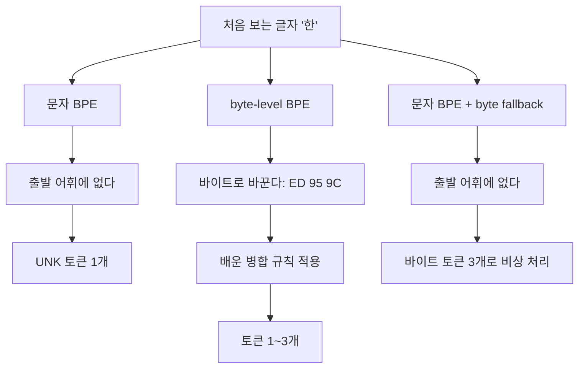

**요즘 LLM 은 대부분 byte-level BPE 로 토큰화한다.**

- GPT 계열(tiktoken), Llama 3, Qwen, DeepSeek-V3 가 모두 이 방식이다.
- byte-level BPE 도 subword 토크나이저다. 자주 붙어 나오는 조각을 합쳐 어휘를 만드는 BPE 를 그대로 쓴다.
- 다른 점은 출발 단위다. 문자가 아니라 UTF-8 바이트에서 시작한다.
- 바이트는 256 가지뿐이고 어떤 글자든 바이트로는 적을 수 있다. 그래서 사전에 없는 입력을 뜻하는 `[UNK]` 가 나올 일이 없다.

Gemma 와 Llama 2 는 조금 다르다. 문자에서 출발하는 BPE 를 쓰되, 사전에 없는 글자만 바이트로 쪼갠다(SentencePiece 의 byte fallback). 출발점은 다르지만 `[UNK]` 가 없다는 결과는 같다.

# A) 문장을 자르는 다섯 가지 크기

모델은 글자를 읽지 못하고 정수 번호만 받는다. 그래서 "안녕하세요" 를 넣으려면 먼저 조각으로 자르고 조각마다 번호를 붙여야 한다. 이 조각이 **토큰**이고, 번호를 붙여 둔 조각 목록이 **어휘 (vocabulary)** 다.

어떤 크기로 자르느냐에 따라 세 가지가 달라진다.

- **어휘 크기**: 번호표를 몇 장 준비해야 하나. 어휘가 크면 모델의 입력층과 출력층이 그만큼 커진다.
- **OOV (out-of-vocabulary)**: 번호표가 없는 조각이 들어오면 어떻게 되나.
- **시퀀스 길이**: 문장 하나가 토큰 몇 개가 되나. 길수록 모델의 계산량이 늘고, 한 번에 넣을 수 있는 글이 짧아진다.

| 자르는 단위 | "안녕하세요" 자른 결과 | 토큰 수 | 어휘 크기 | 사전에 없는 입력 |
| --- | --- | --- | --- | --- |
| 단어 | `안녕하세요` | 1 | 학습 데이터의 단어 수만큼 (수십만 이상) | 신조어·오타마다 `[UNK]` |
| 문자 | `안` `녕` `하` `세` `요` | 5 | 유니코드 전체를 넣으면 13만 이상 | 처음 보는 글자는 `[UNK]` |
| subword (문자 BPE) | 병합 결과에 따라 다르다 | 1~5 | 사람이 정한다 (보통 3만~26만) | 처음 보는 글자는 `[UNK]` |
| subword (byte-level BPE) | `안` `녕하세요` (GPT-4o) | 2~14 | 사람이 정한다 (보통 5만~20만) | 없다 |
| 바이트 | `EC` `95` `88` `EB` … | 15 | 256 | 없다 |

**subword 는 단어와 문자 사이의 절충이다.** 자주 나오는 덩어리는 통째로 한 토큰이 되고, 드문 단어는 아는 조각 여러 개로 쪼개진다. 그래서 어휘를 적당한 크기로 두면서도 시퀀스가 문자 단위만큼 길어지지 않는다.

byte-level BPE 의 토큰 수가 2~14 로 넓은 이유는 뒤에서 실제 토크나이저로 보인다.

# B) BPE 가 어휘를 만드는 과정

BPE (Byte-Pair Encoding) 의 규칙은 하나다. **가장 자주 붙어 나오는 두 조각을 하나로 합친다.** 어휘가 원하는 크기가 될 때까지 이걸 반복한다.

학습 데이터가 아래 여섯 단어뿐이라고 하자. 숫자는 등장 횟수다.

```
low ×2   lower ×3   newest ×3   widest ×4   lot ×1   fast ×2
```

처음에는 모든 단어를 글자 단위로 쪼갠다. 이때 어휘는 등장한 글자 12 개 `a d e f i l n o r s t w` 다.

```
l o w   l o w e r   n e w e s t   w i d e s t   l o t   f a s t
```

**1 회차: `s` + `t` → `st`**

- 나란히 붙은 두 글자를 모두 센다. `s t` 가 newest 3 + widest 4 + fast 2 = 9 번으로 가장 많다.
- 2 등은 `e s` (7 번) 다.
- `st` 를 어휘에 넣고, 데이터에서 `s t` 를 전부 `st` 로 바꾼다.

```
l o w   l o w e r   n e w e st   w i d e st   l o t   f a st
```

**2 회차: `e` + `st` → `est`**

- 방금 만든 `st` 도 한 조각으로 센다. `e st` 가 newest 3 + widest 4 = 7 번으로 가장 많다.
- 합친 조각을 다시 합치면서 조각이 점점 길어진다.

```
l o w   l o w e r   n e w est   w i d est   l o t   f a st
```

**3 회차: `l` + `o` → `lo`** (low 2 + lower 3 + lot 1 = 6 번)

**4 회차: `lo` + `w` → `low`** (low 2 + lower 3 = 5 번)

```
low   low e r   n e w est   w i d est   lo t   f a st
```

네 번 합쳤으므로 어휘는 12 + 4 = 16 개가 됐다. 실제 토크나이저는 이걸 수만 번 반복한다.

**학습 때 한 번도 못 본 단어 `lowest` 를 넣어 보자.**

- 배운 합치기 규칙을 같은 순서로 적용하면 `low` + `est` 두 토큰이 된다.
- 단어 사전이었다면 `lowest` 는 통째로 `[UNK]` 였다.
- 실제 GPT-2 토크나이저도 `lowest` 를 `low` + `est` 로 자른다.

**그럼 `lowly` 는 어떨까.**

- `low` + `l` 까지는 되지만 `y` 는 처음 어휘 12 개에 없다.
- 그래서 `y` 자리는 `[UNK]` 가 된다.
- **BPE 는 처음 보는 단어는 처리하지만, 처음 보는 글자는 처리하지 못한다.** 출발 어휘에 없는 글자는 어떤 조합으로도 만들 수 없다.

이 빈틈을 메우는 것이 byte-level BPE 다.

# C) 문자에서 출발하는 BPE 와 바이트에서 출발하는 BPE

## C.1) 한글 한 글자의 UTF-8 바이트

컴퓨터는 UTF-8 이라는 규칙으로 글자를 바이트(0~255 사이의 숫자)에 담는다. 영어 알파벳은 1 바이트, 한글 한 글자는 3 바이트다.

```
"한"          →  ED 95 9C                                              (3 바이트)
"안녕하세요"  →  EC 95 88 | EB 85 95 | ED 95 98 | EC 84 B8 | EC 9A 94   (15 바이트)
```

## C.2) 처음 보는 글자를 다루는 세 방식

학습 데이터에서 "한" 을 한 번도 못 봤다고 하자. 세 방식은 이 글자를 이렇게 다룬다.



**문자 BPE** 는 앞의 `lowly` 에 나온 `y` 와 같은 일을 겪는다.

- 출발 어휘에 "한" 이 없으면 `[UNK]` 다.
- 그렇다고 유니코드 글자를 전부 출발 어휘에 넣으면, 병합을 하나도 안 했는데 어휘가 13만 개를 넘는다.
- GPT-2 논문이 byte-level BPE 를 택한 이유가 이것이다.

**byte-level BPE** 는 글자를 먼저 바이트로 바꾸고, 그 바이트 위에서 앞의 영어 예시와 똑같이 병합한다.

- 출발 어휘가 바이트 256 개라서 어떤 글자든 바이트 토큰으로는 적을 수 있다.
- 학습 데이터에 "한" 이 자주 나왔다면 `ED 95 9C` 가 병합돼 "한" 이 토큰 하나가 된다.
- 드물게 나왔다면 바이트 조각 두세 개로 남는다. 토큰이 늘어날 뿐 정보는 그대로다.

**byte fallback** 은 문자 BPE 에 비상구를 단 것이다.

- 평소에는 문자에서 출발해 병합한다.
- 출발 어휘에 없는 글자를 만났을 때만 `<0xED>` `<0x95>` `<0x9C>` 같은 바이트 토큰 3 개로 적는다.
- byte-level BPE 와 달리 이 바이트 토큰들은 서로 병합되지 않는다. 비상용으로만 쓰인다.
- SentencePiece 의 `byte_fallback` 옵션이 이것이고, Llama 2(어휘 32k)와 Gemma(어휘 256k)가 쓴다.

## C.3) 토크나이저별 한국어 토큰 수

OpenAI 의 토크나이저 셋으로 "안녕하세요" 를 잘라 보면 이렇다. 셋 다 byte-level BPE 다.

| 토크나이저 | 쓰는 모델 | 어휘 크기 | "안녕하세요" 토큰 수 |
| --- | --- | --- | --- |
| `gpt2` | GPT-2 | 50,257 | 14 |
| `cl100k_base` | GPT-4, GPT-3.5 | 100,277 | 5 |
| `o200k_base` | GPT-4o | 200,019 | 2 |

알고리즘은 같은데 토큰 수가 7 배 차이 난다. **어떤 조각이 병합되는지는 학습 데이터가 정한다.**

- GPT-2 는 영어 위주 데이터로 학습해서 한글 바이트끼리 병합된 것이 거의 없다. 15 바이트가 거의 그대로 14 토큰이 된다.
- 뒤 토크나이저일수록 어휘가 크고 한글 바이트끼리 병합된 조각이 많다. `o200k_base` 에서는 `녕하세요` 가 통째로 한 토큰이다.
- API 요금과 한 번에 넣을 수 있는 글 길이는 토큰 수로 정해진다. 그래서 이 차이는 그대로 비용 차이다.

**토큰 하나가 글자 하나는 아니다.** byte-level BPE 는 바이트끼리 병합하므로 글자 경계를 신경 쓰지 않는다.

- `cl100k_base` 는 "토크나이저" 를 9 토큰으로 자르는데, 그중 하나가 `A0 ED` 다.
- `A0` 은 "토" 의 마지막 바이트이고 `ED` 는 "크" 의 첫 바이트다. 토큰 하나가 두 글자에 걸쳐 있다.
- 그래서 토큰을 하나씩 따로 문자열로 바꾸면 깨진 글자(�)가 나온다. 토큰을 모두 이어 붙인 뒤 바꿔야 원래 글이 된다.

# D) 다른 subword 방식: WordPiece, Unigram

BPE 말고도 subword 어휘를 만드는 방식이 두 가지 더 있다. 단어와 문자 사이 크기의 조각을 만든다는 목표는 같고, 어떤 조각을 어휘에 넣을지 고르는 기준이 다르다.

| 방식 | 어휘 만드는 법 | 대표 모델 |
| --- | --- | --- |
| [[Byte-Pair Encoding Tokenization\|BPE]] | 가장 **자주** 붙어 나오는 쌍을 합친다 | GPT 계열, Llama, Qwen |
| [[WordPiece]] | 각자 나오는 횟수에 비해 **유난히 자주** 붙어 나오는 쌍을 합친다 | BERT, Electra |
| [[unigram lanugage model\|Unigram]] | 큰 후보 어휘에서 출발해, 빼도 손해가 적은 조각을 지워 나간다 | T5, BigBird |

**WordPiece** 는 BPE 처럼 합치는 방향이지만 첫 병합부터 다르다.

- 앞의 여섯 단어 데이터에서 BPE 는 9 번 나온 `st` 를 먼저 합쳤다.
- WordPiece 는 2 번뿐인 `fa` 를 먼저 합친다. `f` 와 `a` 는 fast 에만, 그것도 늘 붙어서 나오기 때문이다.
- `s` 와 `t` 는 여기저기 흔하게 나와서, 붙어 나오는 것이 그다지 특별하지 않다고 본다.

**Unigram** 은 반대로 지우는 방향이다.

- 조각마다 확률을 둔다.
- 한 단어를 자르는 방법이 여러 개면 조각 확률을 곱한 값이 가장 큰 것을 고른다.

세 방식 모두 문자에서 출발하면 처음 보는 글자가 `[UNK]` 가 된다. **바이트에서 출발하느냐는 병합 방식과 별개의 선택이다.** BPE 에만 바이트를 붙일 수 있는 것이 아니다.

[[SentencePiece]] 는 방식이 아니라 라이브러리다. BPE 와 Unigram 을 둘 다 지원하고, 공백도 `▁` 라는 글자로 다뤄서 띄어쓰기 없는 언어도 그대로 학습한다.

# E) 바이트를 그대로 쓰는 모델 (ByT5)

이름에 "byte" 가 들어가서 헷갈리지만 byte-level BPE 와 순수 바이트 모델은 다르다.

- **byte-level BPE** 는 바이트에서 출발해 병합한다. 그래서 "안녕하세요" 가 2 토큰까지 줄어든다.
- **ByT5** 같은 순수 바이트 모델은 병합을 아예 하지 않는다. 바이트 하나가 토큰 하나라서 "안녕하세요" 는 15 토큰이다.
- 어휘가 바이트 256 개와 특수 토큰 몇 개뿐이라 토크나이저를 따로 학습할 필요가 없고, 오타에도 강하다.
- 대신 시퀀스가 길어져 계산량이 늘어난다. 지금 널리 쓰이는 LLM 이 byte-level BPE 쪽을 택한 이유다.

# F) Special Tokens

[[Tokenizers(huggingface)]] 에서는 토큰을 종류별로 나눈다.

1. bos_token: 문장의 시작을 알리는 토큰
2. eos_token: 문장의 끝을 알리는 토큰
3. unk_token: [[out-of-vocabulary]] 토큰을 나타내는 특수 토큰
4. sep_token: 같은 입력 안에서 서로 다른 두 문장을 구분하는 토큰
5. pad_token: 배치 안의 짧은 시퀀스를 길이에 맞춰 채우는 토큰
6. cls_token: 입력 전체의 클래스를 나타내는 토큰
7. mask_token: [[Bidirectional Encoder Representations from Transformers|BERT]] 와 같은 [[masked language modeling]] 에서 사용하는 masked token

# 부록: 식과 설정

**GPT-2 의 병합 제한.** 바이트에 그대로 BPE 를 돌리면 `dog` `dog.` `dog!` `dog?` 가 각각 토큰이 돼 어휘가 낭비된다.

- 그래서 GPT-2 는 글자 종류(문자·숫자·구두점)가 다른 바이트끼리는 병합하지 않는다.
- 앞 공백은 예외로 단어에 붙여 준다 (`␣world`).
- 실제로는 정규식으로 문장을 먼저 나눈 뒤 그 안에서만 병합한다. 이 단계를 pre-tokenization 이라고 한다.

**`Ġ` 의 정체.** Hugging Face 의 GPT-2 계열 토크나이저 어휘를 열면 `Ġworld` 같은 토큰이 보인다. 바이트 256 개를 화면에 보이는 글자로 바꿔 저장해서 생긴 표시이고, `Ġ` 는 공백 바이트(0x20)다.

**WordPiece 의 점수.** 쌍 $(a, b)$ 마다 아래 점수를 매기고, 점수가 가장 높은 쌍을 합친다.

$$
\text{score}(a, b) = \frac{\text{freq}(ab)}{\text{freq}(a) \times \text{freq}(b)}
$$

여섯 단어 데이터의 1 회차로 검산하면 이렇다.

- `fa`: 2 / (2 × 2) = 0.5 로 1 등이다. `f` 와 `a` 는 각각 2 번 나온다.
- `st`: 9 / (9 × 10) = 0.1 로 5 등이다. `s` 는 9 번, `t` 는 10 번 나온다.

**Unigram 의 자르기.** 단어 $X$ 를 조각 $x_1, \dots, x_n$ 으로 자르는 방법 중 조각 확률의 곱이 가장 큰 것을 고른다.

$$
\hat{x} = \arg\max_{x_1 \cdots x_n = X} \prod_{i=1}^{n} p(x_i)
$$

**토큰 수를 직접 확인하는 코드.** OpenAI 토크나이저 셋의 토큰 수 표는 아래 코드로 얻었다.

```python
import tiktoken

for name in ["gpt2", "cl100k_base", "o200k_base"]:
    enc = tiktoken.get_encoding(name)
    ids = enc.encode("안녕하세요")
    print(name, enc.n_vocab, len(ids), [enc.decode_single_token_bytes(i) for i in ids])
```

# References

- [Language Models are Unsupervised Multitask Learners (GPT-2, Radford et al., 2019)](https://cdn.openai.com/better-language-models/language_models_are_unsupervised_multitask_learners.pdf) — 2.2 절: byte-level BPE, 출발 어휘 256, 유니코드 전체면 13만 이상
- [The Llama 3 Herd of Models (2024)](https://arxiv.org/abs/2407.21783) — 3.2 절: 어휘 128K, tiktoken 의 100K 토큰 + 비영어 28K 토큰
- [Qwen2 Technical Report (2024)](https://arxiv.org/abs/2407.10671) — 2.1 절: byte-level BPE, 일반 토큰 151,643 개
- [DeepSeek-V3 Technical Report (2024)](https://arxiv.org/abs/2412.19437) — 4.1 절: byte-level BPE, 어휘 128K
- [Llama 2 (Touvron et al., 2023)](https://arxiv.org/abs/2307.09288) — 2.2 절: SentencePiece BPE, 모르는 UTF-8 글자는 바이트로 분해, 어휘 32k
- [Gemma (2024)](https://arxiv.org/abs/2403.08295) — 4.1 절: SentencePiece, 모르는 토큰은 바이트로, 어휘 256k
- [SentencePiece options](https://github.com/google/sentencepiece/blob/master/doc/options.md) — `byte_fallback`
- [openai/tiktoken](https://github.com/openai/tiktoken)
- [ByT5: Towards a token-free future with pre-trained byte-to-byte models (Xue et al., 2021)](https://arxiv.org/abs/2105.13626)
- [Hugging Face: Tokenization algorithms](https://huggingface.co/docs/transformers/tokenizer_summary)
