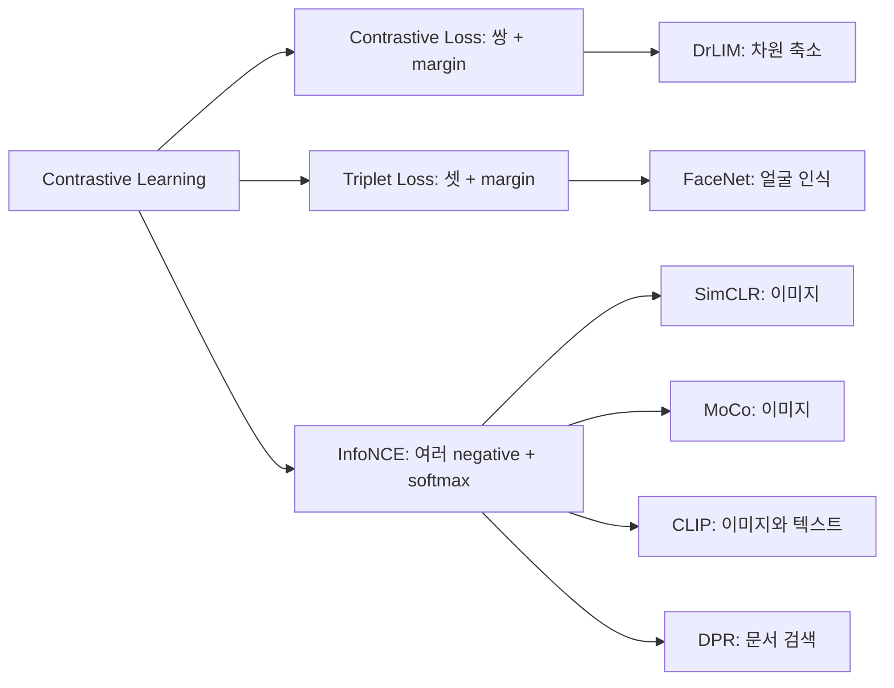

문장 검색 모델을 만든다고 하자. "강아지가 공원에서 뛰어논다" 를 넣으면 "개가 잔디밭을 달린다" 가 먼저 나오고, "오늘 코스피가 2% 올랐다" 는 한참 뒤에 나와야 한다.

이렇게 되려면 뜻이 비슷한 문장은 임베딩(embedding, 문장을 숫자 벡터로 바꾼 것)이 서로 가깝고, 뜻이 다른 문장은 멀어야 한다. 그 배치를 학습하는 방식이 contrastive learning 이다.

# A) 한눈에 보기

**Contrastive learning 은 학습 방식이고, Triplet Loss 와 InfoNCE 는 그 방식을 구현하는 손실 함수다.**

- 방식: 비슷한 것(positive)은 가깝게, 다른 것(negative)은 멀게 임베딩을 학습한다.
- 손실 함수: "지금 얼마나 잘 벌어져 있나" 를 숫자 하나로 바꾸는 규칙이다. 같은 방식을 여러 규칙으로 구현할 수 있다.

**Triplet Loss 는 negative 를 하나씩 margin 과 비교하고, InfoNCE 는 negative 여러 개를 한꺼번에 softmax 로 비교한다.**

- 이 차이 때문에 InfoNCE 는 헷갈리는 negative 에 저절로 힘을 더 준다.
- Triplet Loss 는 헷갈리는 negative 를 따로 골라 넣어야 학습이 된다.

아래 그림은 왼쪽부터 학습 방식, 그 방식을 구현하는 손실 함수, 각 손실을 쓰는 대표 응용 순이다.

각 손실 함수의 식과 설정은 개념 노트에 따로 있다. 이 노트는 두 손실을 같은 예시로 나란히 계산해 차이를 보인다.

- [[InfoNCE]]: 식의 유래, temperature, in-batch negative
- [[retrieval/concepts/Triplet Loss|Triplet Loss]]: margin, negative 고르는 법(mining)

# B) 예시: 기준 문장과 후보 네 개

기준 문장 하나를 anchor 라고 부른다. anchor 와 뜻이 같은 문장이 positive, 다른 문장이 negative 다.

학습 중간에 임베딩을 뽑아 anchor 와의 cosine 유사도를 계산했더니 다음과 같았다고 하자. 거리는 1 − cosine 유사도로 쓴다.

| 이름 | 문장 | anchor 와의 cosine 유사도 | 거리 |
| --- | --- | --- | --- |
| anchor | 강아지가 공원에서 뛰어논다 | | |
| p (positive) | 개가 잔디밭을 달린다 | 0.8 | 0.2 |
| n1 (negative) | 고양이가 공원에서 졸고 있다 | 0.6 | 0.4 |
| n2 (negative) | 오늘 코스피가 2% 올랐다 | 0.1 | 0.9 |
| n3 (negative) | 파스타 면은 8분 삶는다 | 0.0 | 1.0 |

- n1 은 "공원" 이 겹치고 동물 이야기라 positive 와 헷갈리기 쉽다. 이런 negative 를 [[hard negative]] 라고 한다.
- n2, n3 은 주제부터 달라서 이미 충분히 멀다. 이런 negative 를 easy negative 라고 한다.

# C) Triplet Loss 로 계산하기

Triplet Loss 는 anchor, positive, negative 세 개를 한 묶음으로 본다. 요구하는 것은 하나다. **positive 가 negative 보다 margin 만큼 더 가까워야 한다.**

$$
L_{\text{triplet}} = \max\big(0,\ d(a,p) - d(a,n) + m\big)
$$

- $d(a,p)$, $d(a,n)$ 은 anchor 와 positive, anchor 와 negative 의 거리다.
- $m$ 은 margin 이다. 여기서는 0.3 으로 둔다.
- 요구가 채워지면 괄호 안이 음수가 되고, loss 는 0 이다.

negative 마다 따로 계산한다.

- n1: max(0, 0.2 − 0.4 + 0.3) = **0.1**
- n2: max(0, 0.2 − 0.9 + 0.3) = max(0, −0.4) = **0**
- n3: max(0, 0.2 − 1.0 + 0.3) = **0**

n1 은 positive 보다 0.2 멀 뿐이라, 요구한 0.3 에 0.1 이 모자란다. 그래서 n1 을 더 밀어내라는 신호가 나온다. n2, n3 은 이미 0.3 넘게 떨어져 있어서 loss 가 0 이고, 이 둘에서는 배울 것이 없다.

# D) InfoNCE 로 계산하기

InfoNCE 는 positive 하나와 negative 여러 개를 한꺼번에 놓고 **"이 중 어느 것이 positive 인가" 를 맞히는 분류 문제**로 바꾼다.

$$
L_{\text{InfoNCE}} = -\log \frac{\exp\big(s(a,p)/\tau\big)}{\sum_{k} \exp\big(s(a,k)/\tau\big)}
$$

- $s$ 는 cosine 유사도이고, 분모의 $k$ 는 positive 를 포함한 후보 네 개다.
- $\tau$ 는 temperature 다. 유사도 차이를 얼마나 크게 볼지 정한다. 여기서는 0.1 로 둔다.
- 분수 부분은 [[softmax function|softmax]] 확률이다. 결국 정답을 맞힐 확률에 −log 를 씌운 [[cross-entropy]] 다.

같은 네 문장으로 계산한다.

- 유사도를 0.1 로 나누면 p 8, n1 6, n2 1, n3 0 이다.
- exp 를 씌우면 2981, 403, 2.7, 1 이다. 합은 3388 이다.
- positive 확률은 2981 ÷ 3388 = 0.880 이다.
- loss 는 −log 0.880 = **0.128** 이다.

남은 확률 0.12 는 거의 전부 n1 몫이다. n1 이 0.119, n2 가 0.0008, n3 이 0.0003 을 가져간다.

**InfoNCE 는 negative 를 그 확률만큼 밀어낸다. 그래서 헷갈리는 n1 을 주로 밀고, 이미 먼 n2·n3 은 거의 건드리지 않는다.**

- 식으로 쓰면, negative $k$ 의 유사도에 대한 기울기가 $P_k / \tau$ 다. $P_k$ 는 그 negative 의 softmax 확률이다.
- 어느 negative 가 어려운지 따로 알려 주지 않아도 softmax 가 확률로 골라낸다.

아래 그림은 같은 네 문장을 두 손실이 어떻게 보는지 나란히 놓은 것이다. 왼쪽 점의 위치는 anchor 와의 거리, 오른쪽 막대 길이는 InfoNCE 의 softmax 확률이다.

![[img-8c10241b5c.png]]

# E) 반대되는 두 경우로 본 차이

## E.1) negative 하나만 볼 때와 여러 개를 동시에 볼 때

**negative 를 하나만 무작위로 뽑으면 대부분 easy negative 가 걸리고, loss 가 거의 0 이 된다.**

- 이 예시에서 negative 셋 중 둘이 easy 다. 무작위로 하나를 뽑으면 3 번 중 2 번은 easy negative 다.
- Triplet Loss 는 n2, n3 을 뽑으면 0 이다.
- InfoNCE 도 negative 를 하나만 넣으면 같은 문제가 생긴다. n2 하나만 넣으면 loss 가 0.0009, n3 하나만 넣으면 0.0003 이다.

**negative 를 여러 개 동시에 넣으면 그중 가장 헷갈리는 것이 loss 를 결정한다.**

- 네 개를 다 넣은 InfoNCE 는 0.128 이다. n1 하나만 넣었을 때(0.127)와 거의 같다.
- 후보가 많을수록 그 안에 hard negative 가 들어 있을 가능성이 커지고, softmax 가 그 negative 에 힘을 몰아준다.

Triplet Loss 는 triplet 마다 negative 를 하나씩만 보므로, 학습할 negative 를 따로 고르는 일(mining)이 필수다.

- FaceNet 은 약 1,800 개짜리 미니배치 안에서 positive 보다는 멀지만 margin 안쪽에 있는 negative(semi-hard)를 골라 학습했다.
- SimCLR 논문은 같은 조건에서 손실만 바꿔 ImageNet linear evaluation 정확도를 비교했다 (margin 50.9% → semi-hard mining 을 더한 margin 57.5% → InfoNCE 계열 NT-Xent 63.9%).

## E.2) margin 안쪽과 바깥쪽

**Triplet Loss 는 margin 바깥의 negative 에서는 아무것도 배우지 않는다.**

- margin 안쪽의 n1 은 loss 0.1 로 밀려난다.
- margin 바깥의 n2, n3 은 loss 0 이라 기울기도 0 이다.

**학습이 진행돼 n1 이 margin 밖으로 나가면 두 손실의 반응이 달라진다.**

- n1 의 유사도가 0.45(거리 0.55)로 떨어졌다고 하자.
- Triplet Loss: max(0, 0.2 − 0.55 + 0.3) = 0 이다. n1 을 더 밀지 않는다.
- InfoNCE: 0.128 → 0.031 로 줄지만 0 은 아니다. 미는 힘이 약해질 뿐 계속 민다.

margin 과 temperature 는 둘 다 "어느 negative 까지 신경 쓰나" 를 정한다.

- margin 은 경계선이다. 선 안쪽만 보고 바깥은 버린다.
- temperature 는 힘의 배분이다. 작으면 가장 가까운 negative 에 몰아주고, 크면 모든 negative 를 비슷하게 민다. 같은 예시로 비교한 그림은 [[InfoNCE]] 노트에 있다.

# F) 원래의 Contrastive Loss: 쌍 하나 + margin

흔히 contrastive loss 라고 부르는 원래 손실은 Hadsell, Chopra, LeCun (2006)이 정리한 형태다. 두 개씩 짝지은 쌍과 "비슷하다/다르다" 라벨 하나를 받는다.

$$
L = (1 - Y)\,\tfrac{1}{2} D^2 + Y\,\tfrac{1}{2}\max(0,\ m - D)^2
$$

- $D$ 는 두 임베딩의 거리다. $Y$ 는 비슷한 쌍이면 0, 다른 쌍이면 1 이다.
- 비슷한 쌍은 거리 자체를 0 으로 당긴다.
- 다른 쌍은 거리가 $m$ 보다 가까울 때만 민다.

같은 예시에 margin 0.5 로 넣는다.

- (anchor, p): ½ × 0.2² = 0.02. 이미 가까운데도 거리가 0 이 될 때까지 계속 당긴다.
- (anchor, n1): ½ × (0.5 − 0.4)² = 0.005
- (anchor, n2), (anchor, n3): 0

**Contrastive loss 의 margin 은 절대 거리이고, Triplet Loss 의 margin 은 positive 와 비교한 상대 거리다.**

- Contrastive loss 는 "negative 는 무조건 0.5 이상 떨어져라" 를 요구한다.
- Triplet Loss 는 "positive 보다 0.3 더 멀면 된다" 를 요구한다. 같은 사람의 얼굴들을 한 점으로 모으지 않아도 된다는 점을 FaceNet 은 Triplet Loss 를 고른 이유로 든다.
- Hadsell 등은 다른 쌍을 미는 항이 없으면 모든 입력이 한 점으로 모여 버린다(collapse)고 짚는다. 세 손실 모두 negative 가 필요한 이유다.

# G) 세 손실 함수 비교

| 항목 | Contrastive Loss (2006) | Triplet Loss | InfoNCE |
| --- | --- | --- | --- |
| 입력 단위 | 쌍 + 비슷함/다름 라벨 | anchor, positive, negative 셋 | anchor, positive 하나 + negative 여러 개 |
| 한 번에 보는 negative 수 | 0 또는 1 | 1 | 여러 개 (배치 B 개면 보통 B − 1) |
| 하이퍼파라미터 | margin (절대 거리) | margin (상대 거리) | temperature |
| loss 가 0 이 되는 때 | 비슷한 쌍 거리 0, 다른 쌍 거리 m 이상 | negative 가 positive 보다 m 이상 멀 때 | 되지 않는다 (작아질 뿐) |
| hard negative 처리 | 따로 고른다 | 따로 고른다 (semi-hard mining) | softmax 가 확률만큼 몰아준다 |
| 배치 크기 의존성 | 낮다 | mining 을 배치 안에서 하면 크다 | 크다. 배치가 곧 negative 수다 |
| 대표 사용처 | DrLIM (차원 축소) | FaceNet, 이미지 검색 | SimCLR, CLIP, DPR, MoCo |

InfoNCE 의 배치 크기 의존성은 응용마다 다르게 다룬다.

- SimCLR 는 배치 4,096, CLIP 은 배치 32,768 로 negative 수를 늘렸다.
- MoCo 는 지난 미니배치들의 임베딩을 큐(queue)에 쌓아 negative 로 쓴다. negative 수를 배치 크기와 따로 정할 수 있다.

# H) 응용별 positive 와 negative

응용이 달라도 손실 함수의 모양은 비슷하고, 무엇을 positive 로 삼는지가 다르다.

| 응용 | positive | negative | 손실 |
| --- | --- | --- | --- |
| FaceNet | 같은 사람의 다른 얼굴 사진 | 다른 사람 얼굴 중 semi-hard | Triplet Loss |
| SimCLR | 같은 이미지를 다르게 변형(augmentation)한 두 장 | 배치 안 나머지 2(N − 1) 장 | NT-Xent (InfoNCE 계열) |
| [[CLIP]] | 이미지와 그 이미지의 캡션 | 배치 안 다른 이미지의 캡션 | InfoNCE (temperature 도 학습) |
| [[DPR]] | 질문과 정답 문단 | 배치 안 다른 질문의 정답 문단 + BM25 상위 오답 문단 1개 | InfoNCE 형태 (temperature 없이 내적) |

배치 안의 다른 샘플을 negative 로 재활용하는 방법을 in-batch negative 라고 한다. 상세는 [[InfoNCE]] 노트에 있다.

# I) 관련 노트

* [[InfoNCE]]
* [[retrieval/concepts/Triplet Loss|Triplet Loss]]
* [[hard negative]]
* [[metric learning]]
* [[self-supervised]]

# J) References

- [Dimensionality Reduction by Learning an Invariant Mapping (Hadsell, Chopra, LeCun, CVPR 2006)](http://yann.lecun.com/exdb/publis/pdf/hadsell-chopra-lecun-06.pdf)
- [FaceNet: A Unified Embedding for Face Recognition and Clustering (Schroff et al., CVPR 2015)](https://arxiv.org/abs/1503.03832)
- [Representation Learning with Contrastive Predictive Coding (van den Oord et al., 2018)](https://arxiv.org/abs/1807.03748)
- [A Simple Framework for Contrastive Learning of Visual Representations (SimCLR, Chen et al., ICML 2020)](https://arxiv.org/abs/2002.05709)
- [Momentum Contrast for Unsupervised Visual Representation Learning (MoCo, He et al., CVPR 2020)](https://arxiv.org/abs/1911.05722)
- [Dense Passage Retrieval for Open-Domain Question Answering (DPR, Karpukhin et al., EMNLP 2020)](https://arxiv.org/abs/2004.04906)
- [Learning Transferable Visual Models From Natural Language Supervision (CLIP, Radford et al., ICML 2021)](https://arxiv.org/abs/2103.00020)
