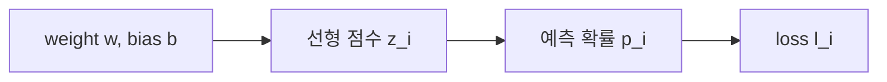

병원에서 종양의 크기만 보고 악성인지 양성인지 가려내야 한다고 하자. 지금까지 모은 환자 데이터는 다음과 같다.

- 양성($y = 0$): 크기가 1, 2, 3, 4 cm 인 종양 4 개
- 악성($y = 1$): 크기가 6, 7, 8, 9 cm 인 종양 4 개

새 환자의 종양 크기를 입력했을 때 양성인지 악성인지 예측하고, 악성일 확률까지 함께 계산하는 문제가 이진 분류([[classification]])다. logistic regression 은 이 문제를 푸는 대표적인 모델이다.

# A) 선형 회귀 분류의 한계

같은 종양 데이터를 [[linear regression]] 으로 먼저 풀어 보면 logistic regression 이 필요한 이유가 드러난다. 직선 $\hat y = wx + b$ 를 0 과 1 에 맞춘 뒤 예측값 $\hat y$ 가 0.5 이상이면 악성, 0.5 미만이면 양성으로 판정하는 방식이다.

아래 그림은 종양 크기에 따른 악성 여부와 두 선형 회귀 직선 $h_\theta(x) = \theta^\top x$ 를 보여 주며, 두 분홍색 직선은 각각 아주 큰 악성 종양을 넣기 전과 넣은 뒤의 결과이고 0.5 위치의 점선이 판정 기준선이다.

![[img-be213e509a.png|image-20200929000946847|500]]

왼쪽 아래의 작은 종양 4 개와 위쪽의 큰 종양 4 개만 있을 때는 가파른 분홍색 직선이 0.5 점선에서 두 무리를 정확히 가른다. 그런데 오른쪽 끝에 동그라미로 표시된 아주 큰 악성 종양이 하나 더해지면 상황이 달라진다. 다른 데이터와 동떨어진 값(outlier)까지 직선에 맞추느라 기울기가 완만해지고, 직선이 0.5 점선과 만나는 지점이 오른쪽으로 밀려 원래 악성으로 맞히던 큰 종양 일부가 0.5 아래인 양성으로 잘못 판정된다.

실제로 8 개 데이터로 학습했을 때와 크기 30 cm 인 악성 종양 하나를 추가했을 때의 판정 경계를 숫자로 확인하면 다음과 같다.

| 학습 데이터 | 선형 회귀의 판정 경계 | 선형 회귀가 틀린 샘플 | logistic regression 의 판정 경계 |
| --- | --- | --- | --- |
| 8 개 | 5.0 cm | 0 개 | 5.0 cm |
| 8 개 + 크기 30 cm 악성 | 6.16 cm | 1 개 (크기 6 cm) | 5.0 cm |

크기 30 cm 인 악성 종양 하나가 추가되자 선형 회귀의 판정 경계가 5.0 cm 에서 6.16 cm 로 이동했고, 그 결과 크기 6 cm 인 악성 종양을 양성으로 틀리게 판정했다. 반면 logistic regression 은 극단적인 종양이 더해져도 판정 경계 5.0 cm 를 그대로 유지했다.

**선형 회귀는 판정과 무관한 극단값 하나에도 경계가 이동하므로 분류 문제에 그대로 쓰기 어렵다.**

선형 회귀로 분류하면 두 가지 문제가 생긴다.

1. **판정에 문제가 없는 샘플이 경계를 바꾼다.**
	- 크기 30 cm 인 종양은 명백한 악성이지만, 선형 회귀의 제곱 오차는 예측값이 1 에서 멀다는 이유로 직선의 기울기를 크게 수정한다.
2. **출력을 확률로 해석할 수 없다.**
	- 크기 30 cm 를 추가하기 전의 직선도 크기 0 cm 에서 $-0.33$, 크기 30 cm 에서 $4.67$ 을 내놓으며, 0 과 1 범위를 벗어나는 값은 악성일 확률이 될 수 없다.

logistic regression 은 출력을 항상 0 과 1 사이로 변환하고, 이미 확실히 맞힌 샘플은 경계를 거의 바꾸지 않음으로써 두 문제를 모두 피한다.

# B) 모델 구조와 확률 해석

**이름에 regression 이 들어가지만 logistic regression 은 연속된 수치를 예측하는 회귀 모델이 아니라 클래스를 나누는 분류 모델이다.**

## B.1) 선형 점수와 sigmoid

종양 크기처럼 모델에 넣는 입력값을 feature 라고 하며 벡터 $\boldsymbol{x}$ 로 쓴다. 각 feature 에 곱해 영향력을 정하는 수는 weight $\boldsymbol{w}$ 다. 여기에 기준 위치를 옮기는 수인 bias $b$ 를 더해 선형 점수 $z$ 를 계산한다. 이 점수 $z$ 는 어떤 실수든 될 수 있으며 logit 이라고도 부른다. 마지막으로 $z$ 를 [[sigmoid function]] $\sigma$ 에 넣어 0 과 1 사이의 악성 확률 $p = P(y = 1 \mid \boldsymbol{x})$ 로 바꾼다.

$$
z = \boldsymbol{w}^\top \boldsymbol{x} + b, \qquad
p = \sigma(z) = \frac{1}{1 + e^{-z}}
$$

sigmoid 는 실수 전체를 받아 항상 0 과 1 사이의 값으로 변환한다.

- **$z$ 가 큰 양수일 때**: $z = 4$ 이면 $\sigma(4) = 0.982$ 로 1 에 가까워지고, $z$ 가 아무리 커져도 출력은 1 을 넘지 않는다.
- **$z$ 가 0 일 때**: $\sigma(0) = 0.5$ 로 악성과 양성의 가능성이 정확히 반반이다.
- **$z$ 가 큰 음수일 때**: $z = -4$ 이면 $\sigma(-4) = 0.018$ 로 0 에 가까워지고, $z$ 가 아무리 작아져도 출력은 0 아래로 내려가지 않는다.

악성($y = 1$)일 확률이 $p$ 이므로 양성($y = 0$)일 확률은 $1 - p$ 다. 동전 던지기처럼 결과가 두 가지뿐인 확률분포를 Bernoulli 분포라고 하며, 두 경우를 한 식으로 합치면 다음과 같다.

$$
P(y \mid \boldsymbol{x}) = p^{\,y}\,(1 - p)^{1 - y}
$$

이 식에 $y = 1$ 을 넣으면 $p$ 가 남고, $y = 0$ 을 넣으면 $1 - p$ 가 남는다.

강의 자료에서는 같은 모델을 $h_\theta(x) = g(\theta^\top x)$ 로 쓰기도 한다. 여기서 $g$ 는 sigmoid, $\theta$ 는 $b$ 와 $\boldsymbol{w}$ 를 한 벡터로 합친 기호이고 $h_\theta(x)$ 가 예측 확률 $p$ 에 해당한다. 종양 그림에 적힌 $h_\theta(x) = \theta^\top x$ 는 sigmoid 를 적용하기 전인 선형 회귀의 직선이다.

## B.2) 종양 크기별 확률과 odds

종양 데이터에서 판정 경계가 5.0 cm 가 되도록 $w = 1.5$, $b = -7.5$ 로 학습된 모델을 가정하자. 선형 점수는 $z = 1.5x - 7.5$ 다. 이때 확률의 변화를 해석하려면 [[odds ratio|odds]] 를 함께 보는 것이 유용하다. odds 는 일이 일어날 확률을 일어나지 않을 확률로 나눈 값 $p / (1 - p)$ 다. 예를 들어 악성 확률이 0.8 이면 odds 는 $0.8 / 0.2 = 4$ 로, 악성일 가능성이 양성일 가능성의 4 배라는 뜻이다.

| 종양 크기 $x$ (cm) | 선형 점수 $z = 1.5x - 7.5$ | 악성 확률 $p$ | odds $p / (1 - p)$ |
| --- | --- | --- | --- |
| 3 | -3.0 | 0.047 | 0.050 |
| 4 | -1.5 | 0.182 | 0.223 |
| 5 | 0.0 | 0.500 | 1.000 |
| 6 | 1.5 | 0.818 | 4.482 |
| 7 | 3.0 | 0.953 | 20.086 |

종양 크기가 1 cm 씩 커질수록 악성 확률 $p$ 는 계속 오르지만, 오르는 폭은 구간마다 다르다. 3 cm 에서 4 cm 로 커질 때는 0.135 오르고, 4 cm 에서 5 cm 로 커질 때는 0.318 오르며, 6 cm 에서 7 cm 로 커질 때는 다시 0.135 만 오른다. 확률이 0 이나 1 에 가까운 구간에서는 sigmoid 곡선의 기울기가 완만하기 때문이다. 반면 표의 마지막 열인 odds 는 종양 크기가 1 cm 커질 때마다 0.050 → 0.223 → 1.000 → 4.482 → 20.086 으로 모든 구간에서 일정하게 약 4.48 배씩 증가한다.

**종양 크기가 같게 늘어도 확률의 증가 폭은 구간마다 달라지지만, odds 의 배율은 모든 구간에서 일정하다.**

## B.3) log-odds 와 weight 의 의미

sigmoid 식을 $z$ 에 대해 풀면 확률과 선형 점수의 관계가 드러난다.

$$
\log \frac{p}{1 - p} = z = \boldsymbol{w}^\top \boldsymbol{x} + b
$$

odds 에 자연로그를 취한 값인 log-odds 가 입력의 선형식과 같다.

**weight 는 확률의 증가량이 아니라 log-odds 의 증가량이다.**

따라서 feature $x_j$ 가 1 커지면 log-odds 가 $w_j$ 만큼 늘고, odds 는 $e^{w_j}$ 배가 된다. 종양 예시에서는 $w = 1.5$ 이므로 크기가 1 cm 커질 때마다 odds 가 $e^{1.5} \approx 4.48$ 배가 된다. 각 feature 의 영향을 일정한 배율로 해석할 수 있어 의료나 금융 분야에서 logistic regression 을 널리 쓴다.

## B.4) 선형 판정 경계와 기준값

예측 확률을 악성(1) 또는 양성(0) 판정으로 바꿀 때는 기준값(threshold)을 정한다. 기준값이 0.5 이면 sigmoid 가 $z = 0$ 에서 0.5 이므로 다음 관계가 성립한다.

$$
p \ge 0.5 \iff z \ge 0 \iff \boldsymbol{w}^\top \boldsymbol{x} + b \ge 0
$$

판정이 갈리는 경계는 $\boldsymbol{w}^\top \boldsymbol{x} + b = 0$ 이다. 종양 예시에서는 $1.5x - 7.5 = 0$ 이므로 5.0 cm 가 판정 경계가 된다. feature 가 하나면 점, 둘이면 직선, 셋 이상이면 초평면이다.

**sigmoid 는 출력만 S 자 곡선으로 바꿀 뿐 판정 경계는 직선(초평면)이다.**

그래서 logistic regression 은 선형 분류기다. 곡선 경계가 필요하면 $x^2$ 이나 두 feature 의 곱처럼 새 feature 를 만들어 입력에 추가한다. 그러면 원래 입력 공간에서는 경계가 곡선이 되며, 구체적인 예시와 그림은 [[Decision boundary]] 에 있다.

**판정 기준값은 0.5 로 고정된 것이 아니라 오진의 위험에 따라 조절한다.**

- 암 진단처럼 악성 환자를 놓치면 치명적인 문제에서는 기준값을 0.5 보다 낮춰 악성으로 의심하는 범위를 넓힌다.
- 반대로 잘못된 경보의 피해가 큰 문제에서는 기준값을 높여 확실할 때만 악성으로 판정한다.
- 정답이 1 인 샘플이 매우 드문 데이터에서 기준값을 정하는 방법은 [[class imbalance problem]] 에 있다.

# C) cross-entropy 학습 원리

데이터에서 좋은 weight 와 bias 를 찾으려면 예측이 정답에서 얼마나 벗어났는지 수치로 재는 함수(loss)가 필요하다. logistic regression 은 [[cross-entropy|binary cross-entropy]] 를 loss 로 두고 이를 최소화한다. 이 선택에는 세 가지 근거가 있다.

1. 확률 모델에서 자연스럽게 유도되는 loss 다.
2. 미분한 gradient 가 단순한 형태로 정리된다.
3. loss 함수가 전체 최솟값을 찾기 쉬운 모양(convex)을 갖는다.

## C.1) binary cross-entropy loss

샘플 하나의 binary cross-entropy 는 다음과 같다.

$$
\ell = -\big[\, y \log p + (1 - y) \log(1 - p) \,\big]
$$

정답이 악성($y = 1$)이면 뒤 항이 0 이 되어 $-\log p$ 가 남고, 양성($y = 0$)이면 앞 항이 0 이 되어 $-\log(1 - p)$ 가 남는다. 어느 쪽이든 모델이 실제 정답에 부여한 확률에 $-\log$ 를 취한 값이다.

- **정답에 높은 확률을 준 경우**: 정답에 확률 0.9 를 주면 loss 는 $0.105$, 확률 0.6 을 주면 $0.511$ 로 작은 값이 나온다.
- **정답에 낮은 확률을 준 경우**: 정답에 확률 0.1 을 주면 loss 는 $2.303$, 확률 0.01 을 주면 $4.605$ 로 크게 오르며 확률 0 을 주면 무한대가 된다.

**정답을 확신하고 맞히면 loss 가 0 에 가까워지고, 확신하고 틀릴수록 loss 가 가파르게 커진다.**

종양 예시($w = 1.5$, $b = -7.5$)에서 크기 6 cm 인 종양의 악성 예측 확률은 $0.818$ 이다. 이 종양이 실제로 악성($y = 1$)이면 loss 는 $-\log 0.818 \approx 0.20$ 으로 작다. 반대로 실제로 양성($y = 0$)이었다면 모델이 양성 확률을 $0.182$ 로 낮게 예측한 셈이므로 loss 가 $-\log 0.182 \approx 1.70$ 으로 크게 늘어난다.

## C.2) MLE 와 NLL 의 연결

학습 데이터 $N$ 개에서 $i$ 번째 샘플의 입력과 정답을 $\boldsymbol{x}_i$, $y_i$ 라 하고 모델의 예측 확률을 $p_i = \sigma(\boldsymbol{w}^\top \boldsymbol{x}_i + b)$ 라 하자. Bernoulli 식에 따라 모델이 정답 $y_i$ 를 관측할 확률은 $p_i^{y_i}(1-p_i)^{1-y_i}$ 다. 샘플들이 서로 독립이면 학습 데이터 전체가 관측될 확률은 각 샘플 확률의 곱이며, 이를 [[likelihood]] 라고 한다.

$$
L(\boldsymbol{w}, b) = \prod_{i=1}^{N} p_i^{\,y_i}\,(1-p_i)^{1-y_i}
$$

관측된 데이터가 나올 확률을 가장 크게 만드는 $\boldsymbol{w}$ 와 $b$ 를 고르는 방법이 [[Maximum Likelihood Estimation|MLE]] 다. 확률의 곱은 계산하기 불편하므로 자연로그를 취해 합으로 바꾸고, 최대화 문제를 최소화 문제로 바꾸기 위해 부호를 뒤집는다. 이렇게 얻은 식이 [[negative log likelihood|NLL]] 이다.

$$
-\log L(\boldsymbol{w}, b) = -\sum_{i=1}^{N} \Big[ y_i \log p_i + (1-y_i)\log(1-p_i) \Big]
$$

합 안의 각 항이 샘플 하나의 binary cross-entropy 그대로다. NLL 을 샘플 수 $N$ 으로 나누면 평균 cross-entropy 가 되며, 양의 상수로 나누어도 최솟값의 위치는 바뀌지 않는다.

**따라서 평균 cross-entropy 를 최소화하는 학습은 MLE 로 가장 그럴듯한 weight 와 bias 를 고르는 과정과 완전히 같다.**

정답을 0 과 1 대신 $-1$ 과 $+1$ 로 표기하면 같은 loss 가 $\log(1 + e^{-y_i z_i})$ 꼴이 되며, [[logistic loss]] 가 이 식을 쓴다.

## C.3) gradient 의 형태 (p − y)

loss 를 줄이려면 weight $\boldsymbol{w}$ 와 bias $b$ 를 어느 방향으로 얼마나 바꿀지 알려 주는 미분값(gradient)을 구해야 한다. 그런데 샘플 하나의 loss $\ell_i$ 는 $\boldsymbol{w}, b$ 에 직접 붙어 있지 않고 다음 순서로 이어져 있다.

그래서 합성함수의 미분법(chain rule)을 써서 먼저 가운데 고리인 $z_i$ 에 대한 미분을 구한 뒤, $z_i$ 를 $\boldsymbol{w}$ 와 $b$ 로 미분한 값을 곱한다.

먼저 $\ell_i$ 를 $p_i$ 로 미분하면 다음과 같다.

$$
\frac{\partial \ell_i}{\partial p_i} = -\frac{y_i}{p_i} + \frac{1-y_i}{1-p_i} = \frac{p_i - y_i}{p_i(1-p_i)}
$$

다음으로 sigmoid 의 미분은 $\sigma'(z) = \sigma(z)(1-\sigma(z))$ 이므로 $\partial p_i / \partial z_i = p_i(1-p_i)$ 다. 두 식을 곱하면 분모와 분자의 $p_i(1-p_i)$ 가 정확히 약분되어 사라진다. 여기에 $\partial z_i / \partial \boldsymbol{w} = \boldsymbol{x}_i$ 와 $\partial z_i / \partial b = 1$ 을 곱하면 최종 gradient 가 나온다.

$$
\frac{\partial \ell_i}{\partial z_i} = p_i - y_i, \qquad
\frac{\partial \ell_i}{\partial \boldsymbol{w}} = (p_i - y_i)\,\boldsymbol{x}_i, \qquad
\frac{\partial \ell_i}{\partial b} = p_i - y_i
$$

**cross-entropy 의 gradient 는 예측 확률과 정답의 차이 $(p_i - y_i)$ 에 입력값을 곱한 단순한 형태가 된다.** 선형 회귀를 제곱 오차로 학습할 때의 gradient $(\hat y_i - y_i)\boldsymbol{x}_i$ 와 모양이 같고, 직선 예측값 자리에 확률 $p_i$ 가 들어간 점만 다르다.

[[gradient descent]] 는 이 gradient 의 반대 방향으로 weight 를 옮겨 loss 를 줄인다. 종양 예시($w = 1.5$, $b = -7.5$)에서 크게 틀린 샘플과 잘 맞힌 샘플을 나란히 보면 각 샘플이 weight 를 얼마나 바꾸는지 분명해진다. 앞의 두 샘플은 학습 데이터와 정답이 반대인 가상의 환자다.

- **크기 6 cm, 양성($y = 0$, 틀린 예측)**: 악성 확률을 $0.818$ 로 예측해 $p - y = 0.818$ 이고, $w$ 의 gradient 는 $0.818 \times 6 = 4.91$ 이다.
	- gradient 가 큰 양수이므로 $w$ 를 크게 줄여 크기 6 cm 의 악성 확률을 낮춘다.
- **크기 3 cm, 악성($y = 1$, 크게 틀린 예측)**: 악성 확률을 $0.047$ 로 예측해 $p - y = -0.953$ 이고, $w$ 의 gradient 는 $-0.953 \times 3 = -2.86$ 이다.
	- gradient 가 음수이므로 $w$ 를 키워 크기 3 cm 의 악성 확률을 높인다.
- **크기 7 cm, 악성($y = 1$, 거의 맞힌 예측)**: 악성 확률을 $0.953$ 으로 예측해 $p - y = -0.047$ 이고, $w$ 의 gradient 는 $-0.047 \times 7 = -0.33$ 이다.
	- 오차가 작아 $w$ 를 조금만 수정한다.
- **크기 30 cm, 악성($y = 1$, 확실히 맞힌 예측)**: $z = 37.5$ 로 악성 확률이 거의 1 이므로 $p - y \approx 0$ 이고 gradient 도 거의 0 이다.
	- 이미 확실히 맞힌 샘플은 $w$ 와 판정 경계를 움직이지 않는다.

크기 30 cm 인 악성 종양이 추가돼도 logistic regression 의 판정 경계가 5.0 cm 에서 움직이지 않은 이유가 바로 여기에 있다. 선형 회귀에서는 크기 30 cm 의 직선 예측값이 1 에서 멀어 오차 $\hat y - y$ 가 컸지만, logistic regression 에서는 예측 확률 $p$ 가 거의 1 이라 오차 $p - y$ 가 사실상 0 이다.

## C.4) loss 의 convexity

binary cross-entropy loss 를 weight 에 대한 그래프로 그리면 어느 방향으로 잘라 보아도 아래로 볼록한 그릇 모양이 된다. 이런 성질을 convex 하다고 한다. 그릇 모양 함수에는 전체에서 가장 낮은 바닥 외에 중간에 멈추게 만드는 국소 최솟값이 없다.

**loss 가 convex 하므로 어떤 초기값에서 학습을 시작해도 항상 같은 전체 최솟값에 도달한다.**

이 모양은 2 차 미분으로 확인할 수 있다. 1 차 미분인 gradient 를 한 번 더 미분해 모은 행렬을 Hessian 이라고 한다. 편의상 bias $b$ 를 값이 항상 1 인 feature 의 weight 로 보고 $\boldsymbol{w}$ 안에 합치면, $\partial p_i / \partial \boldsymbol{w} = p_i(1-p_i)\boldsymbol{x}_i$ 이므로 전체 loss 의 Hessian 은 다음과 같다.

$$
\nabla^2_{\boldsymbol{w}} \sum_{i=1}^{N} \ell_i = \sum_{i=1}^{N} p_i(1-p_i)\, \boldsymbol{x}_i \boldsymbol{x}_i^\top
$$

$p_i$ 는 항상 0 과 1 사이 값이므로 $p_i(1-p_i)$ 는 언제나 0 보다 크다. 또한 어떤 방향 벡터 $\boldsymbol{v}$ 를 잡아도 $\boldsymbol{v}^\top \boldsymbol{x}_i \boldsymbol{x}_i^\top \boldsymbol{v} = (\boldsymbol{x}_i^\top \boldsymbol{v})^2 \ge 0$ 이 성립해 어느 방향으로도 곡률이 음수가 되지 않는다. 모든 방향에서 0 이상인 이런 행렬을 positive semi-definite 라고 하며, 양수 배를 해 더한 Hessian 역시 positive semi-definite 이므로 loss 는 $\boldsymbol{w}$ 에 대해 convex 하다.

다만 예외 조건이 하나 있다. 학습 데이터가 직선이나 초평면 하나로 완벽히 갈라지면(linearly separable), $\boldsymbol{w}$ 의 크기를 그 방향으로 계속 키울수록 모든 $p_i$ 가 0 과 1 끝에 가까워져 loss 가 끝없이 줄어든다. 이때는 최솟값에 도달하는 유한한 $\boldsymbol{w}$ 가 없고 weight 가 무한대로 커진다. weight 크기에 벌점을 더하는 L2 [[regularization]] 을 추가하면 weight 가 커질수록 벌점도 커지므로 유한한 값에서 멈춘다. 크기 5.0 cm 를 기준으로 완벽히 나뉘는 종양 데이터에서도 scikit-learn 의 `LogisticRegression` 이 기본으로 L2 벌점을 적용하기 때문에 경계가 5.0 cm 로 정해졌다.

## C.5) MSE 학습의 한계

같은 logistic regression 모델을 cross-entropy 대신 제곱 오차(MSE) $(p_i - y_i)^2$ 로 학습할 수도 있다. MSE 역시 $\boldsymbol{w}, b \to z_i \to p_i \to \text{loss}$ 경로를 따르므로 먼저 $z_i$ 로 미분하면, MSE 를 $p_i$ 로 미분한 $2(p_i - y_i)$ 에 sigmoid 의 미분 $p_i(1-p_i)$ 가 곱해진 채 그대로 남는다.

$$
\frac{\partial}{\partial z_i}(p_i - y_i)^2 = 2\,(p_i - y_i)\; p_i(1-p_i)
$$

cross-entropy 에서는 loss 미분의 분모가 $p_i(1-p_i)$ 를 약분했지만, MSE 에는 이를 약분할 분모가 없다. 그 결과 두 가지 문제가 생긴다.

1. **크게 틀린 샘플에서 gradient 가 사라진다.**
	- $p_i(1-p_i)$ 는 $p_i$ 가 0 이나 1 에 가까울수록 0 에 가까워진다.
	- 실제 악성($y_i = 1$)인데 악성 확률 $p_i$ 를 0 에 가깝게 예측한, 가장 크게 틀린 샘플에서 gradient 가 거의 0 이 되어 weight 를 고치지 못한다.
2. **loss 가 convex 하지 않다.**
	- 입력이 $x = 1$ 이고 정답이 악성($y = 1$)인 샘플 하나만 놓고 bias 없이 $p = \sigma(w)$ 로 계산하면, MSE 의 2 차 미분은 $-2p(1-p)^2(1-3p)$ 다.
	- 이 값은 $p < 1/3$, 즉 $w < -\ln 2 \approx -0.69$ 구간에서 음수가 되어 loss 곡선이 위로 볼록하게 굽는다.
	- 같은 조건에서 cross-entropy 의 2 차 미분은 $p(1-p)$ 로 항상 양수다.

아래 그림은 정답이 1 인 샘플 하나($x = 1$, $y = 1$, bias 없음)에서 weight $w$ 에 따른 loss 값(왼쪽)과 gradient 크기(오른쪽)를 보여 주며, 청록색 선은 cross-entropy, 주황색 선은 MSE, 옅은 베이지색 영역은 MSE 가 위로 볼록한 구간이다.

![[img-9896ff9d00.png|800]]

가로축 왼쪽으로 갈수록 예측이 정답에서 크게 벗어난 구간이다. 왼쪽 패널에서 청록색 cross-entropy 는 왼쪽으로 갈수록 직선에 가깝게 계속 올라가지만, 주황색 MSE 는 베이지색 구간에서 위로 볼록하게 굽어 1 근처에서 거의 수평이 된다. 오른쪽 패널에서 청록색 cross-entropy 의 gradient 크기는 많이 틀릴수록 1 에 가까워지지만, 주황색 MSE 는 봉우리를 지난 뒤 왼쪽으로 갈수록 오히려 0 으로 내려간다.

| $w$ | $p = \sigma(w)$ | CE loss | CE gradient | MSE loss | MSE gradient |
| --- | --- | --- | --- | --- | --- |
| -5 | 0.007 | 5.01 | -0.993 | 0.987 | -0.013 |
| -2 | 0.119 | 2.13 | -0.881 | 0.776 | -0.185 |
| -0.69 | 0.333 | 1.10 | -0.667 | 0.444 | -0.296 |
| 0 | 0.500 | 0.69 | -0.500 | 0.250 | -0.250 |
| 2 | 0.881 | 0.13 | -0.119 | 0.014 | -0.025 |

가장 크게 틀린 $w = -5$ 지점에서 MSE 의 gradient 크기는 cross-entropy 의 약 75 분의 1 수준에 불과하다. 초기값이 이 수평에 가까운 구간에 놓이면 gradient descent 가 거의 움직이지 못해 학습이 정체된다.

**MSE 는 크게 틀린 구간에서 gradient 가 사라지고 위로 볼록한 구간을 만들어 학습을 방해한다.**

샘플이 여럿이면 이런 수평 구간과 굽은 구간이 샘플마다 다른 위치에 겹치면서 전체 loss 에 국소 최솟값이 여럿 생길 수 있다. Auer, Herbster, Warmuth (1995) 는 sigmoid 뉴런 하나를 제곱 오차로 학습할 때 국소 최솟값의 수가 입력 차원에 대해 지수적으로 늘어날 수 있음을 보였다.

# D) 최적화 방법

선형 회귀는 loss 를 가장 작게 만드는 weight 를 정규 방정식 하나로 바로 구할 수 있다. 반면 logistic regression 은 확률 $p_i$ 가 weight 에 대해 비선형이라 해를 한 번에 내는 공식이 없다. 대신 cross-entropy loss 가 convex 하므로, 조금씩 내려가는 반복 최적화 방법으로 전체 최솟값을 찾는다.

최적화 방법들은 모두 같은 convex loss 의 바닥을 찾아가며, 1 차 미분(gradient)만 쓸지 2 차 미분(Hessian)까지 쓸지, 그리고 한 번에 전체 데이터를 쓸지 일부만 쓸지에 따라 나뉜다.

가장 기본인 **gradient descent** 는 모든 샘플의 gradient 를 더해 learning rate $\alpha$ 만큼 반대 방향으로 weight 와 bias 를 이동시킨다.

$$
\boldsymbol{w} \leftarrow \boldsymbol{w} - \alpha \sum_{i=1}^{N} (p_i - y_i)\,\boldsymbol{x}_i, \qquad
b \leftarrow b - \alpha \sum_{i=1}^{N} (p_i - y_i)
$$

feature 수나 데이터 크기에 따라 더 빠르게 수렴하는 방법들을 선택해 쓴다.

- **Newton 법**: gradient 와 함께 Hessian 까지 사용해 곡률에 맞는 보폭으로 크게 이동하는 방법이다 ([[Newton-Raphson method]]).
	- 보통 열 번 안팎의 반복으로 빠르게 수렴한다.
	- 반복 한 번이 샘플마다 $p_i(1-p_i)$ 를 곱한 최소제곱 문제를 푸는 것과 같아 IRLS(iteratively reweighted least squares)라고도 부른다.
	- 다만 feature 가 $d$ 개면 $d \times d$ 크기의 Hessian 을 풀어야 하므로 feature 가 많을 때는 느려진다.
- **L-BFGS**: feature 가 많을 때 Hessian 을 직접 계산하는 대신 근사해 쓰는 방법이다.
	- scikit-learn 의 `LogisticRegression` 은 기본으로 L-BFGS 와 L2 벌점(`C=1.0`, $C$ 는 벌점 세기의 역수)을 함께 쓴다.
- **SGD**: 데이터가 매우 많을 때 전체 샘플 대신 미니배치로 gradient 를 추정해 빠르게 갱신하는 방법이다.

# E) 모델 확장

기본 logistic regression 은 고정된 데이터에서 두 클래스를 나누는 모델이지만, 같은 확률 구조를 유지한 채 클래스 수, 데이터 유입 방식, 예측 확률 활용 범위를 확장할 수 있다.

- **클래스가 셋 이상일 때 (multinomial logistic regression)**: 클래스 $k$ 마다 선형 점수 $z_k = \boldsymbol{w}_k^\top \boldsymbol{x} + b_k$ 를 두고, softmax $p_k = e^{z_k} / \sum_j e^{z_j}$ 로 각 클래스의 확률을 만든다.
	- 클래스가 둘뿐이면 $p_1 = \sigma(z_1 - z_0)$ 이 되어 이진 logistic regression 과 같아진다.
	- 클래스마다 "이 클래스인가 아닌가" 를 따로 학습하는 one-vs-rest 방식도 쓴다.
- **데이터가 계속 들어올 때**: weight 를 고정된 값 하나가 아니라 확률분포로 두고, 새 데이터가 올 때마다 그 분포를 갱신하는 베이지안 방식을 쓴다.
	- 광고 클릭 예측에서 쓰는 [[Sequential logistic regression]] 이 그 예다.
- **예측 확률을 그대로 쓸 때**: cross-entropy 는 확률의 정확도를 직접 맞추므로, 학습 데이터와 같은 분포에서는 예측 확률이 실제 비율과 비교적 잘 맞는다.
	- 다만 negative 샘플을 버리거나 class weight 를 주어 학습하면 예측 확률이 실제보다 크게 계산되므로 별도로 보정해야 한다 ([[class imbalance problem]], [[probability calibration]]).

# References

- Trevor Hastie, Robert Tibshirani, Jerome Friedman, *The Elements of Statistical Learning*, 2nd ed., Springer, 2009. 4.4 절 Logistic Regression.
- Christopher M. Bishop, *Pattern Recognition and Machine Learning*, Springer, 2006. 4.3.2 절 Logistic regression, 4.3.3 절 Iterative reweighted least squares.
- Peter Auer, Mark Herbster, Manfred K. Warmuth, "Exponentially many local minima for single neurons", NeurIPS 1995.