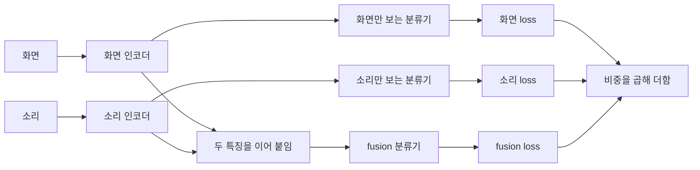

두 방법은 **무언가가 학습을 혼자 끌고 가지 못하게 그 비중을 낮춘다**는 점이 같다. 다른 점은 비중을 낮추는 대상이다.

- **Focal loss 는 샘플마다 비중을 바꾼다.** loss 는 cross-entropy 하나뿐이고, 여러 loss 를 섞지 않는다.
- **Gradient Blending 은 loss 마다 비중을 바꾼다.** 멀티모달 모델에서 모달리티별 loss 와 fusion loss(모든 모달리티를 함께 보는 분류기의 loss)를 섞을 때 쓴다.
- 그래서 Focal loss 는 클래스 불균형과 어려운 샘플 문제에, Gradient Blending 은 여러 loss 의 비중을 정하는 문제(multi-task, 멀티모달)에 속한다.

| 구분 | Focal Loss | Gradient Blending |
| --- | --- | --- |
| 비중을 바꾸는 대상 | 샘플 (loss 는 하나) | loss (모달리티별 loss + fusion loss) |
| 문제 상황 | 쉬운 샘플이 너무 많아 전체 loss 를 쉬운 샘플이 채운다 | 모달리티를 합쳤더니 하나만 쓸 때보다 성능이 떨어진다 |
| 비중 기준 | 그 샘플의 정답을 얼마나 확신하나 ($p_t$) | 학습할수록 일반화되나, 외우기만 하나 (OGR) |
| 핵심 수식 | $-\alpha_t (1-p_t)^\gamma \log p_t$ | $\sum_k w_k \mathcal{L}_k$, $w_k \propto G_k / O_k^2$ |
| 비중이 바뀌는 시점 | 매 샘플마다 자동으로 | 학습 전이나 학습 중간에 따로 재서 |
| 출처 | Lin et al. 2017 (RetinaNet) | Wang, Tran, Feiszli 2020 (CVPR) |

# A) Focal Loss

## A.1) 쉬운 배경이 loss 를 채우는 문제

사진에서 물체를 찾는 모델(object detection)을 생각하자. one-stage 검출기는 사진 위에 후보 상자를 약 10만 개 깔고, 상자마다 "물체인가 배경인가"를 분류한다.

- 물체가 든 상자는 몇 개뿐이고, 나머지는 거의 다 배경이다.
- 배경 상자 대부분은 하늘이나 벽처럼 모델이 금방 맞히는 쉬운 샘플이다.

상자 1,000 개로 줄여서 보자.

- 쉬운 배경 상자 990 개: 모델이 정답에 확률 0.9 를 준다.
- 어려운 상자 10 개: 모델이 정답에 확률 0.1 밖에 못 준다.

여기서 정답에 준 확률을 $p_t$ 라 부른다. 정답이 물체면 물체일 확률, 정답이 배경이면 배경일 확률이다. $p_t$ 가 크면 쉬운 샘플, 작으면 어려운 샘플이다.

[[cross-entropy]] 로 loss 를 계산하면 다음과 같다.

- 쉬운 상자 하나는 $-\log 0.9 = 0.105$ 이고, 990 개를 더하면 104.3 이다.
- 어려운 상자 하나는 $-\log 0.1 = 2.30$ 이고, 10 개를 더하면 23.0 이다.
- 전체 loss 의 82% 를 이미 맞히는 쉬운 상자가 차지한다.

**하나하나는 작아도 수가 많으면 쉬운 샘플이 gradient 를 끌고 간다.** 모델은 이미 아는 배경을 더 확실히 맞히는 데 힘을 쓴다.

## A.2) 잘 맞히는 샘플일수록 loss 를 깎는 아이디어

Focal loss 는 cross-entropy 앞에 $(1-p_t)^\gamma$ 를 곱한다.

$$
\mathrm{FL}(p_t) = -(1-p_t)^\gamma \log p_t
$$

- $p_t$ 가 1 에 가까우면(쉬운 샘플) $(1-p_t)^\gamma$ 가 0 에 가까워져 loss 가 거의 사라진다.
- $p_t$ 가 작으면(어려운 샘플) $(1-p_t)^\gamma$ 가 1 에 가까워 cross-entropy 가 거의 그대로 남는다.
- $\gamma$ 는 얼마나 세게 깎을지를 정한다. $\gamma = 0$ 이면 cross-entropy 와 같고, 논문은 $\gamma = 2$ 를 썼다.

## A.3) Step by Step 예시

$\gamma = 2$ 로 두고, 앞의 상자 1,000 개에 focal loss 를 한 단계씩 적용해 보자.

**Step 1. 상자마다 loss 에 곱할 값 $(1-p_t)^2$ 를 구한다.**

- 쉬운 상자($p_t = 0.9$)는 $(1-0.9)^2 = 0.01$ 이다.
- 어려운 상자($p_t = 0.1$)는 $(1-0.1)^2 = 0.81$ 이다.

**Step 2. 상자 하나의 cross-entropy 에 그 값을 곱한다.**

- 쉬운 상자는 0.105 → 0.00105 로, 100 분의 1 이 된다.
- 어려운 상자는 2.30 → 1.87 로, 거의 그대로다.

**Step 3. 상자 수만큼 더한다.**

- 쉬운 990 개의 합은 104.3 → 1.04 로 줄어든다.
- 어려운 10 개의 합은 23.0 → 18.7 로 조금만 줄어든다.

**Step 4. 전체 loss 에서 차지하는 비중을 비교한다.**

- 어려운 상자의 비중이 18% → 95% 로 뒤집힌다.
- 이제 gradient 는 대부분 어려운 상자에서 나온다.

**Focal loss 는 쉬운 샘플을 버리지 않고 비중만 줄인다.** 쉬운 샘플을 빼고 어려운 것만 골라 학습하는 OHEM(online hard example mining)과 다르다. 논문은 같은 검출기에서 focal loss 가 OHEM 보다 높은 성능을 냈다고 보고했다.

## A.4) 클래스 가중치 α

실제 focal loss 에는 클래스 가중치 $\alpha_t$ 가 하나 더 붙는다.

$$
\mathrm{FL}(p_t) = -\alpha_t (1-p_t)^\gamma \log p_t
$$

- $\alpha_t$ 는 정답이 물체면 $\alpha$, 배경이면 $1-\alpha$ 다. 드문 클래스에 큰 가중치를 주던 기존 방법(α-balanced cross-entropy)을 그대로 가져왔다.
- **$\gamma$ 는 쉬움과 어려움에 따라, $\alpha$ 는 클래스에 따라 비중을 바꾼다.** 둘은 서로 다른 축이다.
- 논문에서 가장 좋았던 값은 $\alpha = 0.25$ 로, 드문 물체 쪽에 오히려 작은 가중치다. $\gamma$ 가 쉬운 배경을 이미 크게 깎았으므로 물체 쪽을 더 키울 필요가 줄었다는 설명이다.

# B) Gradient Blending

## B.1) 합쳤더니 더 나빠지는 문제

영상을 보고 어떤 동작인지 분류하는 모델을 생각하자. 영상에는 화면(RGB)과 소리(audio)가 있다. 둘 다 쓰면 하나만 쓸 때보다 나아야 할 것 같다.

논문은 Kinetics 데이터셋에서 반대 결과를 보였다.

- 화면만 쓴 모델의 정확도는 72.6% 다.
- 화면과 소리를 함께 쓴 멀티모달 모델은 71.4% 로 더 낮다.
- 화면·소리·광학 흐름(optical flow) 셋을 합치면 70.0% 로 더 떨어진다.

원인은 과적합이다.

- 멀티모달 모델은 화면만 쓴 모델보다 학습 오차는 낮고 validation 오차는 높았다. 입력이 늘어 모델이 커진 만큼 학습 데이터를 외우기 쉬워졌다.
- 모달리티마다 외우는 속도와 일반화되는 속도가 다르다. 한 모달리티가 먼저 외우기 시작하면, fusion loss 하나로만 학습할 때 그 모달리티가 학습을 끌고 간다.

## B.2) 분류기를 여러 개 다는 구조

모달리티마다 특징을 뽑는 인코더가 따로 있다. Gradient Blending 은 각 인코더 끝에 그 모달리티만 보는 분류기(head)를 하나씩 더 단다.

- 두 특징을 이어 붙여 예측하는 분류기를 fusion 분류기라 부른다.
	- 보통의 멀티모달 모델은 이 분류기 하나만 둔다.
- 세 loss 는 모두 같은 동작 분류 문제의 cross-entropy 다. 서로 다른 목적을 섞는 것이 아니라 **같은 문제를 다른 입력으로 푼 결과**를 섞는다.
- 가장 단순한 방법은 fusion loss 만 쓰거나 세 loss 를 똑같이 더하는 것이다. Gradient Blending 은 비중을 학습 상태를 재서 정한다.

## B.3) 비중 기준: 외운 만큼과 일반화된 만큼

학습 데이터 일부를 validation 셋으로 분리해 놓고, 각 분류기를 몇 epoch 학습시키며 두 값을 잰다.

- **일반화 $G$**: validation 정확도가 오른 만큼이다. 처음 보는 데이터에서 실제로 좋아진 몫이다.
- **과적합 $O$**: 학습 정확도가 오른 만큼에서 validation 정확도가 오른 만큼을 뺀 값이다. 학습 데이터에서만 좋아진, 즉 외운 몫이다.

$O$ 를 $G$ 로 나눈 값을 overfitting-to-generalization ratio(OGR)라 부른다. 작을수록 외우지 않고 일반화되며 학습하고 있다는 뜻이다. 논문은 세 loss 를 섞은 gradient 의 OGR 이 가장 작아지는 비중을 구했고, 결과는 다음과 같다.

$$
w_k \propto \frac{G_k}{O_k^2}
$$

- 일반화가 많이 되는 분류기($G$ 가 큼)는 비중을 키운다.
- 외우기만 하는 분류기($O$ 가 큼)는 비중을 제곱으로 깎는다.
- 비중은 합이 1 이 되도록 나눠 맞춘다.

## B.4) Step by Step 예시

분리해 놓은 validation 셋으로 세 분류기를 각각 몇 epoch 학습시켰다고 하자.

**Step 1. 분류기마다 학습 정확도와 validation 정확도가 얼마나 올랐는지 잰다.**

- 화면 분류기는 학습 +9%p, validation +6%p 다.
- 소리 분류기는 학습 +9%p, validation +3%p 다.
- fusion 분류기는 학습 +12%p, validation +8%p 다.

**Step 2. 일반화 $G$ 와 과적합 $O$ 를 구한다.**

- $G$ 는 validation 정확도가 오른 만큼이고, $O$ 는 학습 정확도가 오른 만큼에서 $G$ 를 뺀 값이다.
- 화면은 $G = 6$, $O = 9 - 6 = 3$ 이다.
- 소리는 $G = 3$, $O = 9 - 3 = 6$ 이다.
- fusion 은 $G = 8$, $O = 12 - 8 = 4$ 다.

**Step 3. $G / O^2$ 로 점수를 매긴다.**

- 화면 $6/9 = 0.67$, 소리 $3/36 = 0.08$, fusion $8/16 = 0.5$ 다.
- 소리는 화면보다 $G$ 가 절반이고 $O$ 가 두 배라서, 점수가 8 분의 1 로 떨어진다.

**Step 4. 점수의 합 1.25 로 나눠 비중을 만든다.**

- 화면 0.53, 소리 0.07, fusion 0.40 이다.

화면과 소리는 학습 정확도가 똑같이 9%p 올랐다. 하지만 소리는 그중 3%p 만 validation 셋에서 나타났고, 나머지 6%p 는 외운 것이다. 그래서 소리 loss 는 거의 반영되지 않는다.

**소리 모달리티를 버리는 것은 아니다.** fusion loss 의 gradient 가 소리 인코더로도 흘러가므로 소리 특징은 계속 학습된다. 소리 분류기가 혼자 외운 방향으로 끌고 가는 몫만 줄어든다.

## B.5) 비중을 재는 시점

- **Offline G-Blend**: 학습 전에 한 번 재고, 그 비중으로 끝까지 학습한다.
- **Online G-Blend**: 학습을 몇 epoch 단위(super-epoch)로 나누고, 단위가 시작될 때마다 다시 잰다. 학습이 진행되면 어느 분류기가 외우기 시작하는지가 바뀌기 때문이다.
- 비중을 잴 때마다 분류기별로 몇 epoch 씩 따로 학습해야 하므로 학습 비용이 늘어난다.

# C) 여러 loss 를 섞는 다른 방법

여러 loss 의 비중을 정하는 문제는 [[multi-task learning]] 에서 먼저 다뤄졌다. Gradient Blending 이 일반화를 기준으로 삼는 것과 달리, 대부분은 loss 크기나 학습 속도를 맞추는 쪽이다.

- **Uncertainty weighting (Kendall et al. 2018)**: 각 loss 의 비중을 학습되는 파라미터로 둔다. 잡음이 큰 작업일수록 비중이 작아지도록 식을 짰다.
- **GradNorm (Chen et al. 2018)**: 작업마다 gradient 크기가 비슷해지도록 비중을 조절한다. 다른 작업보다 덜 학습된 작업은 gradient 를 더 키운다.
- **PCGrad (Yu et al. 2020)**: 비중이 아니라 방향을 고친다. 두 작업의 gradient 가 서로 반대쪽을 가리키면, 한쪽에서 상대와 부딪치는 성분을 덜어낸다.
- **OGM-GE (Peng et al. 2022)**: Gradient Blending 의 멀티모달 후속 연구다. 앞서 가는 모달리티의 gradient 를 학습 중에 줄여 뒤처진 모달리티가 따라오게 한다.

# 부록: 식과 설정

## Focal loss

$$
p_t = \begin{cases} p & y = 1 \\ 1-p & \text{otherwise} \end{cases} \qquad \alpha_t = \begin{cases} \alpha & y = 1 \\ 1-\alpha & \text{otherwise} \end{cases}
$$

$$
\mathrm{FL}(p_t) = -\alpha_t (1-p_t)^\gamma \log p_t
$$

- 논문 설정은 $\gamma = 2$, $\alpha = 0.25$ 다. $\alpha = 0.5$ 도 거의 비슷했다.
- $\gamma = 2$ 에서 $p_t = 0.9$ 인 샘플은 cross-entropy 대비 loss 가 100 분의 1, $p_t \approx 0.968$ 인 샘플은 1000 분의 1 이 된다.
- 본문 검산: $0.01 \times 0.105 = 0.00105$, $0.81 \times 2.303 = 1.865$.
- 실제로는 분류기의 마지막 bias 를 물체 확률이 0.01 정도에서 시작하도록 초기화한다. 학습 첫 step 에서 배경 상자 수만 개가 큰 loss 를 내 학습이 흔들리는 것을 막는다.

## Gradient Blending

$\mathcal{L}^{T}$ 는 학습 loss, $\mathcal{L}^{*}$ 는 실제 분포에서의 loss 이고, 아래 첨자는 epoch 이다.

$$
O_N = \left(\mathcal{L}^{T}_0 - \mathcal{L}^{T}_N\right) - \left(\mathcal{L}^{*}_0 - \mathcal{L}^{*}_N\right) \qquad G_N = \mathcal{L}^{*}_0 - \mathcal{L}^{*}_N
$$

$$
\Delta O_{N,n} = O_{N+n} - O_N \qquad \Delta G_{N,n} = G_{N+n} - G_N \qquad \mathrm{OGR} = \left| \frac{\Delta O_{N,n}}{\Delta G_{N,n}} \right|
$$

$$
\mathcal{L}_{\mathrm{blend}} = \sum_{k=1}^{K+1} w_k \mathcal{L}_k \qquad w_k^{*} = \frac{1}{Z} \frac{\Delta G_k}{(\Delta O_k)^2}
$$

- $K$ 개는 모달리티별 분류기, 마지막 하나는 fusion 분류기의 loss 다.
- $\mathcal{L}^{*}$ 는 학습 데이터에서 분리해 놓은 validation 셋으로 근사한다. validation 셋 크기는 학습 데이터의 약 8~13% 였다.
- 실제로는 loss 대신 정확도로 $G$ 와 $O$ 를 잰다. 본문 예시가 정확도로 계산한 이유다.
- $Z$ 는 비중을 정규화하는 상수다. 상수배는 학습률에 흡수되므로 비율만 중요하고, 본문 예시는 합이 1 이 되게 나눴다.
- Online G-Blend 는 첫 super-epoch 를 10 epoch, 이후를 5 epoch 로 두었다.

## Uncertainty weighting

작업 $k$ 의 잡음 크기를 학습되는 파라미터 $\sigma_k$ 로 두고, 회귀 작업이면 다음 식을 최소화한다.

$$
\mathcal{L} = \sum_k \left( \frac{1}{2\sigma_k^2} \mathcal{L}_k + \log \sigma_k \right)
$$

- $\sigma_k$ 가 커지면 그 작업의 비중 $1/(2\sigma_k^2)$ 이 작아진다.
- $\log \sigma_k$ 항이 $\sigma_k$ 를 무한히 키워 모든 loss 를 0 으로 만드는 것을 막는다.

## PCGrad

작업 $i$ 와 $j$ 의 gradient $g_i$, $g_j$ 가 반대쪽을 가리킬 때($g_i \cdot g_j < 0$) $g_i$ 에서 $g_j$ 방향 성분을 뺀다.

$$
g_i \leftarrow g_i - \frac{g_i \cdot g_j}{\lVert g_j \rVert^2} g_j
$$
