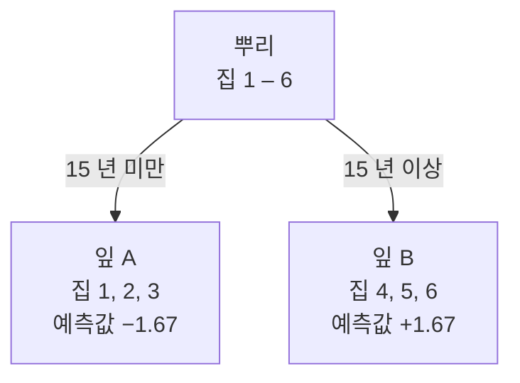
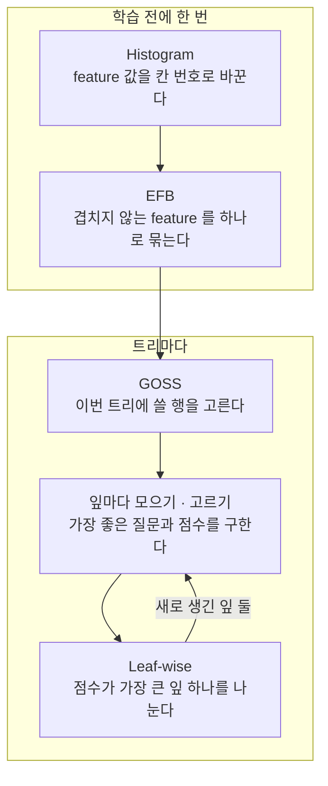

집값을 예측하는 모델을 만든다고 하자. 결정 트리 하나로 먼저 대강 맞히고, 틀린 만큼을 다음 트리가 고치는 식으로 트리를 여러 개 쌓는다. 이 방식을 [[Gradient Boosting Machine|gradient boosting decision tree]](GBDT)라 한다.

LightGBM 은 Microsoft 가 만든 GBDT 라이브러리다 (Ke et al., NeurIPS 2017). 다른 GBDT 와 정확도는 거의 같으면서, 논문 기준으로 학습이 최대 20 배 넘게 빨랐다.

# A) 트리를 쌓아 오차를 줄이는 방식

실제 가격이 3.5 억인 집 하나를 보자.

- 트리 1 이 3.0 억으로 예측했다. 0.5 억이 모자란다.
- 트리 2 는 남은 0.5 억을 맞추도록 학습한다. 트리 1 과 트리 2 를 더한 예측은 3.4 억이고, 0.1 억이 남는다.
- 트리 3 은 남은 0.1 억을 맞춘다. 셋을 더하면 3.48 억이다.

트리 하나의 예측을 다 더하지 않고 일부만 반영한다(learning rate). 그래서 오차가 한 번에 0 이 되지 않고 조금씩 줄어든다.

**LightGBM 이 빠르다는 것은 이 트리 하나하나를 빨리 만든다는 뜻이다.** 그러니 먼저 트리 하나가 만들어지는 과정을 따라가 보자.

# B) 트리 하나가 만들어지는 과정

## B.1) 질문으로 집을 나누기

트리 1 이 예측을 마친 뒤, 집 6 채에 남은 오차(정답 − 예측)가 다음과 같다고 하자. 트리 2 는 이 남은 오차를 맞춘다.

| 집 | 연식 (년) | 남은 오차 (천만 원) |
| --- | --- | --- |
| 1 | 3 | −2 |
| 2 | 7 | −1 |
| 3 | 11 | −2 |
| 4 | 18 | +3 |
| 5 | 22 | +1 |
| 6 | 25 | +1 |

- 음수면 트리 1 이 너무 높게 예측한 집이고, 양수면 너무 낮게 예측한 집이다.
- 집 하나하나를 **행**(데이터 샘플)이라 하고, 연식처럼 행을 설명하는 열을 **feature** 라 한다.

결정 트리는 "연식 < 15 ?" 같은 질문으로 집을 둘로 나눈다. 이 질문을 **분할 조건**(split)이라 한다.

- 질문을 거쳐 도착한 집의 묶음을 **잎**(leaf)이라 한다. 잎은 질문이 아니라 집의 묶음이다.
- 잎은 예측값 하나를 준다. 그 잎에 든 집들의 남은 오차 평균이다.
  - 잎 A 의 평균은 −1.67 이다. 트리 1 이 집 1 – 3 을 평균 1,670 만 원 높게 예측했으니, 그만큼 낮추라는 뜻이다.
  - 실제로는 이 값에 learning rate 를 곱해 더한다. 정규화를 켜면 평균보다 0 쪽으로 조금 줄어든다 (식은 부록).
- 새 집이 들어오면 질문을 따라 내려가 도착한 잎의 값을 받는다.
- 트리는 집 전체가 든 잎 하나(뿌리)에서 시작한다. 잎 하나를 골라 다시 질문으로 나누기를 되풀이하며 자란다.

## B.2) 좋은 질문 고르기

**좋은 질문은 트리 2 가 고쳐 준 뒤에 남는 오차가 작은 질문이다.** 두 질문을 비교해 보자.

- **연식 < 15 ?**: 잎 A(집 1 – 3)는 예측을 1.67 낮추고, 잎 B(집 4 – 6)는 1.67 올린다.
- **연식 < 20 ?**: 왼쪽 잎(집 1 – 4)은 예측을 0.5 낮추고, 오른쪽 잎(집 5, 6)은 1 올린다.

트리 2 가 고쳐 준 뒤에도 남는 오차를 집마다 보면 다음과 같다.

| 집 | 나누기 전 | 연식 < 15 로 나눈 뒤 | 연식 < 20 으로 나눈 뒤 |
| --- | --- | --- | --- |
| 1 | −2 | −0.33 | −1.5 |
| 2 | −1 | +0.67 | −0.5 |
| 3 | −2 | −0.33 | −1.5 |
| 4 | +3 | +1.33 | +3.5 |
| 5 | +1 | −0.67 | 0 |
| 6 | +1 | −0.67 | 0 |
| 제곱 합 | 20 | 3.33 | 17 |

- **나누기 전**은 잎이 뿌리 하나뿐인 상태다. 모든 집에 같은 값(남은 오차 평균 0)을 보태니 아무것도 못 고친다.
- **연식 < 15** 는 모든 집의 오차를 줄인다.
  - 예: 집 1 은 2,000 만 원 높게 예측돼 있었는데, 예측을 1,670 만 원 낮추니 330 만 원만 높게 남는다.
- **연식 < 20** 은 집 4 를 오히려 더 틀리게 만든다 (+3 → +3.5).
  - 집 4 는 너무 낮게 예측된 집인데, 같은 잎에 든 집 1 – 3 때문에 예측을 0.5 더 낮춰 버렸다.

남는 오차를 하나의 숫자로 비교하려고 제곱해서 더한다. 제곱하면 음수와 양수가 서로 지워지지 않고, 크게 틀린 집이 더 크게 반영된다.

제곱 합이 줄어든 양을 그 질문의 **점수**(gain)라 한다. 연식 < 15 는 20 → 3.33 으로 16.67, 연식 < 20 은 20 → 17 로 3 이라서 "연식 < 15 ?" 를 고른다.

**이 점수는 양쪽의 오차 합과 집 수만 알면 계산된다.** 집을 하나하나 다시 볼 필요가 없다는 뜻이다.

- 실제 식은 집 수 대신 hessian(손실의 2 차 미분) 합으로 나누고 정규화 항을 더한다. 제곱 오차에서는 hessian 이 집마다 1 이라 집 수와 같다 (식은 부록).

그래서 실제 계산은 두 단계로 나뉜다.

- **모으기**: 집을 한 번만 훑으며, 연식 칸(10 년 미만 · 10 – 15 년 · 15 – 20 년 · 20 년 이상)마다 오차 합과 집 수를 더해 둔다.
  - 칸별 오차 합은 −3, −2, +3, +2 다.
  - 이 칸을 **bin** 이라 하고, 칸별 합을 모은 것을 **히스토그램**이라 한다.
- **고르기**: 집은 다시 보지 않고 칸 합만 더해 후보(10 · 15 · 20 년)마다 점수를 낸다.
  - 15 년 기준이면 왼쪽은 −3 − 2 = −5, 오른쪽은 +3 + 2 = +5 다. 위에서 직접 구한 것과 같은 점수가 나온다.

feature 가 여럿이면 feature 마다 같은 일을 하고, 그중 점수가 가장 큰 질문을 고른다. 그래서 잎 하나를 나누는 비용은 두 덩어리다.

- 모으기는 행 수와 feature 수에 비례한다.
- 고르기는 후보 수와 feature 수에 비례한다.

# C) LightGBM 이 빠른 이유

행이 수천만 개, feature 가 수천 개면 위 비용이 커지고, 잎을 나눌 때마다 이 일을 되풀이한다. LightGBM 은 네 가지 기법으로 이 숫자를 하나씩 줄인다.

- **Histogram — 후보 수를 줄인다**: 값을 칸으로 묶어 칸 경계에서만 자른다.
- **GOSS — 모으기의 행 수를 줄인다**: 이미 잘 맞힌 행은 일부만 본다.
- **EFB — 모으기의 feature 수를 줄인다**: 함께 값이 있을 일이 없는 feature 를 하나로 묶는다.
- **Leaf-wise — 나누는 횟수를 줄인다**: 점수가 가장 큰 잎 하나만 나눈다.

**네 기법은 따로 노는 것이 아니라 병목을 넘겨받는다.**

- Histogram 으로 후보가 수십만 개에서 254 개 이하로 줄면 고르기는 싸진다. 남는 비용은 대부분 모으기다.
- 그래서 GOSS 와 EFB 가 모으기에 들어가는 행과 feature 를 줄인다. LightGBM 논문이 새로 내놓은 것이 이 둘이다.
- Leaf-wise 는 잎 하나를 나누는 속도가 아니라, 같은 정확도에 필요한 잎 나누기 횟수를 줄인다.

![[img-ebfc6376cb.png]]

## C.1) Histogram: 칸 경계에서만 자르기

**값을 칸으로 묶으면 후보가 크게 준다.**

- 연봉처럼 서로 다른 값이 50 만 종류인 feature 를 칸 없이 다루면, 이웃한 값 사이를 모두 시험해야 해서 후보가 50 만 개 가깝다. XGBoost 의 exact 방식이 이렇게 한다.
- LightGBM 은 학습 전에 값을 최대 255 개 칸으로 나눠 둔다. 경계는 254 개라 후보도 254 개 이하다.
- 원래 값 대신 칸 번호만 저장하므로 메모리도 준다.

**대신 칸 안쪽의 세밀한 기준값은 고를 수 없다.** 칸을 늘리면 더 세밀해지고 그만큼 느려진다.

**히스토그램은 뺄셈으로 한 번 더 아낀다.**

- 잎을 둘로 나누면 두 자식의 히스토그램이 필요하다.
- 부모의 칸별 합에서 한 자식의 합을 빼면 다른 자식의 합이 된다 (예: 10 − 4 = 6).
- 그래서 집이 적은 자식만 직접 모은다.

## C.2) Leaf-wise: 효과가 큰 잎만 나누기

잎 A 와 잎 B 중 하나를 더 나눈다면 어느 쪽이 나을까.

- **잎 A (−2, −1, −2)**: 오차가 이미 −2 근처로 고르다. 가장 좋은 질문으로 나눠도 점수가 0.17 이다.
- **잎 B (+3, +1, +1)**: 집 4 의 +3 이 튄다. 집 4 를 떼어 내면 점수가 2.67 이다.

**level-wise 는 같은 층의 잎을 모두 나누고, leaf-wise 는 점수가 큰 잎 하나만 나눈다.**

- level-wise(XGBoost 기본)는 A 와 B 를 모두 나눈다. 효과가 거의 없는 A 에도 계산을 쓴다.
- leaf-wise(LightGBM)는 B 만 나눈다. 다음에도 그때 있는 잎 전부를 놓고 다시 하나만 고른다.
- 그래서 같은 잎 수라면 leaf-wise 가 오차를 더 많이 줄인다.

**대신 데이터가 적으면 [[overfitting|과적합]] 하기 쉽다.**

- 많이 틀리는 쪽만 계속 깊어져서, 몇 안 되는 집에 맞춘 질문이 쌓인다.
- 잎 수 상한과 잎 하나에 들어갈 최소 행 수를 걸어 막는다.

## C.3) GOSS: 잘 맞힌 행은 일부만 보기

LightGBM 은 남은 오차 대신 **gradient** 라는 말을 쓴다. 제곱 오차에서는 남은 오차와 부호만 다르고 크기는 같다.

**잘 맞힌 행(gradient 가 작은 행)은 점수에 미치는 영향이 작다.** 다음 트리가 고칠 것이 거의 없기 때문이다.

[[Gradient-based One-Side Sampling|GOSS]] 는 이 점을 이용해, 행이 10 만 개면 다음만 쓴다.

1. gradient 가 큰 상위 20%, 2 만 행은 모두 쓴다.
2. 나머지 8 만 행에서는 1 만 행만 무작위로 뽑는다.
3. 뽑은 1 만 행은 8 배로 쳐 준다. 버린 7 만 행의 몫까지 대신하게 하려는 것이다.

**결과적으로 10 만 행 대신 3 만 행으로 히스토그램을 만든다.**

- 8 배로 쳐 주지 않으면 잘 맞힌 행이 실제보다 적게 반영되어 점수가 틀어진다.
- 기본으로는 꺼져 있다.

## C.4) EFB: 겹치지 않는 feature 묶기

**한 행에서 함께 값이 있을 일이 없는 feature 들은 하나로 묶어도 된다.** 여기서 값이 있다는 것은 0 이 아니라는 뜻이다. 색깔을 one-hot 으로 펼친 feature 를 보자.

| 집 | 빨강 | 파랑 | 초록 | 합친 feature |
| --- | --- | --- | --- | --- |
| 1 | 1 | 0 | 0 | 1 |
| 2 | 0 | 0 | 1 | 3 |
| 3 | 0 | 1 | 0 | 2 |
| 4 | 0 | 0 | 0 | 0 |

- 어느 집도 두 색이 동시에 1 이 아니다.
- 합친 값 1, 2, 3 만 보면 원래 어느 색이었는지 그대로 안다.

**겹치는 feature 는 묶지 않는다.**

- 연식은 모든 집에 값이 있어서 빨강 · 파랑 · 초록과 겹친다. 집 1 의 연식 3 과 빨강 1 을 한 칸에 담을 수 없다.
- 그래서 기본 설정에서 연식은 혼자 남고, 세 색만 하나로 묶인다.
- 겹침을 조금 허용하게 설정하면 더 많이 묶여 빨라지지만, 겹친 행에서는 값 일부를 잃는다.

**값이 여러 개인 feature 를 묶을 때는 칸 번호를 이어 붙인다.**

- 예: feature A 의 칸이 0 – 9, B 의 칸이 0 – 19 면 B 를 10 – 29 로 밀어 칸 30 개짜리 하나로 만든다.
- 어떤 feature 끼리 묶을지는 값이 많은 feature 부터 차례로, 겹치지 않는 묶음에 넣어 가며 정한다 (greedy).

**0 이 대부분인 feature 가 많을 때만 효과가 크다.**

- one-hot, 단어 빈도처럼 sparse 한 feature 가 수만 개면 크게 준다.
- 대부분 값이 있는 dense feature 끼리는 서로 다 겹쳐서 묶을 것이 거의 없다.

## C.5) 지금의 XGBoost 와 비교

위 기법 중 일부는 XGBoost 에도 들어갔다. 같은 설정으로 맞추면 속도 차이는 예전보다 작고, 데이터와 파라미터에 따라 결과가 달라진다.

| 비교 항목 | LightGBM | XGBoost |
| --- | --- | --- |
| 기준값 후보 | 칸 경계 (histogram) | 2.0 부터 기본값(`tree_method="auto"`)이 histogram. exact 도 고를 수 있다 |
| 트리 성장 | leaf-wise | 기본은 level-wise. `grow_policy="lossguide"` 로 leaf-wise 가능 |
| 행 샘플링 | GOSS 를 고를 수 있다 | 무작위 subsample. GPU 에서는 gradient 크기 기반 샘플링(`sampling_method="gradient_based"`)도 가능 |
| sparse 열 | EFB 로 묶는다 | 묶지 않는다. 결측 · 0 인 값을 왼쪽과 오른쪽 중 어디로 보낼지 따로 학습한다 (sparsity-aware split) |

# D) 쓸 때 주의할 점

## D.1) 과적합을 막는 파라미터

leaf-wise 성장 때문에 데이터가 적으면 과적합하기 쉽다. LightGBM 문서도 작은 데이터에서는 `num_leaves` 를 줄이고 `min_data_in_leaf` 를 키우라고 권한다.

| 파라미터 | 기본값 | 정하는 것 | 과적합 시 조정 |
| --- | --- | --- | --- |
| `num_leaves` | 31 | 트리 하나의 잎 수 상한 | 줄인다 |
| `min_data_in_leaf` (`min_child_samples`) | 20 | 잎 하나에 들어가야 하는 최소 행 수 | 키운다 |
| `max_depth` | -1 (제한 없음) | 트리 깊이 상한. 한쪽으로만 깊어지는 것을 막는다 | 건다 |
| `feature_fraction` (`colsample_bytree`) | 1.0 | 트리마다 쓰는 feature 비율 | 줄인다 |
| `learning_rate` · `num_iterations` (`n_estimators`) | 0.1 · 100 | 트리 하나를 얼마나 반영할지, 트리를 몇 개 만들지 | 학습률을 낮추고, 검증 점수가 더 나아지지 않으면 트리 추가를 멈춘다 (early stopping) |

괄호 안은 scikit-learn 방식 API(`LGBMClassifier` 등)에서 쓰는 이름이다.

## D.2) scikit-learn 방식 API

`lgb.LGBMClassifier` · `lgb.LGBMRegressor` 는 scikit-learn 과 같은 `fit` / `predict` 인터페이스다. `lgb.Dataset` 을 만들 필요 없이 pandas DataFrame 이나 numpy 배열을 바로 넣는다. DataFrame 의 `category` 타입 열은 자동으로 categorical feature 로 처리한다.

클래스 불균형이 있으면 `class_weight="balanced"` 로 드문 클래스에 큰 가중치를 줄 수 있다.

* 가중치는 전체 행 수 ÷ (클래스 수 × 그 클래스의 행 수) 다.
* 예: 1 만 행 중 양성이 100 행이면 양성은 10,000 ÷ (2 × 100) = 50, 음성은 10,000 ÷ (2 × 9,900) ≈ 0.505 다.
* 양성을 더 잘 잡게 되지만, 학습 분포가 바뀌어 양성의 예측 확률이 실제보다 높게 나온다. 확률값을 그대로 써야 하면 [[probability calibration|보정]] 을 거친다.

## D.3) Boosting 방식

`boosting` 파라미터로 GBDT(기본), DART, random forest 를 고른다. 예전에는 GOSS 도 `boosting="goss"` 로 골랐지만, 4.0 부터는 행 샘플링 방식으로 분리되어 `data_sample_strategy="goss"` 로 지정한다. 순위 학습용 목적 함수(`objective="lambdarank"`)도 기본으로 들어 있다 ([[LambdaRank]]).

# E) 한계: ID 사이의 관계 학습

트리의 질문은 언제나 열 하나만 본다. "이 행의 user_id 가 {user_A, user_C} 중 하나인가?" 는 물을 수 있지만, "user_A 와 user_B 가 비슷한가?" 는 물을 수 없다. 그래서 사용자 ID · 상품 ID 를 넣어도 트리 모델은 어떤 ID 끼리 비슷한지 배우지 못한다.

ID 처럼 범주가 많은 열(`max_cat_to_onehot`, 기본 4 개 초과)을 LightGBM 은 다음처럼 나눈다.

1. ID 마다 "모델이 지금 이 ID 의 행을 어느 쪽으로 얼마나 틀리고 있나" 를 숫자 하나로 낸다 (gradient 합 ÷ hessian 합).
2. 이 숫자로 ID 를 줄 세운다.
3. 줄의 한 지점을 잘라 두 무리로 나눈다.

| ID | 1 단계 숫자 |
| --- | --- |
| user_B | -0.6 |
| user_D | -0.1 |
| user_A | 0.4 |
| user_C | 0.5 |

위 예에서는 user_D 와 user_A 사이를 잘라 {user_A, user_C} 와 나머지로 나눌 수 있다.

user_A 와 user_C 가 한 무리가 된 이유는 1 단계 숫자가 비슷했기 때문뿐이다. 둘이 같은 상품을 샀는지, 취향이 비슷한지는 모델이 모른다.

* 행이 적은 ID 는 이 숫자가 들쭉날쭉해서 믿기 어렵다.
* 처음 보는 ID 는 숫자가 없어서 쓸 정보가 없다.

임베딩을 쓰는 신경망(MLP 등)은 다르다. ID 마다 벡터를 두고 학습하면서, 비슷한 행동을 한 ID 의 벡터를 서로 가깝게 만든다. 행이 적은 user_A 도 비슷한 user_B 에게서 배운 정보를 나눠 쓴다.

| 비교 항목 | LightGBM (결정 트리) | MLP (임베딩) |
| --- | --- | --- |
| ID 를 쓰는 방식 | ID 마다 오차 통계를 내서 무리를 나눈다 | ID 마다 벡터를 두고 학습한다 |
| 학습하는 관계 | feature 와 target 사이 | feature 와 target 사이 + ID 끼리의 유사도 |
| 행이 적은 ID | 통계가 불안정해 거의 쓸모없다 | 비슷한 ID 의 정보를 빌려 쓴다 |

그래서 ID 를 트리 모델에 넣을 때는 ID 자체보다 ID 의 통계(과거 클릭률, 구매 수 등)를 feature 로 만들어 넣는 일이 많다.

# F) Feature Importance

LightGBM 은 feature 중요도를 두 가지로 낸다.

| `importance_type` | 계산 |
| --- | --- |
| `split` (기본값) | 그 feature 로 분할한 횟수 |
| `gain` | 그 feature 로 분할해서 줄어든 오차의 합 |

두 값은 순위가 서로 다를 수 있다.

| feature | 분할 횟수 | 분할 한 번에 줄어든 오차 | `split` | `gain` |
| --- | --- | --- | --- | --- |
| A | 10 번 | 0.1 | 10 | 1.0 |
| B | 2 번 | 3.0 | 2 | 6.0 |

`split` 은 A 를, `gain` 은 B 를 더 중요하다고 본다. `split` 은 분할이 오차를 얼마나 줄였는지 보지 않기 때문이다. 보통 `gain` 을 더 믿을 만한 지표로 쓴다.

[[random forest]] 의 기본 중요도(scikit-learn 의 `feature_importances_`)는 분할로 줄어든 불순도의 평균이다. 원리는 LightGBM 의 `gain` 과 같지만, 두 모델의 값을 그대로 비교하면 안 된다.

| 비교 항목 | Random Forest | LightGBM |
| --- | --- | --- |
| 트리 관계 | 서로 독립 ([[bagging]]) | 앞 트리의 오차를 이어 받음 ([[boosting]]) |
| 분할 기준 | 불순도(Gini, entropy) 감소 | gradient 로 계산한 오차 감소 |
| 중요도 분포 | 트리마다 feature 를 무작위로 골라 여러 feature 에 퍼지는 편 | 오차를 가장 잘 줄이는 소수 feature 에 몰리는 편 |

두 방식 모두 값 종류가 많은 feature(ID 등)를 실제보다 중요하게 보는 경향이 있다. 자를 수 있는 곳이 많아서, 우연히 오차를 크게 줄이는 자리도 찾기 쉽기 때문이다. feature 의 실제 기여를 보려면 permutation importance 나 SHAP 을 함께 본다.

# G) 부록: 식과 설정

## G.1) 분할 점수와 잎 값

행 $i$ 의 gradient 를 $g_i$, hessian 을 $h_i$ 라 하고, 한 잎에 든 행들의 합을 $G = \sum g_i$, $H = \sum h_i$ 라 하자. L2 정규화 계수는 $\lambda$ (`lambda_l2`, 기본 0) 다.

- 잎 값: $w = -\dfrac{G}{H + \lambda}$
- 분할 점수: $\text{gain} = \dfrac{G_L^2}{H_L + \lambda} + \dfrac{G_R^2}{H_R + \lambda} - \dfrac{G^2}{H + \lambda}$
- 이 점수가 `min_gain_to_split`(기본 0) 보다 커야 나눈다.
- 제곱 오차 $\frac{1}{2}(y - \hat{y})^2$ 이면 $g_i = \hat{y}_i - y_i$ (남은 오차의 부호를 뒤집은 값), $h_i = 1$ 이다.
  - $\lambda = 0$ 이면 잎 값은 남은 오차의 평균, 분할 점수는 B.2 에서 구한 「줄어든 제곱 합」 과 같다.
  - 연식 < 15 의 점수: $\frac{(-5)^2}{3} + \frac{5^2}{3} - \frac{0^2}{6} \approx 16.67$
- 앞 트리들의 예측에 더하는 값은 $w$ 에 learning rate 를 곱한 것이다.

## G.2) GOSS 가중치

`top_rate` 를 $a$, `other_rate` 를 $b$ 라 하면, 무작위로 뽑은 행에 곱하는 가중치는 $\frac{1 - a}{b}$ 다. 기본값 $a = 0.2$, $b = 0.1$ 이면 $\frac{0.8}{0.1} = 8$ 이다.

## G.3) 기법별 설정

| 기법 | 파라미터 | 기본값 | 바꾸는 경우 |
| --- | --- | --- | --- |
| Histogram | `max_bin` | 255 | 키우면 칸이 세밀해지고 느려진다 |
| GOSS | `data_sample_strategy="goss"`, `top_rate`, `other_rate` | 꺼짐 (켜면 0.2, 0.1) | 행이 아주 많아 학습이 느릴 때 켠다 |
| EFB | `enable_bundle`, `max_conflict_rate` | 켜짐, 0.0 | `max_conflict_rate` 를 올리면 겹침을 허용해 더 빨라지고 조금 부정확해진다 |
| Leaf-wise | `num_leaves` | 31 | 과적합이면 줄인다 (D.1 표) |

# H) Related

[[Gradient Boosting Machine]], [[Extreme Gradient Boosting|XGBoost]], [[GBM comparison]]

# I) References

* [LightGBM: A Highly Efficient Gradient Boosting Decision Tree (Ke et al., NeurIPS 2017)](https://papers.nips.cc/paper_files/paper/2017/hash/6449f44a102fde848669bdd9eb6b76fa-Abstract.html)
* [LightGBM Features](https://lightgbm.readthedocs.io/en/latest/Features.html)
* [LightGBM Parameters](https://lightgbm.readthedocs.io/en/latest/Parameters.html)
* [XGBoost - Tree Methods](https://xgboost.readthedocs.io/en/stable/treemethod.html)
* [scikit-learn - Permutation feature importance](https://scikit-learn.org/stable/modules/permutation_importance.html)
* [Understanding LightGBM Parameters (and How to Tune Them) - neptune.ai](https://neptune.ai/blog/lightgbm-parameters-guide)
