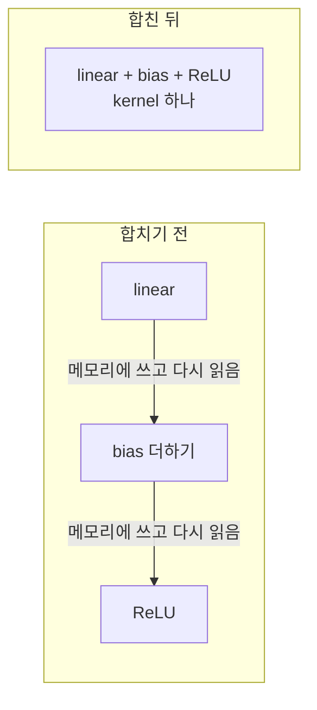
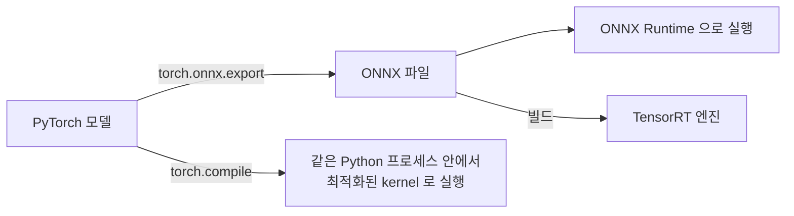

PyTorch 로 학습한 랭킹 모델을 서빙 코드에서 `model(x)` 로 그대로 부른다고 하자.

- Python 이 모델 코드를 한 줄씩 읽으며 연산을 하나씩 GPU 에 보낸다.
- 연산 하나가 끝날 때마다 결과를 GPU 메모리에 쓰고, 다음 연산이 그것을 다시 읽는다.
- linear → bias 더하기 → ReLU 처럼 짧은 연산이 이어지면, 계산보다 메모리를 오가는 시간과 GPU 에 일을 시키는 횟수가 더 커진다.

컴파일은 이 모델의 계산 순서 전체를 먼저 받아 두고, GPU 에서 빠르게 돌도록 다시 짜서 실행 엔진으로 만드는 일이다. 추론 최적화 전체에서의 자리는 [[Inference Optimization]] 에 있다.

# A) eager 실행과 그래프 실행

**eager 실행은 코드를 만나는 대로 하나씩 실행하고, 그래프 실행은 전체 계산 순서를 먼저 보고 한꺼번에 실행한다.**

- PyTorch 의 기본은 eager 실행이다. 디버깅이 쉽고, `if` · `for` 로 입력마다 다른 계산을 할 수 있다.
- 그래프 실행은 계산 순서를 [[computational graph|계산 그래프]] 로 먼저 만든다. 노드는 연산이고, 노드를 잇는 선은 연산 사이를 흐르는 텐서다.
- 그래프 전체가 보이면 "이 세 연산은 하나로 합칠 수 있다" 같은 판단을 미리 할 수 있다.

**추론은 그래프 실행에 잘 맞는다.**

- 학습이 끝난 모델은 구조가 바뀌지 않는다.
- 역전파를 하지 않으므로 중간 결과를 남겨 둘 필요가 없다.
- 그래서 학습 중에는 못 하는 변형을 마음 놓고 할 수 있다.

# B) 컴파일러가 하는 일

1. **그래프 정리**: 미리 계산할 수 있는 부분은 상수로 바꾸고 (constant folding), 결과를 아무도 안 쓰는 연산은 지운다. 추론에서는 dropout 이 아무것도 안 하므로 빠지고, BatchNorm 은 앞의 conv · linear 의 weight 에 합쳐 넣는다.
2. **연산 합치기 (layer · kernel fusion)**: 이어진 연산을 GPU 프로그램 (kernel) 하나로 합친다. 중간 결과를 메모리에 쓰고 다시 읽는 일이 사라진다. 자세한 것은 [[Kernel Fusion]].
3. **정밀도 고르기**: 층마다 FP32 · FP16 · INT8 중 무엇으로 계산할지 정한다 ([[Quantization]]).
4. **kernel 고르기 (auto-tuning)**: 같은 행렬 곱이라도 입력 크기와 GPU 종류에 따라 빠른 구현이 다르다. 후보를 실제로 돌려 보고 가장 빠른 것을 고른다.
5. **메모리 계획**: 텐서마다 언제 만들어지고 언제 더 안 쓰이는지 미리 알므로, 겹치지 않는 텐서끼리 같은 메모리를 나눠 쓴다.

연산 합치기는 아래처럼 생겼다. 왼쪽은 kernel 세 번 실행과 메모리 왕복 두 번이 필요하고, 오른쪽은 kernel 한 번이면 끝난다.

# C) 대표 도구

**ONNX 는 모델을 담는 파일 형식이고, ONNX Runtime · TensorRT · torch.compile 은 모델을 실행하거나 최적화하는 도구다.**

- **[[mlops/Open Neural Network Exchange|ONNX]]**: 계산 그래프와 weight 를 프레임워크와 상관없는 파일 하나에 담는 형식이다. PyTorch 에서 `torch.onnx.export` 로 내보낸다.
- **[[onnxruntime|ONNX Runtime]]**: ONNX 파일을 읽어 그래프를 정리하고 실행한다. CPU · NVIDIA GPU · 다른 가속기를 백엔드로 골라 쓸 수 있다.
- **[[TensorRT]]**: NVIDIA GPU 전용 최적화 도구다. 보통 ONNX 파일을 받아 위 다섯 가지를 모두 하고, 그 GPU 에서만 도는 엔진 파일을 만든다.
- **torch.compile**: PyTorch 2.0 부터 들어간 기능이다. 모델 코드를 그대로 두고 `torch.compile(model)` 한 줄로 쓴다.
	- 실행 중에 Python 코드에서 그래프를 잡아내고 (TorchDynamo), GPU kernel 을 새로 만들어 (TorchInductor) 합친 연산을 실행한다.
	- 그래프로 못 바꾸는 Python 코드를 만나면 그 자리에서 그래프를 끊고 그 부분만 eager 로 실행한다 (graph break).

세 가지 흐름을 그리면 다음과 같다.

**[[Triton]] 이라는 이름이 두 가지를 가리킨다.**

- Triton Inference Server 는 NVIDIA 의 서빙 서버다. TensorRT 엔진 · ONNX 파일을 올려 요청을 받는다.
- Triton 언어는 OpenAI 가 만든 GPU kernel 작성 언어다. TorchInductor 가 GPU kernel 을 이 언어로 만든다.

# D) 얻는 것과 내주는 것

컴파일은 실행을 빠르게 하는 대신 몇 가지 제약을 받아들이는 일이다.

1. **빌드 시간**: TensorRT 엔진은 kernel 후보를 실제로 돌려 보며 만들기 때문에 시간이 걸린다. 서빙을 시작하기 전에 미리 만들어 둔다. torch.compile 은 첫 호출에서 컴파일하므로 첫 요청이 느리다. 그래서 서버를 띄운 뒤 가짜 요청으로 미리 한 번 돌린다 (warm-up).
2. **입력 크기**: 입력 크기가 하나로 고정돼 있을 때 가장 빠르다. 크기가 바뀔 수 있으면 허용 범위를 미리 정해야 한다.
	- 랭킹 모델은 요청마다 후보 수가 다르다. 후보 수 차원을 가변으로 두고 최소 · 자주 쓰는 값 · 최대를 정하거나, 몇 가지 크기로 맞춰 남는 자리를 빈 값으로 채운다 (padding).
	- torch.compile 은 처음 보는 입력 크기가 오면 다시 컴파일할 수 있다.
3. **하드웨어 · 버전 종속**: TensorRT 엔진은 만든 GPU 종류와 TensorRT 버전에서만 돈다. 배포할 GPU 마다 따로 만든다.
4. **지원하지 않는 연산**: 직접 만든 연산이나 Python 의 복잡한 분기는 ONNX 로 안 내보내지거나 TensorRT 가 처리하지 못할 수 있다.
	- ONNX Runtime 과 TensorRT 는 처리하지 못한 부분을 다른 백엔드 (보통 CPU) 에 넘긴다.
	- 그러면 그래프가 쪼개지고 그 사이에 데이터 복사가 생겨 이득이 줄어든다.
5. **출력이 조금 달라짐**: 연산 순서가 바뀌고 정밀도가 낮아지므로 출력이 원본과 소수점 아래에서 다르다. 원본과 같은 입력으로 점수와 순위를 비교해 본다.

# E) 도구 고르기

**손이 가장 덜 가는 것은 torch.compile 이고, NVIDIA GPU 에서 가장 많이 다듬는 것은 TensorRT 다.**

- **torch.compile**: 코드를 바꾸지 않고 PyTorch 안에서 바로 시도할 수 있다. 서빙 서버도 Python 이어야 한다.
- **ONNX Runtime**: PyTorch 없이 C++ · Java 등 여러 언어에서 돌릴 수 있고, CPU 서빙에도 쓴다.
- **TensorRT**: 빌드 시간 · 입력 크기 범위 · GPU 종속을 감수하고 NVIDIA GPU 에서 최대한 빠르게 돌린다.
- 셋은 같이 쓰기도 한다. ONNX Runtime 은 TensorRT 를 백엔드로 고를 수 있다.

# References

- [PyTorch, torch.compile 소개](https://pytorch.org/tutorials/intermediate/torch_compile_tutorial.html)
- [ONNX Runtime, Graph Optimizations](https://onnxruntime.ai/docs/performance/model-optimizations/graph-optimizations.html)
- [NVIDIA, TensorRT Developer Guide](https://docs.nvidia.com/deeplearning/tensorrt/latest/index.html)
