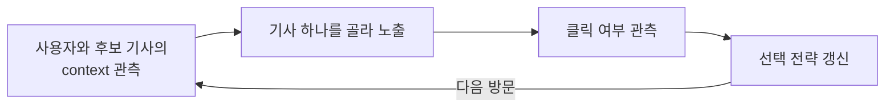
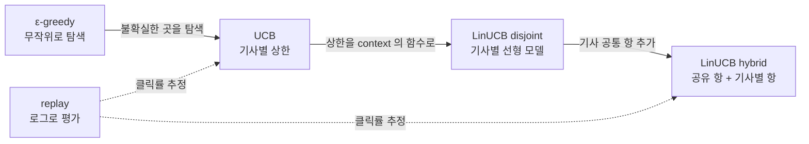
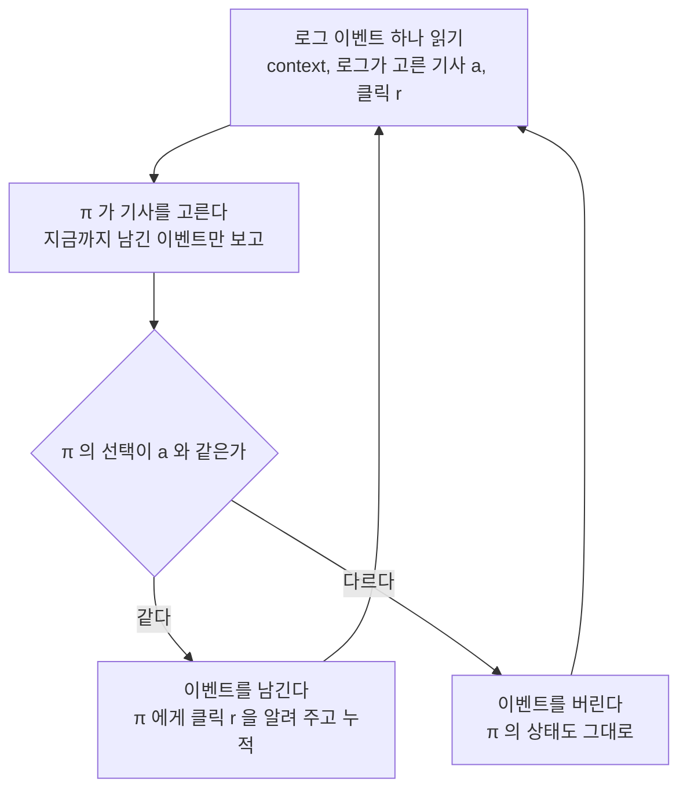

Yahoo! Labs 의 Lihong Li, Wei Chu, John Langford 와 Robert E. Schapire 가 WWW 2010 에 발표한 논문이다. contextual bandit 의 대표 알고리즘인 **LinUCB** 를 제안했고, 로그 데이터만으로 bandit 알고리즘을 편향 없이 평가하는 **replay** 방법을 함께 내놓았다.

# A) 핵심 요약

| 항목 | 내용 |
| --- | --- |
| 문제 | 기사가 계속 바뀌고 처음 온 사용자가 많아서, 과거 이력에 기대는 collaborative filtering 을 쓰기 어렵다 |
| 접근 | 사용자와 기사 정보를 보고 기사를 하나 고르고, 클릭 여부를 보고 바로 배운다 (contextual bandit) |
| 알고리즘 | LinUCB: 기사별 선형 회귀로 클릭률(CTR)을 예측하고, 예측이 불확실한 만큼 점수를 더 얹어 준다 |
| 평가 | 기사를 무작위로 보여 준 로그를 다시 재생(replay)해, 실제로 배포하지 않고도 클릭률을 편향 없이 추정한다 |
| 결과 | Yahoo! Front Page 로그에서 사용자 정보를 안 쓰는 ε-greedy 대비 클릭 12.5% 증가. 학습 데이터가 적을수록 차이가 커진다 |

- **덜 아는 곳을 골라 탐색한다.**
  - ε-greedy 는 아무 기사나 무작위로 보여 주며 탐색한다.
  - LinUCB 는 덜 본 사용자·기사 조합을 골라 탐색하므로 같은 노출로 더 빨리 배운다.
- **계산이 가볍다.**
  - 신뢰 구간을 닫힌 꼴(closed form)로 구한다.
  - 계산량은 기사 수에 선형, feature 차원에 최대 세제곱이다.
- **온라인 실험 없이 알고리즘을 비교했다.**
  - 무작위 노출 로그와 replay 만으로 여러 bandit 알고리즘의 클릭률을 추정했다.

# B) 용어와 예시

## B.1) 예시 상황

노트 전체에서 아래 상황 하나를 계속 쓴다. 후보 기사는 셋이고 사용자는 두 유형이다. 표의 값은 실제 클릭률이며, 알고리즘은 이 값을 모른 채 시작한다.

| 기사 | 스포츠 관심 사용자 | 정치 관심 사용자 | 전체 평균 (두 유형 반반) |
| --- | --- | --- | --- |
| A (스포츠) | 8% | 2% | 5% |
| B (정치) | 1% | 9% | 5% |
| C (연예) | 3% | 3% | 3% |

- **사용자를 안 보면 최선이 5% 다.**
  - 모두에게 같은 기사를 보여 줘야 하므로 A 나 B 중 하나를 고르게 된다.
- **사용자를 보면 8.5% 까지 오른다.**
  - 스포츠 관심 사용자에게 A, 정치 관심 사용자에게 B 를 보여 주면 (8% + 9%) / 2 = 8.5% 다.
  - 이 차이가 이 논문이 사용자 정보(context)를 쓰는 이유다.

## B.2) 용어

| 용어 | 뜻 | 예시 |
| --- | --- | --- |
| arm | 매번 고를 수 있는 선택지. 이 논문에서는 후보 기사 | 기사 A, B, C |
| trial | 한 번의 선택 기회. 이 논문에서는 사용자 한 명의 방문 | 정치 관심 사용자가 첫 화면에 들어온다 |
| context (feature 벡터 $\mathbf{x}_{t,a}$) | 고르기 전에 보이는 사용자·기사 정보를 숫자로 담은 벡터 | 스포츠 관심 사용자 → $(1, 0)$, 정치 관심 사용자 → $(0, 1)$ |
| 보상 (payoff) $r_{t,a}$ | 고른 뒤에 받는 값. 클릭하면 1, 아니면 0 | B 를 보여 줬더니 클릭했다 → 1 |
| 클릭률 (CTR) | 노출 대비 클릭 비율. 보상의 기대값과 같다 | 정치 관심 사용자의 B 클릭률 9% |
| context-free | context 를 보지 않고 기사마다 클릭률 하나만 추정하는 방식 | 모두에게 A 를 보여 준다 |
| exploit | 지금 가장 좋아 보이는 기사를 보여 준다 | 추정 클릭률이 가장 높은 A 를 보여 준다 |
| explore | 정보를 얻으려고 덜 아는 기사를 보여 준다 | 몇 번 안 보여 준 B 를 보여 준다 |
| regret | 매번 최선의 기사를 골랐을 때보다 덜 받은 클릭 수의 기대값 | 정치 관심 사용자에게 A 를 보여 주면 0.09 − 0.02 = 0.07 클릭 손해 |
| 신뢰 구간 · 상한 (UCB) | 실제 클릭률이 높은 확률로 들어 있는 범위와 그 위끝 | 예측 4.5%, 신뢰 구간 2.9–6.1%, 상한 6.1% |
| 불확실성 보너스 | 상한에서 예측을 뺀 값. 덜 본 기사·사용자 조합일수록 크다 | 6.1% − 4.5% = 1.6%p |
| 로그 정책 (logging policy) | 로그를 남길 때 기사를 고른 정책. 이 논문의 로그는 균등 무작위다 | 기사 셋 중 하나를 1/3 확률로 고른다 |
| off-policy evaluation | 다른 정책이 남긴 로그로 새 정책을 평가하는 문제 | 무작위 로그로 LinUCB 의 클릭률을 추정한다 |

# C) 문제 설정

## C.1) 뉴스 추천이 어려운 이유

- **콘텐츠 풀이 계속 바뀐다.**
  - 편집자가 기사를 수시로 넣고 뺀다.
  - 새 기사는 클릭 이력이 없어서 collaborative filtering 을 쓸 수 없다.
- **처음 온 사용자가 많다.**
  - 소비 이력이 전혀 없는 cold-start 사용자가 상당수다.
- **학습과 계산이 모두 빨라야 한다.**
  - 트래픽이 크고 기사의 가치가 시간에 따라 빠르게 변한다.
- **인기는 콘텐츠만 보고 알 수 없다.**
  - 실제로 보여 주고 반응을 받아 봐야 안다.
  - 그래서 새 기사에는 트래픽을 더 주어 빨리 배우고, 기존 기사에는 적게 주어 변화만 따라가야 한다.

## C.2) contextual bandit

[[Multi-Armed Bandit]] 은 보상 분포를 모르는 arm 여러 개 중 하나를 골라 보상을 받는 일을 반복하며 누적 보상을 최대화하는 문제다. contextual bandit 은 매 trial 마다 context 를 먼저 보여 준다. 한 trial 은 다음 순서로 돈다.

- **고르지 않은 기사의 보상은 모른다.**
  - 정치 관심 사용자에게 A 를 보여 주면, 같은 순간 B 를 보여 줬을 때 클릭했을지는 영영 모른다.
  - 정답이 다 주어지는 지도 학습과 가장 다른 점이고, explore 가 필요한 이유다.

목표는 $T$ 번의 trial 동안 받는 보상 합의 기대값을 최대화하는 것이다. 매번 기대 보상이 가장 큰 arm $a_t^*$ 를 골랐을 때와의 차이(regret)를 최소화하는 것과 같다.

$$
R_{\mathrm{A}}(T)\stackrel{\text{def}}{=}\mathbf{E}\left[\sum_{t=1}^{T}r_{t,a_{t}^{*}}\right]-\mathbf{E}\left[\sum_{t=1}^{T}r_{t,a_{t}}\right]
$$

## C.3) explore 와 exploit

- **exploit 만 하면 틀린 추정을 고칠 기회가 없다.**
  - 데이터가 적을 때는 지금 가장 좋아 보이는 기사가 실제로는 덜 좋을 수 있다.
- **explore 는 단기 손해와 장기 이득을 맞바꾼다.**
  - 덜 좋아 보이는 기사를 보여 주면 당장의 클릭은 줄 수 있다.
  - 대신 추정이 정확해져 장기 regret 이 줄어든다.

context-free bandit 의 대표 해법은 두 가지다.

| 방식 | 선택 규칙 | 탐색 대상 |
| --- | --- | --- |
| ε-greedy | 확률 $1-\epsilon$ 으로 추정 클릭률이 가장 높은 기사, 확률 $\epsilon$ 으로 무작위 기사 | 무작위. 이미 나쁘다고 아는 기사에도 노출을 쓴다 (unguided) |
| [[UCB]] (Upper Confidence Bound) | $\arg\max_{a}\left(\hat{\mu}_{t,a}+c_{t,a}\right)$: 추정 평균에 불확실성 보너스를 더한 상한이 가장 큰 기사 | 덜 본 기사. 노출이 적을수록 보너스 $c_{t,a}$ 가 크다 (guided) |

예시 상황을 context-free UCB 로 몇 번 돌린 뒤라고 하자.

![[img-641ba92a23.png|600]]

- 기사 A 는 예측 클릭률이 가장 높지만 노출이 많아 신뢰 구간이 좁다.
- 기사 B 는 예측 클릭률이 낮아도 노출이 적어 신뢰 구간이 넓고, 상한이 가장 높아 선택된다.
  - B 의 실제 평균 클릭률 5% 는 이 구간 안에 있다.
  - 예측 4.5% 는 노출이 적어 낮게 나온 값이다.
- B 를 보여 주면 신뢰 구간이 좁아진다.
  - 실제로 좋은 기사면 계속 선택되고, 아니면 상한이 내려가 다시 A 가 선택된다.
- 이 원칙을 optimism in the face of uncertainty 라고 부른다.
  - 모르는 기사는 좋을 수도 있다고 보고 기회를 준다.

**context-free UCB 는 잘 돌아가도 5% 에서 멈춘다.** 기사마다 클릭률 하나만 추정하므로 모든 사용자에게 같은 기사를 고른다. 8.5% 에 가려면 신뢰 구간을 context 의 함수로 구해야 하는데, 일반적인 모델에서는 이 계산이 비싸다. LinUCB 는 클릭률을 context 의 선형 함수로 두어 이것을 닫힌 꼴로 푼다.

# D) LinUCB

## D.1) 알고리즘 사이의 관계

이 노트에 나오는 알고리즘은 한 줄로 이어진다. replay 는 알고리즘이 아니라 이들을 평가하는 방법이다.

| 알고리즘 | context 사용 | 탐색 방식 | 기사 사이 학습 공유 |
| --- | --- | --- | --- |
| ε-greedy | 안 씀 | 무작위 | 없음 |
| UCB | 안 씀 | 불확실성 보너스 | 없음 |
| LinUCB disjoint | 기사별 선형 모델 | 불확실성 보너스 | 없음 |
| LinUCB hybrid | 공유 항 + 기사별 선형 모델 | 불확실성 보너스 | 공유 항으로 옮겨 간다 |

## D.2) 핵심 아이디어

기사의 점수를 **예측 클릭률 + 불확실성 보너스** 로 매기고, 점수가 가장 높은 기사를 고른다.

$$
a_{t}=\arg\max_{a\in\mathcal{A}_{t}}\left(\underbrace{\mathbf{x}_{t,a}^{\top}\hat{\boldsymbol{\theta}}_{a}}_{\text{예측 클릭률}}+\underbrace{\alpha\sqrt{\mathbf{x}_{t,a}^{\top}\mathbf{A}_{a}^{-1}\mathbf{x}_{t,a}}}_{\text{불확실성 보너스}}\right)
$$

- **첫 항은 exploit 이다.**
  - 지금까지의 데이터로 학습한 선형 모델이 이 사용자에게 예측한 클릭률이다.
- **둘째 항은 explore 이다.**
  - 이 기사를 이 사용자와 비슷한 사용자에게 얼마나 덜 보여 줬는지를 나타낸다.
  - 비슷한 사용자에게 많이 보여 준 기사일수록 작아진다.
- **$\alpha$ 가 두 항의 비율을 정한다.**
  - 클수록 탐색을 많이 한다.
  - 이론값 $\alpha=1+\sqrt{\ln(2/\delta)/2}$ 는 실제로는 보수적으로 클 수 있다.
  - 그래서 논문은 튜닝 데이터로 $\alpha$ 를 골랐다.

context-free UCB 의 "노출이 적을수록 보너스가 크다" 를 "이런 유형의 사용자에게 덜 보여 줬을수록 보너스가 크다" 로 넓힌 것이다.

## D.3) disjoint 모델

기사마다 별도의 선형 모델을 둔다. 기사 사이에 파라미터를 공유하지 않아서 disjoint 라 부른다.

$$
\mathbf{E}\left[r_{t,a}\mid\mathbf{x}_{t,a}\right]=\mathbf{x}_{t,a}^{\top}\boldsymbol{\theta}_{a}^{*}
$$

**학습은 기사별 [[ridge regression]] 이다.** 기사 $a$ 를 보여 준 $m$ 번의 context 를 행으로 쌓은 design matrix $\mathbf{D}_{a}$ ($m\times d$) 와 클릭 여부 벡터 $\mathbf{c}_{a}$ 로 계수를 추정한다.

$$
\hat{\boldsymbol{\theta}}_{a}=\left(\mathbf{D}_{a}^{\top}\mathbf{D}_{a}+\mathbf{I}_{d}\right)^{-1}\mathbf{D}_{a}^{\top}\mathbf{c}_{a}
$$

**신뢰 구간도 같은 행렬로 나온다.** $\mathbf{c}_{a}$ 의 원소가 $\mathbf{D}_{a}$ 의 행이 주어졌을 때 서로 독립이면, 확률 $1-\delta$ 이상으로 다음이 성립한다.

$$
\left|\mathbf{x}_{t,a}^{\top}\hat{\boldsymbol{\theta}}_{a}-\mathbf{E}\left[r_{t,a}\mid\mathbf{x}_{t,a}\right]\right|\leq\alpha\sqrt{\mathbf{x}_{t,a}^{\top}\left(\mathbf{D}_{a}^{\top}\mathbf{D}_{a}+\mathbf{I}_{d}\right)^{-1}\mathbf{x}_{t,a}}
$$

$\mathbf{A}_{a}=\mathbf{D}_{a}^{\top}\mathbf{D}_{a}+\mathbf{I}_{d}$ 로 두면 이 상한이 D.2 의 선택 규칙이 된다.

**예시로 불확실성 보너스를 손으로 계산해 보자.** 기사 B 를 지금까지 스포츠 관심 사용자 $(1, 0)$ 에게만 9번 보여 줬고, 그중 1번 클릭이 나왔다고 하자. $\alpha = 1$ 로 둔다.

| 값 | 계산 | 결과 |
| --- | --- | --- |
| $\mathbf{A}_{B}$ | $\mathbf{I}_2 + 9 \cdot (1,0)^{\top}(1,0)$ | $\begin{pmatrix}10 & 0\\ 0 & 1\end{pmatrix}$ |
| $\hat{\boldsymbol{\theta}}_{B}$ | $\mathbf{A}_{B}^{-1}\,(1, 0)^{\top}$ | $(0.1,\ 0)$ |
| 스포츠 관심 사용자의 점수 | 예측 $0.1$ + 보너스 $\sqrt{1/10}$ | $0.1 + 0.32 = 0.42$ |
| 정치 관심 사용자의 점수 | 예측 $0$ + 보너스 $\sqrt{1}$ | $0 + 1.0 = 1.0$ |

- **정치 관심 사용자에게는 B 의 예측이 0 이지만 보너스가 크다.**
  - 정치 관심 사용자에게 B 를 보여 준 적이 한 번도 없어서다.
  - 그래서 B 를 정치 관심 사용자에게 보여 줄 이유가 생기고, 실제 클릭률 9% 를 곧 배운다.
- **보너스 $\sqrt{\mathbf{x}^{\top}\mathbf{A}_{a}^{-1}\mathbf{x}}$ 는 "이 방향의 사용자를 얼마나 봤나" 를 잰다.**
  - $\mathbf{A}_{a}$ 는 기사 $a$ 를 본 사용자들의 context 를 누적한 행렬이다.
  - 자주 본 방향으로는 $\mathbf{A}_{a}$ 가 커지고, 역행렬 $\mathbf{A}_{a}^{-1}$ 은 그 방향으로 작아진다.
- **베이지안으로 보면 예측 클릭률의 표준편차다.**
  - $\boldsymbol{\theta}_{a}$ 의 사후 분포는 평균 $\hat{\boldsymbol{\theta}}_{a}$, 공분산 $\mathbf{A}_{a}^{-1}$ 인 가우시안이다.
  - 이때 $\mathbf{x}^{\top}\boldsymbol{\theta}_{a}$ 의 분산이 $\mathbf{x}^{\top}\mathbf{A}_{a}^{-1}\mathbf{x}$ 다.

전체 알고리즘은 다음과 같다.

![[img-daf0afaca1.png|500]]

- **기사마다 $\mathbf{A}_{a}$ ($d\times d$) 와 $\mathbf{b}_{a}$ ($d$ 차원) 만 들고 있으면 된다.**
  - 새 기사는 $\mathbf{A}_{a}=\mathbf{I}_{d}$, $\mathbf{b}_{a}=\mathbf{0}$ 으로 시작한다 (4–7행).
- **방문마다 후보 기사 전부의 점수 $p_{t,a}$ 를 계산해 가장 큰 기사를 고른다** (8–11행).
- **고른 기사의 통계만 갱신한다.**
  - $\mathbf{A}_{a_t}$ 에 $\mathbf{x}\mathbf{x}^{\top}$ 를, $\mathbf{b}_{a_t}$ 에 $r_t\mathbf{x}$ 를 더한다 (12–13행).
  - 과거 데이터를 다시 훑지 않고 누적 합만 더하면 된다.
  - 위 예시의 $\mathbf{b}_{B} = (1, 0)$ 은 클릭 1번의 $r_t\mathbf{x} = 1 \cdot (1, 0)$ 을 더한 값이다.

## D.4) hybrid 모델

disjoint 모델에서는 기사 B 에서 배운 것이 다른 기사로 넘어가지 않는다. 기사가 많고 기사당 노출이 적으면 학습이 느리다. hybrid 모델은 모든 기사가 공유하는 항을 더해 이 문제를 줄인다.

$$
\mathbf{E}\left[r_{t,a}\mid\mathbf{x}_{t,a}\right]=\mathbf{z}_{t,a}^{\top}\boldsymbol{\beta}^{*}+\mathbf{x}_{t,a}^{\top}\boldsymbol{\theta}_{a}^{*}
$$

| 항 | feature | 계수 | 학습 대상 |
| --- | --- | --- | --- |
| 공유 항 | $\mathbf{z}_{t,a}\in\mathbb{R}^{k}$: 사용자·기사 조합의 feature | $\boldsymbol{\beta}^{*}$: 모든 기사가 공유 | "정치 관심 사용자 × 정치 기사" 처럼 기사를 넘어 통하는 규칙 |
| 기사별 항 | $\mathbf{x}_{t,a}\in\mathbb{R}^{d}$ | $\boldsymbol{\theta}_{a}^{*}$: 기사마다 따로 | 그 기사만의 특성 |

- **새 기사도 첫 노출부터 공유 항을 쓴다.**
  - 예시에 정치 기사 D 가 새로 들어왔다고 하자.
  - disjoint 모델은 D 를 아무것도 모르는 상태에서 시작한다.
  - hybrid 모델은 B 에서 배운 "정치 관심 사용자 × 정치 기사" 계수를 D 에 바로 쓴다.
  - 실험에서 데이터가 적을 때 hybrid 가 가장 좋았던 이유다 (F.3).
- **신뢰 구간 계산이 조금 복잡해진다.**
  - 공유 항 때문에 기사별 신뢰 구간이 서로 독립이 아니다.
  - 논문은 block 행렬 역행렬로 푼 의사 코드(Algorithm 2)만 싣고 유도는 생략했다.
  - 기사별 통계에 더해 공유 통계 $\mathbf{A}_{0}$ ($k\times k$), $\mathbf{b}_{0}$ 와 기사별 $\mathbf{B}_{a}$ ($d\times k$) 를 들고 있으면 된다.

## D.5) 계산 비용과 이론적 성질

- **계산량은 기사 수에 선형, feature 차원 $d$ 에 최대 세제곱이다.**
  - $\mathbf{A}_{a}$ 는 매번 $O(d^2)$ 로 갱신하고, 역행렬은 주기적으로만 다시 계산해 캐시하면 더 줄어든다.
  - hybrid 도 모든 행렬 크기가 고정이라 같은 방식으로 trial 당 $O(d^2+k^2)$ 까지 줄인다.
- **기사 풀이 바뀌어도 그대로 돈다.**
  - 새 기사는 단위 행렬로 시작하고, 빠진 기사의 통계는 계산에서 빠진다.
- **regret 은 $\tilde{O}(\sqrt{KdT})$ 다.**
  - arm 이 $K$ 개로 고정된 경우다.
  - 같은 선형 가정에서 당시 최고 결과(LinRel)와 같은 수준이다.
  - 논문의 주제가 아니어서 기존 분석을 가져와 보일 수 있다고만 적었다.

# E) 오프라인 평가 (replay)

## E.1) 로그로 평가하기 어려운 이유

- **로그에는 그때 고른 기사의 보상만 있다.**
  - 평가할 정책 $\pi$ 가 다른 기사를 고르면 그 결과를 알 수 없다.
  - 강화 학습의 off-policy evaluation 문제의 특수한 경우다.
- **온라인 실험은 비용이 크다.**
  - 알고리즘마다 실제 트래픽을 나눠 주기 어렵다.
- **시뮬레이터는 편향된다.**
  - 로그로 사용자 반응 모델을 만들어 그 위에서 평가하면, 모델링 오차가 평가 결과에 그대로 들어간다.

## E.2) replay 방법

전제는 두 가지다.

- 방문 하나하나(이벤트)가 [[i.i.d.]] 다.
- 로그 정책이 매번 기사를 **균등 무작위**로 골랐다.

로그를 순서대로 읽으며 평가할 정책 $\pi$ 에게 같은 상황을 보여 준다. 로그와 같은 기사를 고른 이벤트만 남긴다.

예시 상황의 무작위 로그 6건에 replay 를 돌리면 다음과 같다.

| 방문 | 사용자 | 로그가 고른 기사 | 클릭 | $\pi$ 가 고른 기사 | 처리 |
| --- | --- | --- | --- | --- | --- |
| 1 | 스포츠 관심 | A | 1 | A | 남김 |
| 2 | 정치 관심 | A | 0 | B | 버림 |
| 3 | 정치 관심 | B | 1 | B | 남김 |
| 4 | 스포츠 관심 | C | 0 | A | 버림 |
| 5 | 스포츠 관심 | A | 0 | A | 남김 |
| 6 | 정치 관심 | C | 0 | B | 버림 |

- **남긴 3건의 평균 클릭 2/3 이 $\pi$ 의 클릭률 추정값이다.**
  - Algorithm 3 의 출력 $R_T/T$ 에 해당한다.
  - 실제로는 이벤트가 수천만 건이라 추정값이 안정된다.
- **버린 이벤트는 $\pi$ 에게도 보여 주지 않는다.**
  - $\pi$ 는 자기가 고른 기사의 결과만 보고 배운다.
  - 실제 서비스에 배포했을 때와 같은 조건이다.

![[img-6687f1ec5b.png|600]]

## E.3) 편향이 없는 이유

- **어떤 이벤트가 남을 확률은 항상 $1/K$ 다.**
  - 로그 정책이 $K$ 개 기사 중 하나를 균등 무작위로 골랐기 때문이다.
  - 예시는 $K = 3$ 이라 평균 세 건 중 한 건이 남는다.
  - 이 확률은 정책·이력·context 와 무관하다.
  - 그래서 남은 이벤트는 원래 분포 $D$ 에서 뽑은 것과 분포가 같다.
- **replay 로 만든 이력과 실제 배포에서 생길 이력의 분포가 같다 (Theorem 1).**
  - $S$ 는 균등 무작위 로그 정책과 $D$ 에서 i.i.d. 로 뽑은 이벤트 스트림이다.

![[img-7eb181b680.png|400]]

- **그래서 $R_T/T$ 는 $\pi$ 의 클릭률의 불편 추정량이다.**
- **대가는 데이터다.**
  - $T$ 개를 남기려면 평균 $KT$ 개의 이벤트가 필요하다.
- **로그 정책이 균등 무작위가 아니어도 된다.**
  - 무작위 정책이기만 하면 rejection sampling 으로 고쳐 쓸 수 있다.
  - 다만 데이터 효율이 더 떨어진다.
- **로그 정책이 결정적(deterministic)이면 쓸 수 없다.**
  - 로그가 고르지 않는 기사는 영영 남지 않아서, $\pi$ 가 그 기사를 고르는 상황을 평가할 수 없다.

# F) 실험

## F.1) 실험 설정

- **서비스는 Yahoo! Front Page 의 Today Module 이다.**
  - 편집자가 매시간 갱신하는 기사 풀에서 4개를 하단(F1–F4)에 보여 주고, 그중 하나를 큰 story 위치에 띄운다.
  - 노출 위치에 따른 편향을 피하려고 F1 기사가 story 위치에 뜬 경우의 클릭만 썼다.
- **데이터는 2009년 5월의 random bucket 로그다.**
  - 방문 단위로 일부 사용자를 뽑아 기사를 균등 무작위로 보여 준 트래픽이다.

| 구분 | 기간 | 이벤트 수 | 용도 |
| --- | --- | --- | --- |
| tuning data | 2009-05-01 | 약 470만 | 알고리즘별 파라미터($\epsilon$, $\alpha$) 선택 |
| evaluation data | 2009-05-03 – 05-09 | 약 3,600만 | 최종 비교 |

- **context 는 사용자 군집 소속도로 6차원까지 줄였다.**
  - 저장·조회 비용 때문에 작은 feature 를 일부러 골랐다.
  - 원시 feature 는 사용자가 인구통계·지역·행동 범주 등 1,000개 이상, 기사가 URL·편집자 범주 약 100개다.
  - 2008년 9월 무작위 로그로 사용자·기사 feature 의 bilinear logistic regression 을 학습하고, 이 공간에서 사용자를 K-means 로 5개 군집에 묶었다.
  - disjoint 모델의 $\mathbf{x}_{t,a}$ 는 5개 군집 소속도에 상수 1 을 더한 6차원이다.
  - hybrid 모델의 $\mathbf{z}_{t,a}$ 는 같은 방식으로 만든 기사 6차원과 사용자 6차원의 외적, 36차원이다.
- **지표는 random 정책 대비 상대 클릭률이다.**
  - 실제 클릭률은 영업 정보라 공개하지 않았다.

클릭률은 두 bucket 에서 따로 잰다. 둘 다 replay 로 추정했다.

| bucket | 역할 | 클릭률의 의미 |
| --- | --- | --- |
| deployment | 학습된 추정값으로 가장 좋은 기사를 서빙하는 큰 트래픽 | 실제 서비스 성과. 더 중요하다 |
| learning | bandit 알고리즘이 탐색하며 배우는 작은 트래픽 | 학습 속도. 높을수록 regret 이 작다 |

## F.2) 비교 알고리즘

| 구분 | 알고리즘 | context 사용 방식 |
| --- | --- | --- |
| context-free | random, ε-greedy, ucb, omniscient | 쓰지 않는다 |
| 사용자 군집별 | ε-greedy (seg), ucb (seg) | 5개 군집마다 알고리즘을 따로 돌린다 |
| 선형 모델 | ε-greedy (disjoint), linucb (disjoint), ε-greedy (hybrid), linucb (hybrid) | feature 의 계수를 온라인으로 학습한다 |

- **omniscient 는 context-free 정책의 상한이다.**
  - 전체 로그를 미리 보고 클릭률이 가장 높은 기사 하나를 늘 고른다.
  - 예시 상황에서는 5% 에 해당한다.
  - 평가 데이터에서 상대 클릭률 1.615 였다.
- **오프라인 모델로 초기화한 warm start 변형은 최종 비교에서 뺐다.**
  - 튜닝 데이터에서 성능이 불안정했다.

## F.3) 결과

평가 데이터의 상대 클릭률이다 (random = 1). 괄호는 ε-greedy 대비 증가율이다. 1% 는 알고리즘이 학습에 쓰는 데이터만 1% 로 줄인 조건이고, 평가는 전체 데이터로 한다. 열마다 가장 높은 값을 굵게 표시했다.

| 알고리즘 | deployment (100%) | learning (100%) | deployment (1%) | learning (1%) |
| --- | --- | --- | --- | --- |
| ε-greedy | 1.596 | 1.326 | 1.234 | 1.139 |
| ucb | 1.594 (0%) | 1.569 (+18.3%) | 1.354 (+9.7%) | 1.220 (+7.1%) |
| ε-greedy (seg) | 1.742 (+9.1%) | 1.446 (+9%) | 1.245 (+0.9%) | 1.072 (−5.8%) |
| ucb (seg) | 1.781 (+11.6%) | **1.677** (+26.5%) | 1.398 (+13.3%) | 1.250 (+9.7%) |
| ε-greedy (disjoint) | 1.769 (+10.8%) | 1.309 (−1.2%) | 1.262 (+2.3%) | 1.183 (+3.9%) |
| linucb (disjoint) | **1.795** (+12.5%) | 1.647 (+24.2%) | 1.382 (+12%) | 1.197 (+5.1%) |
| ε-greedy (hybrid) | 1.739 (+9%) | 1.521 (+14.7%) | 1.342 (+8.8%) | 1.200 (+5.4%) |
| linucb (hybrid) | 1.730 (+8.4%) | 1.663 (+25.4%) | **1.482** (+20.1%) | **1.446** (+27%) |

- **context 를 쓰면 deployment 클릭률이 약 10% 오른다.**
  - context 를 쓴 6개 알고리즘 모두 ε-greedy 대비 +8.4% 이상이다.
  - 모두 사용자마다 다른 기사를 골라야만 넘을 수 있는 omniscient(1.615)를 넘었다.
  - 예시 상황에서 5% 를 넘어 8.5% 쪽으로 가는 것과 같은 현상이다.
  - disjoint 모델에서는 한 기사의 클릭률이 132% 오르기도 했다 (기본 클릭률 1.31 → 3.03).
- **UCB 계열이 같은 context 를 쓰는 ε-greedy 계열보다 대체로 낫다.**
  - learning 에서는 표의 두 조건 모두 UCB 쪽이 높다.
  - 논문의 다른 데이터 비율(30%, 20%, 10%, 5%)까지 보면 learning 에서 linucb (disjoint) 만 두 번 뒤졌다.
  - deployment 에서는 데이터가 넉넉하면 비슷하고, 1% 조건에서는 네 짝 모두 UCB 쪽이 높다.
  - ε-greedy 는 무작위로 탐색하고, UCB 는 불확실한 곳으로 탐색하기 때문이다.
- **데이터가 적을수록 hybrid 가 돋보인다.**
  - 1% 조건에서 linucb (hybrid) 가 deployment·learning 모두 1위다.
  - 공유 항 $\boldsymbol{\beta}$ 를 통해 한 기사에서 배운 것이 다른 기사로 옮겨 간다.
  - 1% 조건은 기사 풀이 커서 기사당 노출이 적은 상황을 흉내 낸 것이다.
- **ucb (seg) 와 linucb (disjoint) 는 성능이 비슷하다.**
  - disjoint 모델의 context 가 군집 소속도라서, 군집에 하나씩 배정하는 seg 와 거의 같다.
  - 가장 가까운 군집의 소속도가 0.5 를 넘는 사용자가 약 85% 였다.
  - 저자들은 PCA 처럼 성분이 다양한 feature 를 더 넣어야 둘의 차이가 벌어질 것으로 봤다.
- **$\epsilon$·$\alpha$ 는 너무 작아도 커도 손해다.**
  - 튜닝 데이터에서 learning 클릭률이 파라미터에 대해 뒤집힌 U자 모양이었다.
  - 작으면 좋은 기사를 못 찾고, 크면 탐색에 노출을 낭비한다.

# G) 관련 노트와 후속 과제

- LinUCB 의 가정 위반 등 한계는 [[LinUCB]] 에 정리돼 있다.
- LinUCB 를 추천에 적용한 예시는 [[Recommender systems using LinUCB - A contextual multi-armed bandit approach]] 에 있다.
- 로그로 정책을 학습하는 문제는 [[batch learning with logged bandit feedback, BLBF]] 를 본다.
- 저자들이 꼽은 다음 과제는 셋이다.
  - 광고처럼 비슷한 다른 웹 서비스에 적용한다.
  - arm 이 기사 하나가 아니라 검색 결과 순위처럼 복잡한 객체인 경우로 넓힌다.
  - 시간에 따라 변하는 사용자 관심을 반영한다.

# H) References

[paper Link](https://arxiv.org/pdf/1003.0146.pdf)
