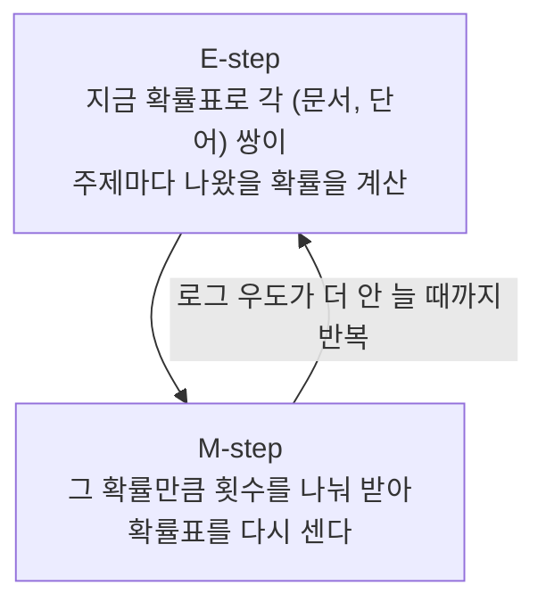

**PLSI 는 "문서가 어떤 주제를 섞어 쓰고, 그 주제가 어떤 단어를 자주 쓰는가" 를 확률로 배우는 모델이다** (Hofmann 1999). PLSA 라고도 부르고, 논문은 aspect model 이라 부른다.

- 관측하는 것은 문서 $d$ 에 단어 $w$ 가 몇 번 나왔는가, 즉 공동 출현 횟수 $n(d, w)$ 뿐이다.
- 그 사이에 눈에 안 보이는 주제 $z$ 가 있다고 가정한다. 문서는 주제를 섞고, 단어는 주제에서 나온다.

$$
P(w \mid d) = \sum_{z} P(w \mid z)\, P(z \mid d)
$$

- 같은 모델을 베이즈 정리로 뒤집으면 $P(d, w) = \sum_z P(z)\, P(d \mid z)\, P(w \mid z)$ 꼴이 된다.
- [[machine_learning/probabilistic_models/EM algorithm|EM]] 으로 학습한다.
	- E-step: 각 (문서, 단어) 쌍이 어느 주제에서 나왔을지 확률로 나눈다.
	- M-step: 나눠 받은 횟수로 확률표 $P(w \mid z)$, $P(z \mid d)$ 를 다시 센다.
- 추천에서는 문서를 사용자로, 단어를 아이템으로 바꾼다. $P(\text{아이템} \mid \text{사용자})$ 가 추천 점수가 된다 (Hofmann 2004).
- 문서마다 $P(z \mid d)$ 를 따로 외우는 것이 약점이다.
	- 학습에 없던 새 문서를 다룰 방법이 모델 안에 없고, 학습 데이터에 과적합되기 쉽다.
	- [[papers/collaborative_filtering/Latent Dirichlet Allocation|LDA]] 가 $P(z \mid d)$ 에 사전분포를 두어 이 문제를 푼다.

# A) 풀려는 문제: 같은 단어, 다른 뜻

기사 두 편이 있다고 하자. 한 편은 스포츠 기사, 한 편은 경제 기사다. 단어 세 개가 몇 번 나왔는지 센다.

| 문서 | 축구 | 경기 | 주가 |
| --- | --- | --- | --- |
| 스포츠 기사 | 4 | 2 | 0 |
| 경제 기사 | 0 | 2 | 4 |

**"경기" 는 두 기사에 똑같이 두 번 나오지만 뜻이 다르다.**

- 스포츠 기사의 경기는 시합이고, 경제 기사의 경기는 경기 침체의 경기다.
- 단어가 겹치는지만 보는 검색은 둘을 구분하지 못한다. "경기" 로 검색하면 두 기사가 똑같이 걸린다.
- 단어 하나가 여러 뜻을 갖는 것을 다의어(polysemy)라 한다. Hofmann 이 PLSI 로 풀려던 문제가 이것이다.

**PLSI 는 단어와 문서 사이에 주제를 하나 끼워 넣어 이 문제를 푼다.**

- 스포츠 기사는 스포츠 주제를 주로 쓰고, 경제 기사는 경제 주제를 주로 쓴다.
- 그러면 같은 "경기" 라도 스포츠 기사 안에서는 스포츠 주제에서 나온 것으로 읽힌다.
- 이보다 먼저 [[Latent Semantic Analysis|LSI]] 가 SVD 로 같은 일을 했다. PLSI 는 그것을 확률 모델로 다시 만든 것이다. 둘의 차이는 뒤의 비교 절에서 다룬다.

# B) 모델: 문서 → 주제 → 단어

**PLSI 는 문서가 다음 순서로 만들어진다고 가정한다** (Hofmann 1999).

1. 문서 $d$ 를 고른다. 확률은 $P(d)$ 다.
2. 그 문서에서 주제 $z$ 를 하나 고른다. 확률은 $P(z \mid d)$ 다.
3. 그 주제에서 단어 $w$ 를 하나 고른다. 확률은 $P(w \mid z)$ 다.

단어 하나를 쓸 때마다 2, 3 을 반복한다. 우리가 보는 것은 (문서, 단어) 쌍뿐이고 주제는 버려진다. 그래서 잠재 변수(latent variable)다.

![[img-f58c1fdebc.png]]

- 그림 (a) 가 위의 순서다.
- 그림 (b) 는 주제를 먼저 고르고, 그 주제에서 문서와 단어를 따로 고르는 순서다.
- 베이즈 정리로 $P(d)P(z \mid d) = P(z)P(d \mid z)$ 이므로 두 그림은 같은 모델이다. 학습 결과도 같다.

**문서는 주제 하나에 속하지 않고 여러 주제를 섞는다.**

- 스포츠 기사가 스포츠 90 %, 경제 10 % 라고 하자. 스포츠 주제는 주가를 0.1 확률로, 경제 주제는 0.5 확률로 쓴다고 하자.
- 그러면 이 기사에 주가가 나올 확률은 0.9 × 0.1 + 0.1 × 0.5 = 0.14 다.
- 주가가 이 기사에 한 번도 안 나왔어도 확률이 생긴다. 이 문서가 쓰는 주제가 주가를 가끔 쓰기 때문이다.
- 문서를 군집 하나에 넣는 클러스터링과 다른 점이 이것이다. Hofmann 은 섞는 비율 $P(z \mid d)$ 가 클러스터링보다 표현력이 크다고 강조한다.

**모델에는 가정이 둘 있다.**

- (문서, 단어) 쌍은 서로 독립으로 나온다. 단어 순서를 무시하는 bag-of-words 가정이다.
- 주제가 정해지면 단어는 문서와 상관없이 나온다. 어느 기사든 스포츠 주제가 고른 단어는 같은 분포를 따른다.

**주제 수 $K$ 는 문서 수보다 훨씬 적게 잡는다.**

- 주제가 문서와 단어 사이의 좁은 통로 역할을 해야 공통 패턴이 뽑힌다. 논문은 이를 병목(bottleneck)이라 부른다.
- 주제 수가 문서 수만큼 많으면 문서마다 주제 하나씩 차지하고 본 것을 그대로 외운다. 아래 예시가 그렇게 된다.

**좋은 확률표란 관측된 횟수를 가장 그럴듯하게 만드는 확률표다.**

- 모든 (문서, 단어) 쌍에 대해 "횟수 × log 확률" 을 더한 값, 즉 로그 우도(log-likelihood)를 최대로 만든다.
- 많이 나온 쌍일수록 모델이 높은 확률을 주도록 맞춰진다.

# C) 학습: EM

**각 단어가 어느 주제에서 나왔는지 알면 학습은 그냥 세기다.**

- 스포츠 기사의 축구 네 번이 전부 스포츠 주제에서 나왔다는 것을 안다고 하자.
- 그러면 $P(\text{축구} \mid \text{스포츠})$ 는 스포츠 주제가 쓴 단어 중 축구의 비율로 바로 센다.
- 문제는 주제를 모른다는 것이다.

**그래서 주제를 추측하고(E), 추측대로 세고(M), 다시 추측한다.** 이것이 EM 이다.

E-step 은 베이즈 정리다. 문서 $d$ 의 단어 $w$ 가 주제 $z$ 에서 나왔을 확률은 다음과 같다.

$$
P(z \mid d, w) = \frac{P(z \mid d)\, P(w \mid z)}{\sum_{z'} P(z' \mid d)\, P(w \mid z')}
$$

- 분자는 "이 문서가 주제 $z$ 를 고를 확률 × 주제 $z$ 가 이 단어를 고를 확률" 이다.
- 분모는 모든 주제에 대한 분자의 합이라, 주제끼리 나눠 가진 몫의 합이 1 이 된다.

M-step 은 그 몫으로 다시 센다.

- $P(w \mid z)$: 모든 문서에서 단어 $w$ 가 주제 $z$ 에 나눠 준 횟수를 모으고, 주제 $z$ 가 받은 전체 횟수로 나눈다.
- $P(z \mid d)$: 문서 $d$ 의 모든 단어가 주제 $z$ 에 나눠 준 횟수를 모으고, 문서 $d$ 의 단어 수로 나눈다.

**EM 은 매 반복마다 로그 우도가 줄지 않는다. 하지만 시작값에 따라 다른 지점에 멈춘다** (Hofmann 1999, local maximum). 실제로는 무작위 시작값으로 여러 번 돌린다.

# D) Step by Step 예시

A 절의 기사 두 편, 단어 세 개에 주제 두 개로 EM 을 돌려 본다.

**시작값을 정한다.**

- 실제로는 무작위로 시작한다. 여기서는 주제 이름을 붙이기 쉽게 처음부터 조금 기운 값을 쓴다.
- 두 기사 모두 주제를 반반 쓴다고 시작한다. $P(z \mid d) = 0.5$.

| 주제 | 축구 | 경기 | 주가 |
| --- | --- | --- | --- |
| 스포츠 | 0.5 | 0.4 | 0.1 |
| 경제 | 0.1 | 0.4 | 0.5 |

이 시작값의 로그 우도는 −13.30 이다.

**E-step 1: 각 단어가 스포츠 주제에서 나왔을 확률을 구한다.**

- 축구: 스포츠 쪽은 0.5 × 0.5 = 0.25, 경제 쪽은 0.5 × 0.1 = 0.05 다. 스포츠 몫은 0.25 / 0.30 = 0.833 이다.
- 경기: 양쪽 모두 0.5 × 0.4 = 0.2 라 스포츠 몫은 0.5 다.
- 주가: 스포츠 쪽 0.05, 경제 쪽 0.25 라 스포츠 몫은 0.167 이다.
- 두 기사의 $P(z \mid d)$ 가 같으므로, 지금은 어느 기사에서든 같은 값이다.

**M-step 1: 몫만큼 횟수를 나눠 받아 다시 센다.**

먼저 $P(z \mid d)$ 다.

- 스포츠 기사에서 스포츠 주제가 받은 횟수는 축구 4 × 0.833 = 3.33 과 경기 2 × 0.5 = 1 을 더한 4.33 이다.
- 기사의 단어는 6 개이므로 $P(\text{스포츠} \mid \text{스포츠 기사}) = 4.33 / 6 = 0.722$ 다.
- 경제 기사는 거꾸로 $P(\text{스포츠} \mid \text{경제 기사}) = 0.278$ 이다.

다음은 $P(w \mid z)$ 다. 스포츠 주제가 받은 횟수를 단어별로 모은다.

- 축구: 스포츠 기사에서 3.33, 경제 기사에서 0. 합 3.33.
- 경기: 두 기사에서 1 씩. 합 2.
- 주가: 경제 기사의 주가 4 번 중 0.167 몫인 0.67.
- 합이 6 이므로 스포츠 주제는 축구 0.556, 경기 0.333, 주가 0.111 이 된다. 경제 주제는 거꾸로 0.111, 0.333, 0.556 이다.

로그 우도는 −13.30 에서 −11.11 로 늘었다. 데이터를 더 잘 설명하는 확률표가 됐다.

**E-step 2: 같은 "경기" 가 기사마다 다른 주제로 해석되기 시작한다.**

- 스포츠 기사의 경기: 스포츠 쪽 0.722 × 0.333, 경제 쪽 0.278 × 0.333 이다. 스포츠 몫은 0.722 다.
- 경제 기사의 경기: 같은 계산에서 스포츠 몫은 0.278 이다. 경제 몫이 0.722 다.
- 첫 E-step 에서는 두 기사 모두 0.5 였다. 단어 "경기" 만 보면 정할 수 없었는데, 같은 기사의 다른 단어(축구, 주가)가 기사의 주제를 정해 주면서 경기의 해석도 정해졌다.

**이것이 PLSI 가 다의어를 다루는 방식이다.**

- 단어 하나의 주제는 그 단어 혼자가 아니라 같은 문서의 다른 단어들이 함께 정한다.
- Hofmann 도 같은 장면을 보인다. "UN" 은 혼자서는 보스니아 주제에 가깝지만, aid · food · medical 과 함께 나온 질의에서는 르완다 주제로 해석된다.

아래 그림은 반복을 계속할 때의 변화다. 왼쪽은 단어 "경기" 가 스포츠 주제에서 나왔을 확률을 기사별로 그렸다. 오른쪽은 스포츠 기사에 한 번도 안 나온 "주가" 에 모델이 주는 확률 $P(\text{주가} \mid \text{스포츠 기사})$ 다.

![[img-012753593c.png]]

**끝까지 돌리면 안 나온 단어의 확률이 0 이 된다.**

- $P(\text{주가} \mid \text{스포츠 기사})$ 는 0.300 → 0.235 → 0.128 → 0.044 로 줄다가 0 이 된다.
- 다 수렴하면 스포츠 기사는 스포츠 주제 100 %, 스포츠 주제는 축구 0.667 · 경기 0.333 · 주가 0 이다. 로그 우도는 −7.64 다.
- 주제 수(2)가 문서 수(2)와 같아서, 기사마다 주제 하나를 통째로 차지하고 본 횟수를 그대로 외웠다.

**이것이 PLSI 의 과적합이다.**

- 실제 데이터는 주제 수가 문서 수보다 훨씬 적어서 이렇게까지 극단적이지는 않다. 하지만 학습 데이터에 맞춰 안 본 조합의 확률을 깎는 방향은 같다.
- Hofmann 은 이를 막으려고 tempered EM 을 제안했다. E-step 에서 우도 쪽의 영향을 줄이고, 분리해 놓은 validation 데이터의 성능이 떨어지면 멈춘다 (식은 부록).

# E) 추천에서의 PLSI

**문서를 사용자로, 단어를 아이템으로 바꾸면 계산이 한 글자도 안 바뀐다.**

| 텍스트 | 추천 |
| --- | --- |
| 문서 $d$ | 사용자 $u$ |
| 단어 $w$ | 아이템 $i$ |
| 문서에 단어가 나온 횟수 $n(d, w)$ | 사용자가 아이템을 클릭 · 구매한 횟수 |
| 주제 $z$ | 취향 그룹 (비슷한 것을 고르는 사용자 집단) |

$$
P(i \mid u) = \sum_{z} P(i \mid z)\, P(z \mid u)
$$

- $P(z \mid u)$ 는 이 사용자가 어떤 취향 그룹에 얼마나 속하는가다.
- $P(i \mid z)$ 는 그 취향 그룹이 어떤 아이템을 자주 고르는가다.
- 사용자가 아직 안 본 아이템 중 $P(i \mid u)$ 가 큰 것을 추천한다.

**예시로 보면, 안 나온 단어에 생긴 확률이 곧 추천 점수다.**

- 스포츠 기사를 사용자 한 명으로 보자. 주가는 이 사용자가 한 번도 안 고른 아이템이다.
- EM 한 번 뒤 $P(\text{주가} \mid \text{사용자}) = 0.235$ 가 생겼다. 이 사용자가 조금 속한 경제 취향 그룹이 주가를 자주 고르기 때문이다.
- D 절처럼 끝까지 외우면 이 점수가 0 이 되어 추천할 것이 사라진다. 추천에서 과적합이 특히 문제인 이유다.

**Hofmann 은 이 모델을 협업 필터링으로 넓혔다** (Hofmann 2003, 2004).

- 사용자 × 아이템 공동 출현에 잠재 클래스를 넣어 사용자 집단과 대표적인 관심 프로필을 찾는다.
- 무엇을 골랐는가(이산 값)뿐 아니라 별점 같은 연속 값을 예측하는 변형도 있다. 2003 년 논문의 Gaussian PLSA 가 별점 버전이다.
- 사용자끼리 직접 비교하는 메모리 기반 방법과 비교한 장점으로 정확도, 사용자 수와 상관없는 예측 시간, 작은 모델 크기를 든다.

**PLSI 는 "무엇을 골랐나" 의 분포를 배우고, 별점 행렬 분해는 별점 값을 맞춘다.**

- PLSI 의 $P(i \mid u)$ 는 확률이라 아이템끼리 합이 1 이다. 클릭 · 구매처럼 별점 없는 데이터(implicit feedback)에서 "다음에 무엇을 고를까" 와 잘 맞는다.
- [[Alternating Least Squares|ALS]] 같은 행렬 분해는 관측된 별점과 예측의 제곱 오차를 줄인다. "이 영화에 몇 점을 줄까" 를 묻는다.
- 별점 없는 데이터용 Weighted ALS 는 안 본 칸을 "선호 0, 낮은 신뢰" 로 넣는다. PLSI 는 안 본 칸을 따로 다루지 않고 고른 횟수만 설명한다.

# F) 다른 방법과 비교

| 구분 | 맞추는 기준 | 값 | 학습 | 새 문서 · 새 사용자 |
| --- | --- | --- | --- | --- |
| [[Latent Semantic Analysis\|LSI]] (SVD) | 제곱 오차 최소 (L2) | 음수 가능, 확률 아님 | SVD 한 번 | 단어 벡터를 평균 내는 선형 변환 |
| [[matrix factorization\|MF]] ([[Alternating Least Squares\|ALS]]) | 관측 칸의 제곱 오차 + 규제 | 실수, 음수 가능 | ALS 또는 SGD | 아이템 벡터를 고정하고 최소제곱 한 번 |
| PLSI | 로그 우도 최대 (= KL divergence 최소) | 0 이상, 합 1 | EM | 주제 분포를 고정하고 그 문서의 $P(z \mid d)$ 만 EM (folding-in) |
| [[papers/collaborative_filtering/Latent Dirichlet Allocation\|LDA]] | 사후분포 추론 | 0 이상, 합 1, $P(z \mid d)$ 에 Dirichlet 사전분포 | 변분 추론 또는 Gibbs sampling | 사전분포가 있어 같은 추론 절차로 바로 계산 |

**LSI 와 비교하면, PLSI 는 같은 분해를 확률로 다시 쓴 것이다.**

![[img-0fba3b5949.png]]

- 구조는 대응한다. LSI 의 $U_k$ 는 $P(d \mid z)$, 특이값 $\Sigma_k$ 는 $P(z)$, $V_k$ 는 $P(w \mid z)$ 자리에 온다.
- LSI 의 근사 행렬에는 음수가 나올 수 있다. "스포츠 기사에 주가가 −0.3 번" 같은 값은 해석이 안 된다.
- PLSI 의 값은 전부 0 이상이고 합이 1 이라 "이 주제가 이 단어를 고를 확률" 로 읽힌다.
- 맞추는 기준도 다르다. LSI 는 횟수 차이의 제곱을, PLSI 는 확률 분포 사이의 KL divergence 를 줄인다.
- Hofmann 의 검색 실험(MED, CRAN, CACM, CISI 네 문서 모음)에서 가장 좋은 PLSI 변형은 네 곳 모두 평균 precision 이 LSI 보다 높았다.
	- 예: MED, tf 가중치에서 단어 일치 44.3 %, LSI 51.7 %, PLSI 63.1 ~ 67.5 %.
	- 같은 조건에서 LSI 는 CRAN · CACM 에서 오히려 단어 일치보다 낮았다.

**행렬 분해(MF · ALS)와 비교하면, PLSI 도 0 이상 값만 쓰는 행렬 분해다.**

- 횟수 표를 전체 합으로 나눈 행렬을 $P(d \mid z)$, $P(z)$, $P(w \mid z)$ 세 행렬의 곱으로 근사한다.
- Ding 등(2008)은 PLSI 와 KL 기준 [[non-negative matrix factorization|NMF]] 가 같은 목적 함수를 최적화한다는 것을 보였다 ([[On the equivalence between Non-negative Matrix Factorization and Probabilistic Latent Semantic Indexing|노트]]).
- ALS 는 음수를 허용하고 제곱 오차를 줄인다. 대신 한쪽을 고정하면 닫힌 해가 나와 빠르고 병렬화가 쉽다.

**LDA 와 비교하면, 차이는 $P(z \mid d)$ 를 외우느냐 뽑느냐다.**

- PLSI 는 학습 문서마다 $P(z \mid d)$ 를 파라미터로 따로 둔다.
	- 파라미터 수가 $kV + kM$ 이라 문서 수 $M$ 에 비례해 늘어난다 (Blei 등 2003). $k$ 는 주제 수, $V$ 는 단어 수다.
	- 학습에 없던 문서는 모델이 확률을 줄 방법이 없다. folding-in 은 주제를 고정하고 EM 을 한 번 더 돌리는 우회책이다.
- LDA 는 $P(z \mid d)$ 자체를 Dirichlet 분포에서 뽑는다고 가정한다.
	- 파라미터 수가 문서 수와 상관없고, 새 문서도 같은 생성 과정 안에서 다룬다.
	- 사전분포 때문에 극단적인 주제 비율이 나오기 어려워서 D 절의 "끝까지 외우기" 가 덜 일어난다. 자세한 것은 [[papers/collaborative_filtering/Latent Dirichlet Allocation|LDA 노트]].

# G) 부록: 식

**대칭형 EM** (Hofmann 1999, 식 5 ~ 8). 로그 우도는 $\mathcal{L} = \sum_{d, w} n(d, w) \log P(d, w)$ 이다.

$$
P(z \mid d, w) = \frac{P(z)\, P(d \mid z)\, P(w \mid z)}{\sum_{z'} P(z')\, P(d \mid z')\, P(w \mid z')}
$$

$$
P(w \mid z) = \frac{\sum_{d} n(d, w)\, P(z \mid d, w)}{\sum_{d, w'} n(d, w')\, P(z \mid d, w')}, \qquad P(d \mid z) = \frac{\sum_{w} n(d, w)\, P(z \mid d, w)}{\sum_{d', w} n(d', w)\, P(z \mid d', w)}
$$

$$
P(z) = \frac{1}{R} \sum_{d, w} n(d, w)\, P(z \mid d, w), \qquad R = \sum_{d, w} n(d, w)
$$

- 본문의 비대칭형과 결과가 같다. $P(d)$ 를 문서 길이 비율 $n(d)/R$ 로 두면 $P(z)P(d \mid z)/P(d) = \sum_w n(d, w) P(z \mid d, w) / n(d)$ 로, 본문의 $P(z \mid d)$ 갱신식이 된다.
- 예시로 검산하면, 첫 M-step 에서 스포츠 주제가 받은 전체 횟수는 6 (두 기사 합 12 중 절반)이라 $P(\text{스포츠}) = 0.5$ 다. $P(\text{스포츠 기사} \mid \text{스포츠}) = 4.33 / 6 = 0.722$ 이고, $P(\text{스포츠 기사}) = 0.5$ 로 나누면 $0.5 \times 0.722 / 0.5 = 0.722$ 로 본문과 같다.

**Tempered EM** (식 9). E-step 의 우도 부분에 지수 $\beta$ 를 건다.

$$
P_{\beta}(z \mid d, w) = \frac{P(z)\, [P(d \mid z)\, P(w \mid z)]^{\beta}}{\sum_{z'} P(z')\, [P(d \mid z')\, P(w \mid z')]^{\beta}}
$$

- $\beta = 1$ 이면 보통 EM 이고, $\beta < 1$ 이면 사후확률이 덜 뾰족해진다.
- 절차: $\beta = 1$ 로 validation 성능이 떨어질 때까지 돌리고, $\beta$ 를 조금씩 줄이며 성능이 더 안 오를 때 멈춘다. 마지막에 학습 · validation 데이터를 합쳐 몇 번 더 돈다.

**Folding-in** (4.6 절). 새 문서 $q$ 는 $P(w \mid z)$ 를 고정하고 $P(z \mid q)$ 만 E-step · M-step 으로 갱신한다.

# H) Related

- [[Latent Semantic Analysis]] — SVD 로 같은 분해를 하는 선행 방법
- [[papers/collaborative_filtering/Latent Dirichlet Allocation|Latent Dirichlet Allocation]] — $P(z \mid d)$ 에 사전분포를 둔 후속 모델
- [[machine_learning/NLP/PLSI]] — PLSI 개념 요약
- [[Tutorial on Probablistic Latent Semantic Analysis]] — EM 유도를 라그랑주 승수로 따라가는 튜토리얼
- [[On the equivalence between Non-negative Matrix Factorization and Probabilistic Latent Semantic Indexing]]
- [[Alternating Least Squares]], [[matrix factorization]], [[collaborative filtering]]
- [[topic modeling]], [[soft-clustering]]

# I) References

- Hofmann, T. (1999). [Probabilistic Latent Semantic Indexing](https://sites.cs.ucsb.edu/~xyan/classes/CS290D-2010winter/reviews/Hofmann-SIGIR99.pdf). SIGIR 1999, 50–57.
- Hofmann, T. (1999). Probabilistic Latent Semantic Analysis. UAI 1999.
- Hofmann, T. (2003). Collaborative Filtering via Gaussian Probabilistic Latent Semantic Analysis. SIGIR 2003.
- Hofmann, T. (2004). [Latent Semantic Models for Collaborative Filtering](https://doi.org/10.1145/963770.963774). ACM TOIS 22(1), 89–115.
- Blei, D. M., Ng, A. Y., Jordan, M. I. (2003). Latent Dirichlet Allocation. JMLR 3, 993–1022.
- Ding, C., Li, T., Peng, W. (2008). On the equivalence between Non-negative Matrix Factorization and Probabilistic Latent Semantic Indexing. Computational Statistics & Data Analysis 52(8).
- [ratsgo, 확률적 잠재 의미 분석](https://ratsgo.github.io/from%20frequency%20to%20semantics/2017/05/25/plsa/)
- [Probabilistic latent semantic analysis (Wikipedia)](https://en.wikipedia.org/wiki/Probabilistic_latent_semantic_analysis)
