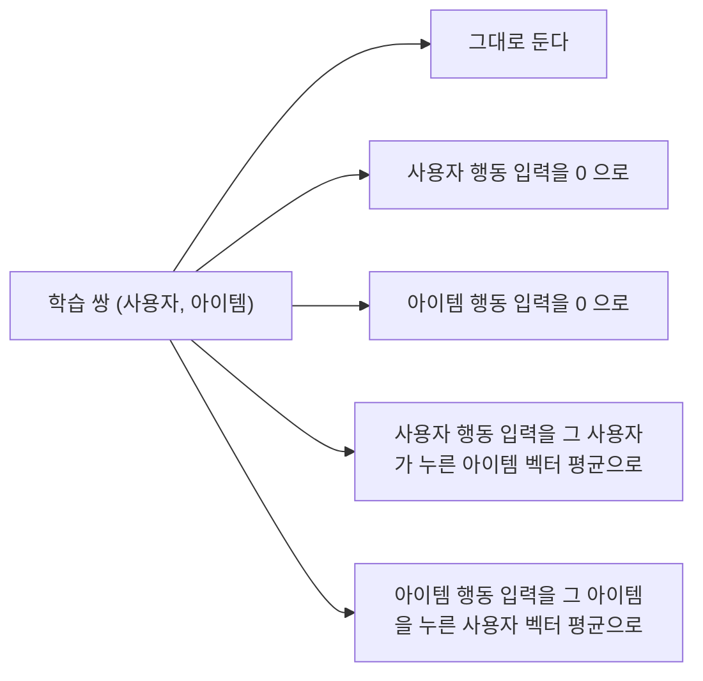

중고 거래 앱에 오늘 아침 "아이폰 15 128GB" 매물이 새로 올라왔다. 제목 · 카테고리 · 가격 · 사진은 있지만, 아직 아무도 누르거나 찜하지 않았다.

클릭 기록으로 상품을 표현하는 추천 · 랭킹 모델은 이 매물을 어디에 둬야 할지 모른다. 이렇게 행동 기록이 없는 새 아이템(또는 새 사용자)을 다루는 문제를 [[cold-start]] 라고 한다. DropoutNet (Volkovs et al., NeurIPS 2017) 은 학습할 때 행동 입력을 일부러 지워, 행동 기록이 없어도 내용만으로 점수를 내는 모델을 만든다.

# A) Cold start 문제

**행동으로 만든 벡터는 행동이 없으면 만들 수 없다.**

- 많이 쓰는 latent model 은 사용자-아이템 선호 행렬을 사용자 벡터와 아이템 벡터의 곱으로 근사한다 ([[matrix factorization]]).
- 선호 행렬의 칸은 클릭 · 찜 · 구매 같은 행동이고, 행동이 없으면 0 이다.
- 새 매물은 그 아이템의 열이 전부 0 이라 벡터를 배울 근거가 없다.
- 논문은 어떤 사용자도 선호를 남기지 않은 아이템을 item cold start, 아무 아이템에도 선호를 남기지 않은 사용자를 user cold start 로 정의한다.

**새 아이템에도 내용 정보는 있다.**

- 아이템 쪽은 제목 · 설명 같은 글, 이미지, 카테고리 같은 속성이다.
- 사용자 쪽은 나이 · 지역 · 기기 같은 프로필이다.
- 이 정보를 고정 길이 벡터로 바꾼 것을 내용 피처라고 부른다. 내용이 없으면 0 벡터로 둔다.

# B) 기존 방식의 한계

**행동만 쓰는 모델과 내용만 쓰는 모델은 서로 반대쪽에서 약하다.**

- 행동만 쓰는 latent model 은 기록이 많은 아이템에서 정확하지만, cold 아이템에는 아예 점수를 못 낸다.
- 내용만 쓰는 모델(DeepMusic, van den Oord et al., 2013)은 cold 아이템에도 점수를 내지만, 기록이 많은 아이템에서 크게 떨어진다.
- 논문의 CiteULike 실험에서 DeepMusic 의 warm 정확도(recall@100)는 0.371 로, 행동 모델 WMF 의 0.592 보다 한참 낮았다.

**둘을 섞는 hybrid 모델은 학습이 복잡하다.**

- [[Collaborative Topic Regression]] (CTR) 이나 Collaborative Deep Learning (CDL) 은 내용 모델과 행동 모델을 함께 두고 목적함수 항을 여럿 더한다.
- CDL 은 목적함수 항이 4 개이고, 항을 섞는 가중치 3 개를 따로 튜닝해야 한다.
- 내용 쪽 항은 대개 내용을 생성 · 설명하도록 학습해서, 추천 정확도에 필요 없는 부분까지 모델 용량을 쓴다.
- 대부분 cold 아이템만 가정하고 만들어져, cold 사용자까지 다루려면 모델을 하나 더 붙여야 한다.

# C) 핵심 아이디어: 행동 입력을 지우는 학습

**cold start 는 입력 중 행동 부분이 빠진 경우로 볼 수 있다.**

- 그래서 목적함수에 내용 항을 더하는 대신, 학습할 때 그 빠진 상황을 미리 겪게 한다.
- 매 mini-batch 마다 일부 사용자 · 아이템을 골라 행동 입력을 0 으로 바꾼 뒤 모델에 넣는다.
- 이것을 입력에 거는 [[dropout]] 이라는 뜻에서 input dropout 이라고 부른다.

**지운 쌍과 지우지 않은 쌍은 모델을 서로 반대 방향으로 민다.**

- 행동 입력을 지운 쌍에서는 내용 피처만 보고 점수를 맞춰야 한다. 모델은 내용을 쓰는 법을 배운다.
- 지우지 않은 쌍에서는 행동 입력을 그대로 따라 하면 점수가 맞는다. 모델은 행동이 있을 때 내용을 무시하는 법을 배운다.
- 둘이 섞여 학습되므로, 행동이 있으면 행동을 따르고 없으면 내용으로 버티는 모델이 된다.

**여기서 dropout 은 뉴런 몇 개를 끄는 보통의 dropout 과 다르다.**

- 보통의 dropout 은 은닉층 노드를 하나하나 무작위로 끈다.
- DropoutNet 은 한 사용자 · 아이템의 행동 입력 벡터 전체를 통째로 0 으로 만든다.
- 손상된 입력에서 원래 값을 복원하도록 학습하는 denoising [[autoencoder]] 와 비슷한 발상이다.

# D) 입력과 구조

## D.1) 입력: 행동 벡터와 내용 피처

**행동 입력으로 선호 행렬의 행을 그대로 쓰지 않고, 이미 학습된 latent model 의 벡터를 쓴다.**

- 선호 행렬의 행은 아이템 수만큼 길어서, 사용자 · 아이템이 많아지면 입력이 감당할 수 없이 커진다.
- 그래서 먼저 WMF 같은 latent model 을 학습하고, 그 모델이 만든 사용자 벡터 $\mathbf{U}_u$ 와 아이템 벡터 $\mathbf{V}_v$ 를 행동 입력으로 쓴다. 논문에서는 200 차원이다.
- 사용자 입력은 [사용자 행동 벡터, 사용자 내용 피처], 아이템 입력은 [아이템 행동 벡터, 아이템 내용 피처] 다.
- 이미 서비스 중인 latent model 위에 그대로 얹을 수 있다는 것이 논문이 강조하는 장점이다.

## D.2) 구조: 사용자 탑과 아이템 탑

사용자와 아이템이 각자의 신경망(tower)을 거쳐 벡터가 되고, 마지막에 두 벡터의 내적으로 점수를 낸다. [[Two-tower Model]] 과 같은 모양이다.

![[img-fd93a5f9eb.png]]

- 사용자 쪽은 행동 벡터와 내용 피처를 각각 작은 신경망에 넣는다.
- 두 출력을 이어 붙여 다시 신경망(그림의 fine-tuning network)에 넣으면 새 사용자 벡터 $\hat{\mathbf{U}}_u$ 가 나온다.
- 아이템 쪽도 같은 방식으로 새 아이템 벡터 $\hat{\mathbf{V}}_v$ 를 만든다.
- 점수는 두 새 벡터의 내적이다.
- 내용 쪽 신경망 자리에 이미 학습된 이미지 · 텍스트 모델을 끼우고 마지막 몇 층만 학습할 수도 있다.

# E) 학습 목표: 원래 점수 재현

**새 벡터의 내적이 입력 latent model 의 점수를 따라가도록 학습한다.**

$$
O = \sum_{u,v} \left(\mathbf{U}_u \mathbf{V}_v^{\top} - \hat{\mathbf{U}}_u \hat{\mathbf{V}}_v^{\top}\right)^2
$$

- 정답 라벨은 원래 클릭이 아니라, 입력 latent model 이 그 쌍에 매긴 점수 $\mathbf{U}_u \mathbf{V}_v^{\top}$ 다.

**행동 입력을 지우지 않으면 모델은 내용을 전혀 쓰지 않아도 된다.**

- 입력에 이미 $\mathbf{U}_u$, $\mathbf{V}_v$ 가 있으므로, 그것을 그대로 내보내기만 해도 손실이 0 이 된다.
- 내용 피처의 가중치를 0 으로 두는 것이 가장 쉬운 해다.
- 그래서 dropout 없이 학습한 모델은 cold 아이템에서 정확도가 낮다.

**행동 입력을 지운 쌍에서는 내용만으로 같은 점수를 맞춰야 한다.**

아이템의 행동 입력을 지운 경우(item cold start)의 손실이다. 정답은 그대로 두고 입력만 0 으로 바꾼다.

$$
O_{uv} = \left(\mathbf{U}_u \mathbf{V}_v^{\top} - f_{\mathcal{U}}(\mathbf{U}_u, \boldsymbol{\Phi}^{\mathcal{U}}_u)\, f_{\mathcal{V}}(\mathbf{0}, \boldsymbol{\Phi}^{\mathcal{V}}_v)^{\top}\right)^2
$$

- $f_{\mathcal{U}}$, $f_{\mathcal{V}}$ 는 사용자 탑과 아이템 탑, $\boldsymbol{\Phi}$ 는 내용 피처다.
- 사용자의 행동 입력을 지운 경우(user cold start)는 $\mathbf{U}_u$ 자리를 $\mathbf{0}$ 으로 바꾼다.

**목적함수가 항 하나뿐이라 튜닝할 것이 적다.**

- 항을 섞는 가중치가 없다.
- 사용자-아이템 쌍을 아무거나 뽑아 학습할 수 있어서, 데이터가 크지 않아도 학습 쌍이 수십억 개가 된다.
- 원래 0/1 선호 행렬로 직접 학습할 때처럼 0 이 너무 많이 뽑히지 않게 조절할 필요도 없다.

# F) Dropout 비율의 역할

dropout 비율 τ 는 한 batch 에서 행동 입력을 지울 사용자 · 아이템의 비율이다. τ 가 0 이면 아무것도 지우지 않고, 1 이면 전부 지운다.

논문은 CiteULike 에서 τ 를 0 부터 1 까지 바꿔 가며 warm · cold 정확도(recall@100)를 쟀다.

- **τ = 0**: 아무것도 지우지 않으므로 cold 정확도가 낮다.
- **τ = 0.1**: 이것만으로 cold 정확도가 60% 넘게 오른다.
- **τ 를 더 키우면**: cold 정확도는 꾸준히 오른다.
- **warm 정확도**: τ 가 0.7 이 될 때까지 1% 미만으로만 떨어지다가, 그 뒤로 빠르게 무너진다.

**0.7 아래에서는 warm 정확도를 거의 잃지 않고 cold 정확도를 크게 얻는다.**

- 지운 쌍이 너무 많으면 행동 입력을 따라 하는 법을 배울 쌍이 모자라 warm 이 무너진다.
- 지운 쌍이 너무 적으면 내용을 쓰는 법을 배울 쌍이 모자라 cold 가 약하다.
- 논문은 두 데이터셋 모두 0.5 를 썼다.
- dropout 이 원래 정규화 기법이라, 깊은 모델에서도 따로 정규화를 거의 걸지 않아도 됐다고 한다.

# G) 추론: cold 아이템과 warm 아이템

학습이 끝나면 모델을 고정하고, 모든 사용자 · 아이템을 한 번씩 통과시켜 새 벡터를 만든다. 검색 · 추천은 원래 latent model 의 벡터 대신 이 새 벡터로 한다.

**아이템의 기록 양에 따라 행동 입력 자리에 넣는 값이 다르다.**

- **warm 아이템**: 원래 latent model 의 아이템 벡터와 내용 피처를 넣는다.
- **cold 아이템 (기록 0)**: 행동 입력 자리에 0 을 넣고 내용 피처만 넣는다. 새 매물도 올라오자마자 벡터를 얻는다.
- **기록이 조금 생긴 아이템**: latent model 을 다시 학습하기 전까지는 그 아이템을 누른 사용자들 벡터의 평균을 행동 입력으로 넣는다.

**평균 벡터로 바꿔 넣는 상황도 학습 때 연습시킨다.**

- 평균으로 만든 벡터는 latent model 이 직접 배운 벡터와 분포가 다를 수 있다.
- 그래서 학습 중 일부 사용자 · 아이템의 행동 입력을 0 이 아니라 이 평균으로 바꿔 넣는 batch 를 dropout batch 와 번갈아 둔다.
- 한 쌍에 적용되는 변환은 다섯 가지 중 하나다.

**기록이 0 개에서 몇 개로 늘어날 때 모델을 다시 학습하지 않아도 된다.**

- 논문은 cold 사용자 1 만 명에게 기록을 0 개부터 5 개까지 시간 순서대로 하나씩 넣으며 정확도를 쟀다.
- DropoutNet 은 다시 학습하지 않고도 기록이 늘수록 정확도가 올랐다.
- 같은 평균 근사를 WMF 벡터에 적용한 것보다 모든 기록 개수에서 높았다.

# H) 실험 결과

## H.1) CiteULike: 논문 추천

사용자가 저장한 논문 목록으로 새 논문을 추천하는 데이터다. 사용자 5,551 명, 논문 16,980 편, 저장 기록 204,986 건이다. 논문의 제목 · 초록을 단어 8,000 개의 tf-idf 로 바꿔 아이템 내용 피처로 쓰고, 사용자 내용 피처는 없다. cold 평가에는 학습에서 뺀 논문 3,396 편을 쓴다.

| 방법 | warm recall@100 | cold recall@100 |
| --- | --- | --- |
| WMF | 0.592 | 계산 불가 |
| CTR | 0.597 | 0.589 |
| DeepMusic | 0.371 | 0.601 |
| CDL | 0.603 | 0.573 |
| DN-WMF | 0.593 | 0.636 |
| DN-CDL | 0.598 | 0.629 |

- DN-WMF 와 DN-CDL 은 각각 WMF 와 CDL 의 벡터를 행동 입력으로 쓴 DropoutNet 이다.

**DropoutNet 은 warm 에서는 입력 모델 수준을 지키고, cold 에서는 가장 높다.**

- warm 정확도는 입력 모델(WMF 0.592, CDL 0.603)과 거의 같다.
- cold 정확도는 가장 좋은 기존 방법 DeepMusic(0.601)보다 DN-WMF 가 약 6% 높다.
- WMF 는 원래 cold 아이템에 점수를 못 내는데, DropoutNet 을 얹으니 cold 에서 가장 좋은 모델이 됐다.
- DN-CDL 은 CDL 의 cold 정확도를 10% 가까이 올렸다.

## H.2) RecSys 2017 Challenge: 채용 공고 추천

채용 SNS XING 의 사용자-공고 상호작용 데이터다. 사용자 150 만 명, 공고 130 만 개, 상호작용 3 억 건 이상이고, 사용자 · 아이템 내용 피처(사용자 831 개, 공고 2,738 개)가 둘 다 있다. 마지막 2 주를 테스트로 두고 warm · user cold · item cold 세 경우를 한 모델로 평가한다.

**층을 깊게 할수록 cold 정확도가 오르고 warm 은 거의 그대로다.**

- 1 층(400)에서 3 층(800 → 800 → 400)으로 늘리면 recall@100 이 user cold 0.211 → 0.231, item cold 0.234 → 0.265 로 오른다.
- warm 은 0.421 → 0.412 로 거의 같고, 입력 모델 WMF(0.426)와 비슷하다.

**cold 에서 내용만 쓰는 모델보다 크게 앞선다.**

- 같은 3 층 구조 · 같은 목적함수로 학습한 DeepMusic 보다 cold 에서 대부분의 구간(recall@50 부터 @500 까지)에서 상대적으로 50% 넘게 높았다.
- 논문은 이 결과를 cold start 가 목표여도 행동 정보를 입력에 넣어야 한다는 근거로 든다.

# I) 한계

**warm 정확도가 입력 latent model 을 넘기 어렵다.**

- 학습 목표가 입력 모델의 점수를 다시 만드는 것이므로, 입력 모델이 틀린 만큼 같이 틀린다.
- RecSys 실험의 warm 정확도(0.412)도 입력 WMF(0.426)보다 조금 낮다.
- 논문도 warm 정확도를 입력 모델 이상으로 올리는 목적함수를 다음 과제로 든다.

**cold 아이템의 벡터는 내용 피처에만 기댄다.**

- 행동 입력이 0 이면 모델이 볼 수 있는 것은 내용 피처뿐이다.
- 내용이 비슷한데 반응이 다른 아이템은 cold 단계에서 구분되지 않는다.

**dropout 비율을 데이터마다 골라야 한다.**

- CiteULike 에서는 0.7 을 넘으면 warm 정확도가 빠르게 떨어졌다.

**평균 근사는 latent model 을 다시 학습하기 전까지의 임시 방법이다.**

- 기록이 쌓이면 결국 latent model 을 다시 학습하고, 그 벡터로 DropoutNet 을 다시 통과시켜야 한다.

# J) 검색 · 추천의 새 매물에 적용하기

논문은 추천 데이터로만 실험했다. 아래는 같은 구조를 새 매물 랭킹에 옮기는 일반적인 방법이다.

**새 매물은 올라오는 즉시 아이템 탑으로 벡터를 만든다.**

- 행동 입력 자리에는 0 을, 내용 피처 자리에는 제목 · 카테고리 · 가격 · 사진에서 뽑은 피처를 넣는다.
- 이 벡터와 사용자 벡터의 내적을 개인화 랭킹이나 추천 지면의 점수로 쓴다.
- 검색 랭커가 따로 있으면 이 점수를 랭커의 피처로 넣을 수 있다.

**클릭이 몇 개 생기면 재학습 전에도 벡터를 갱신한다.**

- 그 매물을 누른 사용자 벡터의 평균을 행동 입력으로 넣고 아이템 탑을 다시 통과시킨다.
- 정기 재학습 때 latent model 이 그 매물의 벡터를 직접 배우면 warm 아이템으로 넘어간다.

**학습 데이터에 새 매물이 없어도 된다.**

- 기록이 많은 매물의 행동 입력을 지워 "새 매물인 척" 하게 만드는 것이 곧 input dropout 이다.

# K) 부록: 식과 설정

## K.1) 식

입력 latent model 은 선호 행렬을 두 저차원 행렬의 곱으로 근사한다.

$$
R_{uv} \approx \mathbf{U}_u \mathbf{V}_v^{\top}
$$

학습이 끝난 뒤 점수는 새 벡터의 내적이다.

$$
\hat{s}_{uv} = \hat{\mathbf{U}}_u \hat{\mathbf{V}}_v^{\top}, \qquad \hat{\mathbf{U}}_u = f_{\mathcal{U}}(\mathbf{U}_u, \boldsymbol{\Phi}^{\mathcal{U}}_u), \qquad \hat{\mathbf{V}}_v = f_{\mathcal{V}}(\mathbf{V}_v, \boldsymbol{\Phi}^{\mathcal{V}}_v)
$$

기록이 새로 생긴 cold 사용자 $u$ 의 행동 입력은, 그 사용자가 상호작용한 아이템 집합 $\mathcal{V}(u)$ 의 벡터 평균으로 근사한다. 아이템은 사용자 벡터 평균으로 같은 방식을 쓴다.

$$
\mathbf{U}_u \approx \frac{1}{|\mathcal{V}(u)|} \sum_{v \in \mathcal{V}(u)} \mathbf{V}_v
$$

## K.2) 학습 설정

- mini-batch 크기 100, 고정 learning rate, momentum 0.9 로 학습했다 (TensorFlow).
- 각 batch 에서 τ × batch 크기만큼 사용자 · 아이템을 고른다. 홀수 batch 에는 dropout, 짝수 batch 에는 평균 근사를 적용하는 식으로 번갈아 둔다.
- 입력 latent model 의 벡터 차원은 200 이다.
- CiteULike 는 은닉층 1 개(500 유닛, tanh)를 썼다. 더 깊게 해도 크게 나아지지 않았다. 사용자 내용 피처가 없어 아이템 행동 입력에만 dropout 을 걸었다.
- RecSys 는 800 → 800 → 400 의 3 층, 층마다 batch norm 과 tanh 를 썼다. ReLU · sigmoid 는 결과가 크게 나빴다.

# L) References

- [paper link (NeurIPS 2017)](https://papers.nips.cc/paper/2017/file/dbd22ba3bd0df8f385bdac3e9f8be207-Paper.pdf)
- [code (layer6ai-labs/DropoutNet)](https://github.com/layer6ai-labs/DropoutNet)
