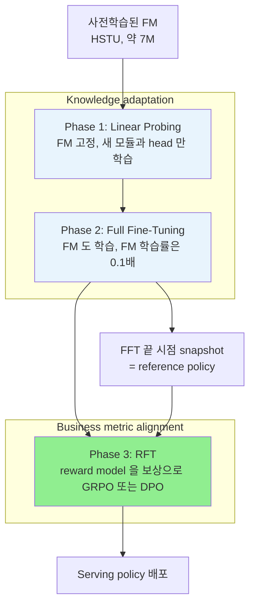

# A) 한줄 요약

웹툰 추천 화면이 **클릭만 많이 받는 작품이 아니라, 사용자가 끝까지 보고 결제까지 이어지는 작품** 을 위에 올리도록 학습하는 방법이다. NAVER WEBTOON 이 이미 사전학습해 둔 추천 Foundation Model(FM)을 "새 작품 발견" 화면에 붙이면서 썼다. FM 을 새로 학습하는 논문은 아니다.

## A.1) 문제

목표는 "작품을 끝까지 보는가" 인데, 이 신호는 드물다. 작품을 클릭하는 사람은 많아도 무료 회차를 다 보고 유료 회차까지 넘어가는 사람은 훨씬 적다.

- 이 드문 신호만으로 추천 모델을 학습하면 수천 개 작품의 순서를 세밀하게 정하지 못한다.
- 반대로 클릭으로만 학습하면 순서는 잘 정하지만, 클릭만 받고 금방 이탈하는 작품도 위로 올라간다.

## A.2) 해법

모델 두 개에 역할을 나눈다.

| 모델 | 하는 일 | 학습 데이터 | 화면에 쓰는가 |
| --- | --- | --- | --- |
| 추천 모델 (serving policy) | 화면에 보여 줄 작품 순서를 정한다 | 클릭 (많음) | 쓴다 |
| 채점 모델 (reward model) | 이 사용자가 이 작품을 어디까지 볼지 점수를 매긴다 | 클릭, 첫 회차, 무료 완독, 유료 진입, 유료 완독 단계 (드묾) | 안 쓴다 |

학습은 세 단계로 한다.

1. **Linear Probing (LP)**: FM 은 얼리고 새로 붙인 부분만 학습한다.
2. **Full Fine-Tuning (FFT)**: FM 까지 풀어 함께 학습한다. 여기까지가 클릭으로 추천 모델을 만들고, 채점 모델도 같이 학습해 두는 단계다.
3. **Reinforcement Fine-Tuning (RFT)**: 추천 모델이 고른 상위 작품에 채점 모델이 점수를 매기고, 점수가 높은 작품의 순위를 올리도록 추천 모델을 다시 학습한다.

결과적으로 추천 모델은 "클릭할 것 같은 작품" 중에서 "끝까지 볼 것 같은 작품" 을 더 위로 올리게 된다.

## A.3) 결과

- **오프라인에서는 클릭 순서와 소비 깊이 순서가 함께 좋아졌다** (Rank NDCG 0.437 → 0.463, Funnel NDCG 0.625 → 0.637).
	- Rank NDCG 는 클릭한 작품을 전체 작품 중 얼마나 위에 올렸는지, Funnel NDCG 는 노출된 작품을 깊이 본 순서대로 줄 세웠는지를 잰다.
- **채점 모델을 그대로 추천에 쓰면 클릭 순서가 가장 나빴다** (Rank NDCG 0.394).
	- 깊이 순서는 잘 맞히지만 수천 개 작품을 줄 세우지는 못한다. 그래서 채점 모델은 추천 모델을 가르치는 데만 쓴다.
- **한 달 온라인 A/B 테스트에서 유료 회차 끝까지 가는 비율이 기존 추천 모델보다 13.4%p 더 올랐다** (LastPaid/Imp).
	- 추천을 한 번 보여 줄 때마다 같은 세션에서 마지막 유료 회차까지 간 비율이다. 실험 시작 전부터 있던 두 모델의 차이는 뺀 값이다.

- **저자**: Oseong Choi\*, Hoeinn Kim\*, Jihoon Lee, Byungsoo Kang, Taeyeong Jang (NAVER WEBTOON, \*공동 1저자)
- **발표**: RecSys '26 (arXiv 2608.06792, 2026-08-07)
- **베이스 모델**: HSTU encoder 기반 sequential FM, 약 7M parameters
- **풀려는 문제**: 한국 웹툰 플랫폼의 "새 작품 발견(discovery)" 화면에서 사용자가 아직 안 본 작품을 추천하되, 클릭보다 깊은 소비(무료 회차 완독, 유료 회차 진입)를 늘리는 것
- **serving 모델의 형태**: 카탈로그 전체 작품을 클래스로 두는 다중 분류(softmax). 입력은 사용자뿐이다
- **코드**: [webtoon/rec-fm-progressive-alignment](https://github.com/webtoon/rec-fm-progressive-alignment) (합성 데이터로 도는 reference 구현, Apache-2.0)

# B) 전체 구조

## B.1) FM 과 이 논문이 학습하는 것

추천 FM 은 대규모 사용자 행동 로그로 다음 행동을 예측하도록 사전학습한(autoregressive multi-task) sequence encoder 다. 입력은 사용자가 시간순으로 본 작품, 콘텐츠 유형, 행동 유형, 행동 사이 시간 간격이고, 출력은 예측값이 아니라 **사용자 표현(embedding)** 이다. FM 의 내부 구조와 사전학습 목표의 세부는 논문과 reference 구현 모두 공개하지 않았다.

"Foundation model" 이라는 이름과 GRPO·DPO 는 LLM 에서 빌려 왔지만, 이 모델은 자연어를 다루지 않는다. 입력은 텍스트가 아니라 작품 id·행동 유형 같은 ID 시퀀스이고, 사용자 표현도 최종 목적이 아니라 중간 산물이다. 최종 출력은 작품마다 매긴 점수이고, 화면에는 그 점수 순으로 고른 상위 작품 목록이 나간다. LLM 에서 action 이 다음 토큰이라면 여기서는 추천할 작품 하나다.

구조로 보면 SASRec 계열의 sequential recommender 와 가깝다. SASRec 은 사용자가 본 작품 id 시퀀스를 왼쪽에서 오른쪽으로만 보는(causal) Transformer 로 읽고 다음 작품을 맞히도록 학습한다. 이 논문의 FM 도 causal Transformer 이고 다음 행동을 예측하도록 사전학습했다. 양방향으로 보고 가려 둔 작품을 맞히는 [[BERT4Rec - Sequential Recommendation with Bidirectional Encoder Representations from Transformer|BERT4Rec]] 보다는 SASRec 쪽이다. 차이는 세 가지다.

| 항목 | SASRec | 이 논문 |
| --- | --- | --- |
| 입력 | 작품 id 시퀀스 | 작품 id 에 콘텐츠 유형, 행동 유형, 시간 간격을 더한 시퀀스 (HSTU 방식) |
| 점수를 내는 법 | 마지막 위치 표현과 작품 임베딩의 내적 | FM 표현과 화면 전용 표현을 이어 붙여 MLP head 가 작품별 logit 을 낸다 |
| 학습 | 다음 작품 맞히기 한 번 | 사전학습한 FM 위에서 클릭으로 다시 학습하고, 채점 모델 점수로 강화학습까지 한다 |

회사는 이 FM 하나를 여러 serving 화면에 붙여 쓴다. 화면마다 목표가 달라 그때마다 화면 전용 모듈과 head 를 새로 달아 학습한다. 이 논문이 다루는 것은 그 붙이는 과정, 즉 **post-training 레시피** 다. 실험한 화면은 사용자가 아직 안 본 작품을 추천하는 discovery 화면이다.

## B.2) 세 개의 head

모델은 FM 위에 세 개의 head 를 가진다. 셋 다 작품 하나하나에 대해 점수를 내는 카탈로그 크기의 출력을 낸다.

| head | 문제 형태 | 정답 | 역할 |
| --- | --- | --- | --- |
| Serving policy $\pi_\theta$ | 카탈로그 전체 작품 중 하나를 고르는 다중 분류 (softmax) | 세션에서 클릭한 작품 (dense) | 실제 랭킹에 쓰는 점수 |
| Reward model $R_\phi$ | 작품마다 ordinal regression (이진 분류 5개) | 그 작품에서 도달한 funnel 단계 (sparse) | RFT 의 보상 |
| Propensity $P_\psi$ | 작품마다 이진 분류 (multi-label) | 노출됐는지 여부 | reward 학습의 편향 보정 |

실제 서비스에 쓰는 serving policy 는 흔한 CTR 이진 분류가 아니다. 입력은 사용자뿐이고, 작품은 입력이 아니라 **출력 클래스** 다. 작품 수만큼 클래스가 있는 분류 문제로, YouTube DNN 의 후보 생성 모델과 같은 형태다. 반대로 비교 대상인 기존 production 모델(CTRL)은 (사용자, 작품) 쌍마다 클릭 확률과 전환 확률을 따로 내서 곱하는 이진 분류 두 개다.

![[img-962970b6b3.png|Foundation–expert 구조 (논문 Figure 1)]]

## B.3) 학습 단계

FM 이 만든 사용자 표현 $h_\text{fm}$ 과 화면 전용 downstream encoder 가 만든 $h_\text{ds}$ 를 이어 붙여(concat) 세 head 에 넘긴다. 학습은 아래 세 단계로 진행한다.

![[img-5500deb686.png|3단계 post-training 파이프라인 (논문 Figure 2). 실선은 gradient 가 흐르는 경로, 점선은 고정되거나 detach 된 경로]]

그림의 점선은 학습 신호(gradient)가 지나가지 않는 경로다. Phase 1 에서는 FM 이 점선, 즉 얼려 둔 상태다. Phase 1·2 에서 채점 모델(reward)과 propensity head 로 가는 화살표도 점선이다.

Reference 구현을 보면 두 head 는 FM 이 만든 사용자 표현을 받기만 하고, 학습 신호를 FM 쪽으로 되돌려 보내지 않는다(`h.detach()`). 그래서 Phase 1·2 동안 FM 을 바꾸는 것은 클릭 학습뿐이다. 결제·완독 같은 신호는 Phase 3 에서 채점 모델 점수를 거쳐서만 추천 모델에 반영된다.

# C) 배경 지식

## C.1) Foundation–Expert 패러다임

거대한 공용 FM 이 범용 사용자 표현을 만들고, 화면마다 가벼운 expert 모듈이 그 표현에 화면 전용 feature 를 더해 최종 예측을 한다. Meta 의 foundation–expert 구조나 Pinterest 의 PinFM 이 같은 방향이다. 이 논문의 downstream encoder 가 expert 에 해당한다.

## C.2) Linear Probing 과 LP-FT

[[linear probing]] 은 사전학습 모델(backbone)을 얼리고 그 위에 붙인 head 만 학습하는 방식이다. 원래는 표현을 **평가하는** 방법이었다. "probe" 는 탐침이라는 뜻으로, 얼린 표현 위에 선형 분류기 하나만 올려 그 표현에 정보가 얼마나 담겨 있는지 잰다. SimCLR·MAE 같은 self-supervised 논문이 보고하는 "linear probe accuracy" 가 이것이다. 엄밀히는 head 가 선형층 하나여야 하고, MLP 를 올리면 보통 MLP probe 라고 따로 부른다.

이 논문의 LP 는 그보다 넓은 뜻이다. FM 만 얼리고, downstream encoder(Transformer)와 MLP head 세 개를 함께 학습한다. 정확히는 "backbone 을 얼린 채 하는 학습" 이고, 이름은 아래 LP-FT 의 관례를 따랐다.

[[fine tuning|Full fine-tuning]] 은 전체 파라미터를 학습하는 방식이다. Kumar et al. (2022) 는 랜덤 초기화된 head 를 단 채 처음부터 전체를 fine-tuning 하면 사전학습 feature 가 망가진다는 것을 보였다. 학습 초반 head 가 엉터리 gradient 를 내고, 그 gradient 가 backbone 까지 흘러 들어가기 때문이다. 그래서 LP 로 head 를 먼저 쓸 만한 상태로 만든 뒤 FT 하는 **LP-FT** 순서가 더 낫다.

**Discriminative learning rate** 는 같은 모델 안에서 부위별로 학습률을 다르게 주는 기법이다. 여기서는 FM backbone 에 downstream 모듈보다 10배 작은 학습률을 준다.

여기서 downstream 모듈은 head 만이 아니라 FM 위에 새로 붙인 부분 전체를 말한다. LLM 에 빗대면 LM head 는 아래 표의 head 세 개에 해당하고, downstream 모듈은 그보다 넓다.

| 구성 요소 | 하는 일 | 속하는 쪽 |
| --- | --- | --- |
| FM sequence encoder | 행동 시퀀스를 사용자 표현으로 바꾼다 | FM |
| 작품 임베딩 | 작품 id 를 벡터로 바꾼다. downstream encoder 도 같은 것을 쓴다 | FM |
| pooling query | FM 출력 시퀀스를 벡터 하나로 줄인다 | downstream |
| downstream encoder | 사용자가 본 작품 목록과 회차 소비 통계를 화면 전용 표현으로 만든다 | downstream |
| head 세 개 (추천, 채점, propensity) | 작품마다 점수를 낸다 | downstream |

FFT 에서는 FM 쪽에 $10^{-5}$, downstream 쪽에 $10^{-4}$ 를 준다. 구분은 reference 구현의 `get_param_groups()` 기준이다.

## C.3) Ordinal Regression

순서는 있지만 간격은 정의되지 않은 라벨(노출 < 클릭 < 첫 화 감상 < …)을 예측하는 방법이다. $L$ 단계 라벨을 $L-1$ 개의 cutpoint 로 나누고, cutpoint 마다 "이 단계를 넘었는가" 를 binary classification 으로 푼다. 6단계 funnel 이면 cutpoint 5개, binary 문제 5개가 된다.

## C.4) IPS 와 SNIPS

로그 데이터에는 과거 추천 정책이 노출시킨 작품의 반응만 남는다([[exposure bias]]). 많이 노출된 인기 작품은 데이터가 많고 드물게 노출된 작품은 적어서, 그대로 학습하면 인기 작품이 학습을 지배한다. [[inverse propensity scoring weighting, IPW|IPS]] 는 각 샘플에 노출 확률(propensity) $p$ 의 역수 $1/p$ 를 가중치로 곱해 이 불균형을 되돌린다. 노출 확률이 10배 낮은 작품은 10배 무겁게 친다.

IPS 계열 세 방식은 편향과 분산이 서로 반대로 움직인다. 여기서 편향은 "학습을 여러 번 반복했을 때 평균적으로 맞는 값에서 비켜나는 정도", 분산은 "어떤 샘플이 뽑혔느냐에 따라 값이 출렁이는 정도" 다.

| 방식 | 가중 평균을 내는 법 | 편향 | 분산 |
| --- | --- | --- | --- |
| IPS | 샘플마다 $1/p$ 를 곱하고 샘플 수로 나눈다 | 없음 | 크다 |
| Clipped IPS | 가중치를 상한에서 자른 뒤 IPS 와 같게 | 생긴다 | 줄어든다 |
| SNIPS | 샘플 수 대신 가중치 합으로 나눈다 | 생긴다 (샘플이 많으면 사라진다) | 줄어든다 |

**IPS 는 평균적으로는 정확하지만 batch 마다 크게 출렁인다.** 설명용 가상 batch 두 개로 보면 다음과 같다.

- batch 1: 인기 작품 샘플 4개 ($p = 0.5$, $w = 2$). 가중치 합 8, 평균 가중치 2
- batch 2: 인기 작품 3개 + 드문 작품 1개 ($p = 0.05$, $w = 20$). 가중치 합 26, 평균 가중치 6.5

IPS 는 $N$ 으로 나누므로 드문 작품이 끼었느냐에 따라 loss 크기가 3배 넘게 달라진다. 드문 작품 샘플 하나가 batch 2 가중치의 77% 를 차지한다. 많은 batch 를 평균하면 각 작품이 노출 확률과 상관없이 고르게 반영되므로 편향은 없지만, batch 하나하나는 우연히 뽑힌 드문 샘플에 크게 휘둘린다. 이것이 분산이다.

**Clipping 은 가중치 상한을 둬서 출렁임을 줄이고, 그 대가로 편향이 생긴다.** 상한이 10이면 드문 작품의 가중치는 20 대신 10이 된다. 출렁임은 줄지만 드문 작품은 이제 덜 보정되므로, 평균을 내도 인기 작품 쪽으로 약간 기운다.

**SNIPS 는 $N$ 대신 가중치 합으로 나눠 가중치 합을 항상 1로 맞춘다.** 그러면 loss 가 언제나 샘플 loss 들의 가중 평균이 되고, batch 구성이 바뀌어도 loss 크기가 개별 샘플 loss 범위 안에 머문다. 대신 분모인 가중치 합도 batch 마다 달라지는 값이라, 분자의 평균을 분모의 평균으로 나눈 값과 정확히 같아지지 않는다. 이 차이가 편향이다. 샘플이 많아지면 가중치 합이 안정돼 편향은 0으로 줄어든다.

이 논문은 clipping 과 self-normalization 을 둘 다 쓰고, 목적을 "학습 중 loss 크기를 안정시키기 위해서" 라고 밝혔다. 식은 부록의 「IPS 와 SNIPS 식」 에 있다.

## C.5) GRPO 와 DPO

둘 다 LLM 정렬에서 온 방법이다.

- **GRPO**(Group Relative Policy Optimization): PPO 에서 value network 를 없앤 변형이다. 한 입력에 대해 출력 여러 개를 묶어(group) reward 를 매기고, group 평균과 표준편차로 정규화한 값을 [[advantage function|advantage]] 로 쓴다. 평균보다 나은 출력은 확률을 올리고, 못한 출력은 내린다.
- **DPO**(Direct Preference Optimization): reward model 없이 "A 가 B 보다 낫다" 는 선호 쌍에서 바로 policy 를 학습한다. Reference policy 대비 log-확률 비율을 A 쪽이 더 크게 만들도록 학습한다.

## C.6) Difference-in-Differences

온라인 실험 결과에 쓰는 추정법이다. 실험군과 대조군의 차이를 실험 시작 전과 후에 각각 재고, 그 둘을 다시 뺀다. 실험 전부터 있던 두 집단의 차이를 지우고 순수한 처치 효과만 남기려는 것이다.

# D) 기존 방법의 한계

추천 FM 에 LLM 식 RFT 를 바로 옮기려 하면 두 문제가 생긴다.

**첫째, 한 번에 전체를 fine-tuning 하면 사전학습 표현이 무너진다.** 새로 붙인 downstream 모듈과 head 는 랜덤 초기화 상태다. 이 상태에서 FM 까지 같이 학습하면 head 쪽의 분산 큰 gradient 가 backbone 을 흔들어, head 가 의미 있는 걸 배우기 전에 FM 표현이 먼저 망가진다(catastrophic forgetting).

**둘째, 비즈니스 지표로 serving 모델을 직접 학습하기 어렵다.** 웹툰에서 실제로 중요한 것은 클릭이 아니라 무료 회차를 다 보고 유료 회차까지 넘어가는지다. 하지만 이런 신호는 클릭보다 훨씬 드물고 늦게 관측된다. 이걸로 serving 모델을 학습하면 "대략 좋은 방향" 은 배우지만 전체 카탈로그에서 작품을 세밀하게 줄 세울 변별력이 부족하다. 실제로 이 논문의 실험에서도 reward model 을 그대로 랭킹에 쓰면 Rank NDCG 가 모든 구성 중 가장 낮다(0.394).

그래서 저자들은 역할을 나눈다. 풍부한 클릭 신호로 변별력 있는 serving policy 를 만들고, 드문 비즈니스 신호는 reward model 에만 학습시켜 RFT 의 보상으로 쓴다.

# E) 제안 방법

## E.1) 모델 구조

FM 이 사용자 행동 시퀀스를 읽어 위치마다 표현을 낸다. 시퀀스 길이가 사용자마다 달라서, 학습 가능한 query 벡터 하나로 attention pooling 해 고정 길이 벡터 하나로 줄인다. 옆에서는 downstream encoder 가 무료·유료 회차 소비량, 연재 이어보기 같은 장기 통계를 읽어 화면 전용 표현을 만든다. 둘을 이어 붙인 벡터가 세 head 로 들어간다.

Downstream encoder 는 사용자가 본 작품 목록을 FM 과 같은 작품 임베딩으로 읽는다(논문 Figure 1). 추천 head 는 이 벡터를 MLP 에 넣어 작품마다 logit 을 내고, softmax 를 씌워 작품 위의 확률분포로 쓴다(reference 구현 기준). 뒤의 RFT 도 이 분포를 직접 바꾼다.

FM 은 약 7M parameters 로 작은 편이다. HSTU 원 논문(Actions Speak Louder than Words)이 수조 파라미터 규모까지 키운 것과 비교하면, 이 논문은 FM 의 규모보다 post-training 절차에 무게를 둔 실험이다.

## E.2) 채점 모델: 어디까지 볼지를 점수로

웹툰 소비는 단계가 깊어지는 funnel 이다. 논문은 이를 6단계로 정의한다.

1. 노출 (impression)
2. 클릭
3. 첫 회차 감상
4. 무료 회차 완독
5. 유료 회차 진입
6. 유료 콘텐츠 완독

채점 모델은 이 단계를 ordinal regression 으로 예측한다. "클릭까지 갔나", "첫 회차까지 갔나" 처럼 단계 경계마다 하나씩, 이진 질문 5개에 각각 확률을 낸다. 최종 점수는 이 5개 확률의 합이다. 넘을 것으로 기대되는 경계의 개수이므로, 기대 funnel 단계에서 1을 뺀 값으로 읽을 수 있다.

예를 들어 경계별 확률이 $0.95, 0.6, 0.4, 0.2, 0.05$ 로 나왔다면(설명용 가상 수치) 점수는 2.2 다. 평균적으로 3단계(첫 회차 감상)와 4단계(무료 회차 완독) 사이까지 갈 것으로 보는 셈이다. "봤다 / 안 봤다" 하나가 아니라 깊이에 비례하는 연속 점수가 나오므로, 뒤에서 GRPO 가 점수의 크기 차이까지 쓸 수 있다.

로그는 과거에 노출된 작품에만 남으므로, 채점 모델을 학습할 때는 propensity head 가 예측한 노출 확률로 샘플마다 가중치를 준다. 앞의 「IPS 와 SNIPS」 에서 본 clipping 과 self-normalization 을 둘 다 적용한다.

## E.3) Phase 1–2: Supervised Fine-Tuning

두 단계 모두 같은 loss 를 쓰고, 어떤 파라미터를 움직이느냐만 다르다. Loss 는 세 head 의 loss 를 그대로 더한 것이다.

- **추천 head**: 클릭한 작품을 작품 전체 중에서 맞히는 cross-entropy
- **채점 모델**: 노출 확률로 가중치를 준 funnel 단계 예측
- **propensity head**: 각 작품이 노출됐는지 맞히는 이진 분류

**Phase 1 (LP)** 에서는 FM 을 얼리고 downstream encoder 와 세 head 만 학습한다. 랜덤으로 초기화된 부분이 고정된 FM 표현에 먼저 맞춰지므로, 초반의 들쭉날쭉한 학습 신호가 FM 을 망가뜨리지 않는다.

**Phase 2 (FFT)** 에서는 FM 까지 풀어 함께 학습한다. Downstream 쪽이 이미 안정된 상태라 최적화가 덜 흔들린다. FM 학습률은 downstream 의 0.1배로 둬서, FM 은 조금씩 고치고 화면 전용 부분은 빠르게 맞춘다.

## E.4) Phase 3: Reinforcement Fine-Tuning

FFT 가 끝난 모델을 복사해 고정하고 reference policy 로 둔다. RFT 동안에는 추천 head 와 FM 만 학습하고, 채점 모델과 propensity head 는 고정한다.

### GRPO

사용자마다 다음을 반복한다.

1. 지금의 추천 모델이 점수가 가장 높은 작품 32개를 고른다. 화면에 실제로 보여 주는 개수에 맞춘 값이다.
2. 채점 모델이 32개 작품에 각각 점수를 매긴다.
3. 32개의 평균을 빼고 표준편차로 나눠 advantage 를 만든다. 평균보다 깊이 볼 작품은 양수, 아닌 작품은 음수다.
4. advantage 가 양수인 작품의 확률은 올리고 음수인 작품은 내린다.
5. 이때 reference policy 에서 너무 멀어지지 않게 확률 비율을 0.9–1.1 범위로 자르고(clipping), KL penalty 를 작게(0.001) 건다.

작은 예로 보면 상위 4개 후보의 점수가 $[3.0, 2.0, 1.0, 2.0]$ 일 때 평균 2.0, 표준편차 약 0.82 이므로 advantage 는 $[+1.22, 0, -1.22, 0]$ 이 된다. 첫 번째 작품의 확률은 올리고 세 번째는 내린다. 네 작품 모두 클릭 확률로는 상위권이지만, 그중 더 깊이 볼 작품 쪽으로 확률을 옮기는 것이다.

LLM 의 GRPO 와는 몇 가지가 다르다. Reference 구현과 Algorithm 1 을 기준으로 정리하면 다음과 같다.

| 항목 | LLM 의 GRPO | 이 논문의 GRPO |
| --- | --- | --- |
| group 을 만드는 법 | 같은 프롬프트로 출력을 여러 번 sampling | 지금 추천 모델의 상위 32개 작품을 그대로 선택 |
| action | 토큰 시퀀스 | 작품 하나 |
| 확률 비율을 재는 기준 | 직전 update 의 policy | FFT 직후 고정한 reference policy |
| reward | 정답 검증기 또는 reward model | 고정된 채점 모델 |

기준이 고정된 reference policy 라는 점은 해석이 필요하다. Clipping 이 "한 번의 update 크기" 가 아니라 "SFT 직후 모델에서 얼마나 멀어질 수 있는가" 를 제한하게 된다. KL 계수가 0.001 로 작은데도 학습이 안정적인 이유 중 하나로 보인다(논문이 직접 밝힌 내용은 아니고, 코드 구조에서 읽은 해석이다).

### DPO

같은 후보 묶음 안에서 점수가 더 높은 작품과 낮은 작품을 짝지어 선호 쌍을 만들고, 높은 쪽의 확률이 상대적으로 더 오르도록 학습한다. 채점 모델 점수로 쌍을 만들면 **DPO w/ RM**, 실제 관측된 funnel 단계로 만들면 **DPO w/o RM** 이다.

GRPO 는 점수 차이의 크기를 advantage 에 그대로 담지만, DPO 는 "누가 더 높은가" 만 남긴다. 3.01 과 3.00 의 차이와 5.0 과 0.5 의 차이가 똑같이 쌍 하나로 취급된다. 이 차이가 뒤의 실험에서 GRPO 와 DPO 가 서로 다른 지표를 올리는 이유로 이어진다.

# F) 데이터셋과 평가

## F.1) 오프라인

- **데이터**: 한국 웹툰 플랫폼의 실제 상호작용 로그
- **평가 구간**: 가장 최근 3주
- **테스트셋**: 사용자 10%를 무작위로 뽑아 이 구간의 세션을 평가
- **과제**: discovery, 즉 사용자가 아직 본 적 없는 작품을 추천

지표는 두 가지로, 각각 다른 질문에 답한다.

| 지표 | 랭킹 대상 | 정답 | 묻는 것 |
| --- | --- | --- | --- |
| Rank NDCG | 전체 카탈로그 | 세션에서 클릭한 작품 = 1, 나머지 0 | 클릭할 작품을 전체 중에서 위로 올리는가 |
| Funnel NDCG | 그 세션에 실제 노출된 작품만 | 도달한 funnel 단계 (graded) | 노출된 작품을 소비 깊이 순으로 줄 세우는가 |

두 지표 모두 [[Normalized Discounted Cumulative Gain|NDCG]] 다. Rank NDCG 는 serving 변별력을, Funnel NDCG 는 비즈니스 지표와의 정렬을 본다. 두 지표를 함께 보는 것은 클릭 변별력과 소비 깊이 중 한쪽만 높은 모델을 걸러내기 위해서다.

## F.2) 온라인

한 달 동안 대규모 A/B 테스트를 했다. 비교 대상은 네 개다.

- **CTRL**: FM 없이 CTR 과 CVR 을 따로 예측해 곱(CTCVR)으로 랭킹하는 기존 production 모델 (ESCM² 계열의 표준 multi-task 구조)
- **SFT**: LP → FFT + LR control
- **GRPO w/ RM**: SFT 위에 reward model 기반 GRPO
- **DPO w/o RM**: SFT 위에 관측 funnel 기반 DPO

지표는 노출 1회당 같은 세션 안에서 일어난 일이다: 클릭(Click/Imp), 몰입 감상(Engaged/Imp), 마지막 무료 회차 도달(LastFree/Imp), 마지막 유료 회차 도달(LastPaid/Imp).

# G) 실험 결과

## G.1) 오프라인 ablation (논문 Table 1)

| 구분 | 구성 | Rank NDCG | Funnel NDCG |
| --- | --- | --- | --- |
| SFT | 1-Phase (FFT only) | 0.429 | 0.620 |
| SFT | 1-Phase (LP only) | 0.426 | 0.620 |
| SFT | 2-Phase (LP → FFT, LR control 없음) | 0.434 | 0.622 |
| SFT | 2-Phase (LP → FFT, LR control) | **0.437** | **0.625** |
| Reward 직접 serving | Reward model 로 랭킹 | 0.394 | 0.637 |
| RFT | 2-Phase SFT baseline | 0.437 | 0.625 |
| RFT | GRPO w/ RM | **0.463** | **0.637** |
| RFT | GRPO w/o RM (관측 funnel) | 0.441 | 0.627 |
| RFT | DPO w/ RM | 0.423 | 0.630 |
| RFT | DPO w/o RM (관측 funnel) | 0.453 | **0.637** |

결과를 세 덩어리로 읽을 수 있다.

**LP → FFT 순서와 학습률 조절은 작지만 일관되게 효과가 있다.** LP 만 하거나 FFT 만 하면 둘 다 Rank NDCG 0.43 근처에 머문다. 두 단계로 나누면 0.434, FM 학습률을 0.1배로 낮추면 0.437 까지 오른다. 차이가 0.008 정도로 작고, 논문은 오프라인 결과의 분산이나 유의성을 보고하지 않았다.

**Reward model 은 정렬 신호로는 좋지만 serving 점수로는 나쁘다.** Reward model 로 직접 랭킹하면 Funnel NDCG 는 0.637 로 최고 수준이지만 Rank NDCG 는 0.394 로 모든 구성 중 가장 낮다. 소비 깊이의 방향은 잘 잡지만 전체 카탈로그에서 줄 세울 변별력이 없다는, 앞의 '기존 방법의 한계' 에서 본 주장 그대로다. GRPO w/ RM 은 Funnel NDCG 를 이 수준(0.637)으로 맞추면서 Rank NDCG 는 0.463 으로 끌어올렸다. 비즈니스 신호가 변별력을 해치지 않고 policy 로 옮겨진 것이다.

**Reward model 을 연속값으로 쓰느냐, 쌍으로 바꿔 쓰느냐에 따라 결과가 달라진다.** GRPO 는 reward model 을 쓸 때(0.463)가 관측 funnel 을 쓸 때(0.441)보다 낫다. DPO 는 반대로 관측 funnel 이 낫고(0.453), reward model 로 쌍을 만들면 Rank NDCG 가 0.423 으로 SFT baseline(0.437)보다도 떨어진다. 논문 본문은 "RFT 가 대체로 두 지표를 모두 올린다" 고 쓰지만, DPO w/ RM 의 Rank NDCG 는 예외다. 저자들의 해석은 이렇다. 연속 reward 를 binary 쌍으로 바꾸면 크기 정보가 사라지고, 근소한 점수 차이까지 확정적인 선호로 바뀌어 reward model 의 노이즈가 증폭된다. 반면 관측 funnel 로 만든 쌍은 드물지만 실제 행동이라 노이즈가 적다.

## G.2) 온라인 A/B (논문 Figure 3)

![[img-eda51bb7ce.png|온라인 A/B 결과 (논문 Figure 3). 위는 지표별 DiD, 아래는 Click/Imp 와 LastPaid/Imp 의 일별 lift 추이]]

CTRL 대비 DiD 추정치(실험 전후 lift 차이, %p)를 옮기면 다음과 같다.

| 모델 | Click/Imp | Engaged/Imp | LastFree/Imp | LastPaid/Imp |
| --- | --- | --- | --- | --- |
| SFT | +13.1 | +9.4 | +8.0 | +5.0 |
| GRPO w/ RM | +16.2 | **+13.4** | **+17.2** | **+13.4** |
| DPO w/o RM | **+18.5** | +11.4 | +13.8 | +8.5 |

- **FM 으로 바꾸는 것만으로 큰 이득이 있다.** SFT 만으로도 모든 지표에서 CTRL 을 넘는다. 기존 CTR×CVR 모델을 FM 기반으로 교체하는 효과가 RFT 이전에 이미 크다.
- **RFT 방법에 따라 funnel 의 어느 쪽이 오르는지가 다르다.** GRPO w/ RM 은 몰입 감상, 무료 회차 도달, 유료 회차 도달처럼 깊은 단계에서 가장 크게 오른다. DPO w/o RM 은 클릭에서 가장 크게 오르고 깊은 단계는 GRPO 에 못 미친다.
- **이득은 초반에 크게 튀었다가 줄어들지만, 줄어든 뒤에도 유의하게 남는다.** 일별 추이를 보면 배포 직후 lift 가 높다가 며칠에 걸쳐 내려오고, 이후 낮지만 양의 수준에서 안정된다(모든 변형·지표에서 p < 0.001). 세 모델의 순서는 실험 기간 내내 바뀌지 않았고, LastPaid/Imp 에서는 GRPO w/ RM > DPO w/o RM > SFT 순서가 유지됐다. 아래 그래프의 점선(실험 기간 평균 lift)은 Click/Imp 가 13.2 / 16.1 / 18.8%, LastPaid/Imp 가 3.4 / 9.3 / 8.8% 다.

온라인 결과도 오프라인에서 본 GRPO 와 DPO 의 차이와 같은 방향이다. GRPO 는 reward 의 크기를 advantage 로 쓰므로 "훨씬 깊이 소비될 작품" 을 강하게 밀어 올린다. DPO w/o RM 은 실제 행동에서 나온 명확한 쌍을 쓰므로 funnel 위쪽, 즉 클릭 선택을 날카롭게 만드는 데 강하다.

## G.3) 실무적 시사점

**드문 비즈니스 라벨은 serving 모델의 목표가 아니라 reward model 의 목표로 둔다.** 결제·완독 같은 라벨로 랭킹 모델을 직접 학습하거나, 그런 모델을 그대로 serving 하면 변별력을 잃는다. 클릭으로 serving 모델을 만들고 비즈니스 지표는 RFT 보상으로 주입하는 분업이 두 지표를 함께 올렸다. 추천에서 흔한 "CTR × CVR 곱" 이나 다목적 가중합의 대안으로 볼 수 있다.

**Reward model 이 연속값이면 GRPO, 깨끗한 graded 라벨이 있으면 DPO 도 경쟁력이 있다.** Reward model 출력을 쌍으로 바꿔 DPO 에 넣는 조합은 이 논문에서 가장 나빴다. 반대로 관측된 funnel 단계처럼 노이즈가 적은 graded 라벨이 있으면 reward model 없이 DPO 만으로도 GRPO 에 가까운 결과를 냈고, 클릭 지표에서는 오히려 앞섰다. 어느 지표를 밀고 싶은지에 따라 고를 수 있다.

**새 head 를 달 때는 LP 를 먼저 하고, backbone 학습률은 낮춘다.** 오프라인 이득은 작지만 비용도 거의 없다. 이 논문은 같은 epoch 예산을 LP 50 + FFT 50 으로 나눴을 뿐이다.

**Reward 와 propensity head 는 공유 표현에서 떼어 학습한다.** Reference 구현은 두 head 를 detach 된 표현 위에서 학습한다. 드물고 편향된 비즈니스 라벨이 SFT 단계에서 FM 표현을 끌고 가지 않게 하려는 설계로 보인다.

**오프라인 결과를 읽을 때 걸리는 조건이 있다.**

- Funnel NDCG 는 과거 정책이 노출한 작품 안에서만 잰다. 노출되지 않은 작품을 잘 올리는지는 이 지표로 알 수 없다.
- Reward model 이 Funnel NDCG 에서 높게 나오는 것은 같은 funnel 라벨로 학습했기 때문이기도 하다. GRPO w/ RM 이 그 수치를 따라잡았다는 결과도 같은 라벨을 보는 reward model 을 보상으로 썼다는 점을 감안해야 한다.
- RFT 는 고정된 reward model 을 최대화하므로 reward hacking 여지가 있다. 이 논문은 clipping 과 작은 KL 로 이를 막고, 온라인 실험에서 실제 지표가 오르는 것으로 확인했다. Reward model 의 예측 오차가 커지는 구간(신작, 롱테일 작품)에서 어떻게 동작하는지는 보고하지 않았다.

# H) 부록: 수식과 구현 세부

## H.1) 사용자 표현 (논문 3.1.1)

$$
E = \text{SequenceEncoder}(s), \quad \alpha = \text{softmax}\left(\frac{qE^\top}{\sqrt{d}}\right), \quad h_\text{fm} = \alpha E
$$

$$
h = [h_\text{fm} ; h_\text{ds}]
$$

| 기호 | 의미 |
| --- | --- |
| $s$ | 사용자의 시간순 행동 시퀀스 (작품 id, 콘텐츠 유형, 행동 유형, 시간 간격) |
| $E$ | FM encoder 출력, 시퀀스 길이 × $d$ |
| $q$ | 학습 가능한 pooling query, $d$ 차원 |
| $h_\text{fm}$ | FM 쪽 사용자 표현 |
| $h_\text{ds}$ | downstream encoder 가 만든 화면 전용 표현 |
| $h$ | 세 head 에 들어가는 최종 사용자 표현, $2d$ 차원 |

Reference 구현의 downstream encoder 는 사용자가 본 작품을 FM 작품 임베딩 $v$ 로 바꾸고, 작품별 행동 통계를 projection 한 $c$ 로 `v * (1 + c)` 처럼 조절한 뒤, CLS 토큰을 앞에 붙인 Transformer 의 CLS 출력을 $h_\text{ds}$ 로 쓴다. 추천 head 의 출력은 $\pi_\theta(\cdot \mid u) = \text{softmax}(\text{MLP}(h))$ 다.

## H.2) 채점 모델 (논문 3.1.2)

$$
t_{u,v,c} = \mathbb{I}(f > c), \quad c = 1, \dots, C
$$

$$
L_\text{reward} = \sum_{(u,v) \in D_r} \tilde{w}_{u,v} \sum_{c=1}^{C} \text{BCE}(\hat{z}_{u,v,c}, t_{u,v,c})
$$

$$
R_\phi(u, v) = \sum_{c=1}^{C} \sigma(\hat{z}_{u,v,c})
$$

| 기호 | 의미 |
| --- | --- |
| $f$ | 사용자 $u$ 가 작품 $v$ 에서 도달한 가장 깊은 funnel 단계 (1–6) |
| $C$ | 단계 경계(cutpoint) 개수, 5 |
| $t_{u,v,c}$ | 경계 $c$ 를 넘었는지 (0 또는 1) |
| $\hat{z}_{u,v,c}$ | 경계 $c$ 를 넘을지에 대한 logit |
| $\tilde{w}_{u,v}$ | 아래 H.3 의 SNIPS 가중치 |
| $D_r$ | reward 학습에 쓰는 노출 로그 |
| $R_\phi$ | 최종 reward, 0–5 범위의 연속값 |

## H.3) IPS 와 SNIPS 식

Propensity head 가 노출 확률 $\hat{p}_{u,v} = \sigma(\hat{z}_{\text{imp},u,v})$ 를 예측하고, 이를 clipped IPS 후 self-normalize 한다.

$$
s_{u,v} = \min\left(\frac{1}{\hat{p}_{u,v}}, \tau_\text{IPS}\right), \quad \tilde{w}_{u,v} = \frac{s_{u,v}}{\sum_{(u',v') \in D_r} s_{u',v'}}
$$

세 방식을 일반형으로 쓰면 다음과 같다. $\ell_i$ 는 샘플 $i$ 의 loss, $N$ 은 샘플 수다.

| 방식 | 식 |
| --- | --- |
| IPS | $\frac{1}{N}\sum_i w_i \ell_i$, $w_i = 1/p_i$ |
| Clipped IPS | 위 식에서 $w_i = \min(1/p_i, \tau_\text{IPS})$ |
| SNIPS | $\sum_i w_i \ell_i \, / \sum_i w_i$ |

논문 식은 $D_r$ 전체의 가중치 합으로 나누지만, reference 구현은 batch 안의 가중치 합으로 나눈다. $\tau_\text{IPS}$ 값은 공개하지 않았다.

## H.4) SFT 목적함수

$$
L_\text{SFT} = L_\text{policy} + L_\text{reward} + L_\text{propensity}
$$

- $L_\text{policy}$: 클릭한 작품에 대한 cross-entropy (카탈로그 전체 softmax)
- $L_\text{reward}$: H.2 의 SNIPS 가중 ordinal BCE
- $L_\text{propensity}$: 각 작품이 노출됐는지에 대한 BCE

## H.5) GRPO (논문 Eq 1)

$$
A_k = \frac{R_\phi(a_k) - \bar{R}}{\sigma_R}, \quad \bar{R} = \frac{1}{K}\sum_{k=1}^{K} R_\phi(a_k), \quad \sigma_R = \text{std}(R_\phi(a_k))
$$

$$
\rho_k(\theta) = \frac{\pi_\theta(a_k)}{\pi_\text{ref}(a_k)}, \quad L_k(\theta) = \min\left(\rho_k(\theta) A_k, \ \text{clip}(\rho_k(\theta), 1-\epsilon, 1+\epsilon) A_k\right)
$$

$$
L(\theta) = -\mathbb{E}_k[L_k(\theta)] + \beta \cdot D_\text{KL}\left(\pi_\theta(\cdot \mid s) \,\|\, \pi_\text{ref}(\cdot \mid s)\right)
$$

| 기호 | 의미 |
| --- | --- |
| $a_k$ | group 안의 $k$ 번째 후보 작품. 현재 policy 의 상위 $K$ 개를 greedy 하게 고른다 |
| $K$ | group 크기, 32 |
| $A_k$ | group 안에서 정규화한 advantage |
| $\rho_k$ | reference 대비 현재 policy 의 확률 비율 |
| $\epsilon$ | clipping 범위, 0.1 |
| $\beta$ | [[KL-Divergence]] penalty 계수, 0.001 |

## H.6) DPO

$$
\mathcal{P} = \{(a_i, a_j) \mid R_\phi(a_i) > R_\phi(a_j)\}, \quad \Delta_k = \log \pi_\theta(a_k) - \log \pi_\text{ref}(a_k)
$$

$$
L_\text{DPO}(\theta) = -\mathbb{E}_{(a_i, a_j) \in \mathcal{P}} \log \sigma\left(\beta(\Delta_i - \Delta_j)\right)
$$

DPO w/o RM 은 $R_\phi$ 대신 관측된 funnel 단계 $f$ 로 $\mathcal{P}$ 를 만든다.

## H.7) 구현 하이퍼파라미터

| 항목 | 값 |
| --- | --- |
| FM | HSTU encoder, 약 7M parameters |
| 1-phase SFT | 100 epochs |
| 2-phase SFT | LP 50 epochs + FFT 50 epochs (총 예산을 1-phase 와 맞춤) |
| 학습률 (LP / FFT) | $10^{-3}$ / $10^{-4}$ |
| FM 학습률 (FFT, LR control 적용 시) | $10^{-5}$ |
| RFT | 2-phase SFT checkpoint 에서 시작, 추가 50 epochs |
| 학습률 (RFT, policy / FM) | $10^{-5}$ / $10^{-6}$ |
| 후보 group 크기 $K$ | 32 (GRPO, DPO 공통) |
| GRPO clipping $\epsilon$ / KL $\beta$ | 0.1 / 0.001 |
| 미공개 | batch size, embedding 차원, $\tau_\text{IPS}$, DPO $\beta$, GPU·학습 시간, 데이터 규모 |

# I) References

- [arXiv 2608.06792](https://arxiv.org/abs/2608.06792) — Choi, Kim, et al. "Progressive Alignment of Recommender Foundation Model through Multi-Phase Post-Training." RecSys '26.
- [DOI 10.1145/3773078.3831870](https://doi.org/10.1145/3773078.3831870)
- [webtoon/rec-fm-progressive-alignment](https://github.com/webtoon/rec-fm-progressive-alignment) — reference 구현 (합성 데이터)
- Kumar et al. 2022, "Fine-Tuning Can Distort Pretrained Features and Underperform Out-of-Distribution" — LP-FT 의 근거
- Zhai et al. 2024, "Actions Speak Louder than Words" — HSTU
- Shao et al. 2024, DeepSeekMath — GRPO
- Rafailov et al. 2023 — DPO
