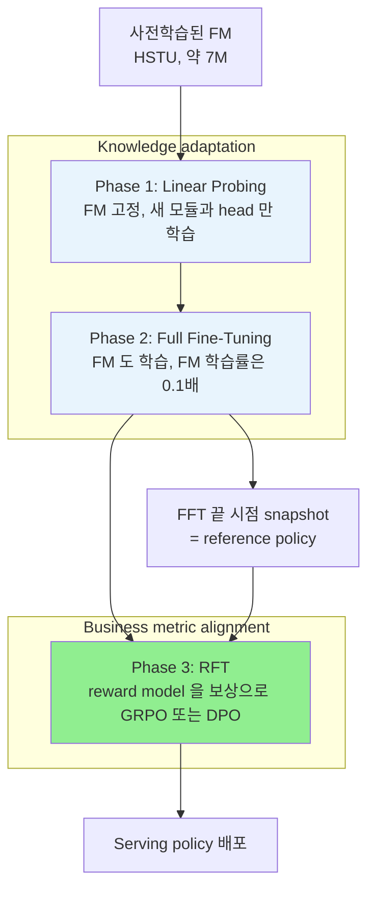

# A) 한줄 요약

NAVER WEBTOON 이 이미 사전학습해 둔 추천 Foundation Model(FM)을 웹툰의 "새 작품 발견" 추천 화면에 붙이면서 쓴 **3단계 post-training** 방법이다. FM 을 새로 학습하는 논문이 아니다. 학습 대상은 FM 위에 붙이는 화면 전용 모듈과 head 이고, FM 은 단계에 따라 얼리거나 조금씩만 고친다. 먼저 FM 을 얼린 채 새 head 만 학습하고(**Linear Probing, LP**), 그다음 전체를 풀어 학습하고(**Full Fine-Tuning, FFT**), 마지막으로 reward model 을 기준으로 강화학습을 한다(**Reinforcement Fine-Tuning, RFT**).

이 논문의 중심 주장은 "비즈니스 지표는 serving 모델이 아니라 reward model 이 배워야 한다" 는 것이다. 결제·완독처럼 드물게 관측되는 신호로 serving 모델을 직접 학습하면 랭킹 변별력이 약하다. 그래서 serving policy 는 클릭처럼 풍부한 신호로 학습하고, 비즈니스 지표는 reward model 에만 학습시킨 뒤 RFT 로 policy 쪽에 옮긴다. 오프라인에서는 GRPO + reward model 조합이 클릭 랭킹(Rank NDCG 0.437 → 0.463)과 깊은 소비 랭킹(Funnel NDCG 0.625 → 0.637)을 함께 올렸고, 한 달 온라인 A/B 에서도 기존 CTR×CVR 모델 대비 유료 회차 끝까지 보기(LastPaid/Imp)가 +13.4%p 올랐다.

- **저자**: Oseong Choi\*, Hoeinn Kim\*, Jihoon Lee, Byungsoo Kang, Taeyeong Jang (NAVER WEBTOON, \*공동 1저자)
- **발표**: RecSys '26 (arXiv 2608.06792, 2026-08-07)
- **베이스 모델**: HSTU encoder 기반 sequential FM, 약 7M parameters
- **풀려는 문제**: 한국 웹툰 플랫폼의 "새 작품 발견(discovery)" 화면에서 사용자가 아직 안 본 작품을 추천하되, 클릭보다 깊은 소비(무료 회차 완독, 유료 회차 진입)를 늘리는 것
- **serving 모델의 형태**: 카탈로그 전체 작품을 클래스로 두는 다중 분류(softmax). 입력은 사용자뿐이다
- **코드**: [webtoon/rec-fm-progressive-alignment](https://github.com/webtoon/rec-fm-progressive-alignment) (합성 데이터로 도는 reference 구현, Apache-2.0)

# B) 전체 구조

## B.1) FM 과 이 논문이 학습하는 것

추천 FM 은 대규모 사용자 행동 로그로 다음 행동을 예측하도록 사전학습한(autoregressive multi-task) sequence encoder 다. 입력은 사용자가 시간순으로 본 작품, 콘텐츠 유형, 행동 유형, 행동 사이 시간 간격이고, 출력은 예측값이 아니라 **사용자 표현(embedding)** 이다. FM 의 내부 구조와 사전학습 목표의 세부는 논문과 reference 구현 모두 공개하지 않았다.

"Foundation model" 이라는 이름과 GRPO·DPO 는 LLM 에서 빌려 왔지만, 이 모델은 자연어를 다루지 않는다. 입력은 텍스트가 아니라 작품 id·행동 유형 같은 ID 시퀀스이고, 사용자 표현도 최종 목적이 아니라 중간 산물이다. 최종 출력은 작품마다 매긴 점수이고, 화면에는 그 점수 순으로 고른 상위 작품 목록이 나간다. LLM 에서 action 이 다음 토큰이라면 여기서는 추천할 작품 하나다.

회사는 이 FM 하나를 여러 serving 화면에 붙여 쓴다. 화면마다 목표가 달라 그때마다 화면 전용 모듈과 head 를 새로 달아 학습한다. 이 논문이 다루는 것은 그 붙이는 과정, 즉 **post-training 레시피** 다. 실험한 화면은 사용자가 아직 안 본 작품을 추천하는 discovery 화면이다.

## B.2) 세 개의 head

모델은 FM 위에 세 개의 head 를 가진다. 셋 다 작품 하나하나에 대해 점수를 내는 카탈로그 크기의 출력을 낸다.

| head | 문제 형태 | 정답 | 역할 |
| --- | --- | --- | --- |
| Serving policy $\pi_\theta$ | 카탈로그 전체 작품 중 하나를 고르는 다중 분류 (softmax) | 세션에서 클릭한 작품 (dense) | 실제 랭킹에 쓰는 점수 |
| Reward model $R_\phi$ | 작품마다 ordinal regression (이진 분류 5개) | 그 작품에서 도달한 funnel 단계 (sparse) | RFT 의 보상 |
| Propensity $P_\psi$ | 작품마다 이진 분류 (multi-label) | 노출됐는지 여부 | reward 학습의 편향 보정 |

실제 서비스에 쓰는 serving policy 는 흔한 CTR 이진 분류가 아니다. 입력은 사용자뿐이고, 작품은 입력이 아니라 **출력 클래스** 다. 작품 수만큼 클래스가 있는 분류 문제로, YouTube DNN 의 후보 생성 모델과 같은 형태다. 반대로 비교 대상인 기존 production 모델(CTRL)은 (사용자, 작품) 쌍마다 클릭 확률과 전환 확률을 따로 내서 곱하는 이진 분류 두 개다.

![[img-962970b6b3.png|Foundation–expert 구조 (논문 Figure 1)]]

## B.3) 학습 단계

FM 이 만든 사용자 표현 $h_\text{fm}$ 과 화면 전용 downstream encoder 가 만든 $h_\text{ds}$ 를 이어 붙여(concat) 세 head 에 넘긴다. 학습은 아래 세 단계로 진행한다.

![[img-5500deb686.png|3단계 post-training 파이프라인 (논문 Figure 2). 실선은 gradient 가 흐르는 경로, 점선은 고정되거나 detach 된 경로]]

그림의 점선은 gradient 가 막힌 경로다. Phase 1 에서는 FM encoder 가 점선, 즉 고정이다. Phase 1·2 모두에서 reward 와 propensity head 로 가는 화살표도 점선이다. Reference 구현을 보면 이 두 head 는 `h.detach()` 를 입력으로 받는다. 비즈니스 지표 신호가 공유 표현을 바꾸지 않고 head 만 학습시킨다는 뜻이다. 공유 표현을 움직이는 것은 SFT 단계에서는 클릭 loss 뿐이고, 비즈니스 지표는 Phase 3 의 RFT 를 통해서만 policy 에 들어간다.

# C) 배경 지식

## C.1) Foundation–Expert 패러다임

거대한 공용 FM 이 범용 사용자 표현을 만들고, 화면마다 가벼운 expert 모듈이 그 표현에 화면 전용 feature 를 더해 최종 예측을 한다. Meta 의 foundation–expert 구조나 Pinterest 의 PinFM 이 같은 방향이다. 이 논문의 downstream encoder 가 expert 에 해당한다.

## C.2) Linear Probing 과 LP-FT

[[linear probing]] 은 사전학습 모델(backbone)을 얼리고 그 위에 붙인 head 만 학습하는 방식이다. 원래는 표현을 **평가하는** 방법이었다. "probe" 는 탐침이라는 뜻으로, 얼린 표현 위에 선형 분류기 하나만 올려 그 표현에 정보가 얼마나 담겨 있는지 잰다. SimCLR·MAE 같은 self-supervised 논문이 보고하는 "linear probe accuracy" 가 이것이다. 엄밀히는 head 가 선형층 하나여야 하고, MLP 를 올리면 보통 MLP probe 라고 따로 부른다.

이 논문의 LP 는 그보다 넓은 뜻이다. FM 만 얼리고, downstream encoder(Transformer)와 MLP head 세 개를 함께 학습한다. 정확히는 "backbone 을 얼린 채 하는 학습" 이고, 이름은 아래 LP-FT 의 관례를 따랐다.

[[fine tuning|Full fine-tuning]] 은 전체 파라미터를 학습하는 방식이다. Kumar et al. (2022) 는 랜덤 초기화된 head 를 단 채 처음부터 전체를 fine-tuning 하면 사전학습 feature 가 망가진다는 것을 보였다. 학습 초반 head 가 엉터리 gradient 를 내고, 그 gradient 가 backbone 까지 흘러 들어가기 때문이다. 그래서 LP 로 head 를 먼저 쓸 만한 상태로 만든 뒤 FT 하는 **LP-FT** 순서가 더 낫다.

**Discriminative learning rate** 는 같은 모델 안에서 부위별로 학습률을 다르게 주는 기법이다. 여기서는 FM backbone 에 downstream 모듈보다 10배 작은 학습률을 준다.

## C.3) Ordinal Regression

순서는 있지만 간격은 정의되지 않은 라벨(노출 < 클릭 < 첫 화 감상 < …)을 예측하는 방법이다. $L$ 단계 라벨을 $L-1$ 개의 cutpoint 로 나누고, cutpoint 마다 "이 단계를 넘었는가" 를 binary classification 으로 푼다. 6단계 funnel 이면 cutpoint 5개, binary 문제 5개가 된다.

## C.4) IPS 와 SNIPS

로그 데이터는 과거 추천 정책이 노출시킨 작품에 대해서만 반응이 남는다([[exposure bias]]). 자주 노출된 작품의 데이터가 학습을 지배하므로, 노출 확률(propensity)의 역수로 가중치를 주어 이 편향을 되돌린다([[inverse propensity scoring weighting, IPW|IPS]]). 노출 확률이 아주 작으면 가중치가 폭발하므로 상한 $\tau_\text{IPS}$ 로 자른다(clipping). **SNIPS**(self-normalized IPS)는 그 가중치를 전체 합으로 나눠 합이 1이 되게 정규화한 것으로, 분산을 줄이는 대신 약간의 편향을 받아들인다.

## C.5) GRPO 와 DPO

둘 다 LLM 정렬에서 온 방법이다.

- **GRPO**(Group Relative Policy Optimization): PPO 에서 value network 를 없앤 변형이다. 한 입력에 대해 출력 여러 개를 묶어(group) reward 를 매기고, group 평균과 표준편차로 정규화한 값을 [[advantage function|advantage]] 로 쓴다. 평균보다 나은 출력은 확률을 올리고, 못한 출력은 내린다.
- **DPO**(Direct Preference Optimization): reward model 없이 "A 가 B 보다 낫다" 는 선호 쌍에서 바로 policy 를 학습한다. Reference policy 대비 log-확률 비율을 A 쪽이 더 크게 만들도록 학습한다.

## C.6) Difference-in-Differences

온라인 실험 결과에 쓰는 추정법이다. 실험군과 대조군의 차이를 실험 시작 전과 후에 각각 재고, 그 둘을 다시 뺀다. 실험 전부터 있던 두 집단의 차이를 지우고 순수한 처치 효과만 남기려는 것이다.

# D) 기존 방법의 한계

추천 FM 에 LLM 식 RFT 를 바로 옮기려 하면 두 문제가 생긴다.

**첫째, 한 번에 전체를 fine-tuning 하면 사전학습 표현이 무너진다.** 새로 붙인 downstream 모듈과 head 는 랜덤 초기화 상태다. 이 상태에서 FM 까지 같이 학습하면 head 쪽의 분산 큰 gradient 가 backbone 을 흔들어, head 가 의미 있는 걸 배우기 전에 FM 표현이 먼저 망가진다(catastrophic forgetting).

**둘째, 비즈니스 지표로 serving 모델을 직접 학습하기 어렵다.** 웹툰에서 실제로 중요한 것은 클릭이 아니라 무료 회차를 다 보고 유료 회차까지 넘어가는지다. 하지만 이런 신호는 클릭보다 훨씬 드물고 늦게 관측된다. 이걸로 serving 모델을 학습하면 "대략 좋은 방향" 은 배우지만 전체 카탈로그에서 작품을 세밀하게 줄 세울 변별력이 부족하다. 실제로 이 논문의 실험에서도 reward model 을 그대로 랭킹에 쓰면 Rank NDCG 가 모든 구성 중 가장 낮다(0.394).

그래서 저자들은 역할을 나눈다. 풍부한 클릭 신호로 변별력 있는 serving policy 를 만들고, 드문 비즈니스 신호는 reward model 에만 학습시켜 RFT 의 보상으로 쓴다.

# E) 제안 방법

## E.1) 모델 구조

### FM 표현과 downstream 표현의 결합

사용자 행동 시퀀스 $s$ 를 FM 의 sequence encoder 에 넣어 임베딩 시퀀스 $E$ 를 얻고, 학습 가능한 query 벡터 $q$ 로 cross-attention pooling 해 고정 길이 벡터로 줄인다 (논문 3.1.1).

$$
E = \text{SequenceEncoder}(s), \quad \alpha = \text{softmax}\left(\frac{qE^\top}{\sqrt{d}}\right), \quad h_\text{fm} = \alpha E
$$

$$
h = [h_\text{fm} ; h_\text{ds}]
$$

여기서:

| 기호 | 의미 |
| --- | --- |
| $s$ | 사용자의 시간순 행동 시퀀스 (작품 id, 콘텐츠 유형, 행동 유형, 시간 간격) |
| $E$ | FM encoder 출력, 시퀀스 길이 × $d$ |
| $q$ | 학습 가능한 pooling query, $d$ 차원 |
| $h_\text{fm}$ | FM 쪽 사용자 표현 |
| $h_\text{ds}$ | downstream encoder 가 만든 화면 전용 표현 |
| $h$ | 세 head 에 들어가는 최종 사용자 표현, $2d$ 차원 |

Downstream encoder 는 무료 회차 소비량, 유료 회차 소비량, 연재 이어보기 같은 장기 행동 통계를 입력으로 받는다. Reference 구현에서는 사용자가 소비한 작품 목록을 FM 과 **같은 item embedding** 으로 임베딩하고, 작품별 행동 통계를 projection 해 `v * (1 + c)` 꼴로 곱한 뒤 CLS 토큰을 붙인 Transformer 로 인코딩한다. 논문 Figure 1 에도 downstream 쪽에 FM item embedding matrix 가 공유돼 있다.

Serving policy 는 이 $h$ 를 MLP 에 넣어 카탈로그 크기의 logit 을 내고, softmax 를 씌워 작품 위의 확률분포 $\pi_\theta(\cdot \mid u)$ 로 쓴다(reference 구현 기준). RFT 의 확률 비율과 KL 은 모두 이 분포 위에서 계산한다.

### Reward model: funnel 깊이를 ordinal regression 으로

웹툰 소비는 단계가 깊어지는 funnel 이다. 논문은 이를 6단계로 정의한다.

1. 노출 (impression)
2. 클릭
3. 첫 회차 감상
4. 무료 회차 완독
5. 유료 회차 진입
6. 유료 콘텐츠 완독

사용자–작품 쌍 $(u, v)$ 에 대해 도달한 가장 깊은 단계를 $f$ 라 하고, cutpoint $C = 5$ 개에 대해 ordinal target 을 만든다.

$$
t_{u,v,c} = \mathbb{I}(f > c), \quad c = 1, \dots, C
$$

노출 편향을 보정하려고 propensity head 가 노출 확률 $\hat{p}_{u,v} = \sigma(\hat{z}_{\text{imp},u,v})$ 를 예측하고, 이를 clipped IPS 후 self-normalize 한 가중치로 바꿔 ordinal loss 에 곱한다.

$$
s_{u,v} = \min\left(\frac{1}{\hat{p}_{u,v}}, \tau_\text{IPS}\right), \quad \tilde{w}_{u,v} = \frac{s_{u,v}}{\sum_{(u',v') \in D_r} s_{u',v'}}
$$

$$
L_\text{reward} = \sum_{(u,v) \in D_r} \tilde{w}_{u,v} \sum_{c=1}^{C} \text{BCE}(\hat{z}_{u,v,c}, t_{u,v,c})
$$

추론 때는 cutpoint 별 확률을 더해 연속값 reward 하나로 만든다.

$$
R_\phi(u, v) = \sum_{c=1}^{C} \sigma(\hat{z}_{u,v,c})
$$

여기서:

| 기호 | 의미 |
| --- | --- |
| $f$ | 사용자 $u$ 가 작품 $v$ 에서 도달한 가장 깊은 funnel 단계 (1–6) |
| $\hat{z}_{u,v,c}$ | cutpoint $c$ 를 넘을지에 대한 logit |
| $\hat{p}_{u,v}$ | propensity head 가 예측한 노출 확률 |
| $\tau_\text{IPS}$ | IPS 가중치 상한 (논문에 값 미공개) |
| $D_r$ | reward 학습에 쓰는 노출 로그 |
| $R_\phi$ | 최종 reward, 0–5 범위의 연속값 |

$R_\phi$ 는 "넘을 것으로 기대되는 cutpoint 개수" 이므로 기대 funnel 깊이에서 1을 뺀 값으로 읽을 수 있다. 예를 들어 cutpoint 별 확률이 $0.95, 0.6, 0.4, 0.2, 0.05$ 로 나왔다면(설명용 가상 수치) $R_\phi = 2.2$ 이고, 평균적으로 3단계(첫 회차 감상)와 4단계(무료 회차 완독) 사이까지 갈 것으로 보는 셈이다. Binary 지표 하나가 아니라 깊이에 비례하는 연속 점수가 나오므로, 뒤에서 GRPO 가 reward 의 크기 차이까지 쓸 수 있게 된다.

## E.2) Phase 1–2: Supervised Fine-Tuning

두 단계 모두 같은 목적함수를 쓴다. 바뀌는 것은 어떤 파라미터를 움직이느냐다.

$$
L_\text{SFT} = L_\text{policy} + L_\text{reward} + L_\text{propensity}
$$

- $L_\text{policy}$: 클릭한 작품에 대한 cross-entropy (카탈로그 전체 softmax)
- $L_\text{reward}$: 위의 SNIPS 가중 ordinal BCE
- $L_\text{propensity}$: 각 작품이 노출됐는지에 대한 BCE

**Phase 1 (LP)** 에서는 FM backbone 을 얼리고 downstream encoder 와 세 head 만 학습한다. 랜덤 초기화된 모듈이 고정된 FM 표현 공간에 먼저 맞춰지므로, 분산 큰 gradient 가 FM 을 망가뜨릴 일이 없다.

**Phase 2 (FFT)** 에서는 FM 까지 풀어 함께 학습한다. Downstream 쪽이 이미 안정된 상태라 최적화가 덜 흔들린다. 여기에 FM 학습률을 downstream 의 0.1배로 주어 FM 은 보수적으로, 화면 전용 모듈은 빠르게 적응하게 한다.

## E.3) Phase 3: Reinforcement Fine-Tuning

FFT 가 끝난 모델의 snapshot 을 고정해 reference policy $\pi_\text{ref}$ 로 둔다. RFT 동안에는 policy head 와 FM backbone 만 학습하고 reward·propensity head 는 고정한다.

### GRPO

사용자 상태 하나에 대해 현재 policy 가 고른 후보 작품 $K$ 개를 group 으로 묶고, reward model 점수를 group 안에서 정규화해 advantage 로 쓴다.

$$
A_k = \frac{R_\phi(a_k) - \bar{R}}{\sigma_R}, \quad \bar{R} = \frac{1}{K}\sum_{k=1}^{K} R_\phi(a_k), \quad \sigma_R = \text{std}(R_\phi(a_k))
$$

$$
\rho_k(\theta) = \frac{\pi_\theta(a_k)}{\pi_\text{ref}(a_k)}, \quad L_k(\theta) = \min\left(\rho_k(\theta) A_k, \ \text{clip}(\rho_k(\theta), 1-\epsilon, 1+\epsilon) A_k\right)
$$

$$
L(\theta) = -\mathbb{E}_k[L_k(\theta)] + \beta \cdot D_\text{KL}\left(\pi_\theta(\cdot \mid s) \,\|\, \pi_\text{ref}(\cdot \mid s)\right)
$$

(논문 Eq 1)

| 기호 | 의미 |
| --- | --- |
| $a_k$ | group 안의 $k$ 번째 후보 작품. 현재 policy 의 상위 $K$ 개를 greedy 하게 고른다 |
| $K$ | group 크기, 실험에서는 32 (serving 추천 개수에 맞춤) |
| $A_k$ | group 안에서 정규화한 advantage |
| $\rho_k$ | reference 대비 현재 policy 의 확률 비율 |
| $\epsilon$ | clipping 범위, 0.1 |
| $\beta$ | [[KL-Divergence]] penalty 계수, 0.001 |

작은 예로 보면 동작이 분명해진다. 상위 4개 후보의 reward 가 $[3.0, 2.0, 1.0, 2.0]$ 이라면 평균 2.0, 표준편차 약 0.82 이므로 advantage 는 $[+1.22, 0, -1.22, 0]$ 이 된다. 첫 번째 작품의 확률은 올리고 세 번째는 내린다. 네 작품 모두 클릭 확률로는 상위권이지만, 그중 더 깊이 소비될 작품 쪽으로 확률을 옮기는 것이다.

LLM 의 GRPO 와는 몇 가지가 다르다. Reference 구현과 Algorithm 1 을 기준으로 정리하면 다음과 같다.

| 항목 | LLM 의 GRPO | 이 논문의 GRPO |
| --- | --- | --- |
| group 을 만드는 법 | 같은 프롬프트로 출력을 여러 번 sampling | 현재 policy 상위 $K$ 개 작품을 deterministic 하게 선택 |
| action | 토큰 시퀀스 | 작품 하나 |
| 확률 비율의 분모 | 직전 policy $\pi_\text{old}$ | FFT 끝 시점의 고정된 $\pi_\text{ref}$ |
| reward | 정답 검증기 또는 reward model | 고정된 funnel reward model |

분모가 고정된 $\pi_\text{ref}$ 라는 점은 해석이 필요하다. Clipping 이 "한 번의 update 크기" 가 아니라 "SFT policy 로부터 얼마나 멀어질 수 있는가" 를 제한하는 역할을 하게 된다. KL 계수가 0.001 로 작은데도 학습이 안정적인 이유 중 하나로 보인다(논문이 직접 밝힌 내용은 아니고, 코드 구조에서 읽은 해석이다).

### DPO

같은 group 안에서 reward 가 더 높은 작품을 선호 쌍으로 만든다. Reward model 점수로 쌍을 만들면 **DPO w/ RM**, 실제 관측된 funnel 깊이로 만들면 **DPO w/o RM** 이다.

$$
\mathcal{P} = \{(a_i, a_j) \mid R_\phi(a_i) > R_\phi(a_j)\}, \quad \Delta_k = \log \pi_\theta(a_k) - \log \pi_\text{ref}(a_k)
$$

$$
L_\text{DPO}(\theta) = -\mathbb{E}_{(a_i, a_j) \in \mathcal{P}} \log \sigma\left(\beta(\Delta_i - \Delta_j)\right)
$$

GRPO 는 reward 의 크기 차이를 advantage 에 그대로 담지만, DPO 는 "누가 더 높은가" 만 남긴다. 3.01 과 3.00 의 차이와 5.0 과 0.5 의 차이가 같은 하나의 쌍으로 취급된다. 이 차이는 뒤의 실험에서 GRPO 와 DPO 가 서로 다른 지표를 올리는 이유로 이어진다.

## E.4) Implementation Details

| 항목 | 값 |
| --- | --- |
| FM | HSTU encoder, 약 7M parameters |
| 1-phase SFT | 100 epochs |
| 2-phase SFT | LP 50 epochs + FFT 50 epochs (총 예산을 1-phase 와 맞춤) |
| 학습률 (LP / FFT) | $10^{-3}$ / $10^{-4}$ |
| FM 학습률 (FFT, LR control 적용 시) | $10^{-5}$ |
| RFT | 2-phase SFT checkpoint 에서 시작, 추가 50 epochs |
| 학습률 (RFT, policy / FM) | $10^{-5}$ / $10^{-6}$ |
| 후보 group 크기 $K$ | 32 (GRPO, DPO 공통) |
| GRPO clipping $\epsilon$ / KL $\beta$ | 0.1 / 0.001 |
| 미공개 | batch size, embedding 차원, $\tau_\text{IPS}$, DPO $\beta$, GPU·학습 시간, 데이터 규모 |

FM 이 7M 으로 작은 편이다. HSTU 원 논문(Actions Speak Louder than Words)이 수조 파라미터 규모까지 키운 것과 비교하면, 이 논문은 FM 의 규모보다 post-training 절차 쪽에 무게를 둔 실험이다.

# F) 데이터셋과 평가

## F.1) 오프라인

- **데이터**: 한국 웹툰 플랫폼의 실제 상호작용 로그
- **평가 구간**: 가장 최근 3주
- **테스트셋**: 사용자 10%를 무작위로 뽑아 이 구간의 세션을 평가
- **과제**: discovery, 즉 사용자가 아직 본 적 없는 작품을 추천

지표는 두 가지로, 각각 다른 질문에 답한다.

| 지표 | 랭킹 대상 | 정답 | 묻는 것 |
| --- | --- | --- | --- |
| Rank NDCG | 전체 카탈로그 | 세션에서 클릭한 작품 = 1, 나머지 0 | 클릭할 작품을 전체 중에서 위로 올리는가 |
| Funnel NDCG | 그 세션에 실제 노출된 작품만 | 도달한 funnel 단계 (graded) | 노출된 작품을 소비 깊이 순으로 줄 세우는가 |

두 지표 모두 [[Normalized Discounted Cumulative Gain|NDCG]] 다. Rank NDCG 는 serving 변별력을, Funnel NDCG 는 비즈니스 지표와의 정렬을 본다. 두 지표를 함께 보는 것은 클릭 변별력과 소비 깊이 중 한쪽만 높은 모델을 걸러내기 위해서다.

## F.2) 온라인

한 달 동안 대규모 A/B 테스트를 했다. 비교 대상은 네 개다.

- **CTRL**: FM 없이 CTR 과 CVR 을 따로 예측해 곱(CTCVR)으로 랭킹하는 기존 production 모델 (ESCM² 계열의 표준 multi-task 구조)
- **SFT**: LP → FFT + LR control
- **GRPO w/ RM**: SFT 위에 reward model 기반 GRPO
- **DPO w/o RM**: SFT 위에 관측 funnel 기반 DPO

지표는 노출 1회당 같은 세션 안에서 일어난 일이다: 클릭(Click/Imp), 몰입 감상(Engaged/Imp), 마지막 무료 회차 도달(LastFree/Imp), 마지막 유료 회차 도달(LastPaid/Imp).

# G) 실험 결과

## G.1) 오프라인 ablation (논문 Table 1)

| 구분 | 구성 | Rank NDCG | Funnel NDCG |
| --- | --- | --- | --- |
| SFT | 1-Phase (FFT only) | 0.429 | 0.620 |
| SFT | 1-Phase (LP only) | 0.426 | 0.620 |
| SFT | 2-Phase (LP → FFT, LR control 없음) | 0.434 | 0.622 |
| SFT | 2-Phase (LP → FFT, LR control) | **0.437** | **0.625** |
| Reward 직접 serving | Reward model 로 랭킹 | 0.394 | 0.637 |
| RFT | 2-Phase SFT baseline | 0.437 | 0.625 |
| RFT | GRPO w/ RM | **0.463** | **0.637** |
| RFT | GRPO w/o RM (관측 funnel) | 0.441 | 0.627 |
| RFT | DPO w/ RM | 0.423 | 0.630 |
| RFT | DPO w/o RM (관측 funnel) | 0.453 | **0.637** |

결과를 세 덩어리로 읽을 수 있다.

**LP → FFT 순서와 학습률 조절은 작지만 일관되게 효과가 있다.** LP 만 하거나 FFT 만 하면 둘 다 Rank NDCG 0.43 근처에 머문다. 두 단계로 나누면 0.434, FM 학습률을 0.1배로 낮추면 0.437 까지 오른다. 차이가 0.008 정도로 작고, 논문은 오프라인 결과의 분산이나 유의성을 보고하지 않았다.

**Reward model 은 정렬 신호로는 좋지만 serving 점수로는 나쁘다.** Reward model 로 직접 랭킹하면 Funnel NDCG 는 0.637 로 최고 수준이지만 Rank NDCG 는 0.394 로 모든 구성 중 가장 낮다. 소비 깊이의 방향은 잘 잡지만 전체 카탈로그에서 줄 세울 변별력이 없다는, 앞의 '기존 방법의 한계' 에서 본 주장 그대로다. GRPO w/ RM 은 Funnel NDCG 를 이 수준(0.637)으로 맞추면서 Rank NDCG 는 0.463 으로 끌어올렸다. 비즈니스 신호가 변별력을 해치지 않고 policy 로 옮겨진 것이다.

**Reward model 을 연속값으로 쓰느냐, 쌍으로 바꿔 쓰느냐에 따라 결과가 달라진다.** GRPO 는 reward model 을 쓸 때(0.463)가 관측 funnel 을 쓸 때(0.441)보다 낫다. DPO 는 반대로 관측 funnel 이 낫고(0.453), reward model 로 쌍을 만들면 Rank NDCG 가 0.423 으로 SFT baseline(0.437)보다도 떨어진다. 논문 본문은 "RFT 가 대체로 두 지표를 모두 올린다" 고 쓰지만, DPO w/ RM 의 Rank NDCG 는 예외다. 저자들의 해석은 이렇다. 연속 reward 를 binary 쌍으로 바꾸면 크기 정보가 사라지고, 근소한 점수 차이까지 확정적인 선호로 바뀌어 reward model 의 노이즈가 증폭된다. 반면 관측 funnel 로 만든 쌍은 드물지만 실제 행동이라 노이즈가 적다.

## G.2) 온라인 A/B (논문 Figure 3)

![[img-eda51bb7ce.png|온라인 A/B 결과 (논문 Figure 3). 위는 지표별 DiD, 아래는 Click/Imp 와 LastPaid/Imp 의 일별 lift 추이]]

CTRL 대비 DiD 추정치(실험 전후 lift 차이, %p)를 옮기면 다음과 같다.

| 모델 | Click/Imp | Engaged/Imp | LastFree/Imp | LastPaid/Imp |
| --- | --- | --- | --- | --- |
| SFT | +13.1 | +9.4 | +8.0 | +5.0 |
| GRPO w/ RM | +16.2 | **+13.4** | **+17.2** | **+13.4** |
| DPO w/o RM | **+18.5** | +11.4 | +13.8 | +8.5 |

- **FM 으로 바꾸는 것만으로 큰 이득이 있다.** SFT 만으로도 모든 지표에서 CTRL 을 넘는다. 기존 CTR×CVR 모델을 FM 기반으로 교체하는 효과가 RFT 이전에 이미 크다.
- **RFT 방법에 따라 funnel 의 어느 쪽이 오르는지가 다르다.** GRPO w/ RM 은 몰입 감상, 무료 회차 도달, 유료 회차 도달처럼 깊은 단계에서 가장 크게 오른다. DPO w/o RM 은 클릭에서 가장 크게 오르고 깊은 단계는 GRPO 에 못 미친다.
- **이득은 초반에 크게 튀었다가 줄어들지만, 줄어든 뒤에도 유의하게 남는다.** 일별 추이를 보면 배포 직후 lift 가 높다가 며칠에 걸쳐 내려오고, 이후 낮지만 양의 수준에서 안정된다(모든 변형·지표에서 p < 0.001). 세 모델의 순서는 실험 기간 내내 바뀌지 않았고, LastPaid/Imp 에서는 GRPO w/ RM > DPO w/o RM > SFT 순서가 유지됐다. 아래 그래프의 점선(실험 기간 평균 lift)은 Click/Imp 가 13.2 / 16.1 / 18.8%, LastPaid/Imp 가 3.4 / 9.3 / 8.8% 다.

온라인 결과도 오프라인에서 본 GRPO 와 DPO 의 차이와 같은 방향이다. GRPO 는 reward 의 크기를 advantage 로 쓰므로 "훨씬 깊이 소비될 작품" 을 강하게 밀어 올린다. DPO w/o RM 은 실제 행동에서 나온 명확한 쌍을 쓰므로 funnel 위쪽, 즉 클릭 선택을 날카롭게 만드는 데 강하다.

## G.3) 실무적 시사점

**드문 비즈니스 라벨은 serving 모델의 목표가 아니라 reward model 의 목표로 둔다.** 결제·완독 같은 라벨로 랭킹 모델을 직접 학습하거나, 그런 모델을 그대로 serving 하면 변별력을 잃는다. 클릭으로 serving 모델을 만들고 비즈니스 지표는 RFT 보상으로 주입하는 분업이 두 지표를 함께 올렸다. 추천에서 흔한 "CTR × CVR 곱" 이나 다목적 가중합의 대안으로 볼 수 있다.

**Reward model 이 연속값이면 GRPO, 깨끗한 graded 라벨이 있으면 DPO 도 경쟁력이 있다.** Reward model 출력을 쌍으로 바꿔 DPO 에 넣는 조합은 이 논문에서 가장 나빴다. 반대로 관측된 funnel 단계처럼 노이즈가 적은 graded 라벨이 있으면 reward model 없이 DPO 만으로도 GRPO 에 가까운 결과를 냈고, 클릭 지표에서는 오히려 앞섰다. 어느 지표를 밀고 싶은지에 따라 고를 수 있다.

**새 head 를 달 때는 LP 를 먼저 하고, backbone 학습률은 낮춘다.** 오프라인 이득은 작지만 비용도 거의 없다. 이 논문은 같은 epoch 예산을 LP 50 + FFT 50 으로 나눴을 뿐이다.

**Reward 와 propensity head 는 공유 표현에서 떼어 학습한다.** Reference 구현은 두 head 를 detach 된 표현 위에서 학습한다. 드물고 편향된 비즈니스 라벨이 SFT 단계에서 FM 표현을 끌고 가지 않게 하려는 설계로 보인다.

**오프라인 결과를 읽을 때 걸리는 조건이 있다.**

- Funnel NDCG 는 과거 정책이 노출한 작품 안에서만 잰다. 노출되지 않은 작품을 잘 올리는지는 이 지표로 알 수 없다.
- Reward model 이 Funnel NDCG 에서 높게 나오는 것은 같은 funnel 라벨로 학습했기 때문이기도 하다. GRPO w/ RM 이 그 수치를 따라잡았다는 결과도 같은 라벨을 보는 reward model 을 보상으로 썼다는 점을 감안해야 한다.
- RFT 는 고정된 reward model 을 최대화하므로 reward hacking 여지가 있다. 이 논문은 clipping 과 작은 KL 로 이를 막고, 온라인 실험에서 실제 지표가 오르는 것으로 확인했다. Reward model 의 예측 오차가 커지는 구간(신작, 롱테일 작품)에서 어떻게 동작하는지는 보고하지 않았다.

# H) References

- [arXiv 2608.06792](https://arxiv.org/abs/2608.06792) — Choi, Kim, et al. "Progressive Alignment of Recommender Foundation Model through Multi-Phase Post-Training." RecSys '26.
- [DOI 10.1145/3773078.3831870](https://doi.org/10.1145/3773078.3831870)
- [webtoon/rec-fm-progressive-alignment](https://github.com/webtoon/rec-fm-progressive-alignment) — reference 구현 (합성 데이터)
- Kumar et al. 2022, "Fine-Tuning Can Distort Pretrained Features and Underperform Out-of-Distribution" — LP-FT 의 근거
- Zhai et al. 2024, "Actions Speak Louder than Words" — HSTU
- Shao et al. 2024, DeepSeekMath — GRPO
- Rafailov et al. 2023 — DPO
