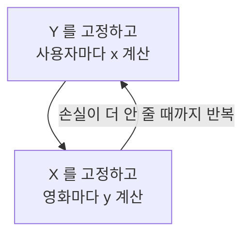

**ALS 는 추천용 행렬 분해를 "번갈아 풀기" 로 학습하는 방법이다.**

- [[matrix factorization|행렬 분해 (Matrix Factorization)]] 는 사용자 × 아이템 표 $R$ 을 작은 두 행렬의 곱 $R \approx XY^{\top}$ 로 근사한다 (교재에 따라 $UV^{\top}$ 로 쓴다).
	- $X$ 의 한 행 $x_u$ 는 사용자 한 명의 취향 벡터, $Y$ 의 한 행 $y_i$ 는 아이템 하나의 특징 벡터다.
- ALS (Alternating Least Squares) 는 $Y$ 를 고정하고 $X$ 를 푼 뒤, $X$ 를 고정하고 $Y$ 를 푸는 일을 번갈아 반복한다.
- 한쪽을 고정하면 문제가 최소제곱 (ridge 회귀) 으로 바뀐다.
	- 답이 $x_u = (Y_u^{\top} Y_u + \lambda I)^{-1} Y_u^{\top} r_u$ 공식 하나로 나온다.
	- 이 식에 다른 사용자가 없으므로 사용자마다 따로, 병렬로 풀 수 있다.
- Weighted ALS 는 클릭 · 시청처럼 별점 없는 데이터(implicit feedback)용 변형이다 (Hu, Koren, Volinsky 2008).
	- 원래 숫자를 "봤는가 (preference)" 와 "그 판단을 얼마나 믿나 (confidence)" 로 나눈다.
	- 안 본 칸까지 전부 학습에 넣고, $Y^{\top}Y$ 를 미리 계산해 두는 트릭으로 그래도 빠르게 푼다.

SGD 와 비교하면 다음과 같다.

| 구분 | SGD | ALS |
| --- | --- | --- |
| 한 번에 고치는 것 | 관측 한 칸에 대해 사용자 · 아이템 값을 조금씩 | 사용자 전체(또는 아이템 전체)를 정답으로 한 번에 |
| 학습률 | 골라야 한다 | 없다 |
| 병렬화 | 같은 사용자 · 아이템을 동시에 고치면 충돌한다 | 사용자끼리, 아이템끼리 독립이라 쉽다 |
| 안 본 칸까지 넣을 때 (implicit) | 모든 칸(수십억 개)을 돌아야 해서 사실상 못 쓴다 | $Y^{\top}Y$ 트릭으로 관측된 칸 수에 비례하는 시간에 끝난다 |
| 쓸 수 있는 손실 함수 | 미분만 되면 무엇이든 (BPR, logistic 등) | 제곱 오차 꼴만 |

Koren 등(2009)도 SGD 가 보통 더 쉽고 빠르지만, 병렬화가 필요하거나 implicit 데이터일 때는 ALS 가 유리하다고 정리한다.

# A) 풀려는 문제: 빈칸 채우기

영화 앱에 사용자 셋, 영화 셋이 있다고 하자. 별점은 일부 칸에만 있다.

| 사용자 | 영화 1 | 영화 2 | 영화 3 |
| --- | --- | --- | --- |
| 지수 | 5 | 4 | ? |
| 민호 | 4 | ? | 2 |
| 서연 | ? | 2 | 1 |

추천은 결국 `?` 칸의 별점을 맞히는 일이다.

**행렬 분해는 사용자마다 벡터 $x_u$, 영화마다 벡터 $y_i$ 를 두고 그 내적이 별점이 되게 맞춘다.**

$$
\hat{r}_{ui} = x_u^{\top} y_i
$$

- 벡터 길이를 $f$ 라 쓴다. 실제로는 20~200 정도를 쓴다.
- $f = 1$ (rank 1) 이면 사람과 영화가 숫자 하나씩이고, 내적은 그냥 곱이다.
	- 지수의 값이 크면 "점수를 후하게 주는 사람", 영화 1 의 값이 크면 "누구나 좋아하는 영화" 쯤으로 읽힌다.

**좋은 값이란 관측된 칸의 오차 제곱 합이 작은 값이다.** 관측된 칸의 집합을 $\mathcal{K}$ 라 하면 다음을 최소화한다.

$$
\min_{X, Y} \sum_{(u,i) \in \mathcal{K}} \left(r_{ui} - x_u^{\top} y_i\right)^2 + \lambda \left( \sum_u \lVert x_u \rVert^2 + \sum_i \lVert y_i \rVert^2 \right)
$$

- 앞 항은 예측과 실제 별점의 차이를 제곱해 관측된 칸만 더한 것이다. `?` 칸은 들어가지 않는다.
- 뒤 항은 벡터가 쓸데없이 커지는 것(과적합)을 막는 규제(regularization)다. $\lambda$ 가 그 세기다.
- 이 전체를 손실(loss)이라 부른다.

# B) 번갈아 풀기

**$X$ 와 $Y$ 를 동시에 모르면 풀기 어렵다.**

- 예측 $x_u^{\top} y_i$ 가 두 미지수의 곱이라 손실이 그릇 모양(볼록)이 아니다.
- 그래서 보통은 SGD 로 조금씩 내려간다.

**$Y$ 를 아는 값으로 고정하면 사용자 한 명의 문제는 ridge 회귀가 된다.** 손실에서 지수($u$)가 들어간 항만 남기면 다음과 같다.

$$
\min_{x_u} \sum_{i \in \mathcal{K}_u} \left(r_{ui} - y_i^{\top} x_u\right)^2 + \lambda \lVert x_u \rVert^2
$$

$\mathcal{K}_u$ 는 $u$ 가 별점을 준 영화다. 이 식을 선형 회귀와 나란히 놓으면 자리가 그대로 맞는다.

| 선형 회귀 | 사용자 $u$ 의 문제 |
| --- | --- |
| 입력 feature 한 행 $a_j$ | 영화 벡터 $y_i$ (고정된 값) |
| 정답 $t_j$ | 별점 $r_{ui}$ |
| 구할 가중치 $w$ | 사용자 벡터 $x_u$ |

**ridge 회귀는 답이 공식 하나로 나온다.** $x_u$ 에 대한 2차식이라 미분해서 0 으로 놓으면 된다.

$$
x_u = \left( Y_u^{\top} Y_u + \lambda I \right)^{-1} Y_u^{\top} r_u
$$

- $Y_u$ 는 $u$ 가 평가한 영화의 $y_i$ 만 행으로 모은 행렬, $r_u$ 는 그 별점 벡터다.
- 반복해서 조금씩 내려가는 SGD 와 달리, 이 한 번의 계산이 "$Y$ 가 이대로일 때의 최선" 이다. 이것이 최소제곱(least squares)이다.
- 식에 다른 사용자의 $x$ 가 없다. 지수 · 민호 · 서연을 동시에 따로 풀 수 있다.

**$X$ 를 고정하면 영화 쪽도 똑같다.** 사용자와 영화의 자리만 바꾼다.

$$
y_i = \left( X_i^{\top} X_i + \lambda I \right)^{-1} X_i^{\top} r_i
$$

$X_i$ 는 영화 $i$ 에 별점을 준 사용자의 $x_u$ 를 모은 행렬, $r_i$ 는 그 별점 벡터다. ALS 는 이 두 식을 번갈아 계산한다.

각 단계는 고정한 쪽 기준으로 최선의 답이라 손실이 늘지 않는다. 다만 출발값에 따라 다른 지점에 멈출 수 있어서 전체 최솟값을 보장하지는 않는다.

# C) Step by Step 예시: 별점 ALS

$f = 1$, $\lambda = 1$ 로 두고, 처음 영화 값은 아무렇게나 전부 1 로 시작한다.

**$f = 1$ 이면 위 공식의 행렬이 전부 숫자가 되고, 역행렬은 나눗셈이 된다.**

$$
x_u = \frac{\sum_{i \in \mathcal{K}_u} r_{ui}\, y_i}{\sum_{i \in \mathcal{K}_u} y_i^2 + \lambda}
$$

- 분자 $Y_u^{\top} r_u$ 는 "별점 × 그 영화 값" 의 합이다.
- 분모 $Y_u^{\top} Y_u + \lambda$ 는 "그 영화 값의 제곱" 의 합에 $\lambda$ 를 더한 것이다.

**1단계: $Y = (1, 1, 1)$ 을 고정하고 $x$ 를 푼다.**

- 지수는 영화 1 · 2 에 5 · 4 점을 줬다. $x_{\text{지수}} = (5 \times 1 + 4 \times 1) / (1^2 + 1^2 + 1) = 9/3 = 3$.
- 민호는 영화 1 · 3 에 4 · 2 점을 줬다. $x_{\text{민호}} = (4 + 2)/3 = 2$.
- 서연은 영화 2 · 3 에 2 · 1 점을 줬다. $x_{\text{서연}} = (2 + 1)/3 = 1$.

지수의 평균 별점은 4.5 인데 값은 3 이 나왔다. 분모의 $\lambda$ 가 값을 0 쪽으로 당긴 것이다. 별점을 적게 준 사람일수록 분모의 다른 항이 작아서 이 당김이 세다.

**2단계: $X = (3, 2, 1)$ 을 고정하고 $y$ 를 푼다.** 같은 공식에서 사람과 영화의 자리만 바꾼다.

$$
y_i = \frac{\sum_{u \in \mathcal{K}_i} r_{ui}\, x_u}{\sum_{u \in \mathcal{K}_i} x_u^2 + \lambda}
$$

- 영화 1 은 지수(값 3)에게 5 점, 민호(값 2)에게 4 점을 받았다. $y_1 = (5 \times 3 + 4 \times 2)/(3^2 + 2^2 + 1) = 23/14 = 1.64$.
- 영화 2 는 $y_2 = (4 \times 3 + 2 \times 1)/(3^2 + 1^2 + 1) = 14/11 = 1.27$.
- 영화 3 은 $y_3 = (2 \times 2 + 1 \times 1)/(2^2 + 1^2 + 1) = 5/6 = 0.83$.

영화 1 은 높은 별점을 받았고, 그 별점을 준 사람의 값도 커서 값이 가장 크다.

**한 바퀴마다 손실이 줄고, 곧 멈춘다.**

- 1단계 뒤 손실은 27.0, 2단계 뒤 20.2 다.
- 10 바퀴쯤 돌면 17.36 에서 더 줄지 않는다.
- 이때 `?` 칸 예측 $x_u y_i$ 는 지수 × 영화 3 이 1.95, 민호 × 영화 2 가 2.67, 서연 × 영화 1 이 1.95 다.
- 민호에게는 영화 2 가 그나마 괜찮다는 예측이다. 지수와 서연에게 남은 영화는 별로라는 예측이다.

# D) 별점이 없을 때: Weighted ALS

같은 앱이 이번에는 별점 없이 **재생 횟수**만 기록한다고 하자. 숫자는 위 표와 같고, `?` 는 이제 0 (안 봄) 이다.

| 사용자 | 영화 1 | 영화 2 | 영화 3 |
| --- | --- | --- | --- |
| 지수 | 5 | 4 | 0 |
| 민호 | 4 | 0 | 2 |
| 서연 | 0 | 2 | 1 |

이렇게 사용자가 따로 점수를 주지 않고 행동으로만 남는 데이터를 [[implicit feedback]] 이라 한다. 별점처럼 직접 남긴 것은 [[explicit feedback]] 이다.

## D.1) 0 칸을 다루는 방법

**0 칸을 빼고 학습하면 순위를 못 매긴다.**

- 남는 칸은 전부 "봤다" 뿐이다. 싫다는 신호가 하나도 없다.
- 모델은 모든 칸을 "본다" 로 예측해도 손실이 작다.
- 위 표로 실제로 돌려 보면 9 칸 예측이 전부 0.5 로 같다. 무엇을 먼저 추천할지 정할 수 없다.

**0 칸을 "싫어한다" 로 그대로 넣는 것도 틀리다.**

- 안 본 이유는 싫어서일 수도 있지만, 몰라서 · 비싸서 · 시간이 없어서일 수도 있다.
- 거꾸로 본 것도 선물용으로 샀거나 채널을 안 돌려서 이어 본 것일 수 있다.
- 숫자의 크기는 "얼마나 좋아하나" 가 아니라 "그 판단을 얼마나 믿을 수 있나" 에 가깝다.

## D.2) preference 와 confidence

Hu 등(2008)은 재생 횟수 $r_{ui}$ 를 두 값으로 나눈다.

**preference $p_{ui}$ 는 "봤는가" 다.** 한 번이라도 봤으면 1, 아니면 0 이다.

$$
p_{ui} = \begin{cases} 1 & r_{ui} > 0 \\ 0 & r_{ui} = 0 \end{cases}
$$

**confidence $c_{ui}$ 는 그 $p_{ui}$ 를 얼마나 믿을지다.** 많이 볼수록 커진다.

$$
c_{ui} = 1 + \alpha r_{ui}
$$

- 안 본 칸은 $c_{ui} = 1$ 이다. "안 좋아함 (0)" 으로 학습하되 가장 약하게 믿는다.
- 5 번 본 칸은 $\alpha = 1$ 일 때 $c_{ui} = 6$ 이다. "좋아함 (1)" 을 여섯 배 세게 믿는다.
- $\alpha$ 는 횟수가 확신으로 바뀌는 속도다. 논문 실험에서는 $\alpha = 40$ 이 좋은 결과를 냈다.

**손실은 모든 칸에 대해 confidence 를 곱한 오차 제곱 합이다** (Hu 등 2008, 식 3).

$$
\min_{X, Y} \sum_{u, i} c_{ui} \left(p_{ui} - x_u^{\top} y_i\right)^2 + \lambda \left( \sum_u \lVert x_u \rVert^2 + \sum_i \lVert y_i \rVert^2 \right)
$$

- 별점 ALS 와 두 가지가 다르다.
	- 합이 관측된 칸 $\mathcal{K}$ 가 아니라 모든 칸 $(u, i)$ 에 걸린다.
	- 맞히는 대상이 별점 $r_{ui}$ 가 아니라 0 · 1 인 $p_{ui}$ 이고, 칸마다 무게 $c_{ui}$ 가 붙는다.
- $Y$ 를 고정하면 이것도 칸마다 무게가 붙은 ridge 회귀(weighted least squares)라 답이 공식 하나로 나온다.

$$
x_u = \left( Y^{\top} C^u Y + \lambda I \right)^{-1} Y^{\top} C^u p(u)
$$

- $C^u$ 는 $c_{u1}, \dots, c_{un}$ 을 대각에 놓은 $n \times n$ 행렬이다.
- $p(u)$ 는 $u$ 의 preference 를 모은 길이 $n$ 벡터다.
- 별점 ALS 식의 $Y_u$ (본 영화만) 가 $Y$ (모든 영화) 로 바뀌고, 그 사이에 무게 $C^u$ 가 끼었다.

**Weighted ALS 의 예측값 $x_u^{\top} y_i$ 는 별점이 아니다.** 0 과 1 사이 근처의 선호 점수이고, 사용자마다 이 점수로 아이템 순위를 매겨 위에서부터 추천한다.

## D.3) 모든 칸을 넣을 때의 계산량

**사용자 $m$ 명, 아이템 $n$ 개면 손실에 $m \times n$ 칸이 들어간다.**

- 논문의 TV 데이터는 셋톱박스 약 30만 대 × 프로그램 약 1만 7천 개였다. 칸이 50억 개가 넘는데, 0 이 아닌 칸은 약 3,200만 개뿐이다.
- SGD 는 칸을 하나씩 돌므로 이 크기에서 쓸 수 없다. 논문도 이 때문에 ALS 를 택했다.

**ALS 공식의 $Y^{\top} C^u Y$ 는 모든 아이템을 한 번씩 더하는 합이다.**

$$
Y^{\top} C^u Y = \sum_{i=1}^{n} c_{ui}\, y_i y_i^{\top}
$$

- 아이템마다 $f \times f$ 행렬 $y_i y_i^{\top}$ 에 무게 $c_{ui}$ 를 곱해 더한다.
- 무게가 사용자마다 달라서, 그대로 하면 사용자 한 명마다 아이템 $n$ 개를 전부 훑어야 한다.
- TV 데이터라면 30만 명 × 1만 7천 개, 약 50억 번을 더한다.

**무게 $c_{ui}$ 를 모두에게 같은 1 과 본 아이템에만 붙는 $\alpha r_{ui}$ 로 쪼갠다.** 아래 그림은 영화가 10 편이고 지수가 영화 1 · 2 만 5 번 · 4 번 봤을 때, 지수의 합에 들어가는 영화별 무게다 ($\alpha = 1$).

![[img-fe55e09674.png]]

- 윗줄이 원래 무게 $c_{ui} = 1 + \alpha r_{ui}$ 다.
- 그 무게를 가운데 줄(1)과 아랫줄($\alpha r_{ui}$)로 나눴다. $6 = 1 + 5$, $5 = 1 + 4$, $1 = 1 + 0$ 이다.
- 식으로 쓰면 합이 두 개로 나뉜다.

$$
\sum_{i=1}^{n} c_{ui}\, y_i y_i^{\top} = \underbrace{\sum_{i=1}^{n} y_i y_i^{\top}}_{Y^{\top}Y} + \underbrace{\sum_{i:\, r_{ui} > 0} \alpha r_{ui}\, y_i y_i^{\top}}_{Y^{\top}(C^u - I)Y}
$$

**가운데 줄 $Y^{\top}Y$ 는 사용자와 상관없어서 한 바퀴에 한 번만 계산한다.**

- 지수 · 민호 · 서연 모두 같은 값을 가져다 쓴다.

**아랫줄은 그 사용자가 본 아이템만 훑는다.**

- 안 본 아이템은 $\alpha r_{ui} = 0$ 이라 더해도 0 이다.

**안 본 아이템을 버린 것이 아니다.**

- 안 본 영화 3~10 도 가운데 줄에 무게 1 로 들어 있다.
- 더하는 순서만 바꿨을 뿐, 결과는 그대로 계산한 것과 똑같다.
- 앞에서 0 칸을 학습에서 아예 빼면 9 칸 예측이 전부 0.5 가 됐다. 이 트릭은 그것과 다르다.

**그래서 더하는 횟수가 전체 아이템 수가 아니라 본 아이템 수에 비례한다** (TV 데이터 기준 약 50억 번 → 약 3,200만 번, 약 160 배 감소).

- 쪼갠 뒤에는 공통 부분 1만 7천 번에, 사용자 몫으로 0 아닌 칸 수 약 3,200만 번을 더한다.
- 사용자 한 명이 본 프로그램은 평균 약 107 개다.

**복잡도로 쓰면 다음과 같다.**

- 사용자 한 명: $O(f^2 n) \to O(f^2 n_u + f^3)$. $n_u$ 는 $u$ 가 본 아이템 수, $f^3$ 은 $f \times f$ 역행렬 몫이다.
- 사용자 전체: $O(f^2 N + f^3 m)$. $N$ 은 0 아닌 칸 수라 입력 크기에 선형이다.
- 분자 $Y^{\top} C^u p(u)$ 는 $p_{ui} = 0$ 인 칸이 원래 0 이라 처음부터 본 아이템만 훑는다.
- 아이템 쪽도 $X^{\top} X$ 를 미리 계산해 같은 방식으로 $y_i$ 를 푼다.

## D.4) Step by Step 예시: Weighted ALS

$f = 1$, $\alpha = 1$, $\lambda = 1$ 로 두고, 영화 값은 다시 전부 1 로 시작한다. $f = 1$ 이면 공식이 다음 나눗셈이 된다.

$$
x_u = \frac{\sum_{i} c_{ui}\, p_{ui}\, y_i}{\underbrace{\sum_{i} y_i^2}_{Y^{\top}Y} + \underbrace{\sum_{i:\, r_{ui} > 0} \alpha r_{ui}\, y_i^2}_{Y^{\top}(C^u - I)Y} + \lambda}
$$

**지수의 표를 두 값으로 나눈다.**

- 재생 횟수 $(5, 4, 0)$ 에서 preference 는 $p = (1, 1, 0)$ 이다.
- confidence 는 $c = (1 + 5,\ 1 + 4,\ 1 + 0) = (6, 5, 1)$ 이다.

**분모: 모두에게 같은 $Y^{\top}Y$ 에 지수 몫을 더한다.**

- $Y^{\top} Y = 1^2 + 1^2 + 1^2 = 3$ 이다. 민호 · 서연도 이 3 을 그대로 쓴다.
- 지수 몫 $Y^{\top}(C^u - I)Y$ 는 본 영화의 $\alpha r_{ui} y_i^2$ 합 $5 + 4 = 9$ 다. 영화 3 은 안 봤으니 훑지 않는다.
- 분모는 $3 + 9 + 1 = 13$ 이다.

**분자: $c_{ui} \times p_{ui} \times y_i$ 를 더한다.**

- $6 \times 1 \times 1 + 5 \times 1 \times 1 + 1 \times 0 \times 1 = 11$ 이다.
- $x_{\text{지수}} = 11/13 = 0.85$ 다.

별점 ALS 에서 지수 값은 영화 1 · 2 만 보고 정했다. 여기서는 안 본 영화 3 도 $Y^{\top}Y$ 를 통해 분모에 1 만큼 들어가 "영화 3 은 0 쪽" 이라는 약한 신호를 준다.

**민호 · 서연도 같은 3 에 자기 몫만 더한다.**

- 민호: 분모 $3 + (4 + 2) + 1 = 10$, 분자 $5 + 3 = 8$, $x_{\text{민호}} = 0.80$.
- 서연: 분모 $3 + (2 + 1) + 1 = 7$, 분자 $3 + 2 = 5$, $x_{\text{서연}} = 0.71$.

**10 바퀴쯤 돌면 다음 점수 $x_u y_i$ 가 나온다.**

| 사용자 | 영화 1 | 영화 2 | 영화 3 |
| --- | --- | --- | --- |
| 지수 | 0.87 | 0.82 | 0.73 (안 봄) |
| 민호 | 0.82 | 0.78 (안 봄) | 0.68 |
| 서연 | 0.73 (안 봄) | 0.68 | 0.60 |

- 0 칸을 뺐을 때는 전부 0.5 였다. 이제는 칸마다 점수가 달라서 순위를 매길 수 있다.
- $f = 1$ 이라 세 사람 모두 순서가 영화 1 > 2 > 3 으로 같다. 숫자 하나로는 "많이 본 영화" 순서밖에 못 담는다.
	- 실제로는 $f$ 를 20~200 으로 두어 사람마다 다른 순서가 나오게 한다.

## D.5) 이름이 비슷한 것

- WRMF, WMF, implicit ALS 는 모두 이 Weighted ALS 를 가리킨다.
- ALS-WR (Zhou 등 2008) 의 "Weighted" 는 다른 뜻이다. 별점 ALS 에서 $\lambda$ 에 그 사람이 매긴 별점 수를 곱해 규제를 키운다는 뜻이다.

# E) 부록: 논문의 설정과 변형

- $f$ 는 보통 20~200, 바퀴 수는 보통 10 이다.
- $\alpha = 40$ 을 썼고, $\lambda$ 는 데이터마다 교차 검증으로 정한다.
- confidence 를 로그로 두는 변형 $c_{ui} = 1 + \alpha \log(1 + r_{ui}/\epsilon)$ 도 잘 됐다고 한다. 실험에서는 $\epsilon = 10^{-8}$ 을 썼다.
- 예측 $x_u^{\top} y_i$ 에 $x_u$ 공식을 넣으면 "사용자가 과거에 본 아이템들의 가중합" 으로 다시 쓸 수 있다. 논문은 이것으로 추천 이유("이 프로그램을 본 적 있어서")를 설명한다.

# F) Related

* [[matrix factorization]]
* [[collaborative filtering]]
* [[implicit feedback]]
* [[Collaborative Filtering for Implicit Feedback Datasets]]
* [[Probabilistic Matrix Factorization]]
* [[BPR - Bayesian Personalized Ranking from Implicit Feedback]]

# G) References

* Hu, Y., Koren, Y., Volinsky, C. [Collaborative Filtering for Implicit Feedback Datasets](http://yifanhu.net/PUB/cf.pdf). ICDM 2008.
* Koren, Y., Bell, R., Volinsky, C. [Matrix Factorization Techniques for Recommender Systems](https://doi.org/10.1109/MC.2009.263). IEEE Computer, 2009.
* Zhou, Y., Wilkinson, D., Schreiber, R., Pan, R. [Large-Scale Parallel Collaborative Filtering for the Netflix Prize](https://doi.org/10.1007/978-3-540-68880-8_32). AAIM 2008.
