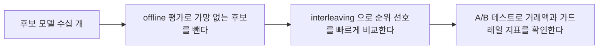

쇼핑 검색 결과의 순서를 정하는 모델 A 를 쓰고 있다. 새 모델 B 를 지난달 검색 기록으로 평가했더니, 클릭된 상품을 얼마나 위에 올렸는지 재는 [[Normalized Discounted Cumulative Gain|NDCG]] 가 A 보다 5% 높았다. 그런데 사용자 절반에게 B 를 2주 동안 보여 줬더니 클릭률은 A 와 거의 같았다.

과거 기록으로 모델을 재는 [[offline evaluation|offline 평가]] 와 달리, 실제 사용자에게 모델을 보여 주고 반응을 재는 것이 online 평가다. 위 장면처럼 두 결과는 자주 어긋나고, 서비스에 올릴지는 online 결과로 정한다.

# A) 한눈에 보기

- **Online 평가는 실제 사용자의 반응으로 모델을 판정한다**: 사용자를 나누는 [[AB Test|A/B 테스트]] 가 기본이고, 한 사용자에게 두 순위를 섞어 보여 주는 interleaving 이 있다.
- **Offline 지표가 올라도 online 결과가 그대로인 이유는 여럿이다**: 과거 랭킹의 편향, 지표와 목표의 불일치, 위쪽 몇 개만 보는 사용자, 평가셋과 실제 트래픽의 차이, 실험이 잡을 수 있는 크기보다 작은 개선, 다른 단계의 병목이다.
- **대응은 원인마다 다르다**: 지표를 online 목표에 맞추고, 로그의 편향을 보정해 평가하고, interleaving 으로 빨리 거르고, 가드레일 지표를 같이 보고, 실험 기간과 표본을 현실적인 개선 폭에 맞춰 정한다.
- **Interleaving 은 같은 검색 안에서 두 모델을 겨루게 해서 적은 사용자로 판정한다**: 대신 거래액이나 재방문 같은 최종 지표는 재지 못한다.

# B) Online 평가가 필요한 이유

**Offline 평가는 과거 기록에 담긴 것만 잴 수 있다.**

- 기록에는 A 가 보여 준 상품에 대한 반응만 있다. B 가 새로 올린 상품에 사용자가 어떻게 반응할지는 기록에 없다.
- 응답 속도, 다른 화면과의 겹침, 사용자의 습관 변화처럼 모델을 실제로 띄워야 생기는 일도 기록에 없다.

**Online 평가는 서비스가 실제로 원하는 결과를 그대로 잰다.**

- 클릭률, 구매 전환율, 거래액, 재방문율을 B 를 본 사용자에게서 직접 센다.
- 대신 실제 사용자가 나쁜 후보를 볼 수 있고, 판정에 수만 명과 몇 주가 든다.

그래서 보통 offline 평가로 후보를 거르고 남은 소수만 online 에 올린다. 실험을 어떻게 설계하고 판정하는지는 [[AB Test]] 에, p-값과 표본 크기의 뜻은 [[통계적 유의성 계산법]] 에 있다.

# C) Offline 지표는 올랐는데 online 결과가 그대로인 이유

## C.1) 과거 랭킹의 편향을 담은 라벨

**Offline 평가의 라벨인 클릭은 A 가 보여 준 순서 위에서 생겼다.**

- A 가 1 위에 둔 상품은 좋은 상품이라서도 클릭되지만 1 위라서도 클릭된다 ([[position bias]]).
- A 가 보여 주지 않은 상품은 클릭될 기회가 없었다 ([[selection bias]]).
- 그래서 offline 평가는 A 와 비슷하게 순위를 매기는 모델을 좋게 본다. B 가 A 와 다르게 바꾼 부분일수록 offline 점수를 덜 믿어야 한다.

자세한 원리는 [[offline evaluation]] 에 있다.

## C.2) Offline 지표와 비즈니스 목표의 불일치

**NDCG 는 클릭된 상품을 위에 올렸는지를 재고, 서비스가 원하는 것은 거래액이나 재방문이다.**

- B 가 싸고 클릭이 잘 되는 상품을 위로 올리면 NDCG 는 오르지만 거래액은 그대로이거나 줄 수 있다.
- Offline 지표는 online 목표를 대신 재는 값이라, 둘이 같이 움직이는지 따로 확인해야 한다.

## C.3) 상위 몇 개만 보는 사용자

**NDCG@10 은 10 위 안의 순서 변화를 모두 점수에 넣지만, 사용자는 대부분 위쪽 몇 개만 본다.**

- B 가 1–4 위는 A 와 똑같이 두고, 10 위에 있던 클릭 상품을 6 위로 올렸다고 하자. 그 검색의 DCG 는 0.29 → 0.36 으로 23% 오른다.
- 휴대폰 첫 화면에 상품이 4 개만 보이면, 6 위까지 내려 보는 사용자가 적어 클릭은 거의 그대로다.

**NDCG 의 위치 할인은 실제 사용자의 시선보다 완만하다.**

- NDCG 는 1 위의 가중치를 1 로 둘 때 6 위에도 0.36, 10 위에도 0.29 를 준다.
- 실제 클릭은 맨 위 몇 개에 훨씬 더 몰린다. 그래서 아래쪽 순서를 바꾼 개선은 offline 에서 크게, online 에서 작게 보인다.

## C.4) 평가셋과 실제 트래픽의 분포 차이

**Offline 평가셋에는 라벨을 만들기 쉬운 질의가 몰린다.**

- 클릭이 충분히 쌓인 질의만 평가셋에 넣으면, 「아이폰 케이스」 처럼 자주 검색되는 질의가 대부분을 차지한다.
- 실제 트래픽에는 한두 번만 검색되는 질의, 오타가 섞인 질의, 새로 나온 상품을 찾는 질의가 많다.
- B 가 자주 검색되는 질의에서만 나아졌다면, 전체 트래픽에서는 그 개선이 희석된다.

지난달 기록과 이번 달 트래픽 사이에 계절·행사·상품 구성이 바뀌는 문제는 [[offline evaluation]] 과 [[covariate shift]] 에 있다.

## C.5) MDE 보다 작은 개선 폭

**실험은 미리 정한 최소 변화량(MDE)보다 작은 차이를 잘 잡지 못한다.**

- 클릭률 5% → 5.5% 를 잡도록 그룹마다 31,300 명으로 설계했다고 하자 ([[AB Test]] 의 예).
- B 의 실제 효과가 5% → 5.1% 라면, 이 실험이 유의한 차이를 찾을 확률(검정력)은 약 9% 다.
- 이 차이를 검정력 80% 로 잡으려면 그룹마다 약 75 만 명이 필요하다.

**NDCG 5% 개선이 클릭률 5% 개선이 되지는 않는다.**

- 앞의 이유들 때문에 online 효과는 보통 offline 개선보다 훨씬 작다.
- 그 작은 효과가 MDE 아래에 있으면 실험은 "유의하지 않음" 으로 끝난다.

**유의하지 않다는 결과가 "B 가 효과 없다" 는 뜻은 아니다.**

- 이 표본으로는 구분하지 못했다는 뜻이다.

## C.6) 다른 단계의 병목

**랭킹 모델은 앞 단계가 넘겨 준 후보의 순서만 바꾼다.**

- 검색은 보통 후보 검색 단계가 수백 개를 꺼내고, 랭킹 모델이 그 순서를 정한다 ([[Cascade Ranking System]]).
- 찾는 상품이 후보에 없으면 B 가 아무리 좋아도 그 검색은 나아지지 않는다.
- Offline 기록의 클릭은 모두 후보 안에서 생겼으므로, 후보 검색이 실패한 검색은 offline 평가에 아예 나타나지 않는다. Online 에서는 그런 검색도 전체 결과에 섞인다.

**화면이 랭킹 모델의 효과를 가리기도 한다.**

- 사용자가 「낮은 가격순」 정렬을 누르면 B 가 정한 순서를 아예 보지 않는다.
- 상품 이미지와 가격이 크게 보이는 화면에서는 순서보다 이미지가 클릭을 더 많이 좌우한다.
- B 그룹 사용자 중 B 의 순서를 실제로 본 검색이 일부뿐이면, 그 효과는 그룹 전체 평균에서 작아진다.

# D) 대응 방법

**Offline 지표를 online 목표에 맞춘다.**

- 사용자가 실제로 보는 개수까지만 재도록 자른다 (예: 첫 화면이 4 개면 NDCG@4).
- 클릭 대신 구매나 구매 금액으로 가중한 지표를 함께 본다.
- 지난 실험들의 offline · online 결과를 쌓아 두고, online 결과와 같은 방향으로 움직인 offline 지표를 믿는다.

**로그의 편향을 보정해 평가한다 (counterfactual · off-policy 평가).**

- 로그의 반응마다 "B 가 그 결과를 보여 줄 확률 ÷ A 가 실제로 보여 준 확률" 로 가중치를 다시 매겨, B 가 서비스됐다면 나왔을 지표를 추정한다.
- 방법과 예시는 [[Offline AB Test]], 위치에 따른 보정은 [[position bias]] 에 있다.

**Interleaving 으로 후보를 빠르게 거른다.**

- 적은 사용자로 두 순위 중 어느 쪽이 더 선호되는지 판정하는 방법이다. 아래에서 따로 다룬다.

**가드레일 지표를 함께 본다.**

- 판정 지표(클릭률)가 올라도 거래액, 응답 시간, 검색 결과 0 건 비율이 나빠지면 B 를 올리지 않는다.
- 가드레일 지표는 승패를 가리는 데 쓰지 않고, B 가 다른 곳을 해치지 않는지 확인하는 데 쓴다 ([[AB Test]]).

**B 가 실제로 결과를 바꾼 검색만 따로 분석한다.**

- A 와 B 의 상위 결과가 똑같은 검색은 두 그룹에서 차이가 날 수 없다. 이런 검색까지 평균에 넣으면 효과가 희석된다.
- 두 모델의 결과가 달랐던 검색만 골라 비교하면(triggered analysis) 같은 효과를 더 적은 표본으로 잡는다.

**실험 기간과 표본을 현실적인 개선 폭에 맞춰 정한다.**

- MDE 는 기대하는 개선이 아니라, online 에서 실제로 나올 법한 개선 크기로 잡는다. 지난 실험에서 offline 개선이 online 에서 얼마로 줄었는지가 기준이 된다.
- 요일 효과가 섞이지 않게 최소 1 주 단위로 돌린다.
- 매일 결과를 보다 멈추기, 새로움 효과 같은 함정은 [[AB Test 함정]] 에 있다.

# E) Interleaving

## E.1) 한 사용자에게 두 순위를 섞어 보여 주기

**A/B 테스트는 사용자를 둘로 나누고, interleaving 은 한 사용자에게 두 모델의 결과를 한 목록으로 섞어 보여 준다.**

- 섞은 목록의 상품마다 A 가 넣은 것인지 B 가 넣은 것인지 기록해 둔다.
- 사용자가 클릭한 상품이 어느 모델 몫인지 세서, 그 검색에서 클릭을 더 많이 받은 모델을 승자로 친다.
- 검색 수천~수만 건에서 B 가 이긴 비율이 50% 보다 유의하게 높으면 B 가 낫다고 판정한다.

## E.2) Team Draft 예시

가장 널리 쓰이는 섞는 방법이 team draft 다. 운동 경기에서 두 주장이 번갈아 선수를 뽑는 것처럼 섞는다.

1. 매 회차마다 동전을 던져 어느 모델이 먼저 뽑을지 정한다.
2. 각 모델은 아직 목록에 없는 상품 중 자기 순위가 가장 높은 것을 하나씩 뽑는다.
3. 목록이 다 찰 때까지 반복한다.

아래 그림에서 색이 칠해진 상자가 섞은 목록에 들어간 상품이고, 괄호 안이 그 상품을 넣은 모델이다.

![[img-7863cf72cc.png]]

- **1 회차**: B 가 먼저 상품 3 을 넣고, A 가 상품 1 을 넣는다.
- **2 회차**: A 가 먼저 뽑는데 상품 1 이 이미 있으므로 상품 2 를 넣고, B 가 상품 6 을 넣는다.
- **3 회차**: B 가 먼저 상품 1 을 건너뛰고 상품 7 을 넣고, A 가 상품 3 을 건너뛰고 상품 4 를 넣는다.

사용자가 상품 3 과 상품 6 을 클릭했다. 둘 다 B 몫이라 이 검색은 B 가 이긴다.

**동전을 던지는 이유는 위치의 이점을 공평하게 나누기 위해서다.**

- 늘 A 가 먼저 뽑으면 A 의 상품이 계속 한 칸 위에 놓이고, 모델과 상관없이 위에 있다는 이유만으로 클릭을 더 받는다.

## E.3) 적은 사용자로 판정되는 이유

**A/B 테스트에서는 사용자 사이의 차이가 모델 사이의 차이보다 훨씬 크다.**

- 어떤 사용자는 검색할 때마다 여러 개를 클릭하고, 어떤 사용자는 거의 클릭하지 않는다.
- 이 차이가 두 그룹의 평균을 흔들어서, 작은 모델 차이를 보려면 사용자가 많이 필요하다.

**Interleaving 은 같은 사용자의 같은 검색 안에서 두 모델을 겨루게 한다.**

- 클릭을 많이 하는 사용자든 적게 하는 사용자든, 그 검색에서 어느 모델 몫을 골랐는지만 센다.
- 사용자 사이의 차이가 비교에서 빠지므로 흔들림이 작다.
- 보고된 연구들에서는 같은 판정에 필요한 사용자가 A/B 테스트보다 10–100 배 적었고, 판정 방향은 A/B 테스트와 대체로 같았다.

## E.4) Interleaving 의 한계

**Interleaving 은 "어느 순위의 상품을 더 많이 클릭하는가" 만 잰다.**

- 거래액, 재방문, 장기 만족도처럼 사용자 단위로 쌓이는 지표는 잴 수 없다. 한 사용자가 두 모델을 동시에 보기 때문이다.
- 화면 구성이나 응답 속도처럼 목록 전체에 걸리는 변경은 비교할 수 없다.
- 클릭이 없는 가치(목록을 훑어보고 만족한 경우)나, 결과 목록 전체의 다양성은 상품 하나하나의 클릭으로 드러나지 않는다.

그래서 interleaving 은 A/B 테스트를 대신하지 않고, A/B 테스트에 올릴 후보를 빠르게 거르는 데 쓴다.

# F) 관련 노트

- [[offline evaluation]]
- [[AB Test]]
- [[AB Test 함정]]
- [[Offline AB Test]]
- [[통계적 유의성 계산법]]
- [[position bias]]
- [[selection bias]]
- [[Normalized Discounted Cumulative Gain]]
- [[Cascade Ranking System]]
- [[Recommendation System]]

# G) References

- Chapelle, Joachims, Radlinski, Yue, "Large-Scale Validation and Analysis of Interleaved Search Evaluation", ACM TOIS, 2012
- Radlinski, Kurup, Joachims, "How Does Clickthrough Data Reflect Retrieval Quality?", CIKM 2008
- Kohavi, Tang, Xu, "Trustworthy Online Controlled Experiments: A Practical Guide to A/B Testing", Cambridge University Press, 2020
- [Spotify Confidence - Interleaving](https://confidence.spotify.com/glossary/interleaving)
