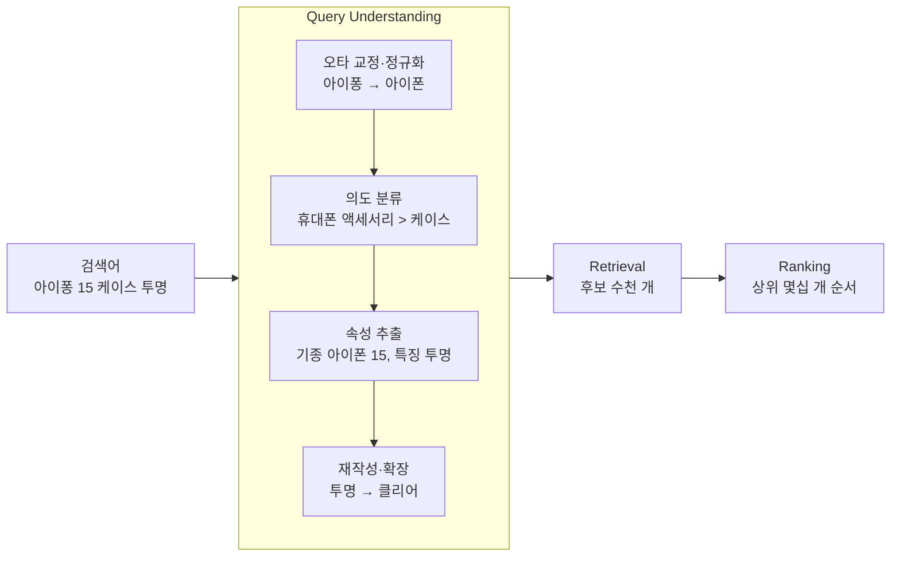

쇼핑 검색창에 `아이퐁 15 케이스 투명` 을 쳤다고 하자.

검색 엔진은 이 글자를 그대로 상품 이름과 맞춰 보지 않는다. 먼저 이 검색어가 무엇을 찾는지 해석하고, 그 해석을 들고 상품을 찾으러 간다. 이 해석 단계가 Query Understanding(QU, 질의 이해)이다.

# A) 한눈에 보기

- **QU 는 상품·문서를 찾기 전에 검색어를 해석하는 단계다.** 오타를 고치고, 무엇을 찾는지(의도) 정하고, 조건(기종·색·크기)을 뽑아 낸다.
- **검색은 보통 QU → 후보 찾기(Retrieval) → 순서 정하기(Ranking) 로 흐른다.** QU 의 해석이 뒤 두 단계의 입력이 된다.
- **QU 가 틀리면 뒤 단계가 바로잡을 수 없다.** Ranking 은 받은 후보의 순서만 바꾸므로, 후보에 없는 상품을 위로 올릴 수 없다.



# B) QU 가 하는 일

같은 검색어 `아이퐁 15 케이스 투명` 이 각 단계를 지나며 어떻게 바뀌는지 따라간다.

**오타 교정과 정규화**: `아이퐁` 을 `아이폰` 으로 고치고, 띄어쓰기·대소문자·숫자 표기를 맞춘다.

- 한국어는 형태소 분석으로 `케이스를` 의 조사를 떼는 일도 여기서 한다.
- 고친 결과가 원래 뜻과 다를 수 있어서, 원래 검색어를 버리지 않고 함께 넘기는 경우가 많다.

**의도 분류 (Query Intent Classification)**: 이 검색어가 어느 카테고리의 무엇을 찾는지 정한다.

- 여기서는 「휴대폰」 이 아니라 「휴대폰 액세서리 > 케이스」 다.
- 같은 `아이폰 15` 라도 뒤에 `케이스` 가 붙으면 본체가 아니라 액세서리를 찾는 것이다.

**속성 추출 (Query Tagging)**: 검색어 안의 조건을 이름표가 붙은 값으로 뽑는다.

- `기종 = 아이폰 15`, `상품 유형 = 케이스`, `특징 = 투명`.
- 문장 속에서 이름 붙은 대상을 찾는 [[Named Entity Recognition|개체 인식(NER)]] 과 같은 방식으로 학습하는 경우가 많다.

**재작성·확장 (Query Rewriting / Expansion)**: 상품 쪽에서 쓰는 말로 바꾸거나 동의어를 더한다.

- `투명` 을 `클리어` 로도 찾는다.
- 결과가 거의 없는 긴 검색어를 결과가 있는 짧은 검색어로 다시 쓰기도 한다. LLM 으로 이 재작성을 하는 사례가 [[BEQUE - Large Language Model based Long-tail Query Rewriting in Taobao Search|BEQUE]] 다.

QU 의 결과는 글자 하나가 아니라 구조를 가진 질의다.

```text
원래 검색어   아이퐁 15 케이스 투명
교정          아이폰 15 케이스 투명
카테고리      휴대폰 액세서리 > 케이스
속성          기종=아이폰 15, 특징=투명
확장어        투명 → 클리어
```

Retrieval 은 이 카테고리로 후보를 좁히고, 속성이 맞는 상품에 가산점을 준다.

# C) QU 가 맞을 때와 틀릴 때

의도 분류 하나만 바꿔서 결과를 비교한다.

**맞게 잡은 경우**: 카테고리를 「케이스」 로 잡으면 후보 수천 개가 전부 케이스다.

- Ranking 은 그중 아이폰 15 용이고 투명한 케이스를 위로 올리면 된다.

**틀리게 잡은 경우**: 카테고리를 「휴대폰」 으로 잡으면 후보가 아이폰 15 본체와 다른 휴대폰이 된다.

- Ranking 이 아무리 정확해도 받은 후보 안에 케이스가 없으므로, 상위 결과에 케이스가 나올 수 없다.
- 사용자에게는 「검색이 엉뚱하다」 로 보이지만, 원인은 Ranking 이 아니라 QU 다.

**검색 품질 문제를 고칠 때는 어느 단계에서 생겼는지부터 나눈다.** 나누는 방법은 [[Search Relevance Evaluation]] 에 이어서 쓴다.

# D) 학습 방법

QU 의 각 일은 대부분 지도학습 문제로 바꿔 푼다.

| 일 | 문제 형태 | 정답 데이터를 얻는 곳 |
| --- | --- | --- |
| 오타 교정 | 글자열 → 글자열 | 사용자가 검색어를 고쳐 다시 친 기록 (`아이퐁` → `아이폰`) |
| 의도 분류 | 검색어 → 카테고리 | 그 검색어 뒤에 클릭·구매한 상품의 카테고리 |
| 속성 추출 | 단어마다 이름표 | 상품 정보(기종·색)와 검색어 단어를 맞춰 자동으로 만든 라벨 |
| 재작성 | 검색어 → 검색어 | 결과가 좋았던 재검색 쌍, 또는 LLM 이 만든 후보 |

- 클릭·구매 기록에서 정답을 뽑으면 사람이 라벨을 달지 않아도 된다. 대신 많이 노출된 상품 쪽으로 치우친다.
- 그래서 드물게 들어오는 긴 검색어(long-tail)에서 QU 가 가장 자주 틀린다.

# Related

- [[Retrieval]]
- [[Search Relevance Evaluation]]
- [[Cascade Ranking System]]
- [[Named Entity Recognition]]
- [[BEQUE - Large Language Model based Long-tail Query Rewriting in Taobao Search]]
- [[Large Scale Deployment of BERT Based Cross Encoder Model for Re-Ranking in Walmart Search Engine]]

# References

- Yi Chang, Hongbo Deng (eds.), [Query Understanding for Search Engines](https://link.springer.com/book/10.1007/978-3-030-58334-7), Springer, 2020.
