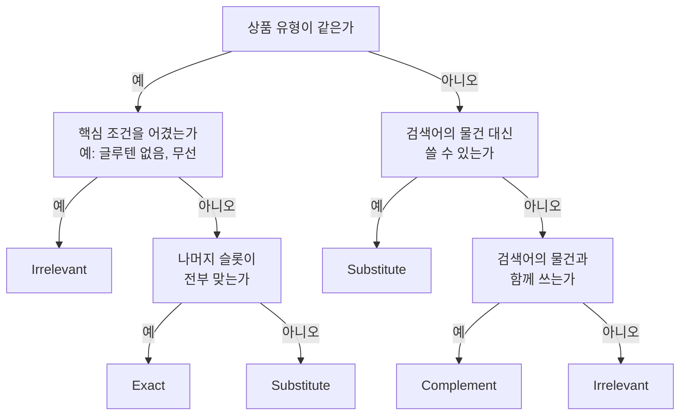
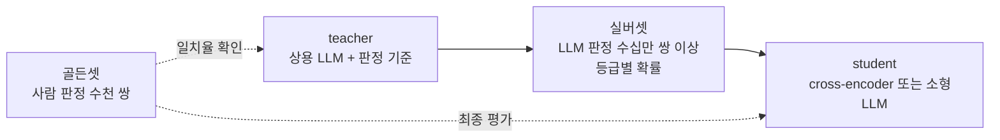

쇼핑 검색창에 `나이키 운동화 270` 을 쳤다고 하자. 결과에는 이런 상품이 섞여 나온다.

- 나이키 운동화, 270mm
- 아디다스 운동화, 270mm
- 신발끈
- 나이키 반바지

넷 다 검색어와 무언가 겹친다. 그런데 사용자에게 보여 줘도 되는 정도는 다르다. 쿼리-상품 relevance 는 검색어와 상품 한 쌍이 얼마나 맞는지를 등급으로 매기는 일이다.

[[Search Relevance Evaluation]] 은 이렇게 매긴 판정을 표본 수천 개에서 모아 지표로 만든다. 서비스에 나가는 모든 결과에 등급을 매기려면 사람 대신 모델이 판정해야 한다.

# A) 한눈에 보기

- **ESCI 는 쿼리-상품 쌍을 Exact · Substitute · Complement · Irrelevant 네 등급으로 나눈다.** Amazon 이 공개한 Shopping Queries Dataset 의 등급 체계다.
- **등급은 쿼리를 상품 유형과 속성 슬롯으로 나눈 뒤, 슬롯이 얼마나 맞는지로 매긴다.**
- **라벨은 사람 골든셋 → LLM teacher → 실버셋 → 작은 student 순서로 증류한다.** 사람은 판정 기준을 정하고 검증하는 데 쓰고, 대량 라벨은 LLM 이 만든다.
- **서빙하는 모델은 상품마다 점수를 낸다.** 점수가 있어야 기준선을 긋고, 미리 계산해 둘 수 있다.
- **relevance 점수는 랭커 피처 하나로 섞지 않고 게이트나 tier 로 쓴다.** 클릭으로 학습한 랭커가 많이 팔리는 엉뚱한 상품을 위로 올리는 것을 구조로 막는다.

# B) ESCI 등급 체계

Shopping Queries Dataset (Reddy et al., 2022) 은 영어·스페인어·일본어 검색어 약 13만 개와 그 결과 상품 약 262만 쌍에 사람이 등급을 단 데이터다. 등급은 넷이다.

**Exact (E)**: 검색어가 말한 조건을 전부 만족한다.

- `나이키 운동화 270` → 나이키 운동화, 270mm.

**Substitute (S)**: 조건 일부가 다르지만, 검색어가 찾는 물건 대신 쓸 수 있다.

- `아이폰` → 갤럭시. 브랜드가 다르지만 같은 스마트폰이다.
- `나이키 운동화 270` → 아디다스 운동화 270mm.

**Complement (C)**: 검색어가 찾는 물건은 아니지만, 그 물건과 함께 쓴다.

- `전자렌지` → 전자렌지 커버.
- `나이키 운동화 270` → 신발끈.

**Irrelevant (I)**: 검색어와 관계없거나, 검색어의 핵심 조건을 어긴다.

- `나이키 운동화 270` → 나이키 반바지. 브랜드는 맞지만 운동화가 아니고, 운동화와 함께 쓰는 물건도 아니다.
- 논문의 예로 `gluten-free bread` → 일반 밀가루 빵이 있다. 빵이긴 하지만 「글루텐 없음」 이라는 핵심 조건을 어겼다.

**Substitute 와 Complement 는 둘 다 검색어와 조건이 다른 상품이지만, 사는 이유가 반대다.**

- Substitute 는 검색어의 물건 **대신** 산다. 갤럭시를 산 사람은 아이폰을 사지 않는다.
- Complement 는 검색어의 물건과 **함께** 산다. 전자렌지 커버를 산 사람에게는 여전히 전자렌지가 필요하다.
- 그래서 Substitute 는 Exact 가 모자랄 때 바로 아래에 보여 줄 수 있다. Complement 는 검색 결과보다 「함께 사면 좋은 상품」 영역에 더 어울린다.

[[Search Relevance Evaluation]] 의 정확 · 부분 · 무관 등급과 비교하면, ESCI 는 「무관」 을 Complement 와 Irrelevant 로 한 번 더 나눈 셈이다. 액세서리를 따로 다룰 수 있게 된다.

## B.1) 슬롯으로 등급 매기기

판정하는 사람이나 모델이 매번 감으로 등급을 고르면 사람마다 결과가 달라진다. 그래서 검색어를 먼저 **상품 유형**과 **속성 슬롯**으로 나눈다. [[Query Understanding]] 의 속성 추출과 같은 일이다.

```text
검색어      나이키 운동화 270
상품 유형   운동화
브랜드      나이키
사이즈      270mm
```

상품 쪽도 상품명 · 카테고리 · 옵션에서 같은 슬롯을 뽑는다. 그다음 상품 유형부터 차례로 맞춰 본다.



상품 유형이 달라도 Substitute 가 될 수 있다. 논문은 `sweater` 검색에 나온 플리스를 Substitute 로 본다. 스웨터는 아니지만 같은 용도로 입는다.

**슬롯마다 어겼을 때 떨어지는 등급이 다르다.**

- 브랜드 · 모델 · 색이 다르면 보통 Substitute 다.
- 「글루텐 없음」 「무선」 처럼 검색어의 목적 자체인 조건을 어기면 Irrelevant 다.
- 사이즈 · 용량은 카테고리마다 다르다. 운동화 사이즈가 다르면 신을 수 없으니 Irrelevant 로 볼 수도 있고, 같은 모델의 다른 사이즈라 Substitute 로 볼 수도 있다.
- 이런 경계는 판정 기준 문서에 카테고리별로 적어 둔다. 사람끼리 판정이 가장 많이 갈리는 곳이 여기다.

**슬롯 값을 잘못 읽으면 등급도 틀린다.**

- `270` 은 사이즈 270mm 일 수도 있고, 모델명 「에어맥스 270」 일 수도 있다.
- 사이즈로 읽으면 에어맥스 90 270mm 는 Exact 다. 모델명으로 읽으면 모델이 다르니 Substitute 다.
- 이런 쌍은 사람도 판정이 갈린다. 뒤에서 라벨을 확률로 받는 이유가 이것이다.

## B.2) 등급을 점수로 바꾸기

NDCG 같은 순위 지표에 쓰려면 등급마다 점수(gain)를 준다. Shopping Queries Dataset 으로 연 KDD Cup 2022 는 Exact 1.0, Substitute 0.1, Complement 0.01, Irrelevant 0 을 썼다.

- Exact 하나가 Substitute 열 개와 같은 값이다.
- Exact 를 맨 위에 두는 것이 무엇보다 중요하고, 그다음이 Substitute 라는 기준을 숫자로 적은 것이다.

# C) 라벨 증류

서비스에서는 하루에도 수백만 개의 검색어-상품 쌍이 나간다. 사람이 판정할 수 있는 것은 수천 쌍이다. 상용 LLM 은 판정 기준을 잘 따르지만, 한 쌍마다 호출하기에는 느리고 비용이 크다.

그래서 역할을 나눈다. 사람은 기준을 정하고 시험지를 만든다. LLM 은 그 시험지로 검증받은 뒤 대량 라벨을 만든다. 서비스에는 그 라벨로 학습한 작은 모델이 나간다.



**골든셋 (golden set)**: 판정 기준을 글로 정하고, 사람 여럿이 같은 쌍을 따로 판정한다.

- 사람끼리 일치율이 낮으면 기준 문장부터 고친다. Substitute 와 Complement, Substitute 와 Irrelevant 의 경계에서 주로 갈린다.
- Shopping Queries Dataset 도 한 쌍을 사람 셋 이상이 판정하고 다수결로 정답을 정했다.
- 골든셋은 teacher 와 student 를 채점하는 시험지로 쓴다. 학습에 넣으면 시험지로 쓸 수 없다.

**teacher 검증**: 상용 LLM 에 판정 기준과 검색어 · 상품 정보를 주고 등급을 묻는다.

- 골든셋에서 LLM 판정이 사람 판정과 얼마나 일치하는지 잰다. 사람끼리의 일치율에 가까우면 쓸 만하다.
- 어느 등급을 어느 등급으로 틀리는지(혼동 행렬)를 보고 프롬프트를 고친다. 예를 들어 전자렌지 커버를 Substitute 로 자주 판정하면 「함께 쓰는 물건은 Complement」 예시를 넣는다.
- LLM 은 애매한 쌍을 사람보다 relevant 쪽으로 더 자주 판정한다는 보고가 있다([[LREF]]). 일치율과 함께 등급별 비율이 사람과 비슷한지도 본다.

**실버셋 (silver set)**: 검증한 teacher 로 대량의 쌍을 판정한다.

- 쌍은 실제 검색어와, 그 검색어에 실제로 후보로 나간 상품에서 뽑는다. 무작위 상품을 붙이면 대부분 쉬운 Irrelevant 라 모델이 배울 것이 없다.
- 등급 하나가 아니라 등급별 확률을 받는다. 확률은 등급 이름 토큰의 logprob 에서 읽거나, 같은 쌍을 여러 번 판정해 비율로 낸다.
- 앞의 에어맥스 90 270mm 라면 teacher 가 Exact 0.55, Substitute 0.40, Irrelevant 0.05 를 줄 수 있다.

**student**: 실버셋으로 작은 모델을 학습한다.

- BERT 크기의 cross-encoder 나 1B 안팎의 소형 LLM 에 등급 분류 head 를 단다([[Bi-Encoder vs Cross-Encoder]]).
- 정답 등급 하나를 맞히게 하지 않고, teacher 의 등급 확률을 그대로 따라 하게 학습한다. 이것이 soft label [[knowledge distillation]] 이다.
- 학습이 끝나면 골든셋에서 student 의 일치율을 다시 재서 teacher 와 얼마나 차이 나는지 본다.

## C.1) 확률 라벨이 필요한 이유

같은 에어맥스 쌍을 두 방식으로 학습시켜 보자.

**hard label 로 학습하면** 등급 하나 「Exact」 만 남는다.

- student 는 이 쌍을 확실한 Exact 로 배운다.
- 사람도 판정이 갈리는 쌍인데, 모델은 그 사실을 모른 채 과하게 확신한다.

**soft label 로 학습하면** 「Exact 와 Substitute 사이에서 애매한 쌍」 으로 배운다.

- student 도 이 쌍에 Exact 0.55 · Substitute 0.40 쯤을 낸다.
- 뒤에서 기준선을 그을 때, 확실한 Exact 와 애매한 Exact 를 점수로 나눌 수 있다.

**실버셋에는 teacher 의 실수가 섞여 있다.** 확률로 받으면 teacher 가 덜 확신한 판정은 student 에 약하게 반영된다. hard label 은 확신한 판정과 망설인 판정을 똑같이 취급한다.

## C.2) 생성형 listwise 대신 점수형을 쓰는 이유

LLM 으로 상품 순서를 정하는 방법은 크게 둘이다.

**생성형 listwise**: LLM 에 검색어와 후보 20 개를 한꺼번에 주고, 순서를 글자로 받는다.

- 출력은 `[3] > [1] > [7] > ...` 같은 번호 목록이다. RankGPT 가 이 방식이다.

**점수형 pointwise**: 검색어와 상품 한 쌍마다 모델을 한 번 돌려 등급 확률을 숫자로 받는다.

- 위의 student 가 이 방식이다.

서빙에서는 점수형이 유리하다.

| 비교 항목 | 생성형 listwise | 점수형 pointwise |
| --- | --- | --- |
| 지연 | 번호를 한 토큰씩 생성하므로 후보가 늘수록 느리다 | 생성 없이 forward 한 번이고, 쌍끼리 병렬로 돈다 |
| 결과의 뜻 | 순서만 나온다. 1 위가 Exact 인지 알 수 없다 | 등급 확률이 나와서 기준선을 그을 수 있다 |
| 미리 계산 | 후보 묶음이 바뀌면 다시 돌려야 한다 | 쌍의 점수가 다른 후보와 무관해서 캐시해 둘 수 있다 |
| 실패 모양 | 번호를 빠뜨리거나 겹쳐 쓰고, 입력 순서에 결과가 영향을 받는다 | 숫자 하나라 형식이 깨지지 않는다 |

**가장 큰 차이는 결과가 순서인지 점수인지다.** 순서만 있으면 후보 20 개가 전부 Irrelevant 일 때도 그중 1 위가 나온다. 점수가 있어야 「이 아래는 보여 주지 않는다」 는 선을 그을 수 있고, 다음 절의 게이트가 이 점수를 쓴다.

listwise 는 후보를 나란히 놓고 비교하므로 판정 자체는 더 정확할 수 있다. 그래서 시간이 넉넉한 오프라인 라벨링(teacher)에는 써도, 요청마다 응답해야 하는 서빙에는 점수형을 쓴다.

# D) relevance 점수를 쓰는 자리

검색 결과 순서는 보통 클릭 · 구매 기록으로 학습한 랭커가 정한다([[Learning-to-Rank]]). `나이키 운동화 270` 의 후보 다섯 개에 relevance 등급과 랭커 점수(클릭 · 구매 예측)가 이렇게 나왔다고 하자.

| 상품 | 등급 | 랭커 점수 |
| --- | --- | --- |
| 나이키 운동화 A | Exact | 0.60 |
| 나이키 운동화 B | Exact | 0.45 |
| 아디다스 운동화 (판매 1 위) | Substitute | 0.80 |
| 신발끈 | Complement | 0.70 |
| 나이키 반바지 | Irrelevant | 0.50 |

**랭커 점수만으로 정렬하면** 아디다스 운동화, 신발끈, 나이키 운동화 A, 나이키 반바지, 나이키 운동화 B 순서다.

- 1, 2 위가 나이키 운동화가 아니다.
- 반바지가 Exact 인 나이키 운동화 B 보다 위에 있다.

**랭커가 배우는 것은 relevance 가 아니라 「무엇이 클릭 · 구매되는가」 다.**

- 많이 팔리는 상품은 어느 검색어에 나가도 클릭이 많다. 싸고 자주 사는 액세서리도 그렇다.
- 위에 노출된 상품이 다시 클릭을 모으므로, 인기 있는 상품이 계속 위에 남는다. 이것이 인기 편향(popularity bias)이다.
- relevance 점수를 피처로 넣어도 그 비중은 랭커가 클릭 기록을 보고 정한다. 클릭 기록에서 relevance 가 낮은 인기 상품이 자주 클릭됐다면, 랭커는 relevance 의 비중을 낮게 배운다.

**게이트 (gate)**: 랭커에 넣기 전에 relevance 가 기준 아래인 상품을 뺀다.

- 예를 들어 student 가 준 Irrelevant 확률이 0.7 이상이면 뺀다. 나이키 반바지가 빠진다.
- 기준선은 골든셋에서 정한다. 빼면 안 되는 상품을 얼마나 뺐는지와, 남은 결과에 Irrelevant 가 얼마나 남았는지를 같이 본다.

**tier**: 남은 상품을 등급별 층으로 나눈 뒤, 층 순서를 먼저 지키고 층 안에서만 랭커 점수로 정렬한다.

- Exact 층 → Substitute 층 → Complement 층 순서다.
- 위 예는 나이키 운동화 A, 나이키 운동화 B, 아디다스 운동화, 신발끈 순서가 된다.
- 아디다스 운동화는 랭커 점수가 가장 높아도 Exact 위로 올라가지 못한다.
- 실제로는 student 의 등급 확률에 기준선을 두어 층을 나눈다. 앞의 에어맥스처럼 애매한 쌍은 기준선에 따라 Exact 층에도 Substitute 층에도 들어갈 수 있다.

**피처로 넣으면 relevance 와 인기의 비중을 랭커가 클릭 기록으로 정한다. 게이트 · tier 로 쓰면 relevance 순서가 먼저 정해지고, 인기는 같은 등급 안에서만 순서를 바꾼다.**

- 인기 신호를 버리는 것이 아니다. 같은 Exact 끼리는 많이 팔리는 쪽을 위로 올리는 것이 맞다.
- relevance 를 학습 라벨에 곱해 넣는 방법도 있다. 랭커가 relevance 가 낮은 클릭을 덜 배우게 한다([[Towards More Relevant Product Search Ranking Via Large Language Models]]).

**게이트 · tier 를 쓰면 생기는 문제도 있다.**

- relevance 모델이 틀리면 바로잡을 단계가 없다. 피처일 때는 다른 신호가 보완하지만, 게이트에서 빠진 상품은 다시 돌아오지 않는다. 그래서 게이트 기준선은 확실한 Irrelevant 만 빼도록 보수적으로 잡는다.
- Exact 가 거의 없는 검색어는 결과가 금방 Substitute 로 넘어간다. 이건 의도한 동작이지만, Substitute 까지 적으면 결과가 비어 보인다. 이때는 Complement 를 결과 목록 대신 「함께 사면 좋은 상품」 같은 별도 영역으로 보낸다.

# E) 부록: 식과 데이터

**soft label 증류 loss**: teacher 의 등급 확률 $p_T$ 와 student 의 등급 확률 $p_S$ 의 KL divergence 를 줄인다.

$$
\mathcal{L} = \mathrm{KL}(p_T \,\|\, p_S) = \sum_{c \in \{E, S, C, I\}} p_T(c) \log \frac{p_T(c)}{p_S(c)}
$$

에어맥스 예의 $p_T = (0.55, 0.40, 0, 0.05)$ 로 검산한다.

- student 가 $(0.90, 0.05, 0.01, 0.04)$ 처럼 Exact 를 확신하면 loss 는 0.572 다.
- student 가 $(0.55, 0.40, 0.01, 0.04)$ 처럼 teacher 를 따라 하면 loss 는 0.011 이다.
- 실제로는 골든셋 일부의 사람 라벨로 만든 cross-entropy 를 더하거나, teacher 확률을 temperature 로 부드럽게 만들기도 한다.

**점수 하나로 줄이기**: 등급 확률에 등급별 gain 을 곱해 더하면 기대 gain 이 된다.

$$
\text{score} = \sum_{c} \text{gain}(c)\, p_S(c), \quad \text{gain} = (1.0,\ 0.1,\ 0.01,\ 0)
$$

- 에어맥스 예에서 $0.55 \times 1.0 + 0.40 \times 0.1 = 0.59$ 다.
- 게이트는 Irrelevant 확률을, tier 는 등급 확률이나 이 점수를 기준선과 비교해 정한다.

**Shopping Queries Dataset (논문 기준)**

| 버전 | 검색어 수 | 판정 쌍 수 | 쓰인 곳 |
| --- | --- | --- | --- |
| 전체 | 130,652 | 2,621,738 | KDD Cup 2022 Task 2 · 3 |
| 축소 | 48,300 | 1,118,170 | KDD Cup 2022 Task 1 |

- 언어는 영어 · 스페인어 · 일본어다. 축소 버전은 너무 쉬운 검색어를 뺀 부분집합이다.
- Task 1 은 순위(NDCG), Task 2 는 네 등급 분류, Task 3 은 Substitute 인지 아닌지 이진 분류다.
- GitHub 저장소 README 의 숫자는 이후 정리를 거쳐 논문과 조금 다르다.

# Related

- [[Search Relevance Evaluation]]
- [[Query Understanding]]
- [[knowledge distillation]]
- [[Bi-Encoder vs Cross-Encoder]]
- [[Learning-to-Rank]]
- [[Cascade Ranking System]]
- [[LREF]]
- [[Semantic Retrieval for Product Search in E-Commerce]]
- [[Towards More Relevant Product Search Ranking Via Large Language Models]]
- [[Large Scale Deployment of BERT Based Cross Encoder Model for Re-Ranking in Walmart Search Engine]]

# References

- Chandan K. Reddy et al., [Shopping Queries Dataset: A Large-Scale ESCI Benchmark for Improving Product Search](https://arxiv.org/abs/2206.06588), 2022.
- [amazon-science/esci-data](https://github.com/amazon-science/esci-data)
- Weiwei Sun et al., [Is ChatGPT Good at Search? Investigating Large Language Models as Re-Ranking Agents](https://arxiv.org/abs/2304.09542), 2023.
- Geoffrey Hinton et al., [Distilling the Knowledge in a Neural Network](https://arxiv.org/abs/1503.02531), 2015.
