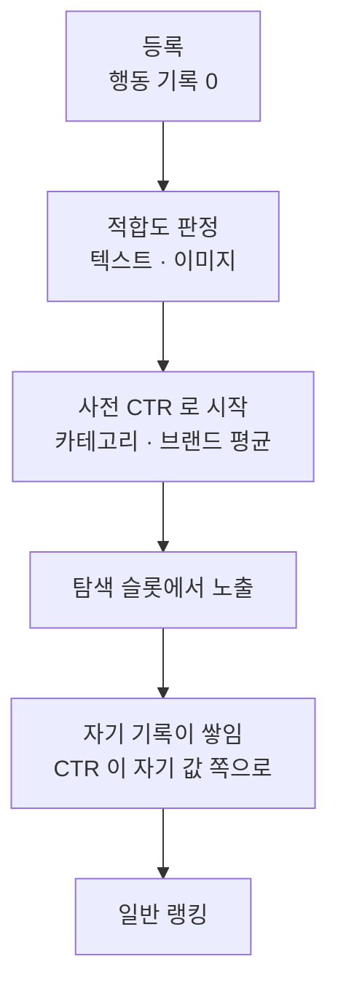

쇼핑 검색에 오늘 두 가지가 처음 나타났다고 하자.

- 오늘 아침 한 판매자가 「무선 넥밴드 선풍기」 를 새로 올렸다. 아직 노출 0 번, 클릭 0 번, 구매 0 건이다.
- 오후에 누군가 `목에 거는 날개 없는 선풍기` 를 검색했다. 이 검색어는 오늘 처음 들어왔다.

검색 결과 순서는 보통 클릭 · 구매 기록으로 학습한 랭커가 정한다([[Learning-to-Rank]]). 그런데 이 상품도, 이 검색어도 아직 그 기록이 없다. 기록이 쌓이기 전이라 랭커가 기대는 신호가 비어 있는 상태를 콜드 스타트(cold start)라고 한다.

# A) 한눈에 보기

- **검색의 콜드 스타트는 쿼리 쪽과 상품 쪽 두 가지다.**
- **콜드 스타트는 적합도를 모르는 문제가 아니라 행동 기록이 없는 문제다.**
- **대응은 세 방향이다: 행동 대신 내용을 읽고, 비슷한 대상의 기록을 빌리고, 모자란 기록은 노출을 일부러 줘서 모은다.**
- **탐색 노출은 적합도 기준을 통과한 신규 상품에만 준다.**
- **신규 상품은 따로 떼어 평가한다.**

# B) 두 가지 콜드 스타트

**쿼리 쪽 콜드 스타트**: 처음 들어왔거나 아주 드물게 들어오는 검색어에는 「이 검색어로 찾은 사람들이 무엇을 클릭했나」 라는 기록이 없다.

- 하루에도 수없이 들어오는 `선풍기` 같은 검색어를 헤드 쿼리(head query)라고 한다.
- `목에 거는 날개 없는 선풍기` 처럼 드물게 들어오는 긴 검색어를 롱테일 쿼리(long-tail query)라고 한다.
- 롱테일 쿼리는 하나하나는 드물지만 종류가 아주 많아서, 모으면 전체 검색의 큰 몫이 된다.
- 헤드 쿼리는 어느 카테고리 · 어느 상품이 클릭됐는지 기록에 넉넉히 남아 있다. 롱테일 쿼리는 그 기록이 없거나 너무 적다.

**상품 쪽 콜드 스타트**: 새로 올라온 상품은 CTR · 판매량 · 리뷰 수 같은 행동 피처가 전부 0 이다.

- 같은 카테고리에 노출 2,000 번 · 클릭 100 번(CTR 5%)을 쌓은 기존 넥밴드 선풍기 A 가 있다고 하자.
- 랭커는 행동 피처가 0 인 신상품을 A 보다 아래에 둔다.
- 아래에 있으니 노출되지 않고, 노출되지 않으니 클릭이 생기지 않는다. 클릭이 없으니 계속 아래에 있다.

**상품 쪽 콜드 스타트는 그대로 두면 풀리지 않는다.**

- 쿼리 쪽은 사용자가 검색할 때마다 결과가 나가므로 기록이 쌓일 기회는 있다.
- 상품 쪽은 노출을 받을지부터 랭커가 정한다. 랭커가 노출을 주지 않으면 기록은 계속 0 이다.
- 이미 기록이 많은 상품이 노출을 계속 가져가는 현상을 [[Matthew effect|마태 효과]] 라고 한다([[popularity bias]]).

**콜드 스타트는 적합도를 모르는 문제가 아니다.**

- `목에 거는 날개 없는 선풍기` 와 「무선 넥밴드 선풍기」 가 잘 맞는다는 것은 글자만 읽어도 안다.
- 모르는 것은 사용자가 이 상품을 얼마나 클릭 · 구매할지다.
- 그래서 적합도는 텍스트로 판정하고, 비어 있는 행동 신호만 다른 방법으로 채운다.

# C) 세 가지 대응 방향

행동 기록이 없을 때 할 수 있는 일은 세 가지다. 같은 방향이 쿼리 쪽과 상품 쪽에서 다른 모양으로 나타난다.

| 대응 방향 | 롱테일 쿼리 | 신규 상품 |
| --- | --- | --- |
| 행동 대신 내용으로 판단 | 쿼리 이해, 텍스트 적합도 모델 | 콘텐츠 피처, 행동 피처를 지운 학습 |
| 비슷한 대상의 기록 빌리기 | 가까운 헤드 쿼리의 행동 분포 | 카테고리 · 브랜드 · 판매자 평균으로 CTR 스무딩 |
| 기록을 일부러 모으기 | 검색이 들어올 때마다 저절로 쌓인다 | 탐색 슬롯, Thompson sampling |

**세 방향은 하나를 고르는 것이 아니라 겹쳐 쓴다.**

- 등록 첫날에는 내용과 빌린 기록에 기댄다.
- 탐색으로 자기 기록이 쌓이면 그쪽으로 무게를 옮긴다.

# D) 롱테일 쿼리

## D.1) 쿼리 이해로 검색어 구조 읽기

`목에 거는 날개 없는 선풍기` 는 검색어 통째로는 처음이지만, 단어 하나하나는 처음이 아니다. [[Query Understanding]] 은 검색어를 통째로 외우지 않고 단어를 읽어 해석한다.

```text
검색어      목에 거는 날개 없는 선풍기
카테고리    계절가전 > 선풍기 > 휴대용 선풍기
속성        착용 방식=넥밴드, 날개=없음
```

같은 검색어를 두 방법으로 해석해 보자.

**검색어 통째의 기록으로 해석하면** 이 검색어로 찾은 사람들이 어느 카테고리 상품을 클릭했는지 센다.

- 처음 들어온 검색어에는 셀 것이 없다.

**단어를 읽는 분류기로 해석하면** 처음 보는 조합도 카테고리와 속성을 낸다.

- 분류기는 헤드 쿼리로 학습했어도 `선풍기` · `목에 거는` · `없는` 같은 단어의 뜻을 이미 배웠다.
- 카테고리가 잡히면 Retrieval 이 후보를 「휴대용 선풍기」 로 좁힌다.
- 속성은 적합도 판정과 가까운 쿼리 찾기에도 쓴다.

**분류기의 학습 라벨도 클릭 기록에서 나오므로, 롱테일 쿼리에서 가장 자주 틀린다.**

- 학습 데이터에 긴 검색어가 적어서, 분류기가 짧은 헤드 쿼리 모양에 맞춰진다.
- 롱테일 쿼리를 따로 뽑아 LLM 으로 카테고리 · 속성 라벨을 달아 보충하기도 한다.

## D.2) 텍스트만으로 적합도 판정

검색어와 상품이 얼마나 맞는지는 두 텍스트만 있으면 판정할 수 있다. 상용 LLM 에 판정 기준을 주고 라벨을 만든 뒤, 그 라벨로 작은 cross-encoder 를 학습해 서빙한다. 등급 체계와 증류 과정은 [[Query-Product Relevance]] 에 있다.

`목에 거는 날개 없는 선풍기` 와 「무선 넥밴드 선풍기」 한 쌍을 두 모델이 본다.

**클릭으로 학습한 랭커**는 이 쌍에 점수를 줄 근거가 없다.

- 검색어 기록도 상품 기록도 0 이다.

**텍스트로 학습한 적합도 모델**은 이 쌍에 높은 점수를 준다.

- 두 텍스트가 같은 물건을 말하기 때문이다.
- 이 모델은 검색어와 상품 어느 쪽의 행동 기록도 쓰지 않는다.

**적합도 모델의 학습 쌍을 뽑을 때 롱테일 쿼리와 신규 상품을 일부러 섞는다.**

- 학습 쌍을 검색량이 많은 쿼리에서만 뽑으면 모델도 헤드 쿼리 모양의 짧은 검색어만 배운다.
- 긴 검색어, `날개 없는` 같은 부정어, 신조어가 든 검색어를 따로 뽑아 LLM 라벨을 단다.

## D.3) 가까운 헤드 쿼리의 행동 빌려 오기

적합도 모델은 맞는지만 알려 준다. 맞는 상품이 여럿일 때 사용자가 그중 무엇을 고를지는 행동 기록에서 나온다. 롱테일 쿼리에는 그 기록이 없으므로, 뜻이 가까운 헤드 쿼리의 기록을 빌린다.

1. 검색어를 임베딩해 가까운 헤드 쿼리를 찾는다.
	- `넥밴드 선풍기`, `목걸이 선풍기`, `휴대용 선풍기`.
2. 그 쿼리들의 행동 분포를 가까운 정도에 비례해 가중 평균한다.
	- 예: 클릭의 70% 가 넥밴드형, 20% 가 손풍기, 10% 가 탁상형이었다.
	- 어느 브랜드 · 가격대가 많이 팔렸는지도 같이 가져온다.
3. 이 분포를 롱테일 쿼리의 사전값(prior)으로 쓴다.
	- 사전값은 자기 기록이 없을 때 대신 믿는 값이다.
	- 롱테일 쿼리에도 기록이 쌓이면 자기 기록 쪽으로 무게를 옮긴다. 신규 상품의 CTR 스무딩과 같은 방식이다.

**임베딩이 가까운 쿼리가 다른 물건을 찾는 쿼리일 수 있다.**

- `선풍기 날개` 는 `날개 없는 선풍기` 와 단어가 거의 같아서 임베딩도 가깝다.
- 하지만 `선풍기 날개` 는 교체용 부품을 찾는 검색어다.
- 이 쿼리의 행동을 빌리면 날개 없는 선풍기를 찾는 사람에게 선풍기 날개 부품이 올라온다.

**그래서 빌리기 전에 쿼리 이해 결과로 이웃을 거른다.**

- 카테고리가 같고 속성이 서로 어긋나지 않는 이웃만 쓴다.
- `선풍기 날개` 는 카테고리가 「선풍기 부품」 이라 빠진다.

## D.4) 신조어 쿼리 확장

롱테일 쿼리 중에는 단어 자체가 처음인 것도 있다. 판매자들이 상품명에 `넥풍기` 라는 줄임말을 쓰기 시작했고, 사용자도 그대로 검색한다고 하자.

**아는 단어의 새 조합과 처음 보는 단어는 다르다.**

- `목에 거는 날개 없는 선풍기` 는 단어를 다 안다. 쿼리 이해와 임베딩이 그대로 동작한다.
- `넥풍기` 는 단어를 모른다. 토크나이저가 `넥` · `풍기` 처럼 쪼개면 선풍기라는 뜻이 남지 않을 수 있다.
- 이 검색어에서는 카테고리 분류도, 임베딩 이웃 찾기도 근거가 약하다.

신조어는 기존 어휘로 바꿔 함께 찾는 쿼리 확장(query expansion)으로 다룬다. 바꿀 말을 찾는 곳은 셋이다.

**상품 텍스트**: 신조어는 판매자 상품명에 먼저 나타난다.

- `넥풍기` 가 든 상품명에 함께 나오는 말(`넥밴드 선풍기`, `목걸이 선풍기`)이 동의어 후보다.

**재검색 기록**: `넥풍기` 로 검색한 사람이 결과가 마음에 들지 않아 바로 `목 선풍기` 로 다시 친 기록이다.

- 클릭 기록이 아니라 검색어와 검색어 사이의 기록이라, 신조어에도 금방 쌓인다.

**LLM 재작성**: LLM 에 검색어를 주고 기존 어휘로 바꾼 검색어를 받는다.

- 결과가 거의 없는 롱테일 쿼리를 LLM 으로 다시 쓰는 사례가 [[BEQUE - Large Language Model based Long-tail Query Rewriting in Taobao Search|BEQUE]] 다.

**LLM 이 모르는 신조어는 그럴듯한 뜻을 지어낸다.**

- LLM 의 학습 시점보다 늦게 생긴 말이면 뜻을 모른다.
- 바꾼 검색어로 실제 상품이 검색되는지, 그 상품이 원래 검색어의 상품과 겹치는지 확인한 뒤에 쓴다.

**확장어는 원래 검색어를 대신하지 않고 함께 찾는다.**

- 상품명에 `넥풍기` 를 그대로 쓴 상품도 결과에 남아야 한다.

# E) 신규 상품

신상품 「무선 넥밴드 선풍기」 가 등록부터 일반 랭킹에 들어가기까지 거치는 흐름이다.



## E.1) 등록 첫날부터 있는 콘텐츠 피처

상품명 · 카테고리 · 속성 · 이미지 · 가격 · 브랜드 · 판매자는 상품이 올라온 순간부터 있다. 이 정보로 적합도를 판정하고, CTR 도 어느 정도 예측한다.

**콘텐츠로 「맞는가」 는 알 수 있지만 「얼마나 팔릴까」 는 정확히 알기 어렵다.**

- 같은 넥밴드 선풍기라도 가격 · 사진 · 판매자 평판에 따라 클릭이 크게 다르다.
- 콘텐츠 피처로 CTR 을 예측하는 모델을 따로 두기도 한다. 새 광고의 CTR 을 광고 문구 · 검색어 · 광고주 피처로 예측한 연구가 있다 (Richardson et al., 2007).
- 그래도 같은 상품의 실제 행동 기록보다는 부정확하다. 그래서 기록이 쌓이면 행동 쪽으로 무게를 옮긴다.

**상품 ID 로 학습한 임베딩 대신 내용에서 만든 임베딩을 쓴다.**

- 상품 ID 마다 임베딩을 학습하는 모델에서 새 상품의 임베딩은 아직 학습되지 않은 값이다([[hash-based embedding]]).
- 상품명 · 이미지로 만든 임베딩은 등록 순간 바로 계산된다([[Contents based recommendation]]).
- Airbnb 는 새 숙소의 임베딩을 위치 · 가격대 · 숙소 유형이 비슷한 기존 숙소 세 곳의 임베딩 평균으로 시작했다([[Listing Embeddings in Search Ranking]]).

## E.2) 사전값으로 CTR 스무딩

신상품 B 를 노출 3 번 해 봤다고 하자. 클릭이 1 번 나왔으면 CTR 이 33% 이고, 0 번이면 0% 다.

**노출이 적을 때 CTR 은 두 경우 모두 믿을 수 없다.**

- 33% 면 기존 상품 A(5%)의 여섯 배가 넘어 랭킹 1 위로 올라갈 수 있다.
- 0% 면 A 보다 한참 아래로 내려가 다시 노출되기 어렵다.
- 노출 3 번에 나온 클릭 1 번은 상품의 실제 매력보다 우연에 가깝다([[통계적 유의성 계산법]]).

**스무딩은 「이미 α 번 노출해서 사전 CTR 만큼 클릭이 나온 셈 치고」 시작하는 방법이다.**

$$
\text{스무딩 CTR} = \frac{\text{클릭} + \alpha \cdot \text{사전 CTR}}{\text{노출} + \alpha}
$$

- 사전 CTR 은 이 상품이 속한 묶음의 평균이다. 「휴대용 선풍기」 카테고리 평균이 4% 라고 하자.
- α 는 사전값을 노출 몇 번어치로 믿을지다. α = 100 이면 노출 100 번에 클릭 4 번을 미리 깔아 두고 시작한다.

이 식을 넣으면 B 의 CTR 은 클릭 1 번일 때 4.9%, 0 번일 때 3.9% 가 된다.

- 33% 와 0% 가 둘 다 사전 CTR 4% 근처로 들어온다.
- 기존 상품 A 는 5.0% 로 원래 값과 거의 같다. 자기 기록 2,000 번이 사전값 100 번어치보다 훨씬 많기 때문이다.
- B 가 노출 1,000 번에 클릭 80 번(8%)을 쌓으면 스무딩 CTR 은 7.6% 다. 이때는 A 를 앞지른다.

**노출이 적으면 사전값 근처에 머물고, 노출이 쌓일수록 자기 기록에 가까워진다.**

- 신상품이 첫 몇 번의 우연으로 1 위에 오르거나 바닥으로 떨어지지 않는다.
- 실제로 더 나은 상품이면 기록이 쌓이며 기존 상품을 앞지른다.

**사전 CTR 은 상품과 가장 닮은 묶음에서 가져온다.**

- 「휴대용 선풍기」 카테고리보다 「휴대용 선풍기 중 같은 브랜드」 나 「휴대용 선풍기 중 같은 판매자」 가 좁은 묶음이다.
- 좁은 묶음일수록 상품과 닮았지만, 묶음 자체의 기록이 적다.
- 그래서 좁은 묶음의 평균도 같은 식으로 넓은 묶음 평균 쪽으로 스무딩해서 쓴다.

실제로는 노출 위치도 보정한다. 같은 상품도 아래에 노출되면 덜 클릭되므로([[position bias]]), 위치마다 기대되는 클릭 수 대비 실제 클릭 수(COEC, clicks over expected clicks)로 센다. α 를 데이터로 정하는 방법은 부록에 있다.

## E.3) 노출 수와 등록 경과일 피처

스무딩 CTR 만 넘기면 랭커는 이 값을 얼마나 믿어야 할지 모른다.

- 신상품 B(노출 3 · 클릭 1)는 4.9%, 기존 상품 A(노출 2,000 · 클릭 100)는 5.0% 다.
- 숫자는 비슷하지만 B 의 값은 대부분 사전값이고, A 의 값은 대부분 자기 기록이다.

**노출 수를 함께 피처로 넣으면 랭커가 두 값을 구분해서 쓴다.**

- 랭커는 노출 수가 적을 때 콘텐츠 피처에 더 기대고, 많을 때 행동 피처에 더 기대도록 배운다.

**등록 경과일도 같은 이유로 넣는다.**

- 오늘 올라와 노출 3 번인 상품은 이제 막 시작한 상품이다.
- 1 년 전에 올라와 노출 3 번인 상품은 랭커가 1 년 동안 계속 아래에 둔 상품이다.

**등록 경과일 피처로 랭커가 「새 상품은 안 팔린다」 를 배울 수 있다.**

- 학습 데이터 속 신상품은 대부분 노출이 적어서 클릭도 적었다.
- 랭커는 이것을 상품의 성질로 배워, 경과일이 짧은 상품의 점수를 낮춘다.
- 신규 상품만 따로 본 평가에서 이 피처를 넣기 전과 후를 비교해 확인한다.

## E.4) 학습 때 행동 피처 지우기

**학습 데이터에서는 거의 모든 상품에 행동 기록이 있다.**

- 노출이 많은 기존 상품이 학습 샘플의 대부분을 차지한다.
- 랭커는 행동 피처가 정답을 가장 잘 맞히는 신호라는 것을 배우고, 콘텐츠 피처는 거의 쓰지 않게 된다.
- 서빙 때 행동 피처가 0 인 신상품이 들어오면, 랭커는 학습 때 거의 보지 못한 입력을 받는다.

DropoutNet (Volkovs et al., 2017) 은 학습 중에 샘플 일부의 행동 입력을 일부러 0 으로 지운다([[DropoutNet - Addressing Cold Start in Recommender Systems|DropoutNet]]).

- 신경망 학습의 dropout 을 중간 뉴런이 아니라 입력에 적용한 것이다.
- 지운 샘플에서도 정답을 맞혀야 하므로, 모델은 콘텐츠만으로 예측하는 법을 함께 배운다.
- 지우지 않은 샘플에서는 행동 기록을 그대로 쓰므로, 기존 상품의 정확도는 크게 떨어지지 않는다.
- 논문은 추천 모델의 사용자 · 아이템 선호 벡터를 지웠다. 검색 랭커의 CTR · 판매량 피처에도 같은 방식을 쓸 수 있다.

같은 신상품 B 를 두 랭커가 본다.

**지우지 않고 학습한 랭커**는 B 의 행동 피처 0 을 「아무도 누르지 않은 상품」 으로 읽는다.

- 학습 때 행동 피처가 0 이던 샘플은 대개 노출됐는데 클릭이 없던 상품이었다.
- B 의 점수가 낮게 나온다.

**지우고 학습한 랭커**는 B 를 콘텐츠로 평가한다.

- 학습 때 행동 피처가 0 인 샘플을 많이 봤고, 그때는 콘텐츠로 정답을 맞혔다.
- B 의 상품명 · 이미지가 넥밴드 선풍기 중 잘 팔리던 상품과 닮았으면 점수가 높게 나온다.

실제로는 0 대신 「기록 없음」 을 표시하는 칸을 따로 두기도 한다. 노출됐는데 클릭이 0 인 상품과 아직 노출되지 않은 상품은 다른 상품이기 때문이다.

**신규 상품 전용 모델을 따로 두는 방법도 있다.**

- AliBoost 는 기존 CTR 모델을 고정해 두고, 그 출력과 신규 상품 전용 피처를 받아 신규 상품 CTR 만 예측하는 모델을 위에 쌓았다([[AliBoost - Ecological Boosting Framework in Alibaba Platform|AliBoost]]).
- 한 모델에서 행동 피처를 지워 학습하면, 모델이 하나라 학습 · 서빙 파이프라인이 단순하다.
- 전용 모델을 따로 두면 기존 모델을 다시 학습하지 않으므로, 기존 상품의 성능이 바뀌지 않는다.

## E.5) 탐색 슬롯과 Thompson sampling

콘텐츠 피처와 스무딩이 있어도 신상품은 기록이 쌓인 상품을 이기기 어렵다. 기록을 모으려면 노출을 일부러 줘야 한다. 모르는 상품을 보여 줘서 정보를 모으는 일을 탐색(exploration)이라고 한다. 이미 잘 팔리는 것으로 확인된 상품을 보여 주는 일은 활용(exploitation)이다([[Exploration and Exploitation trade-off]]).

**탐색 슬롯 (exploration slot)**: 결과 상위 몇십 개 중 몇 자리를 신규 상품 몫으로 떼어 둔다.

- 예: 상위 20 개 중 5 위와 12 위 두 자리.
- 나머지 자리는 평소 랭킹 그대로다. 탐색 때문에 잃는 클릭을 이 두 자리로 제한한다.

**탐색 후보는 적합도 기준을 통과한 신규 상품으로 제한한다.**

- `목에 거는 날개 없는 선풍기` 검색의 탐색 슬롯에 오늘 올라온 선풍기 날개 교체 부품이 들어가면, 사용자는 엉뚱한 결과를 본다.
- 클릭이 안 나올 것이 뻔하므로 기록을 모으는 의미도 없다.
- 그래서 적합도가 기준 아래인 상품을 미리 빼는 적합도 게이트(gate)를 먼저 통과시키고, 통과한 신규 상품끼리 슬롯을 나눈다([[Query-Product Relevance]]).

**슬롯을 누구에게 줄지는 Thompson sampling 으로 정한다.**

- 각 상품의 실제 CTR 을 값 하나가 아니라 분포로 본다. 스무딩에 쓴 사전값에 자기 기록을 더한 [[Beta distribution|베타 분포]] 다.
- 요청이 들어올 때마다 상품마다 자기 분포에서 CTR 을 하나 뽑는다. 뽑힌 값이 가장 큰 상품이 슬롯을 갖는다.

게이트를 통과한 신상품이 셋 있다고 하자. B 는 첫 노출 3 번에 클릭이 0 번 나온 경우로 둔다. C 와 D 는 며칠 먼저 올라와 노출이 300 번씩 쌓였다.

아래 그림은 세 상품의 CTR 분포를 곡선으로 그린 것이다. 곡선이 넓게 퍼질수록 그 상품의 CTR 을 아직 잘 모른다는 뜻이고, 곡선 위 숫자는 슬롯을 얻는 비율이다.

![[img-aae7eca954.png]]

- C(노출 300 · 클릭 24)는 7% 근처에 모여 있다. 10 번 중 9 번은 C 가 슬롯을 갖는다.
- D(노출 300 · 클릭 6)도 좁게 모여 있지만 2.5% 근처라 C 를 거의 이기지 못한다.
- B(노출 3 · 클릭 0)는 평균이 3.9% 로 C 보다 한참 낮지만 곡선이 넓다. 오른쪽 꼬리에서 C 보다 큰 값이 뽑히는 일이 10 번 중 1 번쯤 있다.

**평균으로 고르면 B 는 다시 노출되지 않고, 분포에서 뽑으면 기록이 적은 상품도 가끔 기회를 얻는다.**

- 스무딩 CTR 이 가장 큰 상품을 고르면 매번 C 다. B 의 기록은 계속 노출 3 번에 머문다.
- Thompson sampling 에서 B 가 노출을 더 받아 클릭이 나오면, 곡선이 오른쪽으로 옮겨 가며 좁아진다.
- 클릭이 안 나오면 곡선이 왼쪽으로 옮겨 가며 좁아지고, 슬롯을 얻는 일이 줄어든다.
- 잘 아는 상품은 덜 탐색하고 모르는 상품은 더 탐색하는 조절이 따로 손대지 않아도 이뤄진다.

**사전값이 없으면 탐색이 지나치다.**

- 사전값 없이 균등 분포 $\text{Beta}(1, 1)$ 에서 시작하면 B 의 분포는 평균이 20% 이고, 0% 부터 수십 % 까지 넓게 퍼진다.
- 같은 세 상품에서 B 가 슬롯을 가져가는 비율이 71% 로 오른다. 노출 3 번뿐인 상품이 기회 대부분을 가져간다.
- 사전값은 「휴대용 선풍기 CTR 은 대개 4% 근처」 라는 정보를 분포에 넣어, 탐색이 그럴듯한 범위 안에서 일어나게 한다.

Thompson sampling 은 구현이 간단하다. 시뮬레이션에서 다른 탐색 방법인 UCB 보다 regret(늘 최선을 골랐을 때와 비교해 놓친 클릭)이 낮았고, 광고 · 뉴스 추천 데이터에서도 기존 방법과 비슷한 성능을 냈다 (Chapelle & Li, 2011).

**contextual bandit 은 비슷한 상품의 기록을 새 상품의 추정에 반영한다.**

- 상품마다 따로 분포를 두면 새 상품은 매번 사전값에서 다시 시작한다.
- contextual bandit 은 상품 피처로 CTR 과 불확실성을 함께 추정한다.
- LinUCB 의 hybrid 모델처럼 모든 상품이 함께 쓰는 파라미터를 두면, 피처가 비슷한 상품의 기록이 새 상품의 추정에도 반영된다([[A Contextual-Bandit Approach to Personalized News Article Recommendation|LinUCB]]).
- 그래서 새 상품도 처음부터 불확실성이 덜 크다.

**탐색 노출을 단계별 예산으로 나눠 주는 방법도 있다.**

- AliBoost 는 신규 상품에 먼저 작은 노출 예산을 준다.
- 그 단계의 CTR 이 카테고리 평균의 일정 배수를 넘으면 더 큰 예산의 다음 단계로 올린다.
- 넘지 못하면 그 상품의 탐색을 끝낸다.

# F) 신규 상품 평가

**전체 지표로는 신규 상품 문제가 잘 보이지 않는다.**

- NDCG · CTR 같은 전체 지표는 검색량이 많은 헤드 쿼리와 기록이 많은 기존 상품이 대부분을 정한다.
- 신규 상품이 하나도 노출되지 않아도 전체 CTR 은 오히려 오를 수 있다. 이미 확인된 상품만 보여 주기 때문이다.
- 그래서 신규 상품만 따로 떼어 본다.

신규 상품 지표는 두 종류다. 신규 상품이 기회를 얻는지 보는 지표와, 그 기회가 결과 품질을 해치지 않는지 보는 지표다.

**노출된 신규 상품 비율**: 하루 동안 등록된 상품 중 정해진 기간 안에 한 번이라도 노출된 상품의 비율이다.

- 예: 오늘 등록된 신상품 1,000 개 중 일주일 안에 노출된 것이 300 개면 30% 다.

**첫 클릭까지 걸린 시간**: 등록부터 첫 클릭까지 걸린 시간의 중앙값이다.

- 짧을수록 신규 상품이 빨리 기회를 얻는다.
- 끝내 클릭이 없는 상품은 중앙값 계산에서 빠지므로, 기간 안에 첫 클릭이 나온 상품의 비율을 함께 본다.

**탐색 슬롯 Defect 비율**: 탐색 슬롯에 나간 결과 중 「결함」 판정을 받은 비율이다([[Search Relevance Evaluation]]).

- 일반 자리의 Defect 비율과 나란히 놓는다.
- 탐색 슬롯 쪽이 크게 높으면 적합도 게이트의 기준선을 다시 본다.

**노출 지표와 품질 지표는 짝으로 본다.**

- 노출된 신규 상품 비율만 올리려면 아무 신규 상품이나 탐색 슬롯에 넣으면 된다. 그러면 Defect 비율이 오른다.
- Defect 비율만 낮추려면 탐색을 끄면 된다. 그러면 노출된 신규 상품 비율이 떨어진다.
- 한쪽만 좋아진 변경은 다른 쪽을 희생했을 가능성이 크다.

**오프라인 평가셋은 시간 순서로 나눈다.**

- 학습 데이터 기간 뒤에 등록된 상품만 모아 평가셋을 만든다.
- 무작위로 나누면 평가셋 상품의 행동 기록이 학습 데이터에 이미 들어가 있어서, 신규 상품 평가가 되지 않는다([[data leakage]]).

# G) 매물이 하나뿐인 C2C 검색

중고거래 검색에서는 거의 모든 문서가 콜드 스타트다.

**쇼핑몰 상품과 중고 매물은 행동 기록이 쌓이는 단위가 다르다.**

- 쇼핑몰의 넥밴드 선풍기는 같은 상품이 여러 해 동안 수천 개 팔린다. 상품 단위로 CTR 과 판매량이 쌓인다.
- 중고 매물 「넥밴드 선풍기 한 번 썼어요」 는 물건이 하나뿐이다. 한 사람이 사 가면 끝이다.
- 매물은 대개 며칠 안에 팔리거나 내려간다. 클릭이 충분히 쌓일 즈음에는 이미 팔렸다.

그래서 앞의 방법들의 비중이 달라진다.

**콘텐츠가 주 신호가 된다.**

- 매물 제목 · 사진 · 가격 · 카테고리로 적합도와 품질을 판정한다.
- 매물 자신의 행동 기록은 짧은 수명 안에서 순서를 조금 고치는 정도로만 쓴다.

**행동 기록은 매물보다 오래 남는 단위로 모은다.**

- 판매자의 응답률 · 거래 후기, 카테고리 · 가격대, 제목에 든 단어 단위로 모은다.
- 이렇게 모은 기록이 새 매물의 사전값이 된다.

**탐색이 예외가 아니라 기본이 된다.**

- 매물마다 짧은 수명 안에 최소한의 노출을 받아야 팔릴 기회가 생긴다.
- 신규 상품 몫의 슬롯을 따로 두기보다, 랭킹 전체가 신선도를 함께 고려한다.

**등록 경과일이 아직 살 수 있는 매물인지 알려 주는 신호가 된다.**

- 오래된 매물일수록 이미 팔렸는데 내려가지 않았을 가능성이 높다.
- 쇼핑몰에서 「새 상품은 안 팔린다」 를 배울까 걱정하던 피처가, 여기서는 「오래된 매물은 이미 팔렸을 수 있다」 를 알려 준다.

**상품 ID 임베딩은 쓸 수 없다.**

- 매물마다 ID 가 새로 생기고 다시 쓰이지 않는다.
- 제목 · 사진에서 만든 임베딩을 쓴다.

# H) 부록: 식과 설정

**CTR 스무딩은 베타 사전 분포의 사후 평균이다.**

사전 CTR 을 $p_0$, 가상 노출 수를 $\alpha$ 라 하면 사전 분포는 다음과 같다.

$$
\text{CTR} \sim \text{Beta}(\alpha p_0,\ \alpha (1 - p_0))
$$

노출 $n$ 번에 클릭 $c$ 번을 관측하면 사후 분포와 그 평균은 다음과 같다.

$$
\text{CTR} \mid c, n \sim \text{Beta}(\alpha p_0 + c,\ \alpha (1 - p_0) + n - c), \qquad \mathbb{E}[\text{CTR} \mid c, n] = \frac{c + \alpha p_0}{n + \alpha}
$$

- 본문 예시 $p_0 = 0.04$, $\alpha = 100$ 이면 사전 분포는 $\text{Beta}(4, 96)$ 이다.
- B(노출 3 · 클릭 0)의 사후 분포는 $\text{Beta}(4, 99)$ 이고, 평균은 $4 / 103 = 3.9\%$ 다.
- C(노출 300 · 클릭 24)는 $\text{Beta}(28, 372)$ 로 평균 $7.0\%$, D(노출 300 · 클릭 6)는 $\text{Beta}(10, 390)$ 으로 평균 $2.5\%$ 다.

사후 평균은 사전 CTR 과 관측 CTR 의 가중 평균으로도 쓸 수 있다.

$$
\frac{c + \alpha p_0}{n + \alpha} = \frac{\alpha}{n + \alpha}\, p_0 + \frac{n}{n + \alpha} \cdot \frac{c}{n}
$$

- 노출 $n$ 이 $\alpha$ 보다 커지면 관측 CTR 쪽 무게가 절반을 넘는다.
- A(노출 2,000)는 관측 CTR 무게가 $2000 / 2100 = 95\%$ 다.

**α 정하기 (empirical Bayes)**: 같은 카테고리에서 노출이 충분한 상품들의 CTR 평균 $m$ 과 분산 $v$ 를 구해, 베타 분포의 평균 · 분산 식에 맞춘다(moment matching).

$$
p_0 = m, \qquad \alpha = \frac{m (1 - m)}{v} - 1
$$

- 상품끼리 CTR 이 비슷하면(분산이 작으면) $\alpha$ 가 커서 사전값을 오래 믿는다.
- 상품끼리 CTR 이 많이 다르면 $\alpha$ 가 작아서 자기 기록으로 빨리 넘어간다.
- 본문 예시로 검산하면, 평균 4% 인 카테고리에서 상품 CTR 의 표준편차가 약 1.95% 일 때 $\alpha = 100$ 이 나온다.

**Thompson sampling (탐색 슬롯 하나)**

1. 후보 신규 상품 $i$ 마다 $\theta_i \sim \text{Beta}(\alpha p_0 + c_i,\ \alpha (1 - p_0) + n_i - c_i)$ 를 하나 뽑는다.
2. $\theta_i$ 가 가장 큰 상품을 슬롯에 넣는다.
3. 노출 결과(클릭 여부)로 그 상품의 $n_i$, $c_i$ 를 갱신한다.

- 본문 그림의 슬롯 비율(B 9% · C 91% · D 0.1%)은 세 분포에서 200 만 번씩 뽑아 센 값이다.
- 사전값 없이 $\text{Beta}(1 + c_i,\ 1 + n_i - c_i)$ 에서 뽑으면 B 71% · C 29% · D 0.01% 미만이다.

**DropoutNet 학습 목표**: 미리 학습한 협업 필터링 모델의 사용자 벡터 $U_u$ 와 아이템 벡터 $V_v$ 가 만든 점수를 따라 하도록 학습한다.

$$
\min \sum_{u, v} \left( U_u V_v^{\top} - f_{\mathcal{U}}(U_u, \Phi^{\mathcal{U}}_u)\, f_{\mathcal{V}}(V_v, \Phi^{\mathcal{V}}_v)^{\top} \right)^2
$$

- $\Phi$ 는 콘텐츠 피처다.
- 학습 중 일부 샘플에서 입력 $U_u$ 또는 $V_v$ 를 0 으로 바꾼다.
- 지워진 샘플에서도 같은 목표 점수를 맞혀야 하므로, $f$ 는 콘텐츠 $\Phi$ 로 선호 벡터를 복원하는 법을 배운다.

# Related

- [[Query Understanding]]
- [[Query-Product Relevance]]
- [[Search Relevance Evaluation]]
- [[Learning-to-Rank]]
- [[cold-start]]
- [[Contents based recommendation]]
- [[DropoutNet - Addressing Cold Start in Recommender Systems]]
- [[A Contextual-Bandit Approach to Personalized News Article Recommendation]]
- [[AliBoost - Ecological Boosting Framework in Alibaba Platform]]
- [[Thompson sampling]]
- [[Beta distribution]]
- [[Exploration and Exploitation trade-off]]
- [[Matthew effect]]
- [[popularity bias]]
- [[position bias]]
- [[Listing Embeddings in Search Ranking]]
- [[BEQUE - Large Language Model based Long-tail Query Rewriting in Taobao Search]]
- [[통계적 유의성 계산법]]

# References

- Maksims Volkovs, Guangwei Yu, Tomi Poutanen, [DropoutNet: Addressing Cold Start in Recommender Systems](https://papers.nips.cc/paper/2017/file/dbd22ba3bd0df8f385bdac3e9f8be207-Paper.pdf), NeurIPS 2017.
- Lihong Li et al., [A Contextual-Bandit Approach to Personalized News Article Recommendation](https://arxiv.org/abs/1003.0146), WWW 2010.
- Olivier Chapelle, Lihong Li, [An Empirical Evaluation of Thompson Sampling](https://papers.nips.cc/paper/2011/hash/e53a0a2978c28872a4505bdb51db06dc-Abstract.html), NIPS 2011.
- Matthew Richardson, Ewa Dominowska, Robert Ragno, [Predicting Clicks: Estimating the Click-Through Rate for New Ads](https://www.microsoft.com/en-us/research/?p=150860), WWW 2007.
- Qijie Shen et al., [AliBoost: Ecological Boosting Framework in Alibaba Platform](https://arxiv.org/abs/2506.00954), KDD 2025.
- Wenjun Peng et al., [Large Language Model based Long-tail Query Rewriting in Taobao Search](https://arxiv.org/abs/2311.03758), WWW 2024 Companion.
- Mihajlo Grbovic, Haibin Cheng, [Real-time Personalization using Embeddings for Search Ranking at Airbnb](https://dl.acm.org/doi/10.1145/3219819.3219885), KDD 2018.
