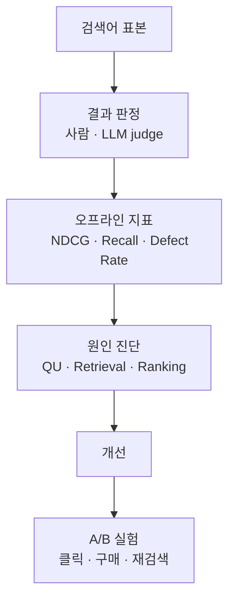

[[Query Understanding|QU]] 노트의 검색어 `아이퐁 15 케이스 투명` 을 이어 쓴다. 검색 결과 상위 10 개 중 하나가 갤럭시 S24 케이스였다고 하자.

이 검색은 잘된 걸까? 나머지 9 개가 맞으니 꽤 잘된 걸까, 아니면 엉뚱한 상품이 하나라도 섞였으니 실패일까? 검색 relevance 평가는 이 질문을 숫자로 바꾸는 일이다.

# A) 한눈에 보기

- **오프라인 평가는 검색어 표본의 결과를 사람이나 LLM 이 하나씩 판정하고 지표로 모은다.** 서비스에 내기 전에 바꾼 모델이 나아졌는지 본다.
- **지표마다 묻는 질문이 다르다.** 맞는 결과가 얼마나 위에 있나(NDCG), 맞는 결과를 빠짐없이 가져왔나(Recall), 명백히 틀린 결과가 섞였나(Defect Rate).
- **나쁜 결과를 찾았으면 QU · Retrieval · Ranking 중 어디서 생겼는지 나눈다.** 고칠 팀과 방법이 단계마다 다르다.
- **오프라인에서 나아진 변경만 A/B 실험으로 실제 사용자에게 확인한다.**

# B) 결과 판정

평가는 실제로 들어온 검색어에서 표본을 뽑는 데서 시작한다. 자주 들어오는 검색어만 뽑으면 잘되는 검색어만 보게 되므로, 드문 검색어도 섞는다.

판정자는 검색어와 결과 하나를 보고 등급을 매긴다.

| 등급 | 뜻 | `아이폰 15 케이스 투명` 에서의 예 |
| --- | --- | --- |
| 정확 | 찾던 그 상품 | 아이폰 15 투명 케이스 |
| 부분 | 관련은 있지만 조건 일부가 다름 | 아이폰 15 검은색 케이스 |
| 무관 | 찾던 것과 관계없음 | 아이폰 충전기 |
| 결함 | 사용자가 보자마자 틀렸다고 느끼는 결과 | 갤럭시 S24 케이스 |

- 판정 기준을 글로 정해 두고, 같은 결과를 두 사람이 따로 판정해 얼마나 일치하는지 본다. 일치율이 낮으면 기준부터 고친다.
- 사람 대신 LLM 에 같은 기준을 주고 판정시키기도 한다(LLM judge). 이때는 사람 판정과 얼마나 일치하는지 먼저 확인한다.
- 공개 데이터셋에서 널리 쓰는 등급 체계는 ESCI 다. 「무관」 을 함께 쓰는 상품(Complement)과 정말 관계없는 상품(Irrelevant)으로 한 번 더 나눈다([[Query-Product Relevance]]).

# C) 지표

판정을 모으는 방법이 지표마다 다르다.

**Precision@k**: 상위 k 개 중 맞는 결과의 비율이다.

- 상위 10 개 중 8 개가 정확·부분이면 0.8 이다.
- 자세한 정의는 [[precision]].

**Recall**: 맞는 상품 전체 중 결과에 들어온 비율이다.

- 맞는 상품이 전부 몇 개인지 알아야 계산할 수 있어서, 주로 Retrieval 단계의 후보 목록을 평가할 때 쓴다.
- 자세한 정의는 [[Recall]].

**NDCG**: 맞는 결과가 위에 있을수록 점수가 높다.

- 1 위가 결함이면 크게 깎이고, 10 위가 결함이면 조금 깎인다.
- 자세한 정의는 [[Normalized Discounted Cumulative Gain|NDCG]].

**Defect Rate (결함률)**: 결과 중 「결함」 판정을 받은 비율이다.

- 순위와 관계없이, 사용자가 보자마자 틀렸다고 느낄 결과가 섞였는지를 센다.
- 회사마다 무엇을 결함으로 볼지와 분모를 조금씩 다르게 정한다. 아래 두 가지가 흔하다.

# D) 결과 단위와 검색어 단위 Defect Rate

검색어 100 개, 검색어마다 상위 10 개, 모두 1,000 개 결과를 판정했다. 그중 30 개가 결함이었다.

**결과 단위 Defect Rate** 는 결함 결과 수 ÷ 전체 결과 수다.

- 30 ÷ 1,000 = 3% 다.

**검색어 단위 Defect Rate** 는 결함이 하나라도 있는 검색어의 비율이다. 같은 결함 30 개라도 어떻게 흩어졌는지에 따라 달라진다.

- 결함 30 개가 검색어 12 개에 몰렸으면 12% 다.
- 결함 30 개가 검색어 30 개에 하나씩 흩어졌으면 30% 다.

**결과 단위가 같아도 사용자가 겪는 품질은 다를 수 있다.**

- 두 경우 모두 결과 단위로는 3% 다.
- 하지만 두 번째 경우에는 검색 10 번 중 3 번꼴로 엉뚱한 상품을 본다.
- 그래서 두 지표를 함께 보고, 검색어 단위가 크게 높으면 결함이 특정 검색어에 몰리지 않고 넓게 퍼진 것이다.

**NDCG 가 높아도 Defect Rate 는 따로 본다.**

- 갤럭시 케이스가 10 위에 있으면 NDCG 는 조금만 깎인다.
- 그래도 사용자가 스크롤하다 그 상품을 보면 「이 검색은 기종도 못 맞춘다」 고 느낀다.
- NDCG 는 좋은 결과가 위에 있는지를, Defect Rate 는 틀린 결과가 아예 없는지를 본다.

# E) 결함의 원인 진단

결함 하나를 찾으면 그 결함이 어느 단계에서 생겼는지 나눈다. 고칠 대상이 단계마다 다르다.

| 원인 단계 | 확인 방법 | 갤럭시 케이스 예 |
| --- | --- | --- |
| QU | 해석(카테고리·속성)이 검색어 뜻과 다른가 | 속성 추출이 기종을 놓쳐 `케이스, 투명` 만 남았다 |
| Retrieval | 맞는 상품이 후보 목록에 아예 없는가 | 아이폰 15 투명 케이스가 후보 수천 개 안에 없었다 |
| Ranking | 맞는 상품이 후보에는 있는데 아래로 밀렸는가 | 후보에는 있었지만, 판매량이 많은 갤럭시 케이스가 더 높은 점수를 받았다 |

- 순서대로 확인한다. QU 가 틀렸으면 뒤 단계 결과는 그 해석을 따른 것이므로, 뒤 단계를 먼저 고쳐도 소용이 없다.
- 원인이 여러 단계에 걸치면 여러 팀이 같이 고쳐야 한다. 예를 들어 기종 속성을 QU 가 뽑아도 Ranking 이 그 속성을 쓰지 않으면 결과가 바뀌지 않는다.
- 판매량이 많은 상품이 relevance 가 낮은데도 위로 올라오는 Ranking 원인은 relevance 점수를 게이트나 tier 로 써서 막는다([[Query-Product Relevance]]).

# F) A/B 실험

오프라인 지표는 표본과 판정 기준 안에서만 맞는다. 그래서 오프라인에서 나아진 변경은 사용자 일부에게만 먼저 내보내 실제 행동을 비교한다([[AB Test]]).

자주 보는 행동 지표:

- **클릭률**: 결과를 눌렀는가.
- **구매 전환율**: 검색 뒤 구매까지 갔는가.
- **재검색률**: 결과를 보고 바로 다른 검색어로 다시 쳤는가. 높을수록 첫 결과가 원하는 것이 아니었다는 뜻이다.
- **결과 없음 비율**: 결과가 0 개인 검색이 얼마나 되는가.

**오프라인 지표와 A/B 결과가 어긋나면 판정 기준을 다시 본다.** 판정자가 「정확」 이라 한 결과를 사용자가 안 누른다면, 기준이 사용자가 실제로 원하는 것과 다른 것이다.

# Related

- [[Query Understanding]]
- [[Query-Product Relevance]]
- [[offline evaluation]]
- [[online evaluation]]
- [[AB Test]]
- [[Normalized Discounted Cumulative Gain]]
- [[mean reciprocal rank]]
- [[precision]]
- [[Recall]]
- [[Cascade Ranking System]]
- [[One Token to Fool LLM-as-a-Judge]]
