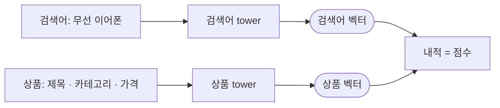

검색어 "무선 이어폰" 에 맞는 상품을 1 억 개 중에서 0.1 초 안에 찾아야 한다고 하자. 검색어가 올 때마다 1 억 개를 하나씩 모델에 넣어 점수를 매길 수는 없다.

Two-tower model 은 검색어와 상품을 서로 다른 신경망(tower)으로 각각 벡터로 바꾸고, 두 벡터의 내적으로 점수를 낸다. 상품 벡터는 검색어 없이 만들 수 있으므로 미리 계산해 둔다.

# A) 구조

**검색어 쪽 tower 와 상품 쪽 tower 가 따로 벡터를 만들고, 마지막 내적에서 한 번 만난다.**

- 추천에서는 검색어 자리에 사용자(최근 본 상품, 연령대 등)를 넣는다. 그래서 user tower 와 item tower 라고도 부른다.
- 검색에서는 같은 구조를 bi-encoder 라고 부른다.

# B) Tower 를 나누는 이유

**상품 벡터를 미리 계산해 색인에 넣어 둘 수 있다.**

- 상품 1 억 개를 상품 tower 로 한 번 벡터로 바꿔 [[retrieval/indexing/ANN|ANN]] 색인에 넣는다.
- 검색어가 오면 검색어 벡터 하나만 만들고, ANN 으로 가까운 상품 수백 개를 꺼낸다.
- 그래서 전체에서 후보를 넓게 가져오는 첫 단계(candidate generation)에 쓴다.

# C) 한계: 벡터 하나로 압축된다

**검색어와 상품이 서로를 보지 못한 채 각각 벡터 하나로 압축된다.**

- "아이폰 15 케이스" 로 검색하면 아이폰 15 본체와 아이폰 15 케이스는 둘 다 "아이폰 15" 와 가까운 벡터를 갖는다.
- 둘을 가르는 것은 "케이스" 한 단어인데, 상품 벡터는 어떤 검색어가 올지 모르는 채 만들어졌다. 검색어의 단어와 상품의 어느 부분이 맞는지 맞대어 볼 수 없다.
- 그래서 뒤 단계의 ranking 모델이 후보 수백 개만 놓고 검색어와 상품을 함께 보며 다시 정렬한다.

검색어와 문서를 한 입력으로 읽는 cross-encoder 와의 비교, 그 중간인 late interaction([[ColBERT]])은 [[Bi-Encoder vs Cross-Encoder]] 에 있다.

# D) 두 tower 의 가중치 공유

**두 쪽 입력이 같은 종류의 글이면 인코더 하나를 같이 쓰고, 입력의 성질이 다르면 따로 둔다.**

- 공유하는 경우: 질문과 질문의 중복 찾기, 문장 유사도처럼 양쪽이 같은 종류의 글이다. 파라미터가 절반이고, 같은 글은 어느 쪽에 넣어도 같은 벡터가 나온다.
- 따로 두는 경우: 추천의 사용자와 상품처럼 입력 feature 가 아예 다르다. 검색에서도 두 단어짜리 검색어와 제목 · 속성 · 가격이 붙은 상품은 성질이 달라 따로 두기도 한다.
- 중간도 있다. 인코더는 공유하되 입력 앞에 어느 쪽인지 표시하는 말을 붙인다. E5 는 `query: ` 와 `passage: ` 를 붙인다.

# E) 학습

**보통 클릭 · 구매 로그의 (검색어, 상품) 쌍을 positive 로 두고 [[InfoNCE]] 로 학습한다.**

- negative 는 같은 배치에 든 다른 검색어의 상품을 재활용한다(in-batch negative).
- 이 방식은 인기 상품을 negative 로 자주 써서 인기 상품의 점수를 낮게 학습한다. 보정법(logQ correction)은 InfoNCE 노트에 있다.
- negative 를 어디서 구하는지와 그 위험은 [[hard negative]] 에 있다.

# F) 모델을 새로 학습해 바꿀 때

상품 tower 로 만든 벡터 1 억 개가 색인에 들어가 서비스 중이다. 모델을 다시 학습해 새 버전을 배포하려고 한다.

**새로 학습한 모델은 벡터 공간 자체가 달라서, 새 검색어 벡터와 옛 상품 벡터를 비교할 수 없다.**

- 다시 학습하면 벡터의 각 차원이 무엇을 뜻하는지가 처음부터 새로 정해진다. 같은 데이터로 학습해도 그렇다.
- 검색어 tower 만 새 버전으로 바꿔도 에러는 나지 않는다. 내적은 그대로 계산되고, 엉뚱한 상품이 나올 뿐이다.
- 그래서 검색 품질 지표를 보고서야 알아챈다.

**두 tower 를 다 바꾸려면 새 색인을 옆에 따로 만들고, 같은 버전끼리 묶어서 전환한다.**

- 새 상품 tower 로 1 억 개를 전부 다시 임베딩해 새 색인을 만든다. 그동안은 옛 검색어 tower 와 옛 색인이 계속 서비스한다.
- 새 색인이 다 만들어지면 새 검색어 tower 와 새 색인 쌍으로 트래픽을 조금씩 옮긴다. 문제가 생기면 옛 쌍으로 되돌린다. 이런 배포를 blue-green 배포라고 한다.
- 색인을 만드는 동안 새로 등록된 상품은 두 버전으로 모두 임베딩해 양쪽 색인에 넣는다.
- 전체를 다시 임베딩하는 비용과, 전환하는 동안 색인 두 벌을 띄우는 메모리가 든다.

**재임베딩이 부담스러우면 상품 tower 를 고정하고 검색어 tower 만 다시 학습한다.**

- 옛 상품 벡터가 놓인 공간에 맞춰 검색어 tower 만 학습하므로 색인을 건드리지 않는다.
- 대신 상품 쪽 표현은 나아지지 않는다. 상품에 새 정보를 넣고 싶어도 쓸 수 없다.
- 새 모델 전체를 옛 벡터와 비교할 수 있게 학습하는 방법도 연구됐다 (backward-compatible training, Shen et al., CVPR 2020).

# G) References

- [Sampling-Bias-Corrected Neural Modeling for Large Corpus Item Recommendations (Yi et al., RecSys 2019)](https://research.google/pubs/pub48840/)
- [Text Embeddings by Weakly-Supervised Contrastive Pre-training (E5, Wang et al., 2022)](https://arxiv.org/abs/2212.03533)
- [Towards Backward-Compatible Representation Learning (Shen et al., CVPR 2020)](https://arxiv.org/abs/2003.11942)
