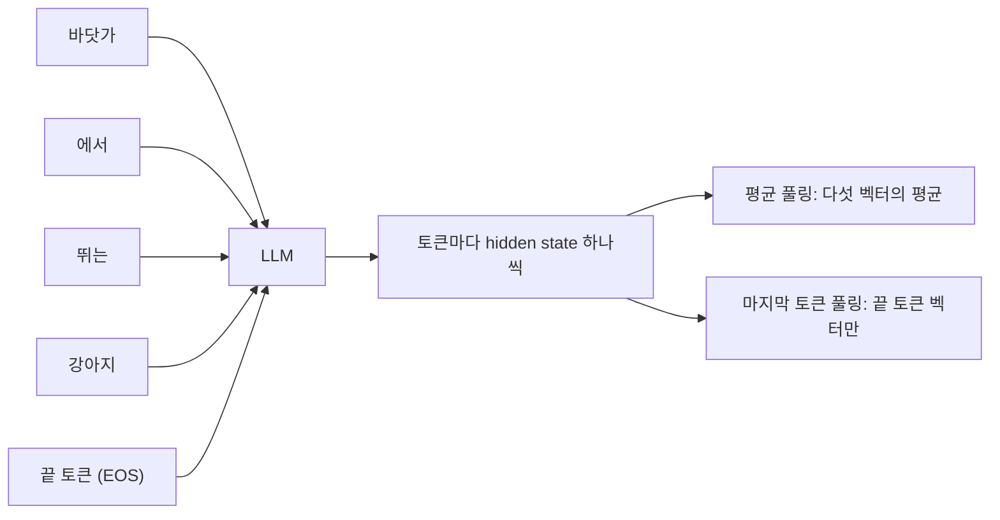
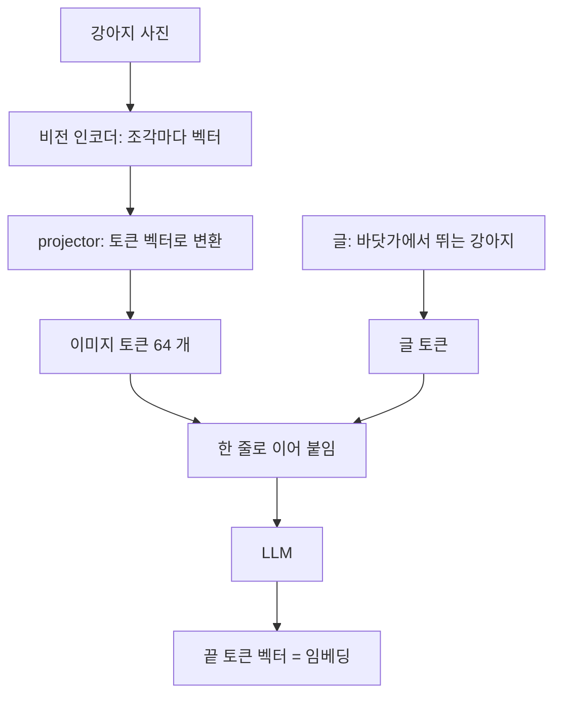
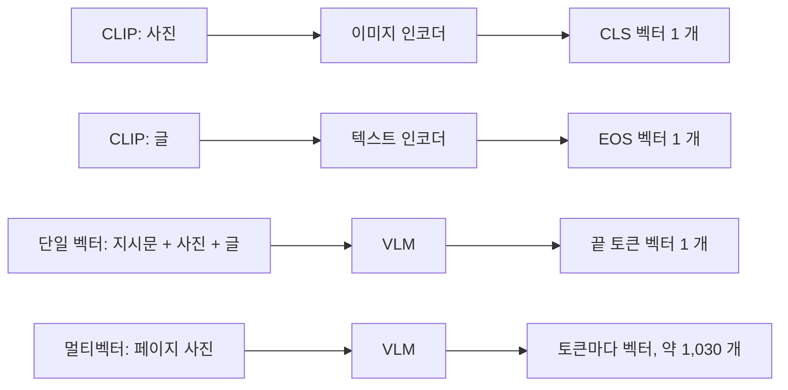

휴대폰 사진첩에서 「바닷가에서 뛰는 강아지」 라고 쳐서 사진을 찾고 싶다고 하자.

- 사진 수천 장을 미리 벡터 하나씩으로 바꿔 둔다.
- 검색어도 벡터 하나로 바꾼다.
- 검색어 벡터와 가장 가까운 사진 벡터를 꺼낸다.

사진과 글을 같은 공간의 벡터로 바꾸는 모델이 필요하다. 요즘은 이 일을 VLM(Vision-Language Model, 사진을 읽는 LLM)으로 한다.

**결론부터 말하면, VLM 임베딩은 LLM 임베딩과 뽑는 법이 같다.**

- 둘 다 맨 끝 토큰의 마지막 층 hidden state 를 문장 벡터로 쓴다.
- 둘 다 그대로는 못 쓰고 대조 학습(contrastive learning)으로 다시 학습한다.
- 다른 점은 입력이다: VLM 은 사진을 토큰 수십~수백 개로 바꿔 글 토큰과 한 줄로 이어 붙인다.

**VLM 이 사진을 설명하는 글을 먼저 쓰고 그 글을 임베딩하는 것이 아니다.** 사진에서 나온 토큰이 글 토큰과 같은 줄에 섞여 LLM 을 한 번 통과하고, 그 끝에서 벡터 하나가 나온다.

# A) LLM 에서 문장 벡터를 뽑는 방법

## A.1) 토큰마다 나오는 벡터를 하나로 줄이기

LLM 에 「바닷가에서 뛰는 강아지」 를 넣으면 토큰마다 벡터가 하나씩 나온다. 이 벡터가 hidden state 다.

- 끝 토큰까지 토큰이 5 개면 벡터도 5 개다.
- 검색에는 문장 하나에 벡터 하나가 필요하다.
- 그래서 여러 벡터를 하나로 줄인다. 이 과정을 풀링(pooling)이라 한다.



풀링은 크게 두 가지다.

- **평균 풀링 (mean pooling)**: 모든 토큰 벡터의 평균을 낸다.
- **마지막 토큰 풀링 (last-token pooling)**: 맨 끝 토큰의 벡터 하나만 쓴다.
	- 보통 문장 끝에 EOS(End of Sequence) 토큰을 붙이고 그 자리를 쓴다.

## A.2) 마지막 토큰을 쓰는 이유

**GPT 같은 LLM 은 각 토큰이 자기 앞의 토큰만 본다.** 이를 causal attention 이라 한다.

- 「바닷가」 자리의 벡터는 뒤에 「강아지」 가 온다는 것을 모른다.
- 맨 끝 자리의 벡터만 문장 전체를 보고 만들어진다.
- 그래서 문장 끝에 끝 토큰(EOS)을 붙이고 그 자리의 벡터를 쓴다.

그래서 평균을 내면 문장 전체를 모르는 벡터들이 섞인다. LLM 기반 임베딩 모델 다수가 마지막 토큰을 쓰는 이유다.

반대 경우와 나란히 놓으면 이렇다.

- **BERT 처럼 양방향으로 보는 모델**: 어느 토큰이든 문장 전체를 보므로 평균 풀링이 잘 통한다.
- **GPT 처럼 앞만 보는 모델**: 끝 토큰만 문장 전체를 보므로 마지막 토큰 풀링을 쓴다.

LLM2Vec 은 LLM 의 attention 을 양방향으로 바꾸고 추가 학습한 뒤 평균 풀링을 쓴다. 앞만 보는 제약을 풀면 평균 풀링이 다시 낫다는 것을 보여 준다 ([LLM2Vec](https://arxiv.org/abs/2404.05961)).

## A.3) 대조 학습으로 다시 학습하기

**LLM 의 끝 토큰 벡터를 그대로 꺼내면 좋은 임베딩이 아니다.** LLM 은 다음 토큰을 맞히도록 학습됐다. 끝 토큰 벡터에는 「문장 뜻」 보다 「다음에 올 단어」 에 쓸 정보가 담긴다.

그래서 대조 학습으로 다시 학습한다.

- 「바닷가에서 뛰는 강아지」 와 실제 그 사진의 설명글을 짝으로 준다.
- 짝끼리는 벡터가 가까워지게 학습한다.
- 같은 배치 안의 다른 글(「눈 속의 고양이」 등)과는 멀어지게 학습한다.
- 이 손실 함수가 [[InfoNCE]] 다.

대표 모델 둘이 이 방식이다.

- **E5-Mistral**: Mistral-7B 에 LoRA 를 붙여 대조 학습했다 ([Wang et al., 2024](https://arxiv.org/abs/2401.00368)).
	- 학습 데이터 상당 부분은 LLM 이 만든 합성 데이터다.
	- 끝 토큰(EOS)의 마지막 층 벡터를 쓴다.
- **[[Qwen3 Embedding]]**: 같은 방식을 세 단계 학습으로 키웠다 ([Zhang et al., 2025](https://arxiv.org/abs/2506.05176)).
	- 합성 쌍 약 1.5 억 개로 먼저 학습하고, 정제된 데이터로 다시 학습한 뒤, 체크포인트 여러 개를 합친다.
	- 역시 끝 토큰(EOS)의 마지막 층 벡터를 쓴다.

## A.4) 검색어 앞에 붙이는 지시문 (instruction)

**같은 문장이라도 무슨 일에 쓸지에 따라 벡터가 달라야 한다.**

- 사진 검색에 쓰면 「바닷가에서 뛰는 강아지」 는 그 장면을 찍은 사진과 가까워야 한다.
- 「동물 / 풍경」 주제 분류에 쓰면 「공원에서 자는 고양이」 같은 다른 동물 문장과 가까워야 한다.

그래서 검색어 앞에 지시문을 붙인다. E5-Mistral 은 이런 모양으로 넣는다.

```text
Instruct: 주어진 검색어에 맞는 사진 설명을 찾아라
Query: 바닷가에서 뛰는 강아지
```

- 끝 토큰은 앞의 모든 토큰을 보므로, 지시문을 보고 벡터를 과제에 맞게 바꾼다.
- 지시문은 검색어 쪽에만 붙이고 문서 쪽에는 붙이지 않는다.
- 문서 벡터는 한 번만 만들어 두고, 과제가 바뀌면 검색어 쪽 지시문만 바꾼다.

# B) VLM 이 사진을 토큰으로 바꾸는 과정

VLM 은 세 부품으로 이뤄져 있다.



**비전 인코더 (vision encoder)**: 사진을 작은 정사각형 조각(패치, patch)으로 자르고 조각마다 벡터를 만든다.

- Qwen2-VL 은 한 변 14 픽셀짜리 조각을 쓴다.
- 224×224 사진이면 가로 16 개 × 세로 16 개, 조각 256 개가 나온다.

**projector**: 비전 인코더가 만든 벡터를 LLM 의 단어 벡터와 같은 공간으로 옮긴다.

- 비전 인코더와 LLM 은 따로 학습된 모델이라 벡터 크기도 뜻도 다르다.
- LLaVA 는 선형 층 하나로 옮긴다 ([Liu et al., 2023](https://arxiv.org/abs/2304.08485)).
- Qwen2-VL 은 작은 MLP 로 옮기면서 이웃한 2×2 조각을 토큰 하나로 합친다 ([Wang et al., 2024](https://arxiv.org/abs/2409.12191)).
	- 조각 256 개가 토큰 64 개가 된다.

**LLM**: 이미지 토큰과 글 토큰을 한 줄로 이어 받는다.

```text
[이미지 시작] [이미지 토큰 64 개] [이미지 끝] 이 사진에 뭐가 있나?
```

- Qwen2-VL 은 이미지 토큰 앞뒤에 시작·끝 표시 토큰을 하나씩 붙인다.
	- 224×224 사진 한 장이 토큰 66 개가 된다.
- LLM 입장에서 사진은 「단어 66 개」 처럼 보인다.
- 이 토큰들은 글 토큰과 같은 attention 을 거치므로, 뒤에 오는 글 토큰이 사진 내용을 볼 수 있다.

조각 크기와 토큰 수의 자세한 내용은 [[Qwen-VL]] 노트에 있다.

# C) VLM 에서 임베딩을 뽑는 방식

사진 검색 임베딩을 만드는 방식은 세 가지다.

- **CLIP**: 사진과 글을 서로 다른 인코더 둘이 읽는다.
- **VLM 단일 벡터**: VLM 하나가 사진과 글을 함께 읽고 벡터 1 개를 낸다 (VLM2Vec, GME, Qwen3-VL-Embedding).
- **VLM 멀티벡터**: VLM 하나가 읽고 토큰마다 벡터를 하나씩 낸다 (ColPali).



## C.1) CLIP: 사진과 글을 따로 읽는 인코더 둘

[[CLIP]] 은 이미지 인코더와 텍스트 인코더를 따로 두고, 마지막에 같은 공간으로 맞춘다.

- 이미지 인코더(ViT)는 맨 앞 CLS 토큰 자리의 벡터를 쓴다.
- 텍스트 인코더는 EOS 토큰 자리의 마지막 층 벡터를 쓴다 ([Radford et al., 2021](https://arxiv.org/abs/2103.00020)).
- 각 벡터를 선형 층 하나로 같은 공간에 투영한다.

**사진과 글이 모델 안에서 만나지 않는다.** 그래서 생기는 한계가 있다.

- 「이 사진에서 색만 빨간색인 것」 처럼 사진과 글을 함께 넣어 벡터 하나를 만들 수 없다.
- 텍스트 인코더가 작고 입력이 76 토큰으로 잘려서, 긴 지시문을 따르게 만들기 어렵다.

## C.2) VLM 단일 벡터: LLM 임베딩과 같은 방식

VLM 하나에 사진이든 글이든 섞어 넣고, LLM 임베딩과 똑같이 끝 토큰 벡터를 쓴다.

- 「바닷가에서 뛰는 강아지」 글만 넣어도 된다.
- 강아지 사진만 넣어도 된다.
- 사진과 「이 사진과 같은 장소에서 찍은 것」 을 함께 넣어도 벡터 하나가 나온다.

대표 모델은 이렇다.

- **VLM2Vec**: Phi-3.5-V 를 대조 학습했다 ([Jiang et al., 2024](https://arxiv.org/abs/2410.05160)).
	- 끝 토큰의 마지막 층 벡터를 쓰고, 검색어 앞에 `Instruct: … Query: …` 지시문을 붙인다.
	- 36 개 데이터셋으로 된 MMEB 벤치마크도 함께 냈다.
- **GME**: Qwen2-VL 2B·7B 를 대조 학습했다 ([Zhang et al., 2024](https://arxiv.org/abs/2412.16855)).
	- 끝 토큰의 마지막 층 벡터를 쓴다.
	- 글, 사진, 사진+글을 모두 받는다.
- **Qwen3-VL-Embedding**: Qwen3-VL 을 대조 학습했다 ([Qwen, 2026](https://arxiv.org/abs/2601.04720)).
	- 입력 끝에 끝 토큰을 붙이고 그 자리의 마지막 층 벡터를 쓴다.
	- 지시문은 system prompt 에 넣고, 없으면 「Represent the user's input.」 을 기본으로 쓴다.

예외도 하나 있다. [[Jina-Embeddings-v4]] 는 같은 VLM 기반이지만 단일 벡터를 평균 풀링으로 만든다 ([Günther et al., 2025](https://arxiv.org/abs/2506.18902)).

## C.3) 지시문이 하는 일

VLM 임베딩에서 지시문은 LLM 임베딩과 같은 일을 하고, 하나를 더 한다.

- **과제를 알려 준다**: 「주어진 사진과 같은 물건을 찾아라」 와 「주어진 사진의 질문에 답하는 글을 찾아라」 는 같은 사진에서 다른 벡터를 만든다.
- **끝 토큰에 내용을 모으게 한다**: E5-V 는 「Summary above image in one word:」 를 붙여 사진을 한 단어로 요약하게 한다 ([Jiang et al., 2024](https://arxiv.org/abs/2407.12580)).

E5-V 의 결과가 지시문의 힘을 잘 보여 준다.

- 학습은 글 쌍으로만 했고, 사진은 한 장도 안 넣었다.
- 그런데 사진에 같은 꼴의 지시문을 붙이니 사진 검색도 됐다.
- 논문은 「한 단어로」 라는 지시가 사진이든 글이든 끝 토큰 하나에 뜻을 모아서라고 본다.

## C.4) 멀티벡터: 토큰 벡터를 전부 쓰는 ColPali

ColPali 는 끝 토큰 하나만 쓰지 않고, 모든 출력 토큰을 각각 128 차원으로 줄여 전부 저장한다 ([Faysse et al., 2024](https://arxiv.org/abs/2407.01449)).

- 바탕 모델은 PaliGemma-3B 다.
- PDF 페이지를 한 장씩 이미지로 바꿔 넣는다.
- 페이지 한 장이 조각 1,024 개와 글 토큰 6 개, 약 1,030 개 벡터가 된다.
- 검색어도 토큰마다 벡터를 만든다.

점수는 [[ColBERT]] 와 같은 late interaction 으로 낸다.

- 검색어 토큰마다 페이지 조각 중 가장 비슷한 것 하나를 찾는다.
- 그 최고 점수들을 모두 더한다.

단일 벡터와 나란히 놓으면 이렇다.

- **단일 벡터**: 페이지 한 장이 벡터 1 개다.
	- 저장이 싸고 검색이 빠르다.
	- 표 안의 숫자 하나 같은 작은 내용은 묻히기 쉽다.
- **멀티벡터**: 페이지 한 장이 벡터 약 1,030 개다.
	- 작은 글씨·표·그래프 속 내용까지 짚는다.
	- 저장과 계산이 그만큼 든다.

벡터 수를 줄이는 방법은 [[token pooling]] 에 있다.

# D) LLM 임베딩과 VLM 임베딩 비교

**같은 점이 훨씬 많다.** VLM 임베딩은 LLM 임베딩 방식을 그대로 가져오고, 입력에 이미지 토큰을 섞은 것이다.

| 항목 | LLM 임베딩 | VLM 임베딩 |
| --- | --- | --- |
| 입력 | 글 토큰 | 글 토큰 + 이미지 토큰 (비전 인코더 → projector) |
| 벡터 위치 | 끝 토큰(EOS)의 마지막 층 | 같다 (ColPali 는 모든 토큰, Jina v4 는 평균) |
| 지시문 | 검색어 앞에 과제 설명 | 같다 + 「한 단어로 요약」 같은 압축 지시 |
| 학습 | 대조 학습 ([[InfoNCE]]) | 같다, 학습 쌍에 사진이 들어간다 |
| 대표 모델 | E5-Mistral, Qwen3-Embedding | VLM2Vec, GME, Qwen3-VL-Embedding, ColPali |
| 이전 세대 | BERT 계열 (평균 풀링) | CLIP (인코더 둘) |
| 추가 비용 | 없음 | 사진 한 장이 토큰 수십~수천 개라 느리고 메모리를 더 쓴다 |

# E) 부록: 입력 템플릿

본문에서 말로 풀었던 입력 모양을 논문 그대로 옮긴다.

E5-Mistral. 검색어 쪽만 지시문을 붙이고, 끝에 EOS 를 붙인다.

```text
Instruct: {task_definition}
Query: {query}
```

Qwen3-Embedding. 지시문과 검색어를 이어 붙이고 끝 토큰을 붙인다.

```text
{Instruction} {Query}<|endoftext|>
```

VLM2Vec. 사진 토큰 뒤에 지시문을 둔다.

```text
<image> Instruct: {task_definition}
Query: {query}
```

Qwen3-VL-Embedding. 지시문은 system, 입력은 user 에 넣고, assistant 자리 끝 토큰의 벡터를 쓴다.

```text
<|im_start|>system
{Instruction}<|im_end|>
<|im_start|>user
{Instance}<|im_end|>
<|im_start|>assistant
<|endoftext|>
```

E5-V. 글과 사진에 같은 꼴의 지시문을 붙인다.

```text
<text>
Summary above sentence in one word:

<image>
Summary above image in one word:
```

# F) References

- [Improving Text Embeddings with Large Language Models (E5-Mistral)](https://arxiv.org/abs/2401.00368)
- [Qwen3 Embedding](https://arxiv.org/abs/2506.05176)
- [LLM2Vec](https://arxiv.org/abs/2404.05961)
- [Visual Instruction Tuning (LLaVA)](https://arxiv.org/abs/2304.08485)
- [Qwen2-VL](https://arxiv.org/abs/2409.12191)
- [Learning Transferable Visual Models From Natural Language Supervision (CLIP)](https://arxiv.org/abs/2103.00020)
- [VLM2Vec](https://arxiv.org/abs/2410.05160)
- [GME: Improving Universal Multimodal Retrieval by Multimodal LLMs](https://arxiv.org/abs/2412.16855)
- [Qwen3-VL-Embedding and Qwen3-VL-Reranker](https://arxiv.org/abs/2601.04720)
- [E5-V](https://arxiv.org/abs/2407.12580)
- [ColPali](https://arxiv.org/abs/2407.01449)
- [jina-embeddings-v4](https://arxiv.org/abs/2506.18902)
