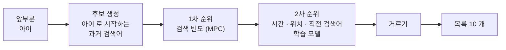

검색창에 `아이` 까지 쳤다. 아래 목록에 이런 후보가 뜬다.

```text
아이폰 16
아이폰 15 케이스
아이패드
아이폰 충전기
```

찾던 검색어가 `아이폰 15 케이스` 라면 2 위를 눌러서 나머지 8 글자를 안 쳐도 된다. 자동완성(query auto-completion, QAC)은 이 목록에 넣을 후보를 고르고 순서를 정하는 일이다. 세 가지 검색어 제안 기능의 공통점은 [[Query Suggestion|검색어 제안]] 노트에 있다.

# A) 한눈에 보기

- **자동완성은 지금까지 친 앞부분(prefix)으로 사용자가 끝내 칠 검색어를 맞히는 일이다.**
- **두 단계로 나뉜다.** 앞부분으로 시작하는 과거 검색어를 찾고(후보 생성), 그중 사용자가 고를 것을 위로 올린다(순위).
- **가장 기본 순위는 많이 검색된 순서(MPC)다.** 여기에 시간·위치·직전 검색어를 신호로 더해 학습한 모델로 다시 정렬한다.
- **한국어는 자모 단위로 맞춰야 한다.** 치는 도중의 글자는 아직 완성되지 않았다.
- **평가는 원하던 검색어가 몇 번째에 떴는지(MRR)와 덜 친 글자 수로 본다.**



# B) 후보 생성

**후보는 사전이 아니라 과거 검색어 목록에서 찾는다.** 사람들이 실제로 친 검색어를 빈도와 함께 모아 두고, 앞부분이 같은 것을 꺼낸다.

- 앞부분으로 빠르게 찾는 자료구조([[Trie|trie]], FST, edge n-gram)는 [[Prefix Search]] 에 있다.
- 검색어 중간 단어로도 찾으려면(`15 케이스` → `아이폰 15 케이스`) 각 단어의 시작 위치를 따로 색인한다.

## B.1) 한글 자모 단위 매칭

`아이폰` 을 치는 동안 화면의 글자는 이렇게 바뀐다.

```text
아 → 아이 → 아잎 → 아이포 → 아이폰
```

- ㅍ 키를 누른 순간 화면에는 `아잎` 이 보인다. ㅍ 이 일단 `이` 의 받침으로 붙기 때문이다.
- 음절 단위로 비교하면 `아이폰` 은 `아잎` 으로도, `아이포` 로도 시작하지 않는다. 이 두 순간에 목록이 비거나 엉뚱한 후보가 뜬다.
- 자모로 풀면 `ㅇㅏㅇㅣㅍ` 과 `ㅇㅏㅇㅣㅍㅗ` 모두 `ㅇㅏㅇㅣㅍㅗㄴ` 의 앞부분이다.

**그래서 색인할 검색어와 입력한 앞부분을 둘 다 자모로 풀어서 맞춘다.** 음절을 자모로 푸는 규칙은 [[Prefix Search]] 의 초성 추출과 같다.

- 같은 방식으로 초성만 친 입력(`ㅇㅇㅍ`)도 받는다.
- 한글 자판을 켜지 않고 친 입력(`dkdl`)은 `아이` 로 바꿔 후보를 찾는다. 바꾸는 방법은 [[Query Spelling Correction|오타 교정]] 노트에 있다.

## B.2) 기록에 없는 앞부분

**앞부분이 길고 드물면 그 앞부분으로 시작하는 과거 검색어가 하나도 없다.** `아이폰 15 투명 맥세이프 범퍼 케` 같은 입력이다.

- 마지막 단어만 떼어 완성한다. 검색어 끝에 자주 오는 말(`케이스`, `케이블`)을 붙여 `... 범퍼 케이스` 같은 새 후보를 만든다 (Mitra & Craswell, 2015).
- 글자 단위 언어 모델로 뒷부분을 생성한다 (Park & Chiba, 2017). 이 자리에 Transformer 를 쓰는 사례도 많다.
- 생성한 후보는 존재하지 않는 상품명이나 어색한 말이 될 수 있다. 그래서 기록에서 찾은 후보가 모자랄 때만 빈자리를 채우는 용도로 쓰는 경우가 많다.

# C) 검색 빈도 순 정렬: MPC

**MPC(Most Popular Completion)는 앞부분으로 시작하는 후보를 과거 검색 횟수 순서로 놓는다.** Bar-Yossef & Kraus (2011) 가 기준선으로 쓰면서 붙은 이름이다.

지난 한 달 `아이` 로 시작한 검색이 이랬다고 하자.

```text
아이폰 16          5,000
아이폰 15 케이스    3,000
아이패드            2,000
아이폰 충전기        1,500
```

- MPC 는 이 순서 그대로 보여 준다.
- 모두에게 같은 목록이 나가므로 미리 계산해 두기 쉽다.

**MPC 는 생각보다 강한 기준선이다.** 많은 사람이 같은 것을 찾으므로, 아무 정보가 없는 사용자에게는 이 순서가 가장 잘 맞는다.

- 검색 횟수 순서는 "이 앞부분을 친 사람이 끝내 이 검색어를 칠 확률" 을 과거 비율로 어림한 것이다.

**MPC 가 틀리는 경우는 둘이다.**

- 시간이 바뀐 경우: `아이폰 17` 이 출시된 날 검색이 급증해도, 한 달 누적 횟수로는 아직 목록 아래에 있다.
- 사람이 다른 경우: 방금 `아이폰 15` 를 검색한 사람과 처음 들어온 사람에게 같은 목록이 나간다.

# D) 시간 신호: 급상승·신규 검색어

**최근 검색에 가중치를 더 준다.**

- 반감기를 7 일로 잡으면 오늘 검색은 1 회, 일주일 전 검색은 0.5 회, 2 주 전 검색은 0.25 회로 센다.
- 반감기가 짧으면 새 흐름을 빨리 따라가지만, 하루 이틀 반짝한 검색어도 위로 올라온다.
- 반감기가 길면 목록이 안정적이지만 새 흐름을 늦게 따라간다.

**급상승은 평소보다 몇 배 늘었는지로 본다.**

- `아이폰 17` 은 평소 시간당 10 번이었는데 출시 당일 1,000 번 들어왔다. 100 배다.
- `아이폰 16` 은 평소 시간당 2,000 번이었는데 2,200 번 들어왔다. 1.1 배다.
- 횟수로는 `아이폰 16` 이 위지만 늘어난 비율로는 `아이폰 17` 이 훨씬 위다.
- 급상승 후보는 이 비율로 뽑아 목록의 몇 자리에 섞는다.

**주기가 있는 검색어는 과거 같은 시기를 본다.**

- 매년 12 월의 `크리스마스 선물`, 매주 금요일 저녁의 `치킨` 처럼 되풀이되는 검색어가 있다.
- 검색 횟수를 시계열로 보고 다음 시간대의 횟수를 예측해 순위에 쓰기도 한다 (Shokouhi & Radinsky, 2012).

**새 검색어는 갑자기 늘어난 것이 진짜 관심인지 확인한다.** 기록이 짧아서 몇 사람의 반복 검색이나 봇과 구분하기 어렵다.

- 횟수가 아니라 서로 다른 사용자 수로 센다.
- 그래도 남는 것은 [[Query Suggestion|검색어 제안]] 의 거르기 단계에서 막는다.

# E) 맥락 신호: 직전 검색어·개인 기록·위치

**직전 검색어가 같은 앞부분의 답을 바꾼다.** `케` 를 쳤을 때 전체 검색 빈도로는 `케이크` 가 1 위일 수 있다.

- 방금 `아이폰 15` 를 검색한 사람이라면 `케이스` 를 칠 가능성이 훨씬 높다.
- 직전 검색어와 후보가 얼마나 비슷한지(겹치는 단어, 임베딩 거리, 같은 세션에 함께 나온 횟수)를 점수에 더한다 (Bar-Yossef & Kraus, 2011).

**사용자 본인의 과거 검색도 강한 신호다.** 사람은 같은 검색어를 다시 치는 일이 많다.

- Shokouhi (2013) 는 개인화 신호 가운데 장기 검색 기록과 위치가 가장 쓸모 있었다고 보고했다.
- 본인 기록에서 나온 후보는 본인에게만 보여 준다.

**위치는 지역마다 따로 센 검색 빈도로 쓴다.**

- 같은 `아이폰 수리` 라도 서울 강남의 사용자에게는 `아이폰 수리 강남`, 부산 사용자에게는 `아이폰 수리 서면` 이 맞다.
- 동네 단위 기록은 적다. 모자라면 시·도 단위로, 그래도 모자라면 전국 빈도로 넓힌다(backoff).
- 보통은 지역 빈도와 전국 빈도를 비율로 섞어서 쓴다.

**개인화가 지나치면 엉뚱한 제안이 계속 뜬다.** 한 번 잘못 친 검색어나 한 번 찾아본 민감한 검색어가 계속 위에 남는다.

- 그래서 개인 신호는 공통 후보의 순서를 조정하는 데 주로 쓰고, 후보를 새로 만드는 데는 조심해서 쓴다.

# F) 학습 기반 순위

**앞부분 하나, 그때의 후보 목록, 사용자가 끝내 친 검색어가 학습 샘플 하나다.**

사용자가 결국 `아이폰 15 케이스` 를 검색했다면, 그 사람이 거친 앞부분마다 샘플이 하나씩 생긴다.

```text
앞부분    그때의 후보 목록                              정답
아        아이폰 16, 아이패드, 아이폰 15 케이스 ...      아이폰 15 케이스
아이      아이폰 16, 아이폰 15 케이스, 아이패드 ...      아이폰 15 케이스
아이폰     아이폰 16, 아이폰 15 케이스, 아이폰 충전기 ...  아이폰 15 케이스
```

- 후보마다 특징을 만든다. 전체 검색 횟수, 최근 검색 횟수, 늘어난 비율, 그 지역의 검색 횟수, 직전 검색어와의 유사도, 본인이 전에 친 적이 있는지, 후보 길이 같은 것이다.
- 정답 후보가 위로 오도록 순위 모델을 학습한다. 보통 [[LambdaMART]] 같은 GBDT 순위 모델을 쓴다. 학습 방식은 [[Learning-to-Rank]] 에 있다.
- 요청마다 후보 수십 개만 계산하면 되므로 GBDT 는 몇 ms 안에 끝난다.

**사용자는 목록 위쪽에 보인 후보를 더 자주 누른다.**

- 기존 모델이 1 위에 둔 후보가 정답으로 더 많이 남는다. 그대로 학습하면 새 모델이 기존 순서를 따라 하게 된다. 이것이 [[position bias]] 다.
- 목록에서 고르지 않고 끝까지 직접 친 경우에도 끝내 검색한 검색어를 정답으로 쓸 수 있다. 이 정답은 목록 순서의 영향을 덜 받는다.

**앞부분과 맥락을 함께 넣는 신경망 순위 모델도 있다.** 키 입력마다 돌아야 하므로, 신경망은 주로 오프라인에서 후보와 특징(임베딩 유사도 등)을 만드는 데 쓴다. 요청 경로의 시간 예산과 캐시는 [[Query Suggestion|검색어 제안]] 노트에 있다.

# G) 평가

**오프라인 평가는 과거 기록을 다시 재생한다.** 사용자가 끝내 친 검색어를 정답으로 두고, 그 사람이 거친 앞부분마다 새 모델의 목록에서 정답이 몇 번째에 오는지 본다.

**[[mean reciprocal rank|MRR]] (Mean Reciprocal Rank) 은 정답 순위의 역수를 평균한 값이다.**

- 정답이 1 위면 1, 2 위면 0.5, 3 위면 0.33, 목록에 없으면 0 이다.
- 앞부분 길이별로 나눠 본다. `아` 한 글자에서는 누구도 맞히기 어렵고, `아이폰 15 케` 까지 치면 대부분 맞힌다.
- 전체 평균만 보면 긴 앞부분의 쉬운 점수가 섞여서 모델 간 차이가 잘 안 보인다.

**덜 친 글자 수는 얼마나 일찍 맞혔는지까지 본다.**

- `아이폰 15 케이스` 는 공백을 포함해 10 글자다.
- `아이` 에서 목록을 눌렀으면 8 글자, `아이폰 15 케` 에서 눌렀으면 2 글자를 덜 쳤다.
- 두 경우 모두 그 순간의 MRR 은 1 이지만, 사용자가 아낀 입력은 4 배 차이다.
- 휴대폰 자판에서는 키 입력 수로 세기도 한다. 한글은 한 글자가 키 두세 번이다.

**온라인에서는 제안 클릭률을 본다.** 검색 가운데 자동완성 목록에서 골라 검색한 비율이다.

- 클릭률만 보면, 사용자가 원래 치려던 구체적인 검색어 대신 짧고 인기 있는 검색어를 누르게 만든 모델도 좋아 보인다.
- 그래서 고른 뒤의 검색 결과에서 클릭·구매가 있었는지, 검색어를 다시 고쳐 쳤는지를 함께 본다.
- 두 모델의 차이가 우연인지는 [[통계적 유의성 계산법]] 으로 판단한다.

# Related

- [[Query Suggestion]]
- [[Query Spelling Correction]]
- [[Related Searches]]
- [[Prefix Search]]
- [[Finite State Transducer]]
- [[Learning-to-Rank]]
- [[mean reciprocal rank]]

# References

- Fei Cai, Maarten de Rijke, [A Survey of Query Auto Completion in Information Retrieval](https://www.nowpublishers.com/article/Details/INR-055), Foundations and Trends in Information Retrieval, 2016.
- Ziv Bar-Yossef, Naama Kraus, [Context-Sensitive Query Auto-Completion](https://doi.org/10.1145/1963405.1963424), WWW 2011.
- Milad Shokouhi, Kira Radinsky, [Time-Sensitive Query Auto-Completion](https://ir.webis.de/anthology/2012.sigirconf_conference-2012.62), SIGIR 2012.
- Milad Shokouhi, [Learning to Personalize Query Auto-Completion](https://doi.org/10.1145/2484028.2484076), SIGIR 2013.
- Bhaskar Mitra, Nick Craswell, [Query Auto-Completion for Rare Prefixes](https://doi.org/10.1145/2806416.2806599), CIKM 2015.
- Dae Hoon Park, Rikio Chiba, [A Neural Language Model for Query Auto-Completion](https://doi.org/10.1145/3077136.3080758), SIGIR 2017.
