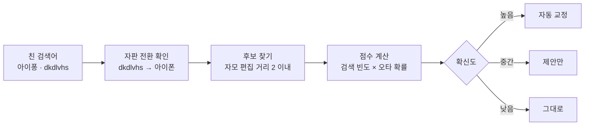

검색창에 `아이퐁` 을 쳤다. 다른 사람은 한글 자판을 켜지 않은 채 `dkdlvhs` 를 쳤다. 둘 다 아이폰을 찾는다.

검색 결과 위에 뜨는 안내가 두 사람에게 다르다.

```text
dkdlvhs 를 친 사람   아이폰 검색 결과입니다.   dkdlvhs 로 검색하기
아이퐁 을 친 사람    아이퐁 검색 결과입니다.   혹시 아이폰 을 찾으셨나요?
```

서비스는 첫 사람의 검색어를 바꿔서 검색했고, 둘째 사람에게는 바꿀 말을 제안만 했다.

오타 교정은 사용자가 친 글자에서 원래 치려던 검색어를 찾는 일이다. [[Query Understanding]] 의 첫 단계이고, 세 가지 검색어 제안 기능의 공통점은 [[Query Suggestion|검색어 제안]] 노트에 있다.

# A) 한눈에 보기

- **오타 교정은 사용자가 친 글자에서 원래 치려던 검색어를 찾는 일이다.**
- **기본 틀은 noisy channel 모델이다.** 후보가 얼마나 흔한 검색어인지와, 그 후보를 치려다 이 글자가 나올 만한지를 곱한다.
- **한국어는 자모 단위 비교와 한영 자판 전환을 따로 챙긴다.**
- **확신이 높으면 바꿔서 검색하고, 애매하면 「혹시 이것을 찾으셨나요」 로 제안만 한다.**



# B) Noisy channel 모델

**사용자는 `아이폰` 을 치려 했는데 손가락이 실수해서 `아이퐁` 이 나왔다고 본다.** 머릿속 검색어가 잡음 섞인 통로(noisy channel)를 지나 화면에 찍힌 셈이다. 교정은 그 반대로, 찍힌 글자를 보고 머릿속 검색어를 맞힌다.

검색 100 만 번이 들어왔다고 하고, 그중 `아이퐁` 이 화면에 찍히는 경우를 센다.

- `아이폰` 을 치려던 검색이 1 만 번이다. 그중 1,000 번에 1 번 꼴로 받침 ㄴ 대신 ㅇ 을 친다. `아이퐁` 이 10 번 찍힌다.
- `아이퐁` 이라는 말을 정말 찾으려던 검색은 1 번이다. 대부분 그대로 친다. `아이퐁` 이 1 번 찍힌다.
- `아이콩` 을 치려던 검색은 2 번이다. 같은 비율로 틀린다고 해도 `아이퐁` 은 0.002 번 찍힌다.

**`아이퐁` 이 찍힌 11 번 가운데 10 번은 `아이폰` 을 치려던 사람이다.** 그래서 `아이폰` 으로 고친다.

식으로 쓰면 이렇다. 친 글자를 $w$, 후보를 $c$ 라 하면

$$
\hat{c} = \arg\max_{c} P(c \mid w) = \arg\max_{c} P(w \mid c)\,P(c)
$$

- $P(c)$ 는 후보가 얼마나 자주 검색되는지다. 위에서 1 만 번, 1 번, 2 번에 해당한다. 검색 기록의 빈도로 센다.
- $P(w \mid c)$ 는 $c$ 를 치려다 $w$ 가 나올 확률이다. 위에서 1,000 번에 1 번에 해당한다. 오류 모델(error model)이라 부른다.
- 두 번째 등호는 [[Bayes theorem|베이즈 정리]] 에서 분모 $P(w)$ 가 후보마다 같아서 빠진 것이다.

**친 글자 그대로도 후보다.** 맞게 친 검색어를 더 흔한 말로 바꾸면 안 된다.

- `다이슨` 을 치려던 검색이 2,000 번이고, 대부분 그대로 친다. `다이슨` 이 약 1,900 번 찍힌다.
- `다이소` 를 치려던 검색은 5,000 번으로 더 많다. 하지만 모음 하나를 바꾸고 받침 하나를 더해야 `다이슨` 이 되므로 그런 실수는 10 만 번에 1 번 꼴이다. `다이슨` 은 0.05 번 찍힌다.
- 1,900 번 대 0.05 번이라서 `다이슨` 은 그대로 둔다.

**흔한 말로 바꾸려면, 그 말이 더 흔한 정도가 그 실수가 드문 정도보다 커야 한다.**

- `아이폰` 은 `아이퐁` 보다 1 만 배 흔하고, 그 실수는 1,000 번에 1 번 나온다. 바꾼다.
- `다이소` 는 `다이슨` 보다 2.5 배 흔할 뿐이고, 그 실수는 10 만 번에 1 번 나온다. 바꾸지 않는다.

**실제로는 단어 하나가 아니라 검색어 전체로 본다.** `아이퐁 케이스` 처럼 뒤에 `케이스` 가 붙으면 `아이폰` 쪽이 더 그럴듯해진다.

- 그래서 $P(c)$ 를 검색어 단위의 언어 모델로 계산한다.

# C) 오류 모델: 편집 거리

**편집 거리(edit distance)는 글자를 넣고, 빼고, 바꾸는 일을 몇 번 해야 같은 말이 되는지 센 값이다.** Levenshtein distance 라고도 한다. 이웃한 두 글자의 자리를 바꾸는 것까지 한 번으로 세면 Damerau-Levenshtein distance 다.

- 가장 단순한 오류 모델은 편집 거리가 클수록 $P(w \mid c)$ 를 작게 주는 것이다.
- 더 나은 오류 모델은 어떤 실수가 흔한지 배운다. 자판에서 이웃한 키, 소리가 같은 받침(`낫`·`낮`·`낟`)처럼 자주 헷갈리는 쌍에 큰 확률을 준다 (Brill & Moore, 2000).

**모든 검색어와 편집 거리를 계산하면 느리다.** 검색어 사전이 수천만 개여도 몇 ms 안에 후보를 찾아야 한다.

- 오타는 대부분 편집 거리 1 이나 2 안에 있으므로, 그 안의 후보만 빠르게 찾는 색인을 쓴다.
- SymSpell 은 사전 단어마다 글자를 한두 개 지운 형태를 미리 색인한다. 입력도 지운 형태를 만들어 겹치는 것을 찾는다.
- Lucene 의 FuzzyQuery 는 편집 거리 안의 단어만 받아들이는 오토마톤(Levenshtein automaton)을 만들고, 단어 사전의 [[Finite State Transducer|FST]] 와 함께 따라 내려가며 후보를 찾는다.

# D) 한글 자모 단위 편집 거리

**음절 단위로 세면 작은 실수와 전혀 다른 말이 같은 거리로 나온다.**

- `아이폰` 과 `아이퐁` 은 받침 하나만 다르다. 음절로 1, 자모로 1 이다.
- `아이폰` 과 `아이감` 은 마지막 음절이 통째로 다르다. 음절로는 똑같이 1 이지만 자모로는 3 이다.
- 자모로 풀어야 두 경우를 구분할 수 있다.

**자모로 풀면 자판 실수를 그대로 셀 수 있다.**

- 2벌식 자판에서 ㄴ(S 키) 바로 오른쪽 키가 ㅇ(D 키)이다. `아이퐁` 은 옆 키를 누른 실수다.
- 자모 단위 오류 모델은 이런 쌍(ㄴ과 ㅇ)에 큰 확률을 준다.

**띄어쓰기도 오타 교정의 큰 부분이다.** `아이폰15케이스` 와 `아이폰 15 케이스` 는 같은 검색어다.

- 공백을 빼고 비교하거나, 띄어쓰기만 바꾼 후보를 따로 만든다.

음절을 자모로 푸는 코드는 부록에 있다.

# E) 한영 자판 전환 오타

**한글 자판으로 바꾸지 않고 치면 `아이폰` 이 `dkdlvhs` 가 된다.** 반대로 영어를 한글 자판 상태로 치면 `iphone` 이 `ㅑㅔㅗㅐㅜㄷ` 가 된다.

- 편집 거리로는 못 찾는다. `dkdlvhs` 와 `아이폰` 은 같은 글자가 하나도 없다.
- 대신 바꾸는 규칙이 정확히 정해져 있다. 키 하나가 자모 하나에 대응하므로, 키 위치대로 자모를 놓고 한글 조합 규칙으로 묶으면 된다 (코드는 부록).

**바꿀지는 두 쪽을 비교해 정한다.**

- `dkdlvhs` 는 영어로 뜻이 없고 검색 기록에도 거의 없다. 바꾼 `아이폰` 은 아주 흔하다. 바꾼다.
- `ipad` 를 한글로 바꾸면 `ㅑㅔㅁㅇ` 이다. 모음으로 시작해 글자로 조합되지도 않는다. 그대로 둔다.
- 짧은 입력은 양쪽 다 말이 될 수 있다. `go` 는 영어 단어이면서 한글로 바꾸면 `해` 다. 이럴 때는 바꾸지 않고 제안만 하거나 두 결과를 섞어서 보여 준다.

**자판 전환도 noisy channel 틀에 그대로 넣을 수 있다.** 자판 전환을 오류 모델의 한 종류로 보고, `아이폰` 을 치려다 영문 자판 상태로 쳤을 확률을 $P(w \mid c)$ 에 더한다.

- 자동완성에도 같은 변환을 쓴다. `dkdl` 까지 쳤을 때 `아이` 로 바꿔 후보를 찾는다 ([[Query Auto-Completion]]).

# F) 학습 데이터: 고쳐 친 기록

**사용자가 직접 고쳐 친 기록이 가장 좋은 정답이다.**

```text
10:02:11  아이퐁 15 케이스   결과 클릭 없음
10:02:19  아이폰 15 케이스   투명 케이스 클릭
```

- 짧은 간격으로 이어 쳤고, 편집 거리가 가깝고, 두 번째 검색 뒤에만 클릭이 있다. (`아이퐁`, `아이폰`) 쌍으로 쓴다.
- 이런 쌍이 많이 모이면 어떤 자모를 어떤 자모로 잘못 치는지 확률을 셀 수 있다. 이것이 오류 모델이다.
- Cucerzan & Brill (2004) 은 검색 기록만으로 교정을 여러 번 반복해, 검색어를 점점 흔한 형태로 옮기는 방법을 보였다.

**모든 재검색이 교정은 아니다.** `아이폰` 다음에 `갤럭시` 를 친 것은 생각을 바꾼 것이다.

- 편집 거리가 먼 쌍은 뺀다.
- 이렇게 이어 친 검색어 쌍은 연관검색어의 재료가 된다 ([[Related Searches]]).

**신경망으로 교정 결과를 직접 생성하기도 한다.** 오타를 넣으면 교정된 검색어를 내는 글자 단위 seq2seq 나 Transformer 모델이다.

- 정답 쌍이 모자라면 정상 검색어의 자모를 바꾸거나 빼서 인공 오타를 만든다.
- 생성 모델은 없는 말을 만들 수 있다. 결과를 검색 기록에 있는 검색어로 제한하거나, noisy channel 점수로 한 번 더 확인한다.

# G) 자동 교정과 제안

**교정 결과를 쓰는 방법은 셋이다.**

- **자동 교정**: `dkdlvhs` 를 `아이폰` 으로 바꾼 결과를 보여 주고, 위에 "`dkdlvhs` 로 검색하기" 링크를 단다.
- **제안만**: `아이퐁` 결과를 그대로 보여 주고, 위에 "혹시 `아이폰` 을 찾으셨나요?" 를 띄운다.
- **그대로**: 아무것도 하지 않는다.

**잘못 자동 교정하면 사용자는 찾던 것을 아예 못 본다.**

- `다이슨` 을 `다이소` 로 바꿔 검색하면 결과에 다이슨 상품이 없다. 사용자는 안내 문구를 찾아 다시 눌러야 한다.
- 제안만 하다 틀리면 사용자는 문구 한 줄을 무시하면 된다.
- 그래서 자동 교정에는 제안보다 높은 확신도 기준을 둔다.

**확신도는 교정 후보의 점수가 원래 검색어 점수의 몇 배인지와, 원래 검색어의 결과 수로 정한다.**

- `dkdlvhs` 는 결과가 0 건이고 바꾼 쪽 점수가 훨씬 높다. 자동 교정한다.
- `아이퐁` 은 바꾼 쪽 점수가 10 배지만 `아이퐁` 으로도 결과가 조금 있다. 제안만 한다.
- `다이슨` 은 원래 검색어 쪽 점수가 훨씬 높다. 그대로 둔다.

**평가는 바꾼 것이 맞았는지와, 사용자가 되돌렸는지로 본다.**

- 오프라인에서는 고쳐 친 쌍으로 만든 평가셋에서 정밀도(바꾼 것 중 맞게 바꾼 비율)와 재현율(고쳐야 할 것 중 고친 비율)을 본다.
- 온라인에서는 자동 교정 뒤 "원래 검색어로 검색하기" 를 누른 비율을 본다. 이 비율이 높으면 잘못 바꾼 것이다.
- 제안을 눌러 교정 검색어로 넘어간 비율과, 교정 뒤 결과 클릭률도 함께 본다.

# 부록: 자모 분해와 자판 변환 코드

음절을 자모로 풀어 편집 거리를 계산한다. 한글 음절 코드에서 `0xAC00`(가)을 빼고 588(중성 21 × 종성 28)로 나눈 몫이 초성 번호다.

```python
CHO = "ㄱㄲㄴㄷㄸㄹㅁㅂㅃㅅㅆㅇㅈㅉㅊㅋㅌㅍㅎ"
JUNG = "ㅏㅐㅑㅒㅓㅔㅕㅖㅗㅘㅙㅚㅛㅜㅝㅞㅟㅠㅡㅢㅣ"
JONG = ["", "ㄱ", "ㄲ", "ㄳ", "ㄴ", "ㄵ", "ㄶ", "ㄷ", "ㄹ", "ㄺ", "ㄻ", "ㄼ", "ㄽ", "ㄾ",
        "ㄿ", "ㅀ", "ㅁ", "ㅂ", "ㅄ", "ㅅ", "ㅆ", "ㅇ", "ㅈ", "ㅊ", "ㅋ", "ㅌ", "ㅍ", "ㅎ"]

def to_jamo(text: str) -> str:
    out = []
    for ch in text:
        code = ord(ch) - 0xAC00
        if 0 <= code < 11172:
            out += [CHO[code // 588], JUNG[code % 588 // 28], JONG[code % 28]]
        else:
            out.append(ch)
    return "".join(out)

def edit_distance(a: str, b: str) -> int:
    prev = list(range(len(b) + 1))
    for i, ca in enumerate(a, 1):
        cur = [i]
        for j, cb in enumerate(b, 1):
            cur.append(min(prev[j] + 1, cur[j - 1] + 1, prev[j - 1] + (ca != cb)))
        prev = cur
    return prev[-1]

edit_distance("아이폰", "아이감")                    # 1 (음절)
edit_distance(to_jamo("아이폰"), to_jamo("아이감"))  # 3 (자모)
```

영문 자판으로 친 글자를 2벌식 위치대로 자모로 바꾸고, 초성 · 중성 · 종성 순서로 묶는다. 받침 뒤에 모음이 오면 받침을 다음 글자의 초성으로 넘긴다(`잎` + ㅗ → `이포`).

```python
KEY = dict(zip("qwertyuiopasdfghjklzxcvbnm", "ㅂㅈㄷㄱㅅㅛㅕㅑㅐㅔㅁㄴㅇㄹㅎㅗㅓㅏㅣㅋㅌㅊㅍㅠㅜㅡ"))
KEY.update(zip("QWERTOP", "ㅃㅉㄸㄲㅆㅒㅖ"))
V2 = {"ㅗㅏ": "ㅘ", "ㅗㅐ": "ㅙ", "ㅗㅣ": "ㅚ", "ㅜㅓ": "ㅝ", "ㅜㅔ": "ㅞ", "ㅜㅣ": "ㅟ", "ㅡㅣ": "ㅢ"}
C2 = {"ㄱㅅ": "ㄳ", "ㄴㅈ": "ㄵ", "ㄴㅎ": "ㄶ", "ㄹㄱ": "ㄺ", "ㄹㅁ": "ㄻ", "ㄹㅂ": "ㄼ",
      "ㄹㅅ": "ㄽ", "ㄹㅌ": "ㄾ", "ㄹㅍ": "ㄿ", "ㄹㅎ": "ㅀ", "ㅂㅅ": "ㅄ"}
C2_SPLIT = {v: k for k, v in C2.items()}

def en_to_ko(text: str) -> str:
    out, cho, jung, jong = [], "", "", ""

    def flush():
        nonlocal cho, jung, jong
        if cho and jung:
            out.append(chr(0xAC00 + (CHO.index(cho) * 21 + JUNG.index(jung)) * 28 + JONG.index(jong)))
        else:
            out.append(cho + jung)
        cho, jung, jong = "", "", ""

    for ch in text:
        j = KEY.get(ch) or KEY.get(ch.lower())
        if j is None:                                   # 자판에 없는 글자(숫자, 공백)
            flush(); out.append(ch)
        elif j in JUNG:                                 # 모음
            if cho and jung and jong:                   # 받침을 다음 글자 초성으로 넘긴다
                keep, move = C2_SPLIT.get(jong, ("", jong))
                jong = keep; flush(); cho, jung = move, j
            elif jung and not jong and jung + j in V2:  # ㅗ + ㅏ → ㅘ
                jung = V2[jung + j]
            elif cho and not jung:
                jung = j
            else:
                flush(); jung = j
        else:                                           # 자음
            if cho and jung and not jong and j in JONG:
                jong = j
            elif cho and jung and jong and jong + j in C2:
                jong = C2[jong + j]
            else:
                flush(); cho = j
    flush()
    return "".join(out)

en_to_ko("dkdlvhs")            # '아이폰'
en_to_ko("dkdlvhs 15 zpdltm")  # '아이폰 15 케이스'
en_to_ko("ipad")               # 'ㅑㅔㅁㅇ'
```

# Related

- [[Query Suggestion]]
- [[Query Auto-Completion]]
- [[Related Searches]]
- [[Query Understanding]]
- [[Bayes theorem]]
- [[Finite State Transducer]]

# References

- Mark D. Kernighan, Kenneth W. Church, William A. Gale, [A Spelling Correction Program Based on a Noisy Channel Model](https://aclanthology.org/C90-2036/), COLING 1990.
- Eric Brill, Robert C. Moore, [An Improved Error Model for Noisy Channel Spelling Correction](https://aclanthology.org/P00-1037/), ACL 2000.
- Silviu Cucerzan, Eric Brill, [Spelling Correction as an Iterative Process that Exploits the Collective Knowledge of Web Users](https://aclanthology.org/W04-3238/), EMNLP 2004.
- Peter Norvig, [How to Write a Spelling Corrector](https://norvig.com/spell-correct.html).
- Wolf Garbe, [SymSpell](https://github.com/wolfgarbe/SymSpell).
- Mike McCandless, [Lucene's FuzzyQuery is 100 times faster in 4.0](https://blog.mikemccandless.com/2011/03/lucenes-fuzzyquery-is-100-times-faster.html).
