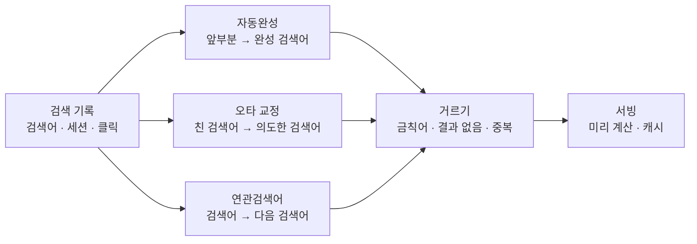
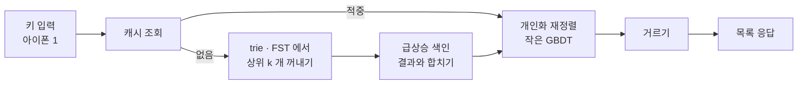

쇼핑 검색창에서 아이폰 15 케이스를 찾는다고 하자. 검색하는 동안 검색창이 세 번 먼저 말을 건다.

- `아이` 까지 치자 아래로 `아이폰 16`, `아이폰 15 케이스`, `아이패드` 가 뜬다.
- 한글 자판으로 바꾸는 걸 잊고 `dkdlvhs` 를 쳤는데 `아이폰` 결과가 나온다.
- 결과 화면 위에는 `아이폰15 커버`, `아이폰 15 필름` 이 뜬다.

차례로 자동완성, 오타 교정, 연관검색어다. 셋 다 사용자가 칠 검색어를 서비스가 먼저 내놓는 기능이라 검색어 제안(query suggestion)으로 묶는다. 논문에서는 query suggestion 이 좁게 연관검색어만 가리키기도 한다.

# A) 한눈에 보기

- **세 기능은 언제, 무엇을 보고 제안하는지가 다르다.**
  - 자동완성은 치는 도중에 앞부분을 보고 나머지를 채운다.
  - 오타 교정은 다 친 검색어를 보고 원래 치려던 말로 바꾼다.
  - 연관검색어는 검색한 뒤에 다음으로 칠 만한 검색어를 보여 준다.
- **세 기능 모두 다른 사용자의 검색 기록에서 후보를 얻는다.** 사전보다 사람들이 실제로 친 검색어가 기본 재료다.
- **만드는 흐름도 같다.** 후보를 만들고, 순서를 정하고, 질 나쁜 것을 거르고, 빠르게 내보낸다.
- **오타 교정은 [[Query Understanding]] 의 첫 단계와 겹친다.**



| 기능 | 제안하는 때 | 입력 예 | 대표 방법 | 대표 지표 |
| --- | --- | --- | --- | --- |
| [[Query Auto-Completion\|자동완성]] | 치는 도중 | `아이` | 앞부분 색인 + 검색 빈도 순 + 학습 순위 | MRR, 덜 친 글자 수 |
| [[Query Spelling Correction\|오타 교정]] | 검색 직후 | `dkdlvhs` | noisy channel, 편집 거리 | 교정 정밀도, 원래 검색어로 되돌린 비율 |
| [[Related Searches\|연관검색어]] | 결과를 본 뒤 | `아이폰 15 케이스` | 세션 공출현, 클릭 그래프 | 연관검색어 클릭률 |

# B) 공통 재료: 검색 기록

사용자 한 명의 검색 기록이 이렇다고 하자.

```text
10:02:11  아이퐁 15 케이스   결과 클릭 없음
10:02:19  아이폰 15 케이스   투명 케이스 클릭
10:05:40  아이폰 15 필름     강화유리 필름 클릭
```

**세션은 한 사람이 짧은 시간 안에 이어서 친 검색어 묶음이다.** 보통 30 분 넘게 아무것도 안 하면 다음 세션으로 끊는다. 위 세 줄은 한 세션이다.

- 첫 두 줄은 오타를 고쳐 다시 친 쌍이다. 오타 교정이 배우는 재료다.
- 둘째와 셋째 줄은 다음 할 일로 넘어간 쌍이다. 연관검색어가 배우는 재료다.
- 세 줄 모두 자동완성의 재료다. `아이` 로 시작해 사람들이 끝내 무엇을 쳤는지 세면 된다.

**클릭은 검색어끼리의 관계를 하나 더 알려 준다.** 같은 상품을 클릭한 두 검색어는 같은 것을 찾았다고 볼 수 있다.

**기록으로 만든 제안은 처음 보는 검색어에 약하다.**

- 오늘 출시된 상품 이름이나 한 번도 안 들어온 긴 검색어에는 기록이 없다.
- 기능마다 이 빈자리를 채우는 방법(최근 빈도, 글자 단위 모델, 생성 모델)이 따로 있다.

# C) 질 나쁜 제안 걸러내기

**제안은 사용자가 치지 않은 말을 서비스가 먼저 보여 주는 것이다.** 검색 결과는 사용자가 친 검색어에 대한 답이지만, 제안은 서비스가 한 말로 읽힌다. 그래서 검색 결과보다 엄격하게 거른다.

**불쾌하거나 해로운 말**: 욕설·성인·혐오 표현, 사람 이름에 범죄·질병 같은 말이 붙은 검색어다.

- 금칙어 목록으로 먼저 막고, 목록에 없는 표현은 분류 모델로 막는다.

**소수만 친 검색어**: 한두 사람만 친 검색어에는 이름·전화번호·주소가 섞일 수 있다.

- 서로 다른 사용자 일정 수 이상이 친 검색어만 후보로 쓴다.

**어뷰징**: 특정 상품명을 반복해서 검색해 제안 목록에 올리려는 시도다.

- 검색 횟수가 아니라 사용자 수로 센다. 같은 사람이 백 번 쳐도 한 번이다.

**결과가 없는 검색어**: 제안을 눌렀는데 결과가 0 건이면 제안이 없느니만 못하다.

- 후보마다 결과 수를 확인하고 0 건이면 뺀다.

**거의 같은 검색어**: `아이폰 케이스`, `아이폰케이스`, `아이폰 케이스들` 이 한 목록에 같이 뜨면 자리만 차지한다.

- 띄어쓰기·조사·대소문자를 맞춘 형태로 묶고 대표 하나만 남긴다.

**오타가 든 검색어**: 자동완성에 `아이퐁` 이 뜨면 다른 사람도 그 오타를 그대로 누른다.

- 후보를 오타 교정기에 통과시켜 맞게 쓴 형태로 바꾼다.

# D) 서빙: 지연 시간 예산과 캐시

**자동완성은 글자를 칠 때마다 요청이 간다.** `아이폰 15 케이스` 를 한 번 검색하는 동안 요청이 열 번 남짓 간다. 검색 요청보다 몇 배 많다.

**다음 글자를 치기 전에 목록이 바뀌어야 한다.**

- 사람이 시스템이 즉각 반응한다고 느끼는 한계가 0.1 초 정도다 (Nielsen).
- 키를 누르는 간격도 0.1 초에서 0.3 초 사이라서, 응답이 늦으면 한 글자 더 친 뒤에 옛 목록이 뜬다.
- 네트워크 왕복도 이 안에 들어가야 하므로, 서버 계산에 쓸 수 있는 시간은 보통 수십 ms 다.



**미리 계산해 둔다.** 앞부분마다 상위 후보 목록을 오프라인에서 만들어 두고, 요청 때는 꺼내기만 한다.

- [[Trie]] 에서 앞부분 노드 아래를 DFS 로 모두 훑으면, `아` 처럼 짧은 앞부분에서는 그 아래 검색어 수십만 개를 돌게 된다.
- 그래서 trie 나 [[Finite State Transducer|FST]] 의 각 노드에 그 아래 검색어 중 점수 상위 k 개를 미리 달아 둔다. 입력한 글자 수만큼 내려가면 바로 목록이 나온다.
- 연관검색어는 검색어마다 목록을 미리 만들어 key-value 저장소에 둔다.
- 오타 교정도 자주 나오는 오타는 교정 결과를 표로 둔다.

**캐시를 둔다.** 짧은 앞부분일수록 많은 사람이 똑같이 친다.

- `아`, `아이` 는 수많은 사용자가 거쳐 가는 앞부분이라 캐시 적중률이 높다.
- 반대로 개인화를 섞으면 사용자마다 목록이 달라져 캐시가 거의 맞지 않는다.
- 그래서 모두에게 같은 후보 목록은 캐시에서 꺼내고, 개인화는 그 위에서 순서만 다시 정한다.

**무거운 모델은 오프라인에, 가벼운 모델은 요청 경로에 둔다.**

- 임베딩 학습, 그래프 계산, 생성 모델로 후보 만들기는 배치로 돌린다.
- 요청 때는 후보 수십 개를 작은 GBDT 로 다시 정렬하는 정도만 한다.

**갱신 주기를 둘로 나눈다.**

- 큰 색인은 하루에 한 번 다시 만든다.
- 급상승 검색어는 몇 분마다 갱신하는 작은 색인에 따로 넣고, 요청 때 두 결과를 합친다.

**클라이언트에서도 지연을 줄인다.**

- 직전 응답을 다시 쓴다. `아이폰` 목록에 `아이폰 15 케이스` 가 있으면, `아이폰 1` 을 칠 때 서버 응답을 기다리지 않고 그 목록을 걸러 먼저 보여 준다.
- 늦게 도착한 옛 요청의 응답은 버린다. 그러지 않으면 `아이폰 15` 목록이 뜬 뒤에 `아이` 목록이 그 위를 덮는다.

**오타 교정과 연관검색어는 검색 한 번에 한 번만 불린다.** 자동완성보다 예산이 넉넉하지만, 검색 결과의 응답 시간에 그대로 더해진다. 그래서 둘 다 미리 계산한 표를 조회하는 쪽을 먼저 쓴다.

# Related

- [[Query Auto-Completion]]
- [[Query Spelling Correction]]
- [[Related Searches]]
- [[Query Understanding]]
- [[Prefix Search]]
- [[Finite State Transducer]]

# References

- Fei Cai, Maarten de Rijke, [A Survey of Query Auto Completion in Information Retrieval](https://www.nowpublishers.com/article/Details/INR-055), Foundations and Trends in Information Retrieval, 2016.
- Jakob Nielsen, [Response Times: The 3 Important Limits](https://www.nngroup.com/articles/response-times-3-important-limits/), Nielsen Norman Group.
