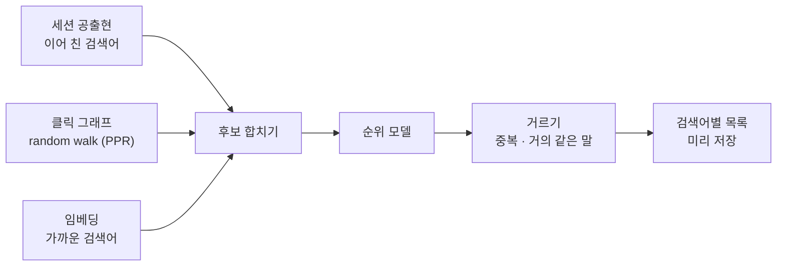
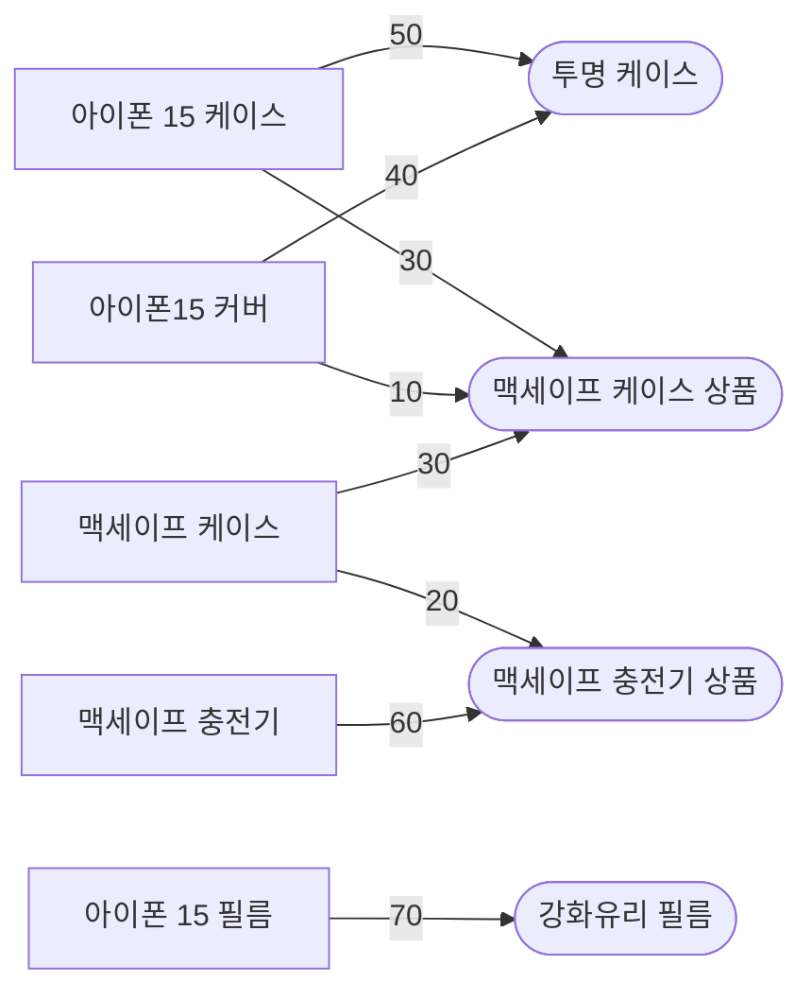

`아이폰 15 케이스` 를 검색했다. 결과 위에 이런 검색어가 뜬다.

```text
아이폰15 커버 · 맥세이프 케이스 · 맥세이프 충전기 · 아이폰 15 필름
```

`아이폰15 커버` 는 같은 것을 다르게 부른 말이고, `아이폰 15 필름` 은 케이스 다음에 살 만한 것이다. 연관검색어는 이렇게 지금 검색어와 관계있는 검색어를 골라 보여 준다. 세 가지 검색어 제안 기능의 공통점은 [[Query Suggestion|검색어 제안]] 노트에 있다.

# A) 한눈에 보기

- **연관검색어는 지금 검색어 다음에 칠 만한 검색어를 보여 준다.** 자동완성과 달리 앞부분이 같을 필요가 없다.
- **후보는 두 기록에서 나온다.** 같은 세션에서 이어 친 검색어와, 같은 상품을 클릭한 검색어다.
- **두 기록이 찾아 주는 관계가 다르다.** 세션은 다음 단계(케이스 → 필름)를, 클릭은 같은 것을 다르게 부른 말(케이스 → 커버)을 잘 찾는다.
- **그래프 위 random walk 와 임베딩은 직접 이어지지 않은 검색어까지 찾는다.**
- **잘 뽑는 것만큼 거르기가 중요하다.** 원래 검색어와 거의 같은 제안은 자리만 차지한다.



# B) 세션 공출현

**같은 세션에서 `아이폰 15 케이스` 다음에 자주 온 검색어를 센다.** 세션은 한 사람이 짧은 시간 안에 이어서 친 검색어 묶음이다.

`아이폰 15 케이스` 를 친 세션 1 만 개를 보니 다음 검색어가 이랬다.

- `아이폰 15 필름` 이 800 세션(8%)에 나왔다.
- `날씨` 가 200 세션(2%)에 나왔다.

**횟수만 보면 원래 인기 있는 검색어가 어디에나 붙는다.** `날씨` 는 무엇을 검색했든 그 뒤에 자주 온다.

- 그래서 "이 검색어 뒤에 나온 비율" 을 "아무 세션에서나 나온 비율" 과 비교한다.
- `날씨` 는 전체 세션의 2% 에 나오는데 케이스 세션에서도 2% 다. 1 배라서 관계가 없다.
- `아이폰 15 필름` 은 전체 세션의 0.1% 에만 나오는데 케이스 세션에서는 8% 다. 80 배라서 관계가 강하다.
- 이 배수를 lift 라 하고, lift 에 로그를 씌운 값이 [[pointwise mutual information|PMI]] 다.

**순서도 정보다.** `케이스 → 필름` 은 자주 나와도 `필름 → 케이스` 는 드물 수 있다.

- 다음에 칠 말을 제안하려면 순서를 지켜서 센다.
- Jones et al. (2006) 은 세션에서 이어 친 검색어 쌍으로 바꿔 쓸 검색어를 만들었다.

**세션에는 관계없는 검색어도 섞인다.** 케이스를 찾다가 점심 메뉴를 검색하기도 한다.

- 함께 나온 횟수가 일정 수 이상인 쌍만 쓰고, 시간 간격이 짧은 쌍에 가중치를 더 준다.
- 드문 검색어는 세션 기록 자체가 적어서 후보가 거의 나오지 않는다.

# C) 쿼리-상품 클릭 그래프

**검색어와 상품을 점으로, 검색어 뒤의 클릭을 선으로 이으면 이분 그래프(bipartite graph)가 된다.** 선에는 클릭 수를 단다. 아래에서 네모는 검색어, 양 끝이 둥근 칸은 상품이다.



**같은 상품을 클릭한 두 검색어는 같은 것을 찾는다고 본다.** 글자가 하나도 안 겹쳐도 된다.

- `아이폰15 커버` 는 `아이폰 15 케이스` 와 상품 두 개를 같이 클릭했다. 가장 가깝다.
- `맥세이프 케이스` 는 상품 하나를 같이 클릭했다.
- `맥세이프 충전기` 와 `아이폰 15 필름` 은 같이 클릭한 상품이 없다. 클릭한 상품을 직접 비교하면 연관이 0 이다.
- Beeferman & Berger (2000) 가 이 그래프로 검색어를 군집화했다.

**클릭 그래프는 같은 것을 다르게 부른 말을 잘 찾는다.** 같은 상품을 누른다는 것은 같은 것을 찾았다는 뜻이기 때문이다.

- 반대로 케이스를 산 사람이 다음에 찾는 필름은 다른 상품이라 클릭 그래프에서 이어지지 않는다.
- 이 관계는 세션 공출현이 찾는다.

# D) 그래프 위 random walk: PPR

**`아이폰 15 케이스` 에서 출발해 선을 따라 무작위로 걷는다.** 검색어에서 클릭한 상품으로, 그 상품에서 그것을 클릭한 다른 검색어로 이어 걷는다. 매 걸음마다 일정 확률로 출발점에 돌아온다.

- 클릭 수가 많은 선을 더 자주 탄다.
- 오래 걸은 뒤 각 검색어에 머문 시간의 비율이 연관 점수다.
- 이 점수가 [[PPR|Personalized PageRank (PPR)]] 다. 걷는 방식은 [[random walk]] 에 있다.
- Craswell & Szummer (2007) 가 클릭 그래프 위 random walk 를 제안했다. Mei et al. (2008) 은 같은 그래프에서 출발점에 얼마나 빨리 닿는지(hitting time)로 연관검색어를 골랐다.

위 그래프에서 PPR 을 계산하면 이렇다. 출발점을 뺀 검색어끼리 점수를 나눠 가진 비율이다.

| 검색어 | 같이 클릭한 상품 | 돌아올 확률 15% | 돌아올 확률 50% |
| --- | --- | --- | --- |
| 아이폰15 커버 | 2 개 | 53% | 65% |
| 맥세이프 케이스 | 1 개 | 32% | 32% |
| 맥세이프 충전기 | 0 개 | 15% | 3% |
| 아이폰 15 필름 | 0 개 | 0% | 0% |

**random walk 는 같이 클릭한 상품이 없는 검색어까지 닿는다.** `맥세이프 충전기` 는 맥세이프 케이스 상품과 `맥세이프 케이스` 검색어를 거쳐 네 걸음 만에 닿는다.

- 충전기는 케이스를 다르게 부른 말이 아니라 케이스와 함께 쓰는 물건이다.
- 가까운 검색어는 같은 것을 다르게 부른 말이 많고, 멀리 갈수록 함께 쓰는 물건 같은 다른 관계가 섞인다.

**돌아올 확률이 출발점에서 얼마나 먼 검색어까지 점수를 줄지 정한다.**

- 돌아올 확률이 낮으면 먼 검색어도 점수를 받는다. `맥세이프 충전기` 가 15% 다.
- 높으면 가까운 검색어에 점수가 모인다. `맥세이프 충전기` 가 3% 로 줄었다.
- 너무 낮으면 출발점과 상관없이 클릭이 많은 검색어가 높은 점수를 받는다. 출발점이 없는 [[retrieval/ranking/PageRank|PageRank]] 와 비슷해진다.

**그래프에서 끊긴 검색어는 아무리 걸어도 닿지 않는다.** `아이폰 15 필름` 이 0 인 이유다. 이 빈자리는 세션 공출현이 채운다.

**클릭이 아주 많은 상품은 관계없는 검색어끼리도 이어 준다.** 여러 종류의 검색어에서 클릭되는 베스트셀러를 거치면 엉뚱한 검색어로 넘어간다.

- 여러 검색어에서 고르게 클릭된 상품일수록 그 상품을 지나는 선의 가중치를 낮춘다. 흔한 단어의 가중치를 낮추는 IDF 와 같은 생각이다.

# E) 임베딩

**검색어마다 벡터를 학습하고, 벡터가 가까운 검색어를 연관검색어로 쓴다.** 가까운 벡터는 근사 최근접 탐색([[ANN]])으로 빠르게 찾는다.

**세션을 문장처럼 본다.** 한 세션의 검색어 순서를 단어 순서로 보고 [[Word2Vec]] 을 학습한다.

- 같은 세션에 자주 나란히 오는 검색어의 벡터가 가까워진다 (Grbovic et al., 2015).

**클릭 그래프에서 학습한다.** 그래프 위 random walk 경로를 문장 삼아 Word2Vec 을 학습하거나([[Graph Embedding]]), 이웃 점의 벡터를 모아 자기 벡터를 만드는 [[Graph Neural Network|GNN]] 을 쓴다.

- [[LightGCN]] 은 사용자-상품 그래프에서 이웃 벡터를 이웃 수로 정규화해 더하는 일만 반복하는 단순한 GNN 이다.
- 사용자 자리에 검색어를 두면 검색어-상품 클릭 그래프에 그대로 옮겨 쓸 수 있다.

**글자로 벡터를 만든다.** 검색어 글자를 인코더에 넣어 벡터를 만드는 [[Two-tower Model|two-tower]] 류는 기록이 없는 새 검색어에도 벡터가 나온다.

**벡터가 가깝다고 좋은 제안은 아니다.**

- `아이폰 15 케이스` 와 가장 가까운 벡터는 `아이폰15 케이스`, `아이폰 15 케이스 추천` 처럼 거의 같은 말이다.
- 사용자가 이미 친 말과 거의 같으니 눌러도 새 결과가 거의 없다.
- 그래서 원래 검색어와 지나치게 가까운 후보는 오히려 뺀다.

# F) 순위와 거르기

**세 출처의 후보를 합쳐 모델로 순서를 정한다.**

- 특징으로 세션 lift, PPR 점수, 임베딩 거리, 후보 검색어의 결과 수와 클릭률, 원래 검색어와 글자가 겹치는 정도를 쓴다.
- 정답은 연관검색어를 눌렀는지, 누른 뒤 결과에서 클릭·구매했는지로 만든다.
- 위쪽에 보인 후보가 더 자주 눌리는 [[position bias]] 는 자동완성과 똑같이 생긴다.

**목록 안에서 서로 비슷한 후보는 하나만 남긴다.**

- `맥세이프 케이스` 와 `맥세이프 케이스 투명` 이 둘 다 있으면 하나를 빼고 다른 관계의 후보(`아이폰 15 필름`)를 넣는 편이 낫다.
- 점수 순으로 뽑되, 이미 뽑힌 후보와 비슷할수록 점수를 깎는다. [[Maximal Marginal Relevance|MMR]] 이 이 방식이다.

**검색어마다 목록을 미리 만들어 둔다.** 연관검색어는 검색 결과와 함께 한 번만 불리므로, 요청 때는 저장된 목록을 꺼내기만 한다.

- 금칙어·결과 없음·어뷰징 같은 공통 거르기와 서빙은 [[Query Suggestion|검색어 제안]] 노트에 있다.

# G) 평가

- 온라인에서는 연관검색어 클릭률과, 누른 뒤 결과에서 클릭·구매가 있었는지를 본다.
- 오프라인에서는 사람이나 LLM 이 후보마다 "이 검색어 다음에 볼 만한가" 를 판정한다. 판정을 지표로 모으는 방법은 [[Search Relevance Evaluation]] 과 같다.

# Related

- [[Query Suggestion]]
- [[Query Auto-Completion]]
- [[Query Spelling Correction]]
- [[PPR]]
- [[random walk]]
- [[Graph Embedding]]
- [[LightGCN]]
- [[pointwise mutual information]]

# References

- Doug Beeferman, Adam Berger, [Agglomerative Clustering of a Search Engine Query Log](https://doi.org/10.1145/347090.347176), KDD 2000.
- Rosie Jones, Benjamin Rey, Omid Madani, Wiley Greiner, [Generating Query Substitutions](https://doi.org/10.1145/1135777.1135835), WWW 2006.
- Nick Craswell, Martin Szummer, [Random Walks on the Click Graph](https://doi.org/10.1145/1277741.1277784), SIGIR 2007.
- Qiaozhu Mei, Dengyong Zhou, Kenneth Church, [Query Suggestion Using Hitting Time](https://doi.org/10.1145/1458082.1458145), CIKM 2008.
- Mihajlo Grbovic et al., [Context- and Content-aware Embeddings for Query Rewriting in Sponsored Search](https://doi.org/10.1145/2766462.2767709), SIGIR 2015.
