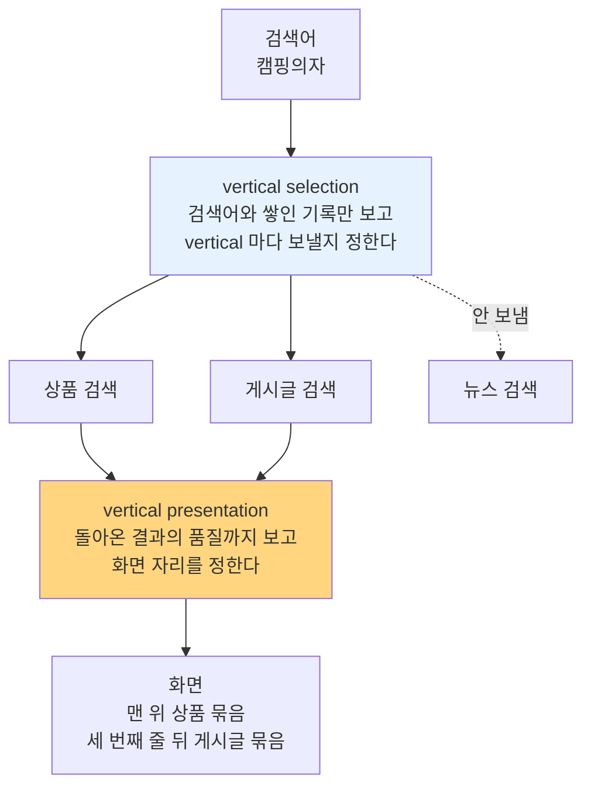

검색창 하나로 상품, 동네 가게, 커뮤니티 게시글, 뉴스를 함께 찾는 앱이 있다고 하자.

- 상품, 가게, 게시글, 뉴스는 각자 따로 만든 검색 엔진이 찾는다.
- 사용자가 `캠핑의자` 를 치면 네 엔진이 모두 무언가를 돌려준다.
- 화면 맨 위에는 한 종류만 둘 수 있다.

`캠핑의자` 를 친 사람은 대개 의자를 사려고 하니 상품이 위에 와야 한다. 같은 앱에서 `캠핑장 추천` 을 친 사람은 후기 게시글을, `태풍` 을 친 사람은 오늘 뉴스를 먼저 봐야 한다. 이렇게 종류가 다른 결과 묶음 가운데 무엇을 보여 주고 어디에 둘지 정하는 일을 aggregated search 라고 한다.

# A) 한눈에 보기

- **결과 종류 하나하나를 vertical 이라 부른다.**
	- 상품, 가게, 게시글, 뉴스가 각각 vertical 이다.
	- 컬렉션이라고도 부른다.
- **일은 두 단계로 나뉜다.**
	- 어느 vertical 을 보여 줄지 고른다 (vertical selection).
	- 고른 것을 화면 어디에 둘지 정한다 (vertical presentation).
- **vertical 마다 판단하는 모델을 따로 둔다.**
	- 같은 신호라도 vertical 마다 뜻이 다르기 때문이다.
- **쿼리가 얼마나 자주 오는지에 따라 쓸 수 있는 신호가 다르다.**
	- 자주 오는 쿼리는 그 쿼리의 클릭 기록으로 정한다.
	- 드문 쿼리는 검색어 글자와 비슷한 쿼리의 기록으로 정한다.
- **클릭률만으로는 vertical 끼리 비교할 수 없다.**
	- vertical 마다 눈에 띄는 정도와 "성공" 의 모양이 다르다.
	- 그래서 세션 단위 성공과 interleaving 으로 평가한다.

# B) Federated search 와 aggregated search

Federated search 는 여러 문서 모음(컬렉션)에 흩어진 문서를 검색창 하나로 찾는 오래된 연구 분야다. 어느 컬렉션에 검색을 보낼지 고르고(resource selection), 돌아온 결과를 한 줄로 합친다(results merging).

Aggregated search 는 이 문제를 포털 검색에 맞게 좁힌 것이다. 웹 문서 결과 사이에 이미지, 뉴스, 쇼핑, 지도 같은 vertical 결과를 끼워 넣는 일에서 출발했다. 실무에서는 두 이름을 섞어 쓴다.

둘은 네 가지가 다르다 (Arguello 2017).

1. **쓸 수 있는 신호가 많다**: federated search 는 남이 운영하는 검색 엔진에 검색어를 넣어 보는 것만 가능하다고 가정한다. vertical 은 같은 회사가 운영하므로 vertical 별 검색 기록과 클릭 기록을 쓸 수 있다.
2. **결과 종류가 다르다**: 상품 카드, 가게 지도, 뉴스 기사는 점수의 뜻이 달라서 한 줄로 섞어 정렬할 수 없다.
3. **고를지 말지를 정한다**: federated search 는 컬렉션의 순서를 매기지만, aggregated search 는 vertical 마다 보여 줄지 말지를 정한다. 아무 vertical 도 안 보여 주는 답도 있다.
4. **결과가 묶음으로 나온다**: 상품 하나, 뉴스 하나를 번갈아 끼우지 않는다. 같은 vertical 결과는 한 묶음(block)으로 붙여서 한 자리에 둔다.

# C) Vertical selection

Vertical selection 은 쿼리를 받아 vertical 마다 "보여 줄까, 말까" 를 정하는 분류 문제다.

**이 단계에서는 아직 vertical 에 검색을 보내지 않는다.**

- 들어오는 쿼리마다 모든 vertical 에 검색을 보내 보는 것은 비싸다.
- 그래서 검색어 글자와 쌓아 둔 기록만 보고 정한다.

## C.1) 판단에 쓰는 신호

`캠핑의자` 에 상품 vertical 을 보여 줄지 정한다고 하자. 다음 신호를 모은다.

**검색어 글자**: 검색어에 든 단어가 vertical 을 가리킨다.

- `추천`, `후기` 가 붙으면 게시글, `근처`, `영업시간` 이 붙으면 가게, `중고`, `최저가` 가 붙으면 상품일 가능성이 크다.

**쿼리 의도 분류기**: 검색어를 주제 카테고리로 분류한다 ([[Query Understanding]]).

- `캠핑의자` 는 「캠핑 용품」 으로 분류된다.
- 주제가 좁은 vertical 에 특히 잘 듣는다.
	- Arguello et al. (2009) 실험에서 주제 카테고리 신호를 뺐을 때 성능이 가장 크게 떨어졌다.
	- 그 실험의 vertical 은 여행, 건강, 게임, 자동차처럼 주제가 좁은 것이 많았다.

**vertical 안에서 직접 들어온 검색 기록 (vertical query log)**: 사람들이 상품 탭에 들어가서 직접 친 검색어 모음이다.

- 그 모음에 `캠핑의자` 와 비슷한 검색어가 많으면 상품 vertical 을 원할 가능성이 크다.
- Arguello et al. (2009) 에서 신호 하나만 쓸 때는 이 신호가 가장 좋았다.

**vertical 이 가진 문서**: 상품 문서 가운데 `캠핑의자` 와 관련된 것이 얼마나 많은지 본다.

**클릭 기록**: 전에 이 쿼리에 상품 묶음을 보여 줬을 때 사람들이 눌렀는지 본다.

- 묶음을 눌렀으면 click, 묶음을 건너뛰고 아래 결과를 눌렀으면 skip 으로 센다.

**같은 신호라도 vertical 마다 뜻하는 방향이 다르다.**

- 「캠핑 용품」 분류 결과는 상품과 게시글에는 보여 줄 근거가 되지만, 뉴스에는 대개 안 보여 줄 근거가 된다.
- 어떤 vertical 은 신호 자체가 없다.
	- 날씨처럼 사용자가 직접 검색하는 탭이 없으면 vertical query log 가 없다.
	- 계산기처럼 검색할 문서가 없으면 문서 신호가 없다.
- 그래서 vertical 하나에 이진 분류기 하나를 따로 둔다. 지금까지의 연구가 모두 이렇게 했다 (Arguello 2017).
	- 분류기는 [[logistic regression|로지스틱 회귀]]나 gradient boosted tree 를 쓴다.

## C.2) 쿼리 빈도에 따른 방법

쿼리는 롱테일 분포를 따른다. `캠핑의자` 처럼 하루에 수천 번 오는 쿼리도 있고, `차박용 경량 캠핑의자 등받이 높은` 처럼 처음 보는 쿼리도 매일 쏟아진다. 쿼리마다 쌓인 기록의 양이 다르니 방법도 달라진다.

1. **자주 오는 쿼리는 클릭으로 정한다**: `캠핑의자` 는 클릭 기록이 충분하다.
	- 상품 묶음을 보여 줘 보고, 눌리는 비율로 정하면 된다.
	- 단, 안 보여 준 vertical 의 클릭은 영영 관측되지 않는다.
	- 그래서 가끔 다른 vertical 을 올려 보는 탐색이 필요하고, 이것이 [[Multi-Armed Bandit|bandit]] 문제다.
2. **중간쯤 오는 쿼리는 분류기로 정한다**: 일주일에 몇 번 오는 쿼리는 클릭이 몇 개뿐이라 클릭률이 들쭉날쭉하다.
	- 검색어 글자와 의도 분류에서 뽑은 신호로 분류기가 정한다.
3. **드문 쿼리는 비슷한 쿼리에서 빌려 온다**: 처음 보는 쿼리는 클릭 기록이 없다.
	- 임베딩으로 가까운 쿼리를 찾아 그 쿼리들의 클릭률을 유사도로 가중 평균한다.
	- Diaz (2009) 는 두 쿼리가 비슷한 문서를 불러오는지로 유사도를 계산했다. 미국 대선을 다르게 쓴 두 쿼리는 뉴스 클릭률도 비슷해야 한다는 생각이다.

**실제로는 세 방법을 따로 쓰지 않고, 클릭이 쌓일수록 분류기 예측보다 클릭률을 더 믿도록 섞는다.**

Diaz (2009) 는 분류기 예측과 클릭 수를 한 식으로 섞었다.

$$
\hat{p} = \frac{C + \mu \pi}{C + S + \mu}
$$

- $\pi$: 분류기가 예측한 확률이다.
- $C$, $S$: 이 쿼리에 이 vertical 을 보여 줬을 때 나온 click 수와 skip 수다.
- $\mu$: 분류기 예측을 클릭 몇 개만큼 믿을지 정하는 값이다.

`캠핑의자` 에 게시글 vertical 을 보여 줄지 정한다고 하자. 분류기는 0.2 로 낮게 봤지만, 실제로 보여 주면 60% 가 누른다. $\mu = 20$ 이다.

- 노출 0 회: $C = S = 0$ 이라 $\hat{p} = 0.2$, 분류기 예측 그대로다.
- 노출 10 회 (click 6, skip 4): $\hat{p} = (6 + 4) / (10 + 20) = 0.33$ 이다.
- 노출 100 회 (click 60, skip 40): $\hat{p} = (60 + 4) / (100 + 20) = 0.53$ 으로, 보여 주는 기준 0.5 를 넘는다.
- 노출 1,000 회: $\hat{p} = 0.59$ 로, 실제 클릭률 0.6 에 거의 닿는다.

아래 그림의 선이 이 추정값이고, 옅은 띠는 그 값이 얼마나 불확실한지(90% 구간)다.

![[img-d2b2c555b8.png]]

**Diaz 는 이 평균을 그대로 쓰지 않고 [[Beta distribution|베타 분포]]에서 뽑아 쓴다.**

- 뽑는 분포는 $\text{Beta}(\mu\pi + C,\ \mu(1 - \pi) + S)$ 이고, 위 식은 이 분포의 평균이다.
- 노출이 적으면 띠가 넓어서 뽑을 때마다 0.5 를 넘기도 하고 못 넘기도 한다.
	- 확신이 없는 쿼리일수록 vertical 을 보여 줬다 안 보여 줬다 하며 저절로 탐색한다.
- 노출이 쌓이면 띠가 좁아져 결정이 굳는다.
- 불확실한 만큼 탐색하는 이 방식은 [[Thompson sampling]] 과 같은 생각이다.

# D) Vertical presentation

고른 vertical 묶음을 화면 어디에 둘지 정하는 단계다. 이 단계에서는 vertical 에 검색을 보낸 뒤라서 돌아온 결과까지 볼 수 있다.

**쿼리 의도가 분명해도 결과가 나쁘면 아래로 내린다.**

- `캠핑의자` 는 상품 의도가 분명하다.
- 그런데 상품 검색이 돌려준 상위 결과가 캠핑의자가 아니라 사무용 의자뿐이면 맨 위에 둘 이유가 없다.
- 그래서 상위 결과의 검색 점수, 결과 수, 검색어와의 유사도 같은 검색 후 신호를 더한다.

**자리는 미리 정한 슬롯 몇 개 가운데 고르는 경우가 많다.**

- 예를 들어 맨 위, 세 번째 결과 뒤, 여섯 번째 결과 뒤, 맨 아래 네 슬롯을 둔다.
- 분류기 확신도가 높을수록 위 슬롯에 둔다. 슬롯마다 넘어야 하는 기준값이 있다 (Arguello et al. 2011, Ponnuswami et al. 2011).
- 위로 올리면 원래 그 자리에 있던 결과가 밀려 내려간다.
	- Ponnuswami et al. (2011) 은 그래서 밀려날 일반 결과의 점수와 클릭률도 신호로 넣었다.

**vertical 마다 따로 학습한 분류기의 확신도는 서로 비교할 수 없다.**

- 상품 분류기의 0.7 과 뉴스 분류기의 0.7 은 같은 뜻이 아니다.
- 그래서 두 묶음 가운데 무엇이 위에 와야 하는지를 직접 학습하는 pairwise 방법을 쓰기도 한다.
- 모든 묶음을 [[Learning-to-Rank]] 모델 하나로 정렬하기도 한다.
	- 이때는 "이 묶음이 어느 vertical 인지" 를 나타내는 feature 를 다른 feature 와 곱해서 넣는다.
	- 그래야 `후기` 라는 단어가 게시글 묶음에는 올릴 근거, 상품 묶음에는 그렇지 않은 근거로 따로 학습된다.

# E) 위치 편향과 vertical 마다 다른 목적 행동

## E.1) vertical 의 위치 편향

**같은 자리라도 vertical 묶음이 일반 결과보다 더 많이 눌린다** (Chen et al. 2012, Wang et al. 2013).

- 시스템이 관련 있을 때만 vertical 을 보여 줘서일 수도 있다.
- 이미지나 썸네일이 있어서 관련과 상관없이 눈에 띄어서일 수도 있다.
- 눈에 잘 띄는 vertical 근처의 일반 결과도 더 눌린다 (Chen et al. 2012).

**클릭을 그대로 학습하면 눈에 띄는 vertical 이 점점 더 위로 올라간다.**

- 위에 있어서 더 눌리고, 더 눌려서 더 위에 놓이는 순환이 생긴다.
- [[position bias]] 를 보정하듯 "이 자리, 이 vertical 이면 볼 확률이 얼마인가" 를 따로 추정해서 클릭에서 빼야 한다.
- vertical 결과를 고려하는 클릭 모델이 이 일을 한다 (Wang et al. 2013).

## E.2) vertical 별 목적 행동

같은 앱 안에서도 vertical 마다 사용자가 하려는 일이 다르다.

- 상품: 눌러 들어가서 찜하거나 판매자에게 연락한다.
- 게시글: 눌러서 읽고 머문다.
- 뉴스: 눌러서 읽는다.
- 가게: 화면에서 영업시간과 전화번호만 보고 끝내는 일이 많다.
	- 날씨 vertical 은 아예 결과 화면에서 답을 다 보여 주도록 만든다. 그래서 클릭이 적다 (Arguello 2017).

**클릭률 하나로 vertical 끼리 비교하면 가게 · 날씨 같은 vertical 이 늘 손해를 본다.**

- 클릭 없이 끝난 검색이 실패가 아니라 성공일 수 있다.
- 그래서 vertical 마다 목적 행동(찜, 연락, 읽기, 전화, 길 찾기)을 따로 정의한다.
- click 과 skip 을 세는 기준도 vertical 마다 다르게 둔다.

# F) 평가

## F.1) vertical selection 만 따로 평가하기

**사람이 판정한 정답으로 precision 과 recall 을 계산한다.**

- 쿼리와 vertical 쌍마다 "보여 줘야 하는가" 를 사람이 판정한다.
- 판정자 여럿의 다수결로 정답을 만들기도 한다.

**클릭으로 정답을 만들면 precision 은 알 수 있지만 recall 은 모른다.**

- 보여 준 vertical 에서는 click 이면 맞게 보여 준 것, skip 이면 잘못 보여 준 것으로 볼 수 있다.
- 안 보여 준 vertical 은 클릭이 아예 없어서, 보여 줬어야 하는데 놓친 경우를 셀 수 없다.
- 그래서 트래픽 일부에서는 vertical 을 항상 같은 자리에 보여 주고 기록을 모은다.
	- 새 모델이 그 기록에서 click 과 skip 을 얼마나 맞히는지로 나중에 평가한다.

## F.2) 세션 단위 성공

**검색 한 번이 아니라 세션 하나가 목적 행동으로 끝났는지를 본다.**

- 세션은 검색어를 치고, 결과를 보고, 다시 치기도 하다가 앱을 떠나거나 무언가를 할 때까지다.
- 성공한 세션은 어느 vertical 에서든 목적 행동이 일어났고, 같은 뜻의 검색어를 다시 치지 않은 세션이다.

반대되는 두 세션을 보자.

- 상품 묶음을 맨 위에 올렸더니 클릭은 늘었지만, 원하는 것이 아니라서 `캠핑의자 후기` 로 다시 검색했다.
	- 클릭률로는 좋아 보이지만 세션은 실패다.
- 가게 묶음을 보고 전화번호만 확인한 뒤 앱을 닫았다.
	- 클릭은 없지만 세션은 성공이다.

배치 정책을 바꿀 때는 이 세션 성공률을 [[AB Test|A/B 테스트]]의 메인 지표로 둔다.

## F.3) Interleaving

**두 배치 정책의 결과를 한 화면에 섞어 보여 주고, 어느 쪽 결과가 더 눌리는지로 우열을 판단한다.**

- 대표 방법인 team-draft interleaving 은 두 팀 주장이 선수를 고르듯 동작한다.
	- 매번 동전을 던져 어느 쪽이 먼저 고를지 정하고, 각자 아직 안 뽑힌 자기 순위의 맨 위 결과를 하나씩 가져온다.
	- 사용자가 누른 결과가 어느 팀이 가져온 것인지 세어 이긴 쪽을 정한다.
- 같은 사용자가 두 정책을 한 화면에서 비교하므로 A/B 테스트보다 적은 쿼리로 우열을 판단할 수 있다 (Chapelle et al. 2012).

**그대로 쓰면 vertical 묶음이 쪼개진다.**

- 상품 결과 하나, 일반 결과 하나, 상품 결과 하나 식으로 섞이면 묶음이 아니게 된다.
- Chuklin et al. (2013) 의 vertical-aware team-draft interleaving 은 어떤 vertical 결과가 처음 들어오면 그 묶음이 다 찰 때까지 같은 vertical 결과만 넣는다.
- 아무 데나 무작위로 누르는 사용자에게는 두 정책이 비기는 것을 시뮬레이션으로 확인했다. 섞는 방식 자체가 한쪽을 편들지 않는다는 뜻이다.

# G) References

- [Arguello, Diaz, Callan, Crespo (2009). Sources of evidence for vertical selection. SIGIR](https://doi.org/10.1145/1571941.1571997)
- [Arguello (2017). Aggregated Search. Foundations and Trends in Information Retrieval](https://ils.unc.edu/~jarguell/ArguelloFNTIR2017)
- Diaz (2009). Integration of news content into web results. WSDM
- Arguello, Diaz, Callan (2011). Learning to aggregate vertical results into web search results. CIKM
- Ponnuswami, Pattabiraman, Wu, Gilad-Bachrach, Kanungo (2011). On composition of a federated web search result page: using online users to provide pairwise preference for heterogeneous verticals. WSDM
- Chen, Chen, Wang, Chen, Yang (2012). Beyond ten blue links: enabling user click modeling in federated web search. WSDM
- Wang, Liu, Zhang, Ma, Zheng, Qian, Zhang (2013). Incorporating vertical results into search click models. SIGIR
- Chuklin, Schuth, Hofmann, Serdyukov, de Rijke (2013). Evaluating aggregated search using interleaving. CIKM
- Chapelle, Joachims, Radlinski, Yue (2012). Large-scale validation and analysis of interleaved search evaluation. ACM TOIS
