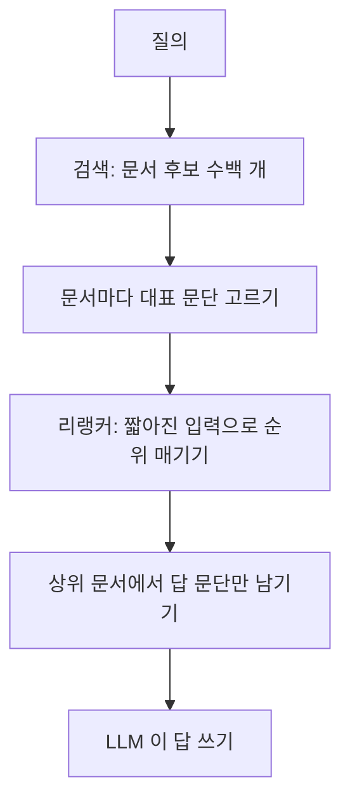

검색창에 「카페인은 몸에 얼마나 오래 남나?」 를 넣었다고 하자. 검색은 「카페인 총정리」 라는 웹 문서를 찾아왔고, 문서는 문단 다섯 개로 이뤄져 있다.

1. **역사**: 커피는 에티오피아 고원에서 처음 발견됐다고 전해진다. 15세기 예멘의 수도사들은 밤샘 기도를 버티려고 커피를 마셨다.
2. **함량**: 카페인 함량은 음료마다 다르다. 아메리카노 한 잔에는 카페인이 약 150mg 들어 있다. 찬물에 15시간 가까이 우려내는 콜드브루는 원두 양에 따라 카페인 함량 차이가 크다. 카페인을 한꺼번에 많이 마시면 몸이 떨릴 수 있다.
3. **반감기**: 카페인을 마시면 몸에서 절반이 빠져나가는 데 성인 기준 평균 5시간쯤 걸린다. 오후 3시에 마신 커피의 절반이 저녁 8시에도 남아 있다는 뜻이다.
4. **개인차**: 이 시간은 사람마다 다르다. 담배를 피우는 사람은 더 짧고, 임신 후기에는 15시간 가까이로 길어진다.
5. **광고**: 오늘만 아메리카노 1+1! 앱에서 쿠폰을 받아 가세요.

질문에 답하는 데 필요한 것은 3번과 4번뿐이다. **Snippet selection 은 이렇게 긴 문서에서 질의에 답하는 문단(snippet, passage)만 골라 다음 단계로 넘기는 일이다.** 다음 단계는 리랭커일 수도 있고 답을 쓰는 LLM 일 수도 있다.

> 예시 문서는 설명용으로 지어낸 것이다. 카페인 수치는 흔히 인용되는 값을 어림해 썼다.

# A) 한눈에 보기

- **하는 일**: 문서를 문단·문장으로 나누고, 질의와 각 조각의 관련도를 매겨, 위에서부터 몇 개만 남긴다.
- **필요한 이유는 셋이다.**
  - 길이: 웹 문서 하나가 수천 토큰이다. 문서 열 개를 그대로 넣으면 LLM 입력 한도와 비용이 먼저 찬다.
  - 비용: LLM 은 입력 토큰마다 계산한다. 위 예시에서 3·4번만 넘기면 글자 수가 359자에서 138자로 줄어든다(38%).
  - 노이즈: 광고·내비게이션·관련 없는 문단이 섞이면 LLM 이 엉뚱한 문장을 근거로 답한다. 긴 입력의 가운데에 놓인 정보는 덜 쓰인다는 측정도 있다(Lost in the Middle).
- **놓이는 자리에 따라 평가 기준이 다르다.**
  - 리랭커 앞이면 리랭커가 매긴 순위로, LLM 앞이면 LLM 답변의 정확도로 잰다.
- **점수를 매기는 방법은 단어 겹침, bi-encoder, cross-encoder 가 기본이다.**
  - 뒤로 갈수록 느리고 정확하다. cross-encoder 는 문단마다 따로 읽는 방식과 문서를 한 번에 읽는 방식이 있다.
- **학습의 핵심은 「어느 문단이 정답인가」 를 정하는 일이다.**
  - 사람이 표시하기, LLM 이 답할 때 도움이 된 문단을 역추적하기, 다음 단계 모델의 결과 자체를 보상으로 쓰기 등이 있다.
- **이 단계 자체가 느려지기 쉽다.**
  - 줄이려고 넣은 단계가 문서를 통째로 한 번 더 읽기 때문이다. 문서를 한 번에 읽기, 작은 모델 쓰기, 리랭커와 합치기, 색인할 때 미리 계산하기로 줄인다.

# B) 검색 파이프라인 안의 위치

Snippet selection 은 「문서 단위」 로 돌아가는 검색과 「문단 단위」 로 읽는 다음 단계 사이에 들어간다. 놓이는 자리는 아래 그림의 두 곳이다. 한 곳에만 두는 시스템도, 두 곳 모두에 두는 시스템도 있다.



**리랭커 앞에 둘 때**: 문서를 대표 문단 몇 개로 줄여 리랭커 입력을 짧게 만든다.

- [[Bi-Encoder vs Cross-Encoder|cross-encoder]] 리랭커는 입력 길이에 한도가 있다. 문서 앞부분만 자르면 3번 문단처럼 중간에 있는 답이 잘려 나간다.
- 선택기는 정답 문서뿐 아니라 **관계없는 후보 문서에도 똑같이 돈다.** 어느 문서가 정답인지는 리랭커가 순위를 매긴 뒤에야 알기 때문이다.
- 문서 수백 개에 돌기 때문에 빨라야 한다.

**LLM 바로 앞에 둘 때**: 순위가 정해진 상위 문서에서 답에 필요한 문장만 남긴다. RAG 의 context compression·context pruning 이 이 자리다.

- 문서 수가 적어서 더 무거운 모델을 쓸 수 있다.

두 자리를 한 모델로 합치기도 한다. Provence 는 리랭커가 문서 점수를 내는 같은 계산에서 남길 문장도 함께 표시한다.

검색 결과 화면에 보이는 요약문(검색 스니펫)도 같은 문제다. 질의와 상관없이 문서 첫 몇 문장을 보여 주던 것을, 질의 단어가 든 문장으로 바꾸면 사용자가 문서의 관련 여부를 더 빠르고 정확하게 판단한다는 실험이 1998년에 나왔다(Tombros & Sanderson).

# C) 동작: Step by Step 예시

## C.1) 문서 나누기

먼저 문서를 점수를 매길 조각으로 나눈다. 조각 크기는 둘 중 하나로 정한다.

- **문단·문장 단위**: HTML 구조(`<p>`, 제목)나 문장 분리기로 자른다. 예시의 다섯 문단이 이 방식이다.
- **고정 길이 창(sliding window)**: 일정 단어 수로 자르고 겹치게 민다. Dai & Callan(2019)은 150 단어 창을 75 단어씩 밀어 문단을 만들었다.
  - 겹치게 미는 이유는 답이 경계에 걸려 반으로 잘리는 것을 막기 위해서다.

**조각을 떼어 내면 앞 조각에 기대던 말이 뜻을 잃는다.**

- 4번 문단의 「이 시간은」 이 무엇인지는 3번을 읽어야 안다.
- 그래서 조각마다 문서 제목을 앞에 붙이는 일이 흔하다. Dai & Callan 도 제목이 있으면 모든 조각 앞에 붙였다.
- 「카페인 총정리 — 이 시간은 사람마다 다르다」 가 되면 4번도 카페인 이야기임이 드러난다.
- 문서 전체를 한 입력으로 읽는 방식이면 이 문제가 처음부터 덜 생긴다.
- 청크 크기를 정하는 일반론은 [[retrieval/chunking/Chunking|Chunking]] 노트에 있다.

## C.2) 질의와 조각의 관련도 매기기

같은 다섯 문단에 네 방법으로 점수를 매겨 본다.

**① 단어 겹침**: 질의 단어(카페인, 몸, 오래, 남아)가 문단에 몇 번 나오는지 센다. 검색 스니펫을 만들던 고전적인 방법이다.

| 문단 | 질의 단어 등장 횟수 |
| --- | --- |
| 1 역사 | 0 |
| 2 함량 | 5 |
| 3 반감기 | 3 |
| 4 개인차 | 0 |
| 5 광고 | 0 |

- 1등이 2번(함량)이다. 「카페인」 이 네 번 나오지만 얼마나 오래 남는지는 말하지 않는다.
- 4번은 0점이다. 「이 시간」, 「짧고」, 「길어진다」 처럼 질의와 다른 말로 같은 내용을 말하기 때문이다.
- **단어가 겹친다고 답이 있는 것은 아니고, 답이 있다고 단어가 겹치는 것도 아니다.**

**② Bi-encoder**: 질의와 문단을 따로 벡터로 바꾸고 두 벡터가 얼마나 가까운지 본다.

- 문단 벡터는 문서를 색인할 때 미리 계산해 둘 수 있어서 빠르다.
- 다만 질의를 보기 전에 문단을 요약해 두는 셈이라, 「카페인에 관한 문단」 이라는 주제는 잘 잡지만 「얼마나 오래」 에 답하는지는 잘 구분하지 못한다. 2번과 3번이 비슷한 점수를 받기 쉽다.

**③ Cross-encoder, 문단마다 따로**: 「질의 + 문단」 을 한 입력으로 이어 붙여 모델이 함께 읽고 점수 하나를 낸다. 아래 점수는 설명용으로 정한 값이다.

| 문단 | 관련도 |
| --- | --- |
| 1 역사 | 0.02 |
| 2 함량 | 0.18 |
| 3 반감기 | 0.94 |
| 4 개인차 | 0.61 |
| 5 광고 | 0.01 |

- 「얼마나 오래」 와 「절반이 빠져나가는 데 5시간」 을 같이 보므로 3번이 1등이 된다.
- 문단 다섯 개면 모델을 다섯 번 돌린다. 질의와 지시문도 매번 다시 읽는다.
- EXIT 는 문장마다 「질의 + 문서 전체 + 이 문장」 을 넣고 Yes/No 를 묻는다. 문맥은 보지만, 문장 수만큼 문서 전체를 다시 읽는다.

**④ Cross-encoder, 문서를 한 번에**: 질의와 모든 문단을 한 입력에 넣고, 문단마다 끝에 붙인 특수 토큰에서 점수를 읽는다.

```text
질의: 카페인은 몸에 얼마나 오래 남나?
커피는 에티오피아 고원에서 ... 커피를 마셨다. [S]
카페인 함량은 음료마다 다르다. ... 몸이 떨릴 수 있다. [S]
카페인을 마시면 몸에서 절반이 ... 남아 있다는 뜻이다. [S]
이 시간은 사람마다 다르다. ... 15시간 가까이로 길어진다. [S]
오늘만 아메리카노 1+1! ... 받아 가세요. [S]
질의: 카페인은 몸에 얼마나 오래 남나? [Q]
```

- 모델을 한 번만 돌린다. 각 `[S]` 자리의 hidden state 를 그 문단의 벡터로, `[Q]` 자리를 질의 벡터로 읽고 둘의 cosine 을 점수로 쓴다.
- **질의를 앞과 끝에 두 번 쓴다.**
  - LLM 계열 모델은 앞쪽만 보며(causal attention) 읽는다.
  - 앞의 질의가 없으면 1번 문단은 질의를 모른 채 인코딩된다.
  - 끝의 `[Q]` 는 모든 문단을 다 본 유일한 자리라서 비교 기준으로 쓴다.
- 4번의 `[S]` 는 3번을 이미 읽은 뒤라 「이 시간」 이 반감기라는 것을 안다.
- jina-reranker-v3 가 문서 여러 개를 한 입력에 넣고 줄 세울 때 쓴 구조다. 그 논문은 이것을 last but not late interaction 이라 부른다. 문서 자리에 문장을 넣으면 그대로 snippet selection 이 된다.
- 대신 문서가 길면 입력도 그만큼 길어진다. 모델 입력 한도를 넘으면 뒤쪽 문단을 잘라야 한다.

세 방법의 차이는 [[Bi-Encoder vs Cross-Encoder]] 노트에 더 자세히 있다.

## C.3) 남길 조각 고르기

Cross-encoder 점수로 몇 개를 남길지 정한다. 기준은 셋이다.

- **상위 k 개**: k = 2 면 3번과 4번이 남는다.
- **임계값**: 0.5 이상만 남기면 역시 3번과 4번이다.
- **길이 예산**: 점수 순으로 담다가 예산을 넘으면 멈춘다. 실제로는 토큰 수로 재지만 여기서는 글자 수로 본다.
  - 예산 150자: 3번(81자)과 4번(57자)을 담아 138자다.
  - 예산 100자: 3번만 들어가고, 4번을 더하면 넘친다.

**상위 k 개와 임계값은 관련 문단이 하나도 없을 때 다르게 움직인다.**

- 질의를 「디카페인 커피는 어떻게 만드나?」 로 바꾸면 다섯 문단 모두 낮은 점수를 받는다.
- 상위 k 개는 그래도 두 개를 넘긴다. LLM 은 관계없는 문단을 근거로 답을 지어낼 수 있다.
- 임계값은 아무것도 넘기지 않는다. 「이 문서에는 답이 없다」 는 신호가 된다.
- LLM 앞이라면 빈 결과가 낫다. RECOMP 와 Provence 는 모두 빈 결과를 내도록 설계됐다.

**리랭커 앞에서는 빈 결과를 내지 않는 쪽이 흔하다.**

- 빈 문서는 리랭커에서 맨 아래로 밀려 후보에서 사실상 빠진다. 선택기가 틀렸을 때 되돌릴 기회가 없다.
- 그래서 점수가 가장 높은 문장 하나는 항상 남기고, 버릴지는 리랭커가 정하게 둔다.

## C.4) 다음 단계에 넘기기

남긴 조각을 이어 붙이는 순서도 정해야 한다.

- **원래 문서 순서**: 3번 다음 4번. 「이 시간은」 이 3번 뒤에 와야 읽힌다. 검색 스니펫도 고른 문장을 원래 순서대로 보여 줬다.
- **점수 순서**: 여러 문서에서 고른 조각이면 중요한 것을 앞에 둔다. LongLLMLingua 는 중요도 순으로 문서를 다시 배열해 긴 입력 가운데가 덜 쓰이는 문제를 줄였다.

최종 입력은 다음과 같다. 원래 359자에서 138자로 줄었다.

> 카페인을 마시면 몸에서 절반이 빠져나가는 데 성인 기준 평균 5시간쯤 걸린다. 오후 3시에 마신 커피의 절반이 저녁 8시에도 남아 있다는 뜻이다. 이 시간은 사람마다 다르다. 담배를 피우는 사람은 더 짧고, 임신 후기에는 15시간 가까이로 길어진다.

# D) 평가

**바로 다음 단계의 결과로 잰다.**

- 줄인 비율만 보면 아무것도 안 남기는 쪽이 이긴다.

## D.1) LLM 앞이면 답변 정확도

- 압축한 문맥으로 LLM 이 답한 결과를 정답과 비교한다(EM, F1, LLM 채점).
- 남긴 비율과 전체 지연을 함께 적는다. 같은 정확도면 덜 남기고 빨리 끝나는 쪽이 낫다.
- **원문을 그대로 넣었을 때보다 정확도가 오를 수도 있다.**
  - EXIT·Provence 모두 압축본이 원문보다 나은 경우를 보고했다. 관계없는 문단이 빠지면 LLM 이 덜 헷갈리기 때문이다.

## D.2) 리랭커 앞이면 순위 지표

리랭커 앞에서는 답변이 아니라 **압축한 문서를 리랭커가 다시 줄 세웠을 때 정답 문서가 얼마나 위에 오는지**를 본다. 흔히 [[mean average precision|MAP]](Mean Average Precision)을 쓴다.

예시 질의에 후보 문서 다섯 개가 붙어 있다고 하자. 질의 하나와 그 후보 묶음을 pool 이라 부른다.

- 정답: 「카페인 총정리」, 「카페인 반감기와 수면」
- 오답: 「콜드브루 만드는 법」, 「커피의 역사」, 「카페 쿠폰 모음」

**원문 그대로**: 리랭커가 `반감기와 수면, 콜드브루, 카페인 총정리, 역사, 쿠폰` 순으로 줄 세웠다. 「카페인 총정리」 는 역사·함량·광고 문단에 답이 묻혀 3등으로 밀렸다.

- AP(Average Precision)는 정답이 나온 자리마다 「그 자리까지 중 정답 비율」 을 구해 평균낸다.
- 1등 정답은 1개 중 1개라 1.0, 3등 정답은 3개 중 2개라 0.67 이다. AP 는 둘의 평균 0.83 이다.

**압축본**: 「카페인 총정리」 가 3·4번 문단만 남기자 2등으로 올라 `반감기와 수면, 카페인 총정리, 콜드브루, 역사, 쿠폰` 이 됐다.

- 정답 둘이 1·2등이라 AP 는 1.0 이다.

**MAP 은 질의 여러 개의 AP 를 평균낸 값이다.**

- 상위 몇 개로 자르지 않고 pool 전체 순위로 AP 를 계산하면, 정답이 꼴찌 근처에 있어도 점수에 반영된다.
- 평가용 pool 에는 헷갈리는 오답(hard negative)을 넣어야 한다. 쉬운 오답만 있으면 압축 전에도 AP 가 1.0 이라 차이가 안 보인다.
- 원문을 그대로 넣은 MAP 과 나란히 적는다. 압축본에서 순위가 오히려 오를 수 있다. 관계없는 문단이 빠지면 관련도 점수가 덜 희석되기 때문이다.

# E) 학습

## E.1) 정답 문단 라벨 얻기

Cross-encoder 를 학습하려면 「이 질의에는 3번이 정답」 이라는 라벨이 필요하다. 웹 문서마다 사람이 문단을 표시할 수는 없으므로 여러 방법으로 라벨을 만든다.

**① 문서 라벨을 물려받기**: 관련 문서의 모든 문단을 정답으로 본다.

- Dai & Callan(2019)이 이렇게 했다. 문단 단위 라벨이 없었기 때문이다.
- 예시에서는 1번(역사)과 5번(광고)까지 정답이 된다. 라벨에 노이즈가 많지만 문서 라벨만 있으면 바로 시작할 수 있다.

**② 사람이 표시하기**: 사람이 답을 쓰면서 실제로 읽은 문단에 표시한다.

- MS MARCO 가 대표 사례다. 검색엔진이 가져온 문단 10개를 편집자에게 보여 주고, 답을 쓰는 데 쓴 문단에 `is_selected` 를 표시하게 했다.
- HotpotQA 처럼 답의 근거 문장을 표시해 둔 데이터셋도 있다. EXIT 는 이 근거 문장을 정답으로 썼다.
- **표시가 없다고 오답은 아니다.**
  - 편집자는 3번만 읽고 답을 쓸 수 있다. 그러면 4번은 쓸모 있는데도 표시가 빠진다.
  - MS MARCO 논문도 이 라벨을 불완전한 것으로 보라고 적었다.

**③ 정답 문자열 찾기**: 정답 답변의 문자열이 들어 있는 문단을 정답으로 본다.

- FILCO 는 이것을 String Inclusion 이라 부르고, 정답이 짧은 추출형 QA 에서 가장 잘 맞았다고 보고했다.
- 정답이 「5시간」 이면 3번이 걸린다. 그런데 2번의 「15시간」 에도 「5시간」 이 들어 있어 2번까지 정답이 된다. **문자열이 겹치는 것과 답을 담은 것은 다르다.**

**④ LLM 이 답할 때 도움이 된 문단 역추적**: 문단을 하나씩 질의 앞에 붙이고, LLM 이 정답을 낼 확률이 얼마나 오르는지 본다. 아래 확률은 설명용으로 정한 값이다.

| 질의 앞에 붙인 것 | 정답 「평균 5시간」 을 낼 확률 | 붙이기 전 대비 |
| --- | --- | --- |
| 없음 | 0.10 | 1.0 배 |
| 3 반감기 | 0.80 | 8.0 배 |
| 4 개인차 | 0.15 | 1.5 배 |
| 2 함량 | 0.08 | 0.8 배 |

- 3번이 확률을 8배로 올리므로 정답이 된다. 2번은 오히려 낮춘다.
- FILCO 는 이 비율을 CXMI(Conditional Cross-Mutual Information)라 부른다. RECOMP 는 정답의 log-likelihood 를 가장 많이 올리는 문장을 정답으로 삼았다.
- 정답 문자열이 없는 긴 답변·사실 검증에도 쓸 수 있다. 대신 문단마다 LLM 을 돌려야 해서 라벨을 만드는 비용이 크다.

**⑤ LLM 에게 인용시키기**: LLM 에게 문서만 보고 답하면서 근거 문장 번호를 달게 한다.

- Provence 가 이 방법을 썼다. Llama-3-8B-Instruct 에게 MS MARCO 질의와 문단을 주고, 답에 `[3]` 처럼 인용을 달게 하거나 답이 없으면 「No answer」 를 쓰게 했다.
- 인용된 문장이 정답, 나머지가 오답이다. 「No answer」 면 모든 문장이 오답이 되어, 빈 결과를 내는 법도 함께 배운다.

**⑥ 다음 단계의 결과를 보상으로 쓰기**: 문장 라벨을 만들지 않는다. 선택기가 고른 결과를 다음 단계에 실제로 넣어 보고, 그 결과가 좋으면 보상을 준다.

- 리랭커 앞이라면 평가 지표인 MAP 을 그대로 보상으로 쓸 수 있다. 「카페인 총정리」 가 3등에서 2등으로 오르면 그 선택이 보상을 받는다.
- LLM 앞이라면 압축본으로 낸 답이 원문으로 낸 답과 얼마나 같은지를 보상으로 쓸 수 있다.
  - TACO-RL 이 이렇게 했다. 압축본과 원문으로 각각 GPT-3.5 답을 받아 BLEU·F1 로 비교하고, 목표 길이를 벗어나면 벌점을 줬다.
- 보상은 미분할 수 없는 결과(순위, 답변 문자열)라서 REINFORCE 같은 강화학습으로 학습한다.
- **장점**: 정답 문자열이나 「표시가 빠진 정답」 같은 라벨 노이즈가 원리상 생기지 않는다. 다음 단계가 실제로 필요로 하는 문장을 배운다.
- **단점**: 다음 단계 모델이 놓치는 것은 선택기도 배우지 못한다. 학습하는 동안 다음 단계 모델을 계속 돌려야 해서 비싸다.
- 처음부터 강화학습만 하면 불안정해서, 다른 라벨로 지도학습을 먼저 하고 이어서 강화학습을 하는 경우가 많다. TACO-RL 도 LLMLingua-2 방식으로 먼저 학습한 모델에서 출발했다.

## E.2) Loss

같은 라벨로도 무엇을 맞히게 하느냐에 따라 loss 가 셋으로 나뉜다.

- **Pointwise**: 문단 하나씩 「남길지 버릴지」 를 맞힌다. 3번은 1, 2번은 0 을 목표로 binary cross-entropy 를 쓴다.
  - 임계값을 쓰려면 점수가 확률처럼 해석돼야 하므로 이 방식이 잘 맞는다.
  - Provence 와 EXIT 가 이 방식이다.
- **Pairwise**: 정답과 오답 한 쌍을 보고 「3번 점수가 2번보다 높다」 를 맞힌다. 점수 차가 일정 이상 벌어지게 하는 margin loss 가 흔하다([[Triplet Loss]]).
- **Listwise·contrastive**: 정답 하나와 오답 여럿을 한꺼번에 놓고, 정답이 뽑힐 확률을 높인다. 질의 하나에 3번과 오답 {2, 1, 5}를 함께 넣는 식이다([[InfoNCE]]).
  - RECOMP 의 extractive compressor 가 이 방식이다. 정답 문장 하나와 오답 문장 최대 다섯 개로 contrastive loss 를 썼다.
  - 길이 예산으로 고를 때는 점수의 순서만 쓰이므로, 순서를 맞히는 pairwise·listwise 가 목적에 더 가깝다.

**큰 모델의 점수를 따라 하게 하는 증류(distillation)도 함께 쓴다.**

- Provence 는 기존 리랭커의 문서 점수를 MSE 로 따라 하게 해서, 문장을 고르는 능력을 더해도 리랭커 성능이 떨어지지 않게 했다.

## E.3) Hard negative

오답을 무엇으로 고르는지가 품질을 좌우한다.

- **쉬운 오답**: 1번(역사), 5번(광고). 질의와 단어도 주제도 안 겹친다.
- **어려운 오답(hard negative)**: 2번(함량). 질의 단어가 가장 많지만 답이 없다.

**쉬운 오답만으로 학습하면 모델은 「카페인이라는 말이 나오면 정답」 을 배운다.**

- 그러면 실제 검색에서 2번을 1등으로 올린다. 앞에서 단어 겹침이 저지른 실수와 같다.
- RECOMP 는 검색 모델 점수는 높은데 LLM 에 붙였을 때 정답 확률을 덜 올리는 문장을 오답으로 골랐다. 2번처럼 「그럴듯하지만 답이 없는」 문장이다.
- EXIT 는 같은 문서의 다른 문장을 hard negative 로, 다른 질의의 문장을 쉬운 오답으로 섞었다.

**반대로 hard negative 를 너무 공격적으로 고르면 숨은 정답을 오답으로 가르친다.**

- MS MARCO 처럼 표시가 빠진 4번이 hard negative 로 뽑히면, 모델은 쓸모 있는 문단을 버리도록 배운다.
- RocketQA(Qu et al., 2021)가 이 문제(unlabeled positive)를 지적했다. cross-encoder 가 정답일 확률이 높다고 본 후보는 오답 목록에서 빼는 식으로 걸러 냈다.

**리랭커 앞에 둘 선택기는 오답 문서도 학습에 넣는다.**

- 실제로는 「콜드브루 만드는 법」 같은 오답 문서에도 선택기가 돈다. 정답 문서로만 학습하면 오답 문서에서 무엇을 남길지는 배운 적이 없다.
- 보상을 pool 전체의 MAP 으로 주면 정답 문서와 오답 문서를 함께 압축한 결과로 학습하게 된다.

# F) 속도

**Snippet selection 은 입력을 줄이려고 넣은 단계인데, 그 자체가 문서를 통째로 한 번 더 읽는다.**

- 그래서 지연을 따로 관리하지 않으면 줄인 만큼보다 더 느려지기 쉽다.

## F.1) 느려지는 자리

- **문서 전체를 모델이 읽는다.**
  - 문서가 길수록 계산이 길이보다 빠르게 늘어난다(attention).
- **리랭커 앞에 두면 두 모델이 같은 문서를 연달아 읽는다.**
  - 선택기가 리랭커와 비슷한 크기면 문서를 거의 두 번 읽는 셈이다.
- **문단마다 따로 넣으면 같은 내용을 반복해서 읽는다.**
  - 문단마다 따로 넣는 cross-encoder 는 질의와 지시문을 다섯 번 읽고, EXIT 방식은 문서 전체를 다섯 번 읽는다.
- **한 요청에 문서 여러 개를 함께 처리하면 가장 긴 문서가 지연을 정한다.**
  - 평균보다 꼬리 지연(p99)이 먼저 나빠진다.

## F.2) 줄이는 방법

**① 문서를 한 번에 읽는다.**

- 앞의 예시에서 질의와 다섯 문단을 한 입력에 넣은 방식이다.
- 질의·지시문을 한 번만 읽고, 문장 점수를 한 번의 계산에서 모두 얻는다.
- Provence 도 문서마다 한 번만 읽는다. 독립 압축기끼리 비교하면 50건을 하나씩 처리하는 데 Provence 25초, LongLLMLingua 194초, RECOMP abstractive 499초였다.

**② 생성하지 않는다.**

- 요약문을 새로 쓰는 압축기는 글자를 하나씩 만들어서 느리다.
- EXIT 논문이 잰 전체 지연(8B LLM 기준)은 원문 그대로 1.0초, EXIT 0.8초, RECOMP extractive 0.5초였다. 생성형 압축기인 CompAct 는 8.4초, Refiner 는 13.1초였다.
- 고르기만 하는 방식은 문장 점수를 병렬로 계산할 수 있다.

**③ 작은 모델로 바꾼다.**

- LLMLingua-2 는 압축을 XLM-RoBERTa-large·mBERT 크기 encoder 의 토큰 분류로 바꿨다.
- 기존 압축 방법보다 3배에서 6배 빠르고, 전체 지연은 1.6배에서 2.9배 줄었다고 보고했다.
- encoder 는 입력 한도가 짧은 경우가 많아, 긴 문서는 창 단위로 잘라 병렬로 돌린다.
- 큰 선택기를 작은 선택기로 증류하거나, 층 일부를 잘라 내는 방법도 같은 목적이다.

**④ 리랭커와 한 모델로 합친다.**

- Provence 는 리랭커가 문서 점수를 내는 계산 안에서 남길 문장도 함께 표시한다.
- 문서를 한 번만 읽으므로 문장을 고르는 추가 비용이 거의 없다.
- 대신 리랭커는 원문을 그대로 읽는다. 압축본을 읽게 해서 순위를 올리는 효과는 이 구조에서 기대할 수 없다.

**⑤ 색인할 때 미리 계산한다.**

- 질의가 오기 전에 할 수 있는 일을 옮긴다.
- Perplexity 는 색인할 때 문서를 그것만 읽어도 뜻이 통하는 span 으로 미리 나눠 둔다. 질의 시점에는 span 에 점수만 매긴다.
- bi-encoder 를 쓰면 문장 벡터를 미리 저장해 두고 질의 시점에는 내적만 한다. 가장 빠르지만 질의와 문장을 함께 읽지 않아 품질이 떨어진다.
- 중간 지점으로 ColBERT 같은 late interaction 이 있다. 토큰 벡터를 미리 저장해 두고 질의 시점에 비교한다. 대신 저장 공간이 크게 늘어난다.

**⑥ 줄일 필요가 없는 문서는 건너뛴다.**

- 선택기를 돌리는 비용이 다음 단계가 원문을 그대로 읽는 비용과 비슷하면, 짧은 문서는 압축하지 않고 넘기는 편이 전체로 빠르다.
- 모델 입력 한도를 넘는 긴 문서는 선택기가 앞부분만 보면서 가장 큰 비용을 낸다. 이런 문서를 따로 처리하면 꼬리 지연이 줄어든다.

**다음 단계가 비쌀수록 줄이는 이득이 크다.**

- EXIT 논문에서 70B LLM 으로 바꾸면 전체 지연이 원문 8.4초에서 EXIT 3.5초로 줄었다. 8B 에서는 1.0초에서 0.8초였다.

# G) 공개 사례

**BERT-MaxP / FirstP (Dai & Callan, SIGIR 2019)**: 긴 문서를 문단으로 잘라 cross-encoder(BERT)로 따로 점수를 매긴다.

- 문서 점수를 첫 문단 점수(FirstP), 가장 높은 문단 점수(MaxP), 문단 점수 합(SumP)으로 내는 세 방법을 비교했다.
- 문서 랭킹을 위한 방법이지만, MaxP 는 「가장 관련 있는 문단이 문서를 대표한다」 는 생각이라 snippet selection 과 같은 계산이다.

**Query-biased summary (Tombros & Sanderson, SIGIR 1998)**: 검색 결과 요약을 질의 단어가 많이 든 문장으로 만든다.

- 비교 대상은 제목과 문서 첫 몇 문장으로 만든 고정 요약이다.
- 사용자가 문서의 관련 여부를 더 정확하고 빠르게 판단했다.

**Google passage ranking (2020)**: 페이지 전체뿐 아니라 페이지 안 개별 문단의 관련도도 보고 순위를 매긴다.

- 답이 되는 한 문장이 긴 페이지 깊숙이 묻혀 있을 수 있다는 것이 출발점이었다. 발표 당시 전체 검색 질의의 7%에 영향을 준다고 했다.
- 색인은 여전히 페이지 단위이고, 순위를 매길 때 문단을 본다. 구현 세부는 공개되지 않았다.
- Featured snippet 도 Google 시스템이 질의마다 그 페이지가 좋은 요약이 될지 정한다는 정도만 공개돼 있다.

**Perplexity Search API (2025)**: snippet selection 을 별도 단계로 두지 않고 색인과 랭킹 안에 넣었다.

- 색인할 때 문서를 section·span 으로 나누고, span 을 문서와 같은 급의 검색 단위로 다룬다.
- 단어 기반·임베딩 기반 점수로 빠르게 줄인 뒤 cross-encoder 리랭커로 정리한다. 문서와 span 양쪽에 점수를 매긴다.
- API 결과의 `snippet` 은 문서 전체가 아니라 고른 발췌다. 페이지당 토큰 상한(`max_tokens_per_page`)과 전체 상한(`max_tokens`)을 옵션으로 연다.
- 임베딩·랭킹 모델 학습 데이터를 사람 피드백과 AI 평가로 보강하고, 생성된 답변 하나하나를 검색 품질 신호로 쓴다고 했다. 모델 구조와 loss 는 공개되지 않았다.

**RECOMP (Xu, Shi & Choi, 2023)**: RAG 에서 검색 문서를 LLM 앞에 붙이기 전에 줄인다. 두 가지 압축기가 있다.

- Extractive: Contriever 로 초기화한 bi-encoder 가 문장을 고른다. 정답 라벨은 LLM 정답 확률을 가장 많이 올리는 문장이다.
- Abstractive: T5-large 가 요약문을 새로 쓴다. GPT-3.5 가 쓴 질의 중심 요약을 따라 하도록 증류했다.
- 문서가 도움이 안 되면 빈 문자열을 낸다(selective augmentation). 원래 길이의 약 6%까지 줄이면서 성능 손실이 작았다고 보고했다.

**FILCO (Wang et al., 2023)**: 검색 문단에서 쓸모 있는 문장을 고르는 필터 모델을 학습한다.

- 정답 문장 라벨을 String Inclusion, 단어 겹침(unigram F1), CXMI 세 가지로 만들고 과제별로 맞는 것을 비교했다.
- 필터는 질의와 문단을 받아 남길 문장을 그대로 생성하는 모델이다. Flan-T5 와 Llama 2 로 실험했다.
- 문단·문장 등 여러 단위 중 문장 단위로 자를 때 결과가 가장 좋았다.

**LongLLMLingua (Jiang et al., 2023)**: 학습 없이 작은 LLM 의 확률로 문서와 토큰을 고른다.

- 문서 단위: 각 문서 뒤에 질의를 붙였을 때 작은 LLM 이 질의를 얼마나 자연스럽게 여기는지(perplexity)로 문서를 고른다.
- 토큰 단위: 질의가 있을 때와 없을 때 토큰 perplexity 차이로 남길 토큰을 정한다.
- 중요한 문서를 앞으로 재배열하고, 순위가 높은 문서일수록 덜 압축한다. 자세한 내용은 [[LLMLingua]] 노트에 있다.

**TACO-RL (Shandilya et al., 2024)**: LLMLingua-2 구조의 토큰 분류 압축기를 강화학습으로 이어 학습한다.

- 보상은 압축본과 원문으로 각각 받은 LLM 답이 얼마나 같은지(요약은 BLEU, QA 는 F1)다. 목표 압축률을 벗어나면 벌점을 준다.
- REINFORCE 로 학습했고, LLMLingua-2 보다 과제 성능이 높았다고 보고했다.

**EXIT (Hwang et al., Findings of ACL 2025)**: 문서 문맥을 보면서 문장마다 남길지 분류한다.

- Gemma-2B 에 문장마다 「질의 + 문서 전체 + 이 문장」 을 넣고 쓸모 있는지 Yes/No 로 묻는다. Yes 확률 0.5 이상을 남기고 원래 순서로 잇는다.
- HotpotQA 의 근거 문장을 정답, 같은 문서의 다른 문장을 hard negative 로 학습했다.
- 생성형 압축기보다 훨씬 빠르지만, 문장 수만큼 문서를 다시 읽는다.

**Provence (Chirkova et al., ICLR 2025)**: 리랭커와 문장 선택을 한 cross-encoder 로 합친다.

- DeBERTa-v3 리랭커에 토큰마다 「남길지」 를 맞히는 머리를 하나 더 붙였다. 문장 안 토큰의 절반 넘게 남기기로 표시되면 그 문장을 통째로 남긴다.
- 라벨은 Llama-3-8B 가 단 인용이고, 리랭커 점수는 원래 리랭커를 따라 하도록 증류했다.
- 남길 문장 수를 정해 두지 않고 문맥마다 모델이 정한다. 데이터셋에 따라 문맥의 50%에서 80%를 지웠다.

**jina-reranker-v3 (Wang et al., 2025)**: snippet selection 모델은 아니지만, 문서를 한 번에 읽는 선택기의 구조를 제공한다.

- Qwen3-0.6B 에 질의와 후보 문서 여러 개를 한 입력으로 넣고, 문서마다 끝에 붙인 특수 토큰의 벡터와 맨 끝 질의 토큰의 벡터를 cosine 으로 비교한다.
- InfoNCE 에 보조 loss 를 더해 학습했다. 문서 자리에 문장을 넣으면 문서를 한 번에 읽는 선택기가 된다.

# H) 방법별 비교

| 방법 | 대표 사례 | 속도 | 품질 | 학습 데이터 요구 |
| --- | --- | --- | --- | --- |
| 단어 겹침 | Query-biased summary | 가장 빠름 | 낮음. 2번을 1등으로 올린다 | 없음 |
| Bi-encoder | RECOMP extractive | 빠름. 문장 벡터를 미리 계산할 수 있다 | 중간. 주제는 잡지만 답이 있는지는 잘 구분하지 못한다 | 질의-문장 쌍 |
| Cross-encoder, 문단마다 | BERT-MaxP, EXIT | 느림. 문단마다 모델 한 번 | 높음 | 질의-문단 라벨 |
| Cross-encoder, 문서 한 번 | jina-reranker-v3 구조 | 문서마다 모델 한 번 | 높음. 문장이 앞뒤 문맥을 본다 | 질의-문장 라벨이나 다음 단계 보상 |
| 리랭커와 합친 토큰 표시 | Provence | 리랭커와 합치면 추가 비용이 거의 없다 | 높음. 남길 개수를 스스로 정한다 | LLM 이 만든 라벨 |
| 작은 LLM 확률 | LongLLMLingua | 느림. 수십억 파라미터 LM 을 돌린다 | 높음 | 없음 |
| 요약 생성 | RECOMP abstractive, FILCO | 가장 느림. 글자를 한 개씩 생성한다 | 여러 문서를 합칠 수 있지만 없는 말을 지어낼 수 있다 | 큰 LLM 이 만든 정답 요약 |

- **고르기(extractive)와 새로 쓰기(abstractive)는 생기는 문제가 다르다.**
  - 고르기는 원문을 그대로 남겨 출처가 확실하지만, 여러 문단에 흩어진 정보를 합치지 못한다.
  - 새로 쓰기는 합칠 수 있지만, 원문에 없는 말이 섞일 수 있다.

# I) 자주 헷갈리는 구분

- **[[Re-ranking]] 과의 차이**: 리랭킹은 문서들 사이의 순서를 정하고, snippet selection 은 한 문서 안에서 남길 부분을 정한다.
  - 둘 다 cross-encoder 를 쓸 수 있어서 Provence 처럼 한 모델로 합치기도 한다. jina-reranker-v3 처럼 리랭커 구조를 문장 단위로 옮겨 쓰기도 한다.
- **[[retrieval/chunking/Chunking|Chunking]] 과의 차이**: chunking 은 질의와 상관없이 색인할 때 문서를 미리 자른다. Snippet selection 은 질의가 들어온 뒤 자른 조각 중 무엇을 쓸지 고른다.
- **[[Prompt Compression]] 과의 관계**: snippet selection 은 문단·문장 단위의 prompt compression 이다.
  - LLMLingua 처럼 토큰 단위로 지우면 더 많이 줄지만 문장이 깨진다. 문장 단위로 고르면 덜 줄지만 사람이 읽어도 자연스럽다.
- **[[Context Precision]] 과의 관계**: context precision 은 LLM 에 넘긴 문맥 중 실제로 쓸모 있는 비율이다. Snippet selection 은 이 값을 올리려는 단계다.

# 부록: 식

**Pointwise (binary cross-entropy)**: 문단 $p$ 가 정답이면 $y=1$, 아니면 $y=0$ 이다. $s(q, p)$ 는 모델 점수, $\sigma$ 는 sigmoid 다.

$$
\mathcal{L}_{\text{point}} = -\big[\, y \log \sigma(s(q,p)) + (1-y) \log (1-\sigma(s(q,p))) \,\big]
$$

**Listwise (contrastive)**: 정답 $p^{+}$ 와 오답 $p^{-}_1, \dots, p^{-}_n$ 중에서 정답이 뽑힐 확률을 높인다. 예시에서는 $p^{+}$ 가 3번, 오답이 2·1·5번이다.

$$
\mathcal{L}_{\text{list}} = -\log \frac{\exp(s(q,p^{+}))}{\exp(s(q,p^{+})) + \sum_{j=1}^{n} \exp(s(q,p^{-}_j))}
$$

**CXMI (FILCO)**: 생성 모델이 정답 $a$ 를 낼 확률이 문단 $p$ 를 붙였을 때 몇 배가 되는지 본다. 학습 라벨 예시 표의 「붙이기 전 대비」 열이 이 값이다.

$$
\text{CXMI}(p) = \frac{P(a \mid p, q)}{P(a \mid q)}
$$

**문서를 한 번에 읽는 점수 (jina-reranker-v3 구조)**: $h_i$ 는 문장 $i$ 뒤 특수 토큰의 hidden state, $h_q$ 는 맨 끝 질의 토큰의 hidden state, $P$ 는 둘에 같이 쓰는 사영 MLP 다.

$$
s_i = \cos\big(P(h_q),\, P(h_i)\big)
$$

**Average Precision**: 정답 문서 수가 $R$, 정답 문서가 놓인 순위가 $r_1 < r_2 < \dots < r_R$ 일 때, $k$ 번째 정답 자리까지의 정답 비율 $k / r_k$ 를 평균낸다. 평가 예시의 원문 순위는 $(1/1 + 2/3)/2 = 0.83$ 이다.

$$
\text{AP} = \frac{1}{R} \sum_{k=1}^{R} \frac{k}{r_k}
$$

**REINFORCE**: 선택기가 고른 문장 집합 $m$ 을 다음 단계에 넣어 얻은 보상 $R(m)$ 에서 기준값 $b$ 를 빼고, 그 선택의 log 확률에 곱해 올린다.

$$
\nabla_\theta J = \mathbb{E}_{m \sim \pi_\theta}\big[\, (R(m) - b)\, \nabla_\theta \log \pi_\theta(m \mid q, d) \,\big]
$$

**Provence 의 loss**: 토큰별 남길지 여부의 log-likelihood 에, 원래 리랭커 점수 $z$ 를 따라 하는 MSE 를 더한다. 논문은 $\lambda = 0.05$ 를 썼다.

$$
\mathcal{L} = \mathcal{L}_{\text{token}} + \lambda \, (s - z)^2
$$

# 관련 노트

- [[Bi-Encoder vs Cross-Encoder]]
- [[Re-ranking]]
- [[Cascade Ranking System]]
- [[retrieval/chunking/Chunking|Chunking]]
- [[Retrieval-Augmented Generation|RAG]]
- [[Prompt Compression]]
- [[LLMLingua]]
- [[Prompt Compression Trends]]
- [[Context Precision]]
- [[mean average precision|MAP]]
- [[Architecting and Evaluating an AI-First Search API]]

# References

- Dai & Callan, [Deeper Text Understanding for IR with Contextual Neural Language Modeling](https://arxiv.org/abs/1905.09217), SIGIR 2019
- Tombros & Sanderson, [Advantages of Query Biased Summaries in Information Retrieval](https://ir.webis.de/anthology/1998.sigirconf_conference-98.2), SIGIR 1998
- Raghavan, [How AI is powering a more helpful Google](https://blog.google/products/search/search-on/), Google Blog, 2020
- Google Search Central, [Featured snippets and your website](https://developers.google.com/search/docs/appearance/featured-snippets)
- Perplexity, [Architecting and Evaluating an AI-First Search API](https://www.perplexity.ai/hub/blog/architecting-and-evaluating-an-ai-first-search-api), 2025
- Perplexity, [Search API quickstart](https://docs.perplexity.ai/guides/search-quickstart)
- Nguyen et al., [MS MARCO: A Human Generated MAchine Reading COmprehension Dataset](https://arxiv.org/abs/1611.09268)
- Xu, Shi & Choi, [RECOMP: Improving Retrieval-Augmented LMs with Compression and Selective Augmentation](https://arxiv.org/abs/2310.04408)
- Wang et al., [Learning to Filter Context for Retrieval-Augmented Generation](https://arxiv.org/abs/2311.08377)
- Jiang et al., [LongLLMLingua: Accelerating and Enhancing LLMs in Long Context Scenarios via Prompt Compression](https://arxiv.org/abs/2310.06839)
- Pan et al., [LLMLingua-2: Data Distillation for Efficient and Faithful Task-Agnostic Prompt Compression](https://arxiv.org/abs/2403.12968), Findings of ACL 2024
- Shandilya et al., [TACO-RL: Task Aware Prompt Compression Optimization with Reinforcement Learning](https://arxiv.org/abs/2409.13035)
- Hwang et al., [EXIT: Context-Aware Extractive Compression for Enhancing Retrieval-Augmented Generation](https://arxiv.org/abs/2412.12559), Findings of ACL 2025
- Chirkova et al., [Provence: efficient and robust context pruning for retrieval-augmented generation](https://arxiv.org/abs/2501.16214), ICLR 2025
- Wang, Li & Xiao, [jina-reranker-v3: Last but Not Late Interaction for Listwise Document Reranking](https://arxiv.org/abs/2509.25085)
- Qu et al., [RocketQA: An Optimized Training Approach to Dense Passage Retrieval for Open-Domain Question Answering](https://arxiv.org/abs/2010.08191), NAACL 2021
- Liu et al., [Lost in the Middle: How Language Models Use Long Contexts](https://arxiv.org/abs/2307.03172)
