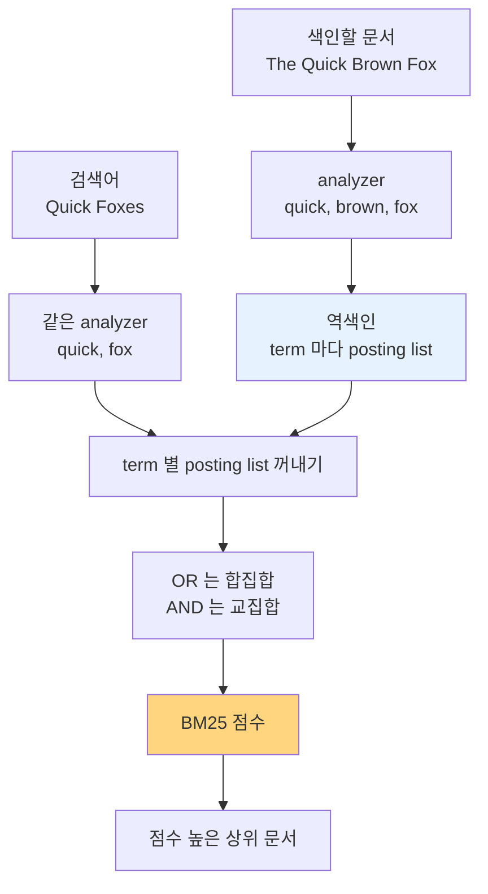

블로그 글 네 개를 Elasticsearch 에 넣고, 검색창에 `Quick Foxes` 를 쳤다고 하자.

```text
doc1  The Quick Brown Fox
doc2  Foxes jumping over dogs
doc3  A quick lunch near the park
doc4  Quick tips for a quick breakfast
```

Elasticsearch 는 이 검색을 두 단계로 처리한다. 글을 넣을 때 단어마다 그 단어가 나온 글 목록([[Inverted Index|역색인]])을 만들어 두고, 검색할 때는 그 목록을 꺼내 점수를 매긴다.

# A) 검색 과정 한눈에 보기

- **색인**: analyzer 가 원문을 다듬고(character filter), 단어로 자르고(tokenizer), 소문자화·불용어 제거·어간 추출(token filter)을 거쳐 term 으로 바꾼 뒤 역색인에 넣는다.
- **검색어 분석**: 검색어도 같은 analyzer 를 거쳐 term 이 된다.
- **문서 찾기**: term 마다 posting list 를 꺼내 OR 면 합집합, AND 면 교집합을 구한다.
- **점수**: [[BM25]] 는 드문 단어일수록, 자주 나올수록(단 점점 덜 오르게), 문서가 짧을수록 점수를 높게 준다.
- **저장 구조**: index 는 shard(= Lucene index)로 나뉘고, 역색인은 바뀌지 않는 segment 로 쌓이며 1 초마다 refresh 되어 검색에 열린다.



# B) 색인 과정 — analyzer

**원문의 `Foxes` 와 검색어의 `fox` 는 글자가 다르다.** 그대로 저장하면 `fox` 로 검색해도 doc2 가 안 나온다. 그래서 역색인에 넣기 전에 단어를 같은 모양으로 다듬는다. 이 일을 하는 부품이 analyzer 다.

analyzer 는 세 단계를 순서대로 거친다.

1. character filter (0 개 이상): 자르기 전에 원문 글자를 고친다.
2. tokenizer (정확히 1 개): 원문을 단어(token)로 자른다.
3. token filter (0 개 이상): 잘린 단어를 고치거나 빼거나 더한다.

doc1 과 doc2 를 이 순서대로 넣으면 이렇게 바뀐다.

| 단계 | doc1 | doc2 |
| --- | --- | --- |
| 원문 | The Quick Brown Fox | Foxes jumping over dogs |
| tokenizer (standard) | The, Quick, Brown, Fox | Foxes, jumping, over, dogs |
| lowercase | the, quick, brown, fox | foxes, jumping, over, dogs |
| stop | quick, brown, fox | foxes, jumping, over, dogs |
| stemmer (porter) | quick, brown, fox | fox, jump, over, dog |

## B.1) character filter

자르기 전에 원문을 글자 단위로 손본다.

- 원문이 웹 페이지라 `The <b>Quick</b> Brown Fox` 처럼 태그가 섞여 있으면 `html_strip` 이 `<b>` 를 지운다.
- 예시 네 글에는 태그가 없어서 이 단계에서 바뀌는 것이 없다.

## B.2) tokenizer

원문을 단어로 자른다.

- `standard` tokenizer 는 공백과 문장부호를 기준으로 자른다.
- 자르면서 각 단어의 위치(position)도 기록한다.
	- 이 위치는 posting list 에 함께 저장되어 구절 검색에 쓰인다.

## B.3) token filter

잘린 단어를 검색하기 좋은 모양으로 다듬는다. 여러 개를 줄줄이 이어 붙인다.

- lowercase: `Quick` 과 `quick` 을 같은 term 으로 만든다.
- stop: `the`, `a`, `for` 같은 불용어를 뺀다.
	- 거의 모든 문서에 나와서 어느 문서를 찾는지 알려 주지 못한다.
- stemmer: 어간만 남긴다.
	- `foxes` → `fox`, `jumping` → `jump` 가 되어 단수·복수, 시제가 달라도 같은 term 이 된다.
- synonym: 동의어를 term 으로 더한다 (`car` 에 `automobile` 을 함께 넣는 식).

실제로는 Elasticsearch 의 기본 analyzer(`standard`)가 `standard` tokenizer 와 lowercase 만 쓰고 불용어 제거와 어간 추출은 하지 않는다. 위 예시는 `html_strip`, `stop`, `porter_stem` 을 직접 붙인 custom analyzer 다 (설정은 부록).

## B.4) 한국어 — nori 형태소 분석기

**한국어를 공백으로 자르면 조사·어미가 단어에 붙은 채로 남는다.** `나무는`, `나무를`, `나무가` 가 서로 다른 term 이 되어 `나무` 로 검색해도 셋 다 안 걸린다. 영어 stemmer 로는 못 고친다.

그래서 한국어는 형태소 분석기로 자른다. Elasticsearch 에서는 Lucene 의 nori 를 플러그인(`analysis-nori`)으로 쓴다.

- nori tokenizer 는 mecab-ko-dic 사전으로 문장을 형태소 단위로 자른다.
	- `뿌리가 깊은 나무는` → 뿌리, 가, 깊, 은, 나무, 는
- `nori_part_of_speech` token filter 가 조사·어미처럼 검색에 쓸모없는 품사를 뺀다.
	- → 뿌리, 깊, 나무
- 그 결과 `나무를 심었다` → 나무, 심 이 되고, `나무가 자란다` → 나무, 자라 가 된다.
	- 세 문장 모두 `나무` 라는 같은 term 을 갖는다.

`nori` analyzer 는 이 둘에 한자를 한글 읽기로 바꾸는 `nori_readingform` 과 lowercase 를 더한 묶음이다. 복합명사는 기본으로 쪼갠 조각만 남긴다 (`가곡역` → 가곡, 역).

# C) 검색 과정

## C.1) 검색어 분석

`Quick Foxes` 로 `match` 검색을 하면 Elasticsearch 는 검색어도 그 필드의 analyzer 에 넣는다.

- `Quick Foxes` → quick, fox

색인할 때 doc2 의 `Foxes` 가 `fox` 가 됐으므로, 검색어의 `Foxes` 도 `fox` 가 되어야 만난다.

**색인할 때와 검색할 때 analyzer 가 다르면 같은 단어도 못 찾는다.**

- 색인은 stemmer 를 거쳐 `fox` 로 저장했는데 검색어는 stemmer 없이 `foxes` 로 찾으면, `foxes` 라는 posting list 가 없어서 결과가 0 건이다.
- 검색용 analyzer(`search_analyzer`)를 따로 지정할 수는 있지만, 보통은 같게 둔다.

## C.2) posting list 합집합과 교집합

검색어의 term 마다 posting list 를 꺼내 합친다. 합치는 원리는 [[Inverted Index]] 에서 다룬다.

```text
quick → doc1, doc3, doc4
fox   → doc1, doc2
```

- OR (합집합): doc1, doc2, doc3, doc4
	- `match` 쿼리의 기본값이다.
- AND (교집합): doc1
	- `match` 에 `"operator": "and"` 를 주면 단어가 전부 들어 있는 문서만 남는다.

## C.3) BM25 점수

OR 로 네 글이 다 걸렸다. Elasticsearch 는 기본으로 [[BM25]] 로 점수를 매겨 순서를 정한다.

| 순위 | 문서 | 합계 점수 |
| --- | --- | --- |
| 1 | doc1 The Quick Brown Fox | 0.520 |
| 2 | doc2 Foxes jumping over dogs | 0.307 |
| 3 | doc4 Quick tips for a quick breakfast | 0.219 |
| 4 | doc3 A quick lunch near the park | 0.158 |

- doc1 은 두 단어를 다 가져서 1 등이다.
- doc2 는 드문 단어 `fox` 를 가져서, 흔한 단어 `quick` 을 두 번 가진 doc4 를 이긴다.
- doc4 는 `quick` 이 두 번이지만 한 번인 doc3 의 두 배가 아니라 1.4 배다.

점수를 term 별로 나눈 표, 세 가지 직관, 그림과 식은 [[BM25]] 에 있다.

**IDF 와 평균 문서 길이는 shard 마다 따로 계산한다.**

- 문서가 적은 index 를 여러 shard 로 나누면 같은 문서도 shard 에 따라 점수가 달라질 수 있다.
- 전체 통계로 계산하려면 `search_type=dfs_query_then_fetch` 를 쓴다.
	- 통계를 모으려고 한 번 더 왕복하는 만큼 느리다.

# D) Elasticsearch 안의 역색인 구조

## D.1) index, shard, segment

Elasticsearch 에서 역색인은 세 겹 안에 들어 있다.

```text
Elasticsearch index "posts"
├── shard 0  (= Lucene index 하나)
│   ├── segment A   ← 작은 역색인 하나
│   └── segment B
└── shard 1  (= Lucene index 하나)
    └── segment C
```

- index: 문서를 모아 두는 단위로, 관계형 DB 의 테이블과 비슷하다.
- shard: index 를 여러 조각으로 나눈 것이다.
	- 조각 하나하나가 독립된 [[Lucene]] index 다.
	- 문서 하나는 primary shard 하나에만 들어가고, replica shard 는 그 복사본이다.
	- primary shard 수는 index 를 만들 때 정하면 바꿀 수 없다.
- segment: shard 안에 쌓이는 작은 역색인 묶음이다 ([[Lucene Segment]]).

검색 요청은 모든 shard 로 퍼진다. shard 마다 자기 segment 들을 검색해 상위 문서를 내면, 요청을 받은 노드가 그것을 모아 최종 상위 문서를 고른다.

**segment 는 한 번 쓰면 바뀌지 않는다 (immutable).**

- 장점: 여러 검색이 잠금 없이 동시에 읽을 수 있고, 운영체제 파일 캐시에 그대로 올려 둘 수 있다.
- 대가: 문서를 고치거나 지울 때 기존 segment 를 손대지 못한다.
	- 삭제는 "지웠음" 표시만 남기고, 수정은 옛 문서에 삭제 표시를 한 뒤 새 문서를 새 segment 에 쓴다.
- segment 가 계속 쌓이면 검색할 곳이 늘어나서, 뒤에서 작은 segment 들을 큰 segment 하나로 합친다 (merge).
	- 삭제 표시된 문서는 이때 실제로 사라진다.

## D.2) refresh 와 near real-time

**색인 요청이 성공해도 바로 검색되지는 않는다.**

- 새 문서는 먼저 메모리 버퍼에 쌓이고, 이때는 아직 역색인이 아니라 검색에 안 걸린다.
- refresh 가 버퍼를 새 segment 로 만들어 열면 그때부터 검색된다.
	- 새 segment 는 디스크에 바로 쓰지 않고 파일시스템 캐시에 먼저 써서, 디스크 커밋보다 훨씬 가볍다.
- Elasticsearch 는 기본으로 1 초마다 refresh 한다.
	- 단, 최근 30 초 안에 검색 요청을 받은 index 만 그렇다.
- 그래서 색인과 검색 사이에 최대 1 초쯤 틈이 있고, 이를 near real-time(거의 실시간) 검색이라 부른다.

반대 경우도 있다.

- 색인 직후 바로 검색돼야 하는 테스트에서는 요청에 `?refresh=wait_for` 를 붙인다.
- 대량으로 색인할 때는 refresh 간격을 늘리거나 꺼서 작은 segment 가 쏟아지지 않게 한다.

# E) 자주 헷갈리는 구분

## E.1) text 와 keyword 필드

같은 문자열 `The Quick Brown Fox` 를 두 필드 타입으로 저장하면 역색인에 들어가는 term 이 다르다.

- text: analyzer 를 거쳐 quick, brown, fox 세 term 으로 저장된다.
	- 본문·제목처럼 단어로 찾는 글에 쓴다.
- keyword: analyzer 를 거치지 않고 `The Quick Brown Fox` 한 term 으로 저장된다.
	- ID·태그·상태 코드·이메일처럼 값이 통째로 같아야 하는 데 쓴다.
	- 정렬과 집계(aggregation)는 text 가 아니라 keyword 로 한다.

둘 다 필요하면 한 필드에 두 타입을 함께 건다 (multi-field). 매핑을 지정하지 않고 문자열을 넣으면 Elasticsearch 가 알아서 `title`(text) 과 `title.keyword`(keyword) 를 함께 만든다.

## E.2) match 와 term 쿼리

- match: 검색어를 필드의 analyzer 에 넣어 term 으로 바꾼 뒤 찾는다.
- term: analyzer 를 거치지 않고 검색어를 그대로 term 하나로 보고 찾는다.

doc1 을 text 와 keyword 로 함께 저장했을 때 결과다.

| 쿼리 | text 필드 (quick, brown, fox 저장) | keyword 필드 (`The Quick Brown Fox` 저장) |
| --- | --- | --- |
| match `Quick Foxes` | 찾는다 (quick, fox 로 바뀜) | 못 찾는다 |
| term `Quick Foxes` | 못 찾는다 | 못 찾는다 |
| term `fox` | 찾는다 | 못 찾는다 |
| term `The Quick Brown Fox` | 못 찾는다 | 찾는다 |

**text 필드에는 match, keyword 필드에는 term 을 쓴다.**

- text 필드에 term 으로 `Quick Foxes` 를 찾으면, 역색인에는 소문자·어간으로 바뀐 term 만 있어서 0 건이다.
- 공식 문서도 text 필드에는 term 쿼리를 쓰지 말라고 한다.

## E.3) query 와 filter

- query: "얼마나 잘 맞나" 를 묻고 BM25 점수를 매긴다.
	- 예: 제목에 `quick fox` 가 들어간 정도.
- filter: "맞나, 안 맞나" 만 묻고 점수를 매기지 않는다.
	- 예: 상태가 `published` 인 글, 작성일이 이번 달인 글.
	- 점수 계산을 안 해서 빠르고, 자주 쓰는 filter 는 결과를 캐시해 둔다.

검색어는 query 에, 조건은 filter 에 두는 것이 기본이다 (`bool` 쿼리의 `must` 와 `filter`).

# F) 부록: 예시를 재현하는 설정

```json
PUT posts
{
  "settings": {
    "analysis": {
      "analyzer": {
        "my_english": {
          "type": "custom",
          "char_filter": ["html_strip"],
          "tokenizer": "standard",
          "filter": ["lowercase", "stop", "porter_stem"]
        }
      }
    }
  },
  "mappings": {
    "properties": {
      "title": {
        "type": "text",
        "analyzer": "my_english",
        "fields": { "keyword": { "type": "keyword" } }
      },
      "status": { "type": "keyword" }
    }
  }
}
```

analyzer 가 문장을 어떻게 바꾸는지는 `_analyze` 로 바로 본다.

```json
GET posts/_analyze
{ "analyzer": "my_english", "text": "Foxes jumping over dogs" }
```

본문에 나온 쿼리들이다. 점수가 왜 그렇게 나왔는지는 검색 요청에 `"explain": true` 를 주면 term 별 계산이 나온다.

```json
GET posts/_search
{ "query": { "match": { "title": "Quick Foxes" } } }

GET posts/_search
{ "query": { "match": { "title": { "query": "Quick Foxes", "operator": "and" } } } }

GET posts/_search
{ "query": { "term": { "title.keyword": "The Quick Brown Fox" } } }

GET posts/_search
{
  "query": {
    "bool": {
      "must":   [ { "match": { "title": "Quick Foxes" } } ],
      "filter": [ { "term": { "status": "published" } } ]
    }
  }
}
```

한국어 필드는 `analysis-nori` 플러그인을 설치하고 `"analyzer": "nori"` 를 건다.

# G) References

- [Elasticsearch Docs - Anatomy of an analyzer](https://www.elastic.co/docs/manage-data/data-store/text-analysis/anatomy-of-an-analyzer)
- [Elasticsearch Docs - Standard analyzer](https://www.elastic.co/docs/reference/text-analysis/analysis-standard-analyzer)
- [Elasticsearch Docs - nori analyzer](https://www.elastic.co/docs/reference/elasticsearch/plugins/analysis-nori-analyzer)
- [Elasticsearch Docs - nori_tokenizer](https://www.elastic.co/docs/reference/elasticsearch/plugins/analysis-nori-tokenizer)
- [Elasticsearch Docs - nori_part_of_speech token filter](https://www.elastic.co/docs/reference/elasticsearch/plugins/analysis-nori-speech)
- [Elasticsearch Docs - Match query](https://www.elastic.co/docs/reference/query-languages/query-dsl/query-dsl-match-query)
- [Elasticsearch Docs - Term query](https://www.elastic.co/docs/reference/query-languages/query-dsl/query-dsl-term-query)
- [Elasticsearch Docs - Text type family](https://www.elastic.co/docs/reference/elasticsearch/mapping-reference/text)
- [Elasticsearch Docs - Dynamic field mapping](https://www.elastic.co/docs/manage-data/data-store/mapping/dynamic-field-mapping)
- [Elasticsearch Docs - Query and filter context](https://www.elastic.co/docs/explore-analyze/query-filter/languages/querydsl)
- [Elasticsearch Docs - Similarity settings](https://www.elastic.co/docs/reference/elasticsearch/index-settings/similarity)
- [Elasticsearch Docs - Clusters, nodes, and shards](https://www.elastic.co/docs/deploy-manage/distributed-architecture/clusters-nodes-shards)
- [Elasticsearch Docs - Near real-time search](https://www.elastic.co/docs/manage-data/data-store/near-real-time-search)
- [Elastic Blog - Practical BM25 Part 1: How shards affect relevance scoring](https://www.elastic.co/blog/practical-bm25-part-1-how-shards-affect-relevance-scoring-in-elasticsearch)
