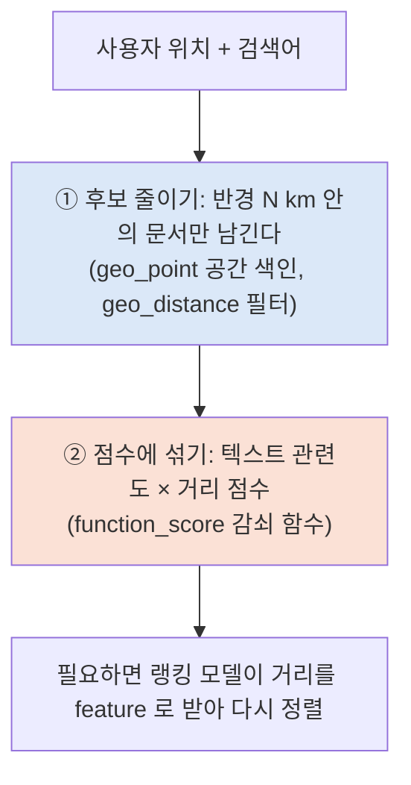

# A) Geo Search ?

문서에 좌표를 붙여 두고, 사용자 위치를 기준으로 거리 조건을 걸거나 거리를 점수에 반영하는 검색이다. "내 주변 카페", "반경 3 km 안의 병원" 같은 검색이 여기에 속한다.

가게가 수백만 곳이면, 쿼리마다 모든 가게와의 거리를 계산하는 것만으로 응답 시간이 다 간다. 그래서 위치 검색은 보통 두 단계로 나눈다.



첫 단계는 거리를 정확히 재지 않고도 먼 문서를 통째로 버리는 일이다. 공간 색인이 이 일을 맡는다. 두 번째 단계는 남은 후보에서 가까울수록 점수를 더 주는 일이다. 여기서는 거리를 직접 계산하지만, 대상이 수천 개로 줄어든 뒤라 부담이 작다.

# B) 후보 줄이기: geo_point 와 BKD Tree

Elasticsearch 에서 좌표는 `geo_point` 필드로 색인한다. [[Lucene]] 은 이 좌표를 BKD tree 라는 공간 색인에 넣는다. 숫자 · 날짜 범위 검색에 쓰는 것과 같은 계열의 구조다 ([[Lucene Segment]] 의 Points 항목).

BKD tree 는 k-d tree 를 디스크 블록 단위로 저장하도록 바꾼 것이다. 점들을 위도와 경도 중 하나를 골라 중앙값으로 반씩 나누기를 반복해, 리프 칸 하나에 점이 일정 개수만 남게 만든다.

![[img-be6429ee2c.png]]

반경 검색이 들어오면 트리를 위에서부터 내려가며 칸마다 원과의 관계를 본다.

| 칸과 원의 관계 | 처리 |
| --- | --- |
| 칸이 원 밖에 있다 | 그 아래를 더 내려가지 않는다. 안의 점은 한 번도 읽지 않는다 |
| 칸이 원 안에 통째로 들어간다 | 안의 점을 거리 계산 없이 모두 결과에 넣는다 |
| 칸이 원의 경계에 걸친다 | 이 칸의 점만 하나씩 거리를 계산한다 |

그림에서는 점 197 개 중 58 개만 거리를 계산했다. 실제 데이터는 점이 수백만 개이고 반경은 그중 작은 영역이라, 원 밖이라서 통째로 건너뛰는 칸의 비율이 그림보다 훨씬 크다. 실제 BKD tree 의 리프 하나에는 점이 수백 개 들어간다.

이 단계는 `geo_distance` 쿼리를 `filter` 안에 넣어 쓴다. filter 는 점수를 매기지 않고 통과 여부만 정하므로 점수 계산 비용이 없다.

```json
{
  "query": {
    "bool": {
      "must": { "match": { "name": "카페" } },
      "filter": {
        "geo_distance": {
          "distance": "3km",
          "location": { "lat": 37.5665, "lon": 126.9780 }
        }
      }
    }
  }
}
```

# C) 점수에 섞기: function_score 감쇠 함수

반경 안에 들어온 문서끼리도 가까운 쪽이 더 낫다. `function_score` 의 감쇠(decay) 함수는 거리를 0 과 1 사이의 점수로 바꾸고, 이 점수를 텍스트 관련도 점수에 곱한다.

감쇠 함수는 네 값으로 모양이 정해진다.

| 파라미터 | 뜻 |
| --- | --- |
| `origin` | 거리를 재는 기준점. 보통 사용자 위치 |
| `offset` | 이 거리 안은 감쇠하지 않고 1 을 준다 |
| `scale` | `offset` 에서 이만큼 더 멀어지면 점수가 `decay` 가 된다 |
| `decay` | `offset + scale` 지점의 점수. 기본값 0.5 |

함수 모양은 `gauss`, `exp`, `linear` 셋 중에 고른다. 세 함수 모두 `offset + scale` 지점에서 `decay` 를 지나지만, 가까운 곳과 먼 곳에서 기울기가 다르다.

![[img-e57f748223.png]]

- **gauss**: 가까운 곳에서는 천천히 줄다가 중간에서 빠르게 떨어진다. 걸어갈 수 있는 거리 안은 거의 같게 보고 싶을 때 맞다.
- **exp**: 처음부터 빠르게 줄고, 멀리서도 0 이 되지 않는다. 먼 문서도 완전히 버리지 않는다.
- **linear**: 일정한 기울기로 줄다가 어느 거리에서 0 이 된다. 그 너머는 거리 점수가 0 이라 곱하면 문서 점수도 0 이 된다.

gauss 의 식은 다음과 같다. $\sigma$ 는 `offset + scale` 지점에서 점수가 `decay` 가 되도록 정해진다.

$$
S(d) = \exp\left(-\frac{\max(0,\, d - \text{offset})^2}{2\sigma^2}\right), \qquad \sigma^2 = -\frac{\text{scale}^2}{2 \ln(\text{decay})}
$$

$d$ 는 문서와 `origin` 사이의 거리다.

```json
{
  "query": {
    "function_score": {
      "query": { "match": { "name": "카페" } },
      "functions": [
        {
          "gauss": {
            "location": {
              "origin": { "lat": 37.5665, "lon": 126.9780 },
              "offset": "0.5km",
              "scale": "2km",
              "decay": 0.5
            }
          }
        }
      ],
      "boost_mode": "multiply"
    }
  }
}
```

`boost_mode` 가 `multiply`(기본값)면 최종 점수는 텍스트 점수 × 거리 점수다. `sum` 으로 바꾸면 더하는데, 텍스트 점수의 범위가 쿼리마다 달라서 거리 점수의 영향이 들쭉날쭉해진다.

# D) 거리를 랭킹 모델에 넣기

감쇠 함수는 사람이 정한 곡선이다. 학습 없이 바로 쓸 수 있는 출발점이지만, 카테고리마다 거리에 대한 민감도가 다르다는 사실을 반영하지 못한다. 커피는 500 m 만 멀어도 안 가지만, 잘 맞는 병원은 5 km 를 간다.

[[Learning-to-Rank]] 모델을 쓰는 서비스라면 거리를 다른 feature 와 함께 넣고, 클릭 · 방문 로그로 학습시킨다. 트리 모델은 "카테고리가 병원이면 거리 영향을 줄인다" 같은 조합을 스스로 찾는다. 이때도 첫 단계의 반경 필터는 그대로 둔다. 랭킹 모델은 수천 개 후보를 다시 정렬할 뿐, 수백만 개 전체를 볼 수는 없기 때문이다.

# E) References

- [Elasticsearch - Geo-distance query](https://www.elastic.co/guide/en/elasticsearch/reference/current/query-dsl-geo-distance-query.html)
- [Elasticsearch - Function score query (decay functions)](https://www.elastic.co/guide/en/elasticsearch/reference/current/query-dsl-function-score-query.html)
- [Apache Lucene - org.apache.lucene.util.bkd package](https://lucene.apache.org/core/9_0_0/core/org/apache/lucene/util/bkd/package-summary.html)
