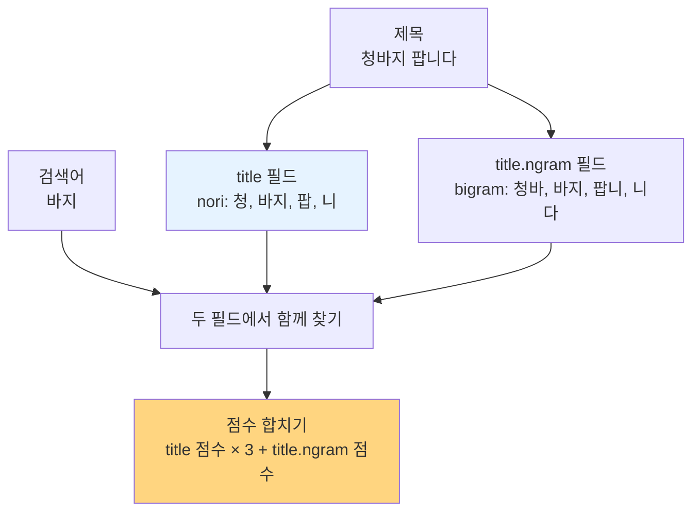

중고거래 앱 검색창에 다섯 개의 게시글 제목이 색인돼 있다고 하자.

```text
doc1  캠핑의자 팝니다
doc2  아이폰 케이스 팝니다
doc3  스벅 기프티콘
doc4  바지락 1kg
doc5  청바지 팝니다
```

사용자는 `캠핑 의자`, `아이퐁`, `스벅`, `바지` 를 검색한다. 검색 엔진은 제목을 term 으로 잘라 [[Inverted Index|역색인]]에 넣고, 검색어도 같은 방식으로 잘라 term 이 겹치는 글을 찾는다 ([[Elasticsearch 검색 과정]]). 그래서 어떻게 자르느냐에 따라 찾는 글이 달라진다.

# A) 한눈에 보기

- **공백으로만 자르면 거의 안 걸린다.**
	- 조사가 붙고, 같은 말을 붙여 쓰기도 띄어 쓰기도 하기 때문이다.
- **형태소 분석은 뜻 단위로 정확하게 자른다.**
	- 엉뚱한 글이 덜 걸리고 색인이 작다.
	- 사전에 없는 오타 · 줄임말 · 신조어 · 상품명은 엉뚱하게 잘리거나 아예 사라진다.
- **n-gram 은 사전 없이 글자 조각으로 자른다.**
	- 오타와 신조어도 조각 일부가 겹쳐서 찾는다.
	- 색인이 크고, 조각만 같은 엉뚱한 글이 함께 걸린다.
- **실무에서는 같은 제목을 두 방식으로 함께 색인한다.**
	- 두 필드에서 함께 찾고, 형태소 쪽 점수에 가중치를 더 준다.

# B) 공백으로 자르면 안 되는 이유

한국어는 띄어쓰기 단위(어절)가 단어가 아니다. 한 어절에 여러 조각이 붙어 있다.

- **조사**: `캠핑의자를`, `캠핑의자가` 는 공백으로 자르면 `캠핑의자` 와 다른 term 이 된다.
- **어미**: `팝니다`, `팔아요`, `팔았던` 은 모두 `팔다` 인데 글자가 다르다.
- **복합명사**: `캠핑의자` 를 붙여 쓰는 사람도 있고 `캠핑 의자` 로 띄어 쓰는 사람도 있다.

`캠핑 의자` 로 검색하면 공백 기준 term 은 `캠핑`, `의자` 다. doc1 의 term 은 `캠핑의자`, `팝니다` 라서 하나도 안 겹친다. 영어처럼 공백으로 자르고 끝에 붙은 `-s` 만 떼는 방식으로는 이 문제를 못 푼다.

# C) 형태소 분석

형태소는 뜻을 가진 가장 작은 말 단위다 ([[morphemes|Morphemes]]). 형태소 분석기는 어절을 형태소로 자르고 품사를 붙인다. Elasticsearch 에서는 Lucene 에 들어 있는 nori 를 쓴다.

- nori 는 mecab-ko-dic 사전을 보고 문장을 형태소로 자른다.
- 그다음 조사 · 어미 · 감탄사 · 부사처럼 검색에 쓸모없는 품사를 뺀다 (`nori_part_of_speech` 필터).

예시 제목을 nori 로 자른 결과다 (Lucene 9.12.1 의 `KoreanAnalyzer` 기본 설정, 2026-11-22 실행).

```text
캠핑의자 팝니다   → 캠핑, 의자, 팝, 니
캠핑 의자         → 캠핑, 의자
청바지 팝니다     → 청, 바지, 팝, 니
바지락 1kg        → 바지락, 1, kg
```

## C.1) 형태소 분석의 장점

1. **띄어쓰기와 조사가 달라도 같은 term 이 된다**: `캠핑 의자` 와 `캠핑의자 팝니다` 가 둘 다 `캠핑`, `의자` 를 가져서 doc1 이 걸린다.
2. **뜻 단위라 엉뚱한 글이 덜 걸린다**: `바지` 로 검색하면 doc5 의 `청바지` 는 `청`, `바지` 로 잘려 걸리고, doc4 의 `바지락` 은 한 단어로 남아 안 걸린다.
3. **색인이 작다**: 어절 하나가 형태소 몇 개로만 잘려서 term 수가 적다.

## C.2) 형태소 분석의 약점: 사전에 없는 말

같은 분석기로 사전에 없는 말이 든 제목을 자른 결과다.

```text
아이폰 케이스 팝니다   → 아이폰, 케이스, 팝, 니다
아이퐁                 → 퐁
스벅 기프티콘          → 기프, 티, 콘
스벅                   → 벅
꾸안꾸 니트 팝니다     → 꿉, 꿉, 니트, 팝, 니
에어팟프로 미개봉       → 에어, 팟, 프로, 미, 개봉
```

- **오타**: `아이퐁` 은 `아이`(감탄사) 와 `퐁` 으로 잘리고 `아이` 가 빠져 `퐁` 만 남는다.
	- doc2 의 `아이폰` 과 겹치는 term 이 없어서 doc2 를 못 찾는다.
- **줄임말**: `스벅` 은 혼자 검색하면 `벅` 이 남지만, doc3 제목 안에서는 `스`, `벅` 이 감탄사 · 부사로 분석돼 둘 다 빠진다.
	- 검색어와 제목에 똑같은 `스벅` 이 있는데도 결과가 0 건이다.
- **신조어**: `꾸안꾸`(꾸민 듯 안 꾸민 듯)는 뜻 없는 `꿉`, `꿉` 이 된다.
- **상품명**: `에어팟` 은 `에어`, `팟` 으로, `미개봉` 은 `미`, `개봉` 으로 쪼개진다.
- 흔한 말도 틀린다. `팝니다` 가 동사 `팔다` 가 아니라 명사 `팝` 으로 분석된다.

**같은 말도 앞뒤 문맥에 따라 다르게 잘린다.**

- 형태소 분석기는 문장 전체에서 가장 그럴듯한 분석을 고른다.
- 그래서 사전에 없는 말은 혼자 있을 때와 문장 속에 있을 때 결과가 달라진다.
- 검색어는 짧고 제목은 길어서, 같은 말이 양쪽에서 다른 term 이 되기 쉽다.

**사용자 사전에 말을 넣으면 고쳐진다.**

- `꾸안꾸`, `에어팟`, `기프티콘` 을 사용자 사전(`user_dictionary`)에 넣으면 이렇게 바뀐다.
	- `꾸안꾸 니트 팝니다` → 꾸안꾸, 니트, 팝, 니
	- `에어팟프로 미개봉` → 에어팟, 프로, 미, 개봉
	- `스벅 기프티콘` → 기프티콘
- 그러나 신조어와 상품명은 매일 생기고, 오타는 사전에 넣을 수 없다.
- 사전을 누군가 계속 관리해야 한다.

사전에 있는 복합명사를 어떻게 남길지는 `decompound_mode` 로 정한다.

- `discard` (기본값): 쪼갠 조각만 남긴다 (`가곡역` → 가곡, 역).
- `mixed`: 원래 말과 조각을 함께 남긴다 (`가곡역` → 가곡역, 가곡, 역).
- `none`: 쪼개지 않는다.

# D) n-gram

n-gram 은 단어를 글자 n 개씩 한 칸씩 밀며 자른 조각이다 ([[n-gram]]). 한국어 검색에서는 두 글자씩 자르는 bigram 을 흔히 쓴다. Elasticsearch 의 `ngram` tokenizer 에 최소 · 최대 길이를 2 로 주고, 글자와 숫자만 단어로 보게 하면 이렇게 잘린다.

```text
캠핑의자 팝니다       → 캠핑, 핑의, 의자, 팝니, 니다
아이폰 케이스 팝니다   → 아이, 이폰, 케이, 이스, 팝니, 니다
스벅 기프티콘          → 스벅, 기프, 프티, 티콘
바지락 1kg            → 바지, 지락, 1k, kg
청바지 팝니다         → 청바, 바지, 팝니, 니다
```

## D.1) n-gram 의 장점

1. **사전이 없어서 신조어와 줄임말도 글자 그대로 남는다**: `스벅` 은 `스벅` 이라 doc3 을 찾는다.
2. **오타가 있어도 조각 일부가 겹친다**: `아이퐁` 은 `아이`, `이퐁` 이고, `아이` 가 doc2 와 겹쳐서 doc2 를 찾는다.
3. **띄어쓰기와 상관없다**: `캠핑 의자` 는 `캠핑`, `의자` 이고 doc1 의 조각에 둘 다 있다.

## D.2) n-gram 의 약점

1. **조각만 같은 엉뚱한 글이 걸린다**: `바지` 로 검색하면 `청바지`(doc5)와 함께 `바지락`(doc4)도 걸린다.
	- `아이퐁` 의 `아이` 는 아이폰뿐 아니라 「아이 옷」, 「아이 장난감」 같은 육아용품 글에도 걸린다.
2. **색인이 크다**: 글자 수만큼 조각이 생겨 term 수가 형태소보다 많다.
	- 짧은 조각은 거의 모든 글에 나와서 posting list 가 길어지고, 검색도 느려진다.
3. **점수가 뜻을 모른다**: [[BM25]] 는 조각을 따로따로 센다.
	- `바지` 검색에서 `청바지` 와 `바지락` 은 똑같이 `바지` 조각 하나를 가져서 비슷한 점수를 받는다.
4. **한 글자 검색어는 못 찾는다**: 두 글자 조각만 만들어서 `옷` 같은 한 글자 검색어에서는 조각이 안 나온다.

## D.3) 같은 예시로 비교하기

네 검색어가 각 방식에서 찾는 글이다.

| 검색어 | 공백 기준 | 형태소 (nori) | bigram |
| --- | --- | --- | --- |
| `캠핑 의자` | 없음 | doc1 | doc1 |
| `아이퐁` | 없음 | 없음 | doc2 |
| `스벅` | doc3 | 없음 | doc3 |
| `바지` | 없음 | doc5 | doc4, doc5 |

**형태소 분석은 엉뚱한 글을 덜 가져오고, n-gram 은 찾아야 할 글을 덜 놓친다.**

- 형태소 분석은 [[precision]] 쪽에 강하다. `바지` 에서 `바지락` 을 걸러 냈다.
- n-gram 은 [[Recall|recall]] 쪽에 강하다. `아이퐁` 과 `스벅` 에서 결과를 냈다.
- 한쪽만 쓰면 다른 쪽의 약점을 그대로 안는다.

# E) 두 방식을 함께 쓰는 법

**같은 제목을 두 필드에 다른 방식으로 색인한다 (multi-field).**

- `title` 은 nori 로, `title.ngram` 은 bigram 으로 자른다.
- 검색할 때는 두 필드에서 함께 찾고 점수를 더한다.
- 이때 `title` 쪽 점수에 가중치(boost)를 더 준다.



같은 예시로 보면 이렇게 된다.

- `바지`: `청바지` 는 두 필드에서 모두 맞아 점수가 높다.
	- `바지락` 은 `title.ngram` 에서만 맞아 아래에 놓인다.
- `아이퐁`: `title` 에서는 0 건이지만 `title.ngram` 이 doc2 를 찾아서 결과가 비지 않는다.
- `옷`: bigram 조각이 안 나와도 `title` 쪽에서 찾는다.

설정은 부록에 있다.

# F) 자모 분해와 초성 검색

**음절을 자모로 풀어 n-gram 을 만들면 오타에 더 강하다.**

- `아이폰` 은 ㅇㅏㅇㅣㅍㅗㄴ, `아이퐁` 은 ㅇㅏㅇㅣㅍㅗㅇ 이다. 받침 하나만 다르다.
- 음절 bigram 으로는 두 조각(`아이`, `이폰` / `아이`, `이퐁`) 가운데 하나만 겹친다.
- 자모 세 글자씩 자르면 다섯 조각 가운데 네 조각이 겹친다.
- 자모 단위 편집 거리로 오타를 고치는 방법은 [[Query Spelling Correction]] 에 있다.

**초성만 뽑아 따로 색인하면 `ㅅㅅㅈㅈ` 로 `삼성전자` 를 찾을 수 있다.**

- 초성을 뽑는 법과 앞부분 검색에 쓰는 edge n-gram 은 [[Prefix Search]] 에 있다.

# G) 부록: 예시를 재현하는 설정

nori 와 bigram 을 함께 거는 매핑이다. nori 는 `analysis-nori` 플러그인을 설치해야 쓸 수 있다.

```json
PUT posts
{
  "settings": {
    "analysis": {
      "tokenizer": {
        "my_nori": {
          "type": "nori_tokenizer",
          "decompound_mode": "discard",
          "user_dictionary_rules": ["꾸안꾸", "에어팟", "기프티콘"]
        },
        "my_bigram": {
          "type": "ngram",
          "min_gram": 2,
          "max_gram": 2,
          "token_chars": ["letter", "digit"]
        }
      },
      "analyzer": {
        "ko_nori": {
          "type": "custom",
          "tokenizer": "my_nori",
          "filter": ["nori_part_of_speech", "nori_readingform", "lowercase"]
        },
        "ko_bigram": {
          "type": "custom",
          "tokenizer": "my_bigram",
          "filter": ["lowercase"]
        }
      }
    }
  },
  "mappings": {
    "properties": {
      "title": {
        "type": "text",
        "analyzer": "ko_nori",
        "fields": {
          "ngram": { "type": "text", "analyzer": "ko_bigram" }
        }
      }
    }
  }
}
```

두 필드에서 찾아 점수를 더하는 검색이다. `most_fields` 는 맞은 필드의 점수를 모두 더하고, `title^3` 은 `title` 점수에 3 을 곱한다.

```json
GET posts/_search
{
  "query": {
    "multi_match": {
      "query": "바지",
      "fields": ["title^3", "title.ngram"],
      "type": "most_fields"
    }
  }
}
```

분석기가 문장을 어떻게 자르는지는 `_analyze` 로 바로 본다.

```json
GET posts/_analyze
{ "analyzer": "ko_nori", "text": "스벅 기프티콘" }
```

본문의 nori 결과는 Elasticsearch 가 아니라 Lucene 9.12.1 의 `KoreanAnalyzer` 를 직접 돌려 얻었다. Elasticsearch 의 nori 도 같은 Lucene 분석기를 쓰지만, 버전에 따라 사전과 결과가 조금 다를 수 있다.

# H) References

- [Elasticsearch Docs - nori_tokenizer](https://www.elastic.co/docs/reference/elasticsearch/plugins/analysis-nori-tokenizer)
- [Elasticsearch Docs - nori_part_of_speech token filter](https://www.elastic.co/docs/reference/elasticsearch/plugins/analysis-nori-speech)
- [Elasticsearch Docs - N-gram tokenizer](https://www.elastic.co/docs/reference/text-analysis/analysis-ngram-tokenizer)
- [Elasticsearch Docs - Multi-match query](https://www.elastic.co/docs/reference/query-languages/query-dsl/query-dsl-multi-match-query)
- [Elasticsearch Docs - fields (multi-fields)](https://www.elastic.co/docs/reference/elasticsearch/mapping-reference/multi-fields)
