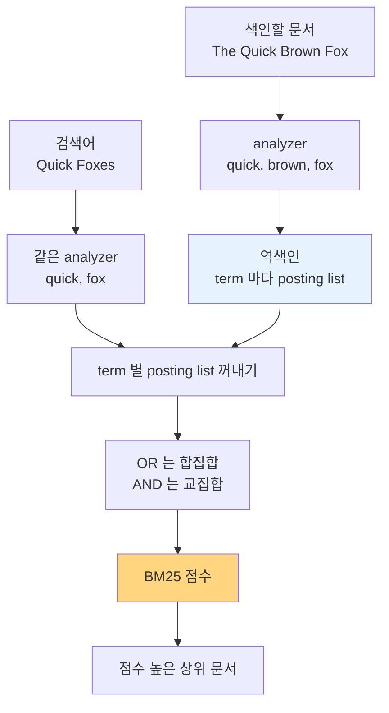

블로그 글 네 개가 있고, 검색창에 `Quick Foxes` 를 쳤다고 하자.

```text
doc1  The Quick Brown Fox
doc2  Foxes jumping over dogs
doc3  A quick lunch near the park
doc4  Quick tips for a quick breakfast
```

글이 넷뿐이면 하나씩 열어 봐도 된다. 글이 1억 개라면 매번 다 열어 볼 수 없다. Elasticsearch 는 글을 넣을 때 **단어마다 그 단어가 나온 글 목록**을 미리 만들어 두고, 검색할 때는 그 목록만 꺼내 본다. 이 목록이 역색인(inverted index)이다.

# A) 면접에서 30초로 답하기

> - 역색인은 책 뒤의 찾아보기처럼, 단어마다 그 단어가 나온 문서 ID 목록(posting list)을 저장한 구조입니다.
> - 문서를 넣을 때 analyzer 가 character filter 로 원문을 다듬고, tokenizer 로 자르고, token filter 로 소문자화·불용어 제거·어간 추출을 해서 term 을 만듭니다.
> - 검색어도 같은 analyzer 를 거쳐 term 이 되고, term 마다 posting list 를 꺼내 OR 면 합집합, AND 면 교집합을 구합니다.
> - 그 문서들을 BM25 로 점수 매기는데, 드문 단어일수록, 자주 나올수록(단 점점 덜 오르게), 문서가 짧을수록 점수가 높습니다.
> - Elasticsearch 에서는 index 가 shard 로 나뉘고 shard 하나가 Lucene index 하나이며, 역색인은 안 바뀌는 segment 로 쌓이고 1 초마다 refresh 되어 거의 실시간으로 검색됩니다.



# B) 역색인 — 단어마다 문서 목록

**보통 문서는 문서 → 단어 방향으로 적혀 있다.** 글을 열면 그 안의 단어가 보인다.

```text
doc1 → quick, brown, fox
doc2 → fox, jump, over, dog
doc3 → quick, lunch, near, park
doc4 → quick, tip, quick, breakfast
```

이 모양으로는 `fox` 가 든 글을 찾으려면 네 줄을 전부 읽어야 한다. 방향을 뒤집어 단어 → 문서로 저장하면 `fox` 줄 하나만 읽으면 된다.

```text
breakfast → doc4
brown     → doc1
dog       → doc2
fox       → doc1, doc2
jump      → doc2
lunch     → doc3
near      → doc3
over      → doc2
park      → doc3
quick     → doc1, doc3, doc4
tip       → doc4
```

방향을 뒤집었다(invert)고 해서 inverted index, 역색인이라 부른다. 책 뒤의 찾아보기가 정확히 이 모양이다.

- 왼쪽 단어를 term 이라 부른다.
	- 원문 단어 그대로가 아니라 검색하기 좋게 다듬은 단어다 (`Foxes` 가 `fox` 가 됐다). 다듬는 법은 다음 절에서 본다.
- 오른쪽 문서 목록을 posting list 라 부른다.
- term 들을 정렬해 모아 둔 사전을 term dictionary 라 부른다.

**posting list 에는 문서 ID 말고도 두 가지가 더 붙는다.**

- 그 문서에서 term 이 몇 번 나왔는지 (term frequency, TF): doc4 의 `quick` 은 2 번이다.
	- 나중에 점수를 매길 때 쓴다.
- term 이 문서의 몇 번째 단어인지 (position): doc1 에서 `quick` 은 0 번째, `brown` 은 1 번째다.
	- `"quick brown"` 처럼 붙어 있는 구절을 찾는 phrase 검색에 쓴다.

실제로는 term dictionary 를 [[Finite State Transducer|FST]] 로 압축하고, posting list 의 문서 ID 도 정렬해서 압축해 둔다. 그래서 수억 문서의 역색인도 디스크와 메모리에 들어간다.

**역색인은 문서를 찾는 목록이지 원문을 담는 곳이 아니다.**

- 원문 JSON 은 `_source` 에 따로 저장된다.
- 검색 결과로 원문을 돌려줄 때는 역색인으로 문서 ID 를 찾은 뒤 `_source` 에서 꺼낸다.

# C) 색인 과정 — analyzer

**원문의 `Foxes` 와 검색어의 `fox` 는 글자가 다르다.** 그대로 저장하면 `fox` 로 검색해도 doc2 가 안 나온다. 그래서 역색인에 넣기 전에 단어를 같은 모양으로 다듬는다. 이 일을 하는 부품이 analyzer 다.

analyzer 는 세 단계를 순서대로 거친다.

1. character filter (0 개 이상): 자르기 전에 원문 글자를 고친다.
2. tokenizer (정확히 1 개): 원문을 단어(token)로 자른다.
3. token filter (0 개 이상): 잘린 단어를 고치거나 빼거나 더한다.

doc1 과 doc2 를 이 순서대로 넣으면 이렇게 바뀐다.

| 단계 | doc1 | doc2 |
| --- | --- | --- |
| 원문 | The Quick Brown Fox | Foxes jumping over dogs |
| tokenizer (standard) | The, Quick, Brown, Fox | Foxes, jumping, over, dogs |
| lowercase | the, quick, brown, fox | foxes, jumping, over, dogs |
| stop | quick, brown, fox | foxes, jumping, over, dogs |
| stemmer (porter) | quick, brown, fox | fox, jump, over, dog |

## C.1) character filter

자르기 전에 원문을 글자 단위로 손본다.

- 원문이 웹 페이지라 `The <b>Quick</b> Brown Fox` 처럼 태그가 섞여 있으면 `html_strip` 이 `<b>` 를 지운다.
- 예시 네 글에는 태그가 없어서 이 단계에서 바뀌는 것이 없다.

## C.2) tokenizer

원문을 단어로 자른다.

- `standard` tokenizer 는 공백과 문장부호를 기준으로 자른다.
- 자르면서 각 단어의 위치(position)도 기록한다.
	- 앞 절의 posting list 에 붙는 위치가 여기서 나온다.

## C.3) token filter

잘린 단어를 검색하기 좋은 모양으로 다듬는다. 여러 개를 줄줄이 이어 붙인다.

- lowercase: `Quick` 과 `quick` 을 같은 term 으로 만든다.
- stop: `the`, `a`, `for` 같은 불용어를 뺀다.
	- 거의 모든 문서에 나와서 어느 문서를 찾는지 알려 주지 못한다.
- stemmer: 어간만 남긴다.
	- `foxes` → `fox`, `jumping` → `jump` 가 되어 단수·복수, 시제가 달라도 같은 term 이 된다.
- synonym: 동의어를 term 으로 더한다 (`car` 에 `automobile` 을 함께 넣는 식).

실제로는 Elasticsearch 의 기본 analyzer(`standard`)가 `standard` tokenizer 와 lowercase 만 쓰고 불용어 제거와 어간 추출은 하지 않는다. 위 예시는 `html_strip`, `stop`, `porter_stem` 을 직접 붙인 custom analyzer 다 (설정은 부록).

## C.4) 한국어 — nori 형태소 분석기

**한국어를 공백으로 자르면 조사·어미가 단어에 붙은 채로 남는다.** `나무는`, `나무를`, `나무가` 가 서로 다른 term 이 되어 `나무` 로 검색해도 셋 다 안 걸린다. 영어 stemmer 로는 못 고친다.

그래서 한국어는 형태소 분석기로 자른다. Elasticsearch 에서는 Lucene 의 nori 를 플러그인(`analysis-nori`)으로 쓴다.

- nori tokenizer 는 mecab-ko-dic 사전으로 문장을 형태소 단위로 자른다.
	- `뿌리가 깊은 나무는` → 뿌리, 가, 깊, 은, 나무, 는
- `nori_part_of_speech` token filter 가 조사·어미처럼 검색에 쓸모없는 품사를 뺀다.
	- → 뿌리, 깊, 나무
- 그 결과 `나무를 심었다` → 나무, 심 이 되고, `나무가 자란다` → 나무, 자라 가 된다.
	- 세 문장 모두 `나무` 라는 같은 term 을 갖는다.

`nori` analyzer 는 이 둘에 한자를 한글 읽기로 바꾸는 `nori_readingform` 과 lowercase 를 더한 묶음이다. 복합명사는 기본으로 쪼갠 조각만 남긴다 (`가곡역` → 가곡, 역).

# D) 검색 과정

## D.1) 검색어 분석

`Quick Foxes` 로 `match` 검색을 하면 Elasticsearch 는 검색어도 그 필드의 analyzer 에 넣는다.

- `Quick Foxes` → quick, fox

색인할 때 doc2 의 `Foxes` 가 `fox` 가 됐으므로, 검색어의 `Foxes` 도 `fox` 가 되어야 만난다.

**색인할 때와 검색할 때 analyzer 가 다르면 같은 단어도 못 찾는다.**

- 색인은 stemmer 를 거쳐 `fox` 로 저장했는데 검색어는 stemmer 없이 `foxes` 로 찾으면, `foxes` 라는 posting list 가 없어서 결과가 0 건이다.
- 검색용 analyzer(`search_analyzer`)를 따로 지정할 수는 있지만, 보통은 같게 둔다.

## D.2) posting list 합집합과 교집합

검색어의 term 마다 posting list 를 꺼낸다.

```text
quick → doc1, doc3, doc4
fox   → doc1, doc2
```

이제 두 목록을 합친다.

- OR (합집합): doc1, doc2, doc3, doc4
	- 단어 하나라도 들어 있으면 결과에 넣는다. `match` 쿼리의 기본값이다.
- AND (교집합): doc1
	- 단어가 전부 들어 있어야 결과에 넣는다. `match` 에 `"operator": "and"` 를 주면 이쪽이다.

**posting list 는 문서 ID 순으로 정렬돼 있어서 합치는 데 한 번만 훑으면 된다.** 두 목록의 맨 앞을 비교하며 작은 쪽을 한 칸씩 넘기면, 병합 정렬의 병합 단계처럼 합집합과 교집합이 동시에 나온다.

실제로는 posting list 에 건너뛰기 정보(skip data)가 붙어 있어서, 교집합을 구할 때 한쪽에 없는 구간은 통째로 건너뛴다.

## D.3) BM25 점수

OR 로 네 글이 다 걸렸다. 이제 어느 글을 먼저 보여 줄지 점수를 매긴다. Elasticsearch 의 기본 점수 함수가 [[BM25]] 다.

네 글을 Lucene 으로 직접 색인해 `quick fox` 로 검색한 점수다.

| 순위 | 문서 | quick 점수 | fox 점수 | 합계 |
| --- | --- | --- | --- | --- |
| 1 | doc1 The Quick Brown Fox | 0.177 | 0.343 | 0.520 |
| 2 | doc2 Foxes jumping over dogs | 0 | 0.307 | 0.307 |
| 3 | doc4 Quick tips for a quick breakfast | 0.219 | 0 | 0.219 |
| 4 | doc3 A quick lunch near the park | 0.158 | 0 | 0.158 |

문서 점수는 검색어 term 별 점수를 더한 값이다. doc1 은 두 단어를 다 가져서 1 등이다. 나머지 순위에 BM25 의 직관 세 가지가 다 들어 있다.

**드문 단어일수록 점수가 크다 (IDF).**

- `fox` 는 네 글 중 두 글에, `quick` 은 세 글에 나온다.
- 그래서 `fox` 의 무게(IDF)는 0.69, `quick` 은 0.36 이다.
	- IDF(inverse document frequency)는 그 단어가 든 문서가 적을수록 커지는 값이다.
- doc2 는 `fox` 한 번(0.307)으로, `quick` 을 두 번 가진 doc4(0.219)를 이긴다.
- 반대로 네 글 모두에 나오는 단어라면 IDF 가 0.11 로 거의 무게가 없다.
	- 어느 글을 찾는지 알려 주지 못하는 단어라서다. 불용어를 빼는 이유와 같다.

**자주 나올수록 점수가 오르지만, 점점 덜 오른다 (TF 포화).**

- doc4 는 `quick` 이 두 번, doc3 은 한 번 나온다.
- 그런데 점수는 두 배가 아니라 1.4 배다 (0.219 대 0.158).
- 횟수에 비례해 점수를 주면 같은 단어를 백 번 써 넣은 글이 1 등을 한다. BM25 는 몇 번을 나오든 넘지 못하는 상한을 둔다.

**짧은 문서에서 나온 단어일수록 점수가 크다 (문서 길이 보정).**

- doc1 과 doc2 는 둘 다 `fox` 가 한 번 나온다.
- doc1 은 3 단어, doc2 는 4 단어라서 doc1 의 `fox` 점수가 조금 더 크다 (0.343 대 0.307).
- 세 단어짜리 제목에 `fox` 가 있으면 여우에 관한 글일 가능성이 크고, 40 단어 글에 한 번 스친 `fox` 는 그만큼 덜하다.

아래 왼쪽 그림은 평균 길이 문서에서 검색어가 나온 횟수에 따른 TF 점수다. 오른쪽 그림은 검색어가 한 번 나왔을 때 문서 길이에 따른 TF 점수다. 실제 점수는 여기에 IDF 를 곱한 값이다.

![[img-c71835360b.png]]

- 왼쪽: 회색 점선처럼 횟수에 비례하면 끝없이 오르지만, BM25 는 10 번 나와도 0.89 로 상한 1 아래에 머문다.
- 오른쪽: 평균 길이(3.75 단어)보다 짧으면 점수가 커지고, 길어질수록 작아진다.

세 직관을 식 하나로 쓰면 이렇다. 문서 $D$ 의 점수는 검색어 $Q$ 의 term $t$ 마다 계산한 값을 더한다.

$$
\operatorname{score}(D, Q)=\sum_{t \in Q} \operatorname{IDF}(t) \cdot \frac{f(t, D) \cdot (k_1+1)}{f(t, D)+k_1 \cdot \left(1-b+b \cdot \frac{|D|}{\text{avgdl}}\right)}
$$

- $\operatorname{IDF}(t)$: 드문 단어일수록 커지는 무게다.
- $f(t, D)$: 문서 $D$ 에서 $t$ 가 나온 횟수다.
	- 분자와 분모에 함께 있어서 횟수가 늘어도 분수가 상한 근처에 머문다. 이것이 TF 포화다.
- $k_1$: 얼마나 빨리 포화될지 정한다. Elasticsearch 기본값은 1.2 다.
	- 작을수록 한두 번 나온 뒤로는 점수가 거의 안 오른다.
- $|D| / \text{avgdl}$: 문서 길이를 전체 평균 길이로 나눈 비율이다.
	- 평균보다 길면 분모가 커져 점수가 줄어든다. 이것이 문서 길이 보정이다.
- $b$: 길이 보정을 얼마나 세게 할지 정한다. 기본값은 0.75 다.
	- 0 이면 길이를 아예 보지 않는다.

실제로는 Lucene 이 분자의 $(k_1+1)$ 을 빼고 계산한다. 모든 문서에 똑같이 곱해지는 상수라 순위는 그대로이고, 위 표의 점수도 이 방식으로 낸 값이다 (식과 검산은 부록).

실제로는 IDF 와 평균 길이를 shard 마다 따로 계산한다. 문서가 적은 index 를 여러 shard 로 나누면 같은 문서도 shard 에 따라 점수가 달라질 수 있다. 전체 통계로 계산하려면 `search_type=dfs_query_then_fetch` 를 쓴다 (한 번 더 왕복하는 만큼 느리다).

# E) Elasticsearch 안의 역색인 구조

## E.1) index, shard, segment

Elasticsearch 에서 역색인은 세 겹 안에 들어 있다.

```text
Elasticsearch index "posts"
├── shard 0  (= Lucene index 하나)
│   ├── segment A   ← 작은 역색인 하나
│   └── segment B
└── shard 1  (= Lucene index 하나)
    └── segment C
```

- index: 문서를 모아 두는 이름이다. 관계형 DB 의 테이블과 비슷하다.
- shard: index 를 여러 조각으로 나눈 것이다.
	- 조각 하나하나가 독립된 [[Lucene]] index 다.
	- 문서 하나는 primary shard 하나에만 들어가고, replica shard 는 그 복사본이다.
	- primary shard 수는 index 를 만들 때 정하면 바꿀 수 없다.
- segment: shard 안에 쌓이는 작은 역색인 묶음이다. 자세한 구조는 [[Lucene Segment]].

검색 요청은 모든 shard 로 퍼진다. shard 마다 자기 segment 들을 검색해 상위 문서를 내면, 요청을 받은 노드가 그것을 모아 최종 상위 문서를 고른다.

**segment 는 한 번 쓰면 바뀌지 않는다 (immutable).**

- 장점: 여러 검색이 잠금 없이 동시에 읽을 수 있고, 운영체제 파일 캐시에 그대로 올려 둘 수 있다.
- 대가: 문서를 고치거나 지울 때 기존 segment 를 손대지 못한다.
	- 삭제는 "지웠음" 표시만 남기고, 수정은 옛 문서에 삭제 표시를 한 뒤 새 문서를 새 segment 에 쓴다.
- segment 가 계속 쌓이면 검색할 곳이 늘어난다. 그래서 뒤에서 작은 segment 들을 큰 segment 하나로 합친다 (merge).
	- 삭제 표시된 문서는 이때 실제로 사라진다.

## E.2) refresh 와 near real-time

**색인 요청이 성공해도 바로 검색되지는 않는다.**

- 새 문서는 먼저 메모리 버퍼에 쌓인다. 이때는 아직 역색인이 아니라 검색에 안 걸린다.
- refresh 가 버퍼를 새 segment 로 만들어 열면 그때부터 검색된다.
	- 새 segment 는 디스크에 바로 쓰지 않고 파일시스템 캐시에 먼저 써서, 디스크 커밋보다 훨씬 가볍다.
- Elasticsearch 는 기본으로 1 초마다 refresh 한다.
	- 단, 최근 30 초 안에 검색 요청을 받은 index 만 그렇다.
- 그래서 색인과 검색 사이에 최대 1 초쯤 틈이 있고, 이를 near real-time(거의 실시간) 검색이라 부른다.

반대 경우도 있다.

- 색인 직후 바로 검색돼야 하는 테스트에서는 요청에 `?refresh=wait_for` 를 붙인다.
- 대량으로 색인할 때는 refresh 간격을 늘리거나 꺼서 작은 segment 가 쏟아지지 않게 한다.

# F) 면접에 자주 나오는 구분

## F.1) text 와 keyword 필드

같은 문자열 `The Quick Brown Fox` 를 두 필드 타입으로 저장하면 역색인에 들어가는 term 이 다르다.

- text: analyzer 를 거친다. term 은 quick, brown, fox 세 개다.
	- 본문·제목처럼 단어로 찾는 글에 쓴다.
- keyword: analyzer 를 거치지 않는다. term 은 `The Quick Brown Fox` 한 개다.
	- ID·태그·상태 코드·이메일처럼 값이 통째로 같아야 하는 데 쓴다.
	- 정렬과 집계(aggregation)도 keyword 로 한다. text 필드는 정렬에 쓰지 않는다.

둘 다 필요하면 한 필드에 두 타입을 함께 건다 (multi-field). 매핑을 지정하지 않고 문자열을 넣으면 Elasticsearch 가 알아서 `title`(text) 과 `title.keyword`(keyword) 를 함께 만든다.

## F.2) match 와 term 쿼리

- match: 검색어를 필드의 analyzer 에 넣어 term 으로 바꾼 뒤 찾는다.
- term: 검색어를 그대로 term 하나로 보고 posting list 를 찾는다. analyzer 를 거치지 않는다.

doc1 을 text 와 keyword 로 함께 저장했을 때 결과다.

| 쿼리 | text 필드 (quick, brown, fox 저장) | keyword 필드 (`The Quick Brown Fox` 저장) |
| --- | --- | --- |
| match `Quick Foxes` | 찾는다 (quick, fox 로 바뀜) | 못 찾는다 |
| term `Quick Foxes` | 못 찾는다 | 못 찾는다 |
| term `fox` | 찾는다 | 못 찾는다 |
| term `The Quick Brown Fox` | 못 찾는다 | 찾는다 |

**text 필드에는 match, keyword 필드에는 term 을 쓴다.**

- text 필드에 term 으로 `Quick Foxes` 를 찾으면, 역색인에는 소문자·어간으로 바뀐 term 만 있어서 0 건이다.
- 공식 문서도 text 필드에는 term 쿼리를 쓰지 말라고 한다.

## F.3) query 와 filter

- query: "얼마나 잘 맞나" 를 묻고 BM25 점수를 매긴다.
	- 예: 제목에 `quick fox` 가 들어간 정도.
- filter: "맞나, 안 맞나" 만 묻고 점수를 매기지 않는다.
	- 예: 상태가 `published` 인 글, 작성일이 이번 달인 글.
	- 점수 계산을 안 해서 빠르고, 자주 쓰는 filter 는 결과를 캐시해 둔다.

검색어는 query 에, 조건은 filter 에 두는 것이 기본이다 (`bool` 쿼리의 `must` 와 `filter`).

# G) 다른 검색에서의 역색인

**[[SPLADE]] 같은 learned sparse retrieval 도 같은 역색인을 쓴다.**

- SPLADE 는 문서를 단어 사전 크기의 sparse vector 로 바꾼다.
- 0 이 아닌 차원(단어)과 그 가중치만 posting list 에 넣으면 기존 검색 엔진을 그대로 쓸 수 있다.
	- dense retrieval 처럼 별도 vector DB 를 둘 필요가 없다.

**[[faiss]] 의 `IndexIVFFlat`, `IndexIVFPQ` 도 이름처럼 inverted file 구조를 쓴다.**

- 단어 대신 클러스터 중심(centroid)이 key 이고, 그 클러스터에 속한 벡터가 posting list 다.

반대로 Elasticsearch 의 dense vector 검색(kNN)은 역색인이 아니라 HNSW 그래프라는 별도 구조를 쓴다.

# H) 부록: 식과 설정

## H.1) Lucene 의 BM25 식과 검산

Lucene 이 실제로 쓰는 IDF 식이다. $N$ 은 전체 문서 수, $n$ 은 term 이 든 문서 수다.

$$
\operatorname{IDF}(t)=\ln \left(1+\frac{N-n+0.5}{n+0.5}\right)
$$

term 하나의 점수는 본문 식에서 $(k_1+1)$ 을 뺀 모양이다. $f$ 는 term 이 나온 횟수, $\text{dl}$ 은 문서 길이(term 수)다.

$$
\operatorname{score}(t, D)=\operatorname{IDF}(t) \cdot \frac{f}{f+k_1 \cdot \left(1-b+b \cdot \frac{\text{dl}}{\text{avgdl}}\right)}
$$

예시 네 글로 검산한다. 문서 길이는 3, 4, 4, 4 라서 평균 길이는 3.75 다.

- `fox` 의 IDF: $N=4, n=2$ → $\ln(1+2.5/2.5)=\ln 2=0.693$
- `quick` 의 IDF: $N=4, n=3$ → $\ln(1+1.5/3.5)=0.357$
- doc1 의 `fox` 점수: $f=1, \text{dl}=3$ → $1/(1+1.2 \times (0.25+0.75 \times 3/3.75)) = 1/2.02 = 0.495$ → $0.693 \times 0.495 = 0.343$
- doc2 의 `fox` 점수: $\text{dl}=4$ → $1/(1+1.2 \times 1.05) = 0.442$ → $0.693 \times 0.442 = 0.307$

본문 표와 같다. 실제 Elasticsearch 에서는 검색 요청에 `"explain": true` 를 주면 이 계산 과정이 그대로 나온다.

Lucene 은 2018 년에 분자의 $(k_1+1)$ 을 뺐다 (LUCENE-8563). 상수라 순위는 안 바뀌지만 점수의 절대값은 작아졌다.

## H.2) 예시를 재현하는 Elasticsearch 설정

```json
PUT posts
{
  "settings": {
    "analysis": {
      "analyzer": {
        "my_english": {
          "type": "custom",
          "char_filter": ["html_strip"],
          "tokenizer": "standard",
          "filter": ["lowercase", "stop", "porter_stem"]
        }
      }
    }
  },
  "mappings": {
    "properties": {
      "title": {
        "type": "text",
        "analyzer": "my_english",
        "fields": { "keyword": { "type": "keyword" } }
      },
      "status": { "type": "keyword" }
    }
  }
}
```

analyzer 가 문장을 어떻게 바꾸는지는 `_analyze` 로 바로 본다.

```json
GET posts/_analyze
{ "analyzer": "my_english", "text": "Foxes jumping over dogs" }
```

본문에 나온 쿼리들이다.

```json
GET posts/_search
{ "query": { "match": { "title": "Quick Foxes" } } }

GET posts/_search
{ "query": { "match": { "title": { "query": "Quick Foxes", "operator": "and" } } } }

GET posts/_search
{ "query": { "term": { "title.keyword": "The Quick Brown Fox" } } }

GET posts/_search
{
  "query": {
    "bool": {
      "must":   [ { "match": { "title": "Quick Foxes" } } ],
      "filter": [ { "term": { "status": "published" } } ]
    }
  }
}
```

한국어 필드는 `analysis-nori` 플러그인을 설치하고 `"analyzer": "nori"` 를 건다.

# I) References

- [Elasticsearch Docs - Anatomy of an analyzer](https://www.elastic.co/docs/manage-data/data-store/text-analysis/anatomy-of-an-analyzer)
- [Elasticsearch Docs - Standard analyzer](https://www.elastic.co/docs/reference/text-analysis/analysis-standard-analyzer)
- [Elasticsearch Docs - nori analyzer](https://www.elastic.co/docs/reference/elasticsearch/plugins/analysis-nori-analyzer)
- [Elasticsearch Docs - nori_tokenizer](https://www.elastic.co/docs/reference/elasticsearch/plugins/analysis-nori-tokenizer)
- [Elasticsearch Docs - nori_part_of_speech token filter](https://www.elastic.co/docs/reference/elasticsearch/plugins/analysis-nori-speech)
- [Elasticsearch Docs - Match query](https://www.elastic.co/docs/reference/query-languages/query-dsl/query-dsl-match-query)
- [Elasticsearch Docs - Term query](https://www.elastic.co/docs/reference/query-languages/query-dsl/query-dsl-term-query)
- [Elasticsearch Docs - Text type family](https://www.elastic.co/docs/reference/elasticsearch/mapping-reference/text)
- [Elasticsearch Docs - Dynamic field mapping](https://www.elastic.co/docs/manage-data/data-store/mapping/dynamic-field-mapping)
- [Elasticsearch Docs - Query and filter context](https://www.elastic.co/docs/explore-analyze/query-filter/languages/querydsl)
- [Elasticsearch Docs - Similarity settings](https://www.elastic.co/docs/reference/elasticsearch/index-settings/similarity)
- [Elasticsearch Docs - Clusters, nodes, and shards](https://www.elastic.co/docs/deploy-manage/distributed-architecture/clusters-nodes-shards)
- [Elasticsearch Docs - Near real-time search](https://www.elastic.co/docs/manage-data/data-store/near-real-time-search)
- [Elasticsearch Docs - index_options](https://www.elastic.co/docs/reference/elasticsearch/mapping-reference/index-options)
- [Elastic Blog - Practical BM25 Part 1: How shards affect relevance scoring](https://www.elastic.co/blog/practical-bm25-part-1-how-shards-affect-relevance-scoring-in-elasticsearch)
- [Apache Lucene 10.3.0 - BM25Similarity](https://lucene.apache.org/core/10_3_0/core/org/apache/lucene/search/similarities/BM25Similarity.html)
- [Apache Lucene - LUCENE-8563 Remove k1+1 from the numerator of BM25Similarity](https://issues.apache.org/jira/browse/LUCENE-8563)
- [Apache Lucene 10.3.0 - org.apache.lucene.index package summary](https://lucene.apache.org/core/10_3_0/core/org/apache/lucene/index/package-summary.html)
- [Apache Lucene - Index File Formats](https://lucene.apache.org/core/3_6_2/fileformats.html)
